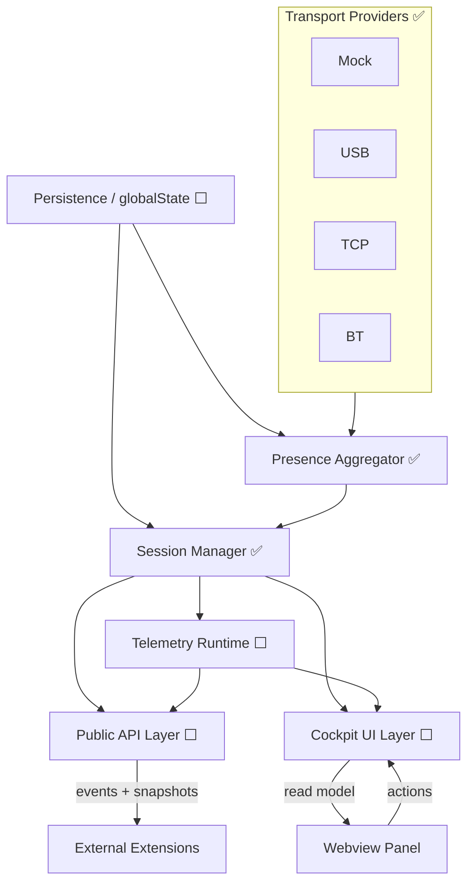
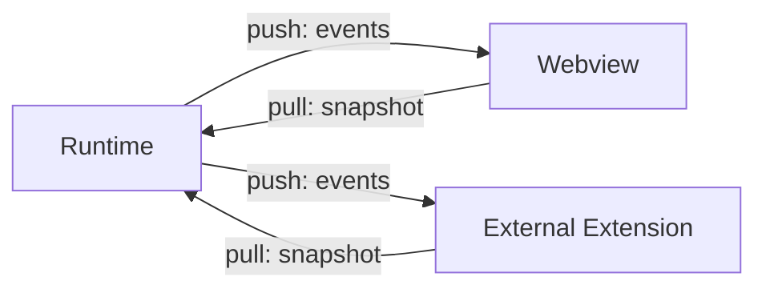
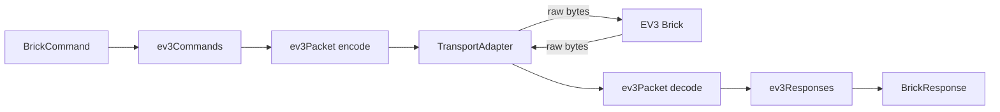

---
tags:
  - ev3-cockpit
  - architektura
  - design
zdroj: "[[DESIGN.md]]"
verze: 2026-04-02
---

# Architektura

> Kanonická verze: [[DESIGN.md]]

## Vrstvy (zdola nahoru)



## Stav implementace vrstev

| Vrstva | Modul | Stav |
| ------ | ----- | ---- |
| Sdílené typy | [[moduly/Contracts\|Contracts]] | ✅ |
| Chybový model | [[moduly/Errors\|Errors]] | ✅ |
| Event infrastruktura | [[moduly/Events\|Events]] | ✅ |
| EV3 protokol | [[moduly/Protocol\|Protocol]] | ✅ |
| Transport adaptéry + providery | [[moduly/Transports\|Transports]] | ✅ |
| Discovery + session runtime | [[moduly/Runtime\|Runtime]] | ✅ |
| Mock transport | [[moduly/Mock\|Mock]] | ✅ |
| Vstupní bod | [[moduly/Extension\|Extension]] | ✅ |
| Telemetrie | — | ⬜ [[fáze/Fáze 3 - Telemetrie\|Phase 3]] |
| Public API | — | ⬜ [[fáze/Fáze 4 - Public API\|Phase 4]] |
| Cockpit panel (UI) | — | ⬜ [[fáze/Fáze 5 - Cockpit panel\|Phase 5]] |
| Persistence | — | ⬜ [[fáze/Fáze 6 - Persistence\|Phase 6]] |

## Komunikační model



- **Push**: Runtime emituje event na každou změnu stavu nebo telemetrie
- **Pull**: Webview a extensions si mohou kdykoli vyžádat aktuální snapshot (po restartu, při inicializaci)
- Uvnitř runtime: přímé volání nebo sdílené observable streams
- Přes process boundary (webview, cizí extension): výhradně events + snapshots

## Interní struktura transport provideru



**Protocol layer** (`src/protocol/`) — čisté funkce, žádné I/O:

| Soubor | Účel |
| ------ | ---- |
| [[src/protocol/ev3Bytecode.ts\|ev3Bytecode]] | encoding primitives (lc0/lc1/lc2/lcs, gv0, uint16le…) |
| [[src/protocol/ev3Packet.ts\|ev3Packet]] | framing: `[length:2LE][counter:2LE][type:1B][payload]` |
| [[src/protocol/ev3Commands.ts\|ev3Commands]] | BrickCommand → EV3 direct/system command bytecode |
| [[src/protocol/ev3Responses.ts\|ev3Responses]] | raw reply bytes → typed BrickResponse |

**Transport adapter** (`TransportAdapter` interface) — raw I/O:

- `open()` — fyzické připojení
- `close()` — uvolnění spojení
- `sendPacket(packet)` — odeslání framed bytes, příjem odpovědi

Konkrétní adaptéry viz [[moduly/Transports]]

## Klíčové principy

1. **Runtime = zdroj pravdy** — webview je jen read-only pohled, nedrží brick state
2. **Jeden foreground brik** — nejvýše jeden brik dostává foreground telemetrii v daný moment
3. **Více simultánních sessions** — více briků připojeno, každý s vlastním heartbeat + reconnect
4. **Public API je read-only** — cizí extensions nemohou triggerovat connect/disconnect
5. **Mock = plnohodnotný transport** — implementovaný brzy, slouží pro vývoj i testy bez fyzického HW
6. **Implementace: runtime-first** — od contracts a runtime směrem k UI, nikoli naopak

## Datové modely

### DiscoveryItem — jeden řádek v discovery listu

```typescript
{
  brickKey: BrickKey,       // stabilní ID, viz koncepty/BrickKey
  displayName: string,
  transport: Transport,     // mock | usb | tcp | bt
  presenceState: PresenceState,
  remembered: boolean,
  connected: boolean,
  favorite: boolean,
  signalInfo?: SignalInfo,
  availableTransports: Transport[],
  btVisible?: boolean,
  lastSeenAt: number,
}
```

### ConnectedSession

```typescript
{
  brickKey: BrickKey,
  displayName: string,
  transport: Transport,
  connectionState: ConnectionState,  // connecting | connected | reconnecting | disconnected
  activeMode: ActivityMode,          // foreground | subscribed | minimal | none
  lastError?: CockpitError,
  subscribedCategories: TelemetryCategory[],
  heartbeatState: HeartbeatState,
}
```

### ActiveBrickViewModel — foreground panel

- Identity (brickKey, displayName, transport)
- Battery state
- Dostupné transporty + BT visibility
- Porty A–D (motory) + 1–4 (senzory): peripheral type + live value
- Button state
- System info (firmware, …) pro config mode
- Favorite state + preferred valueDisplayStyle
- Status bar konfigurace

## Stavový model

Viz [[koncepty/Presence State Machine]]

## Bezpečnostní omezení firmware

Viz [[koncepty/Firmware Safety]]

## Transport Contract Pattern

Viz [[koncepty/Transport Contract Pattern]]

## Telemetrie (Phase 3+)

Kategorie: `ports` · `filesystem` · `system`

Adaptive throttling — frekvence se škáluje podle:
- **Response latency**: jak dlouho trvalo poslední příkazy
- **Queue depth**: kolik příkazů čeká ve frontě per brik

Jeden pomalý brik nesmí zpomalit ostatní. Aktuální rychlost telemetrie bude viditelná v panelu jako diagnostika.

## Filesystem (Phase 4+)

Filesystem je service pro API consumery, **ne GUI feature**.

Operace první verze: `uploadFile` · `downloadFile` · `executeRbf` · `listFiles` · `readFile`

## Integrace cizích extensions (Phase 4+)

```
// Cizí extension:
const cockpit = vscode.extensions.getExtension('ev3-cockpit')?.exports;
const consumer = cockpit.registerConsumer('my-extension');
const bricks = cockpit.getConnectedBricks();
const sub = cockpit.subscribeTelemetry(brickKey, 'ports');
```

Předpoklady: cizí extension deklaruje `extensionDependencies: ["ev3-cockpit"]` v `package.json`.
