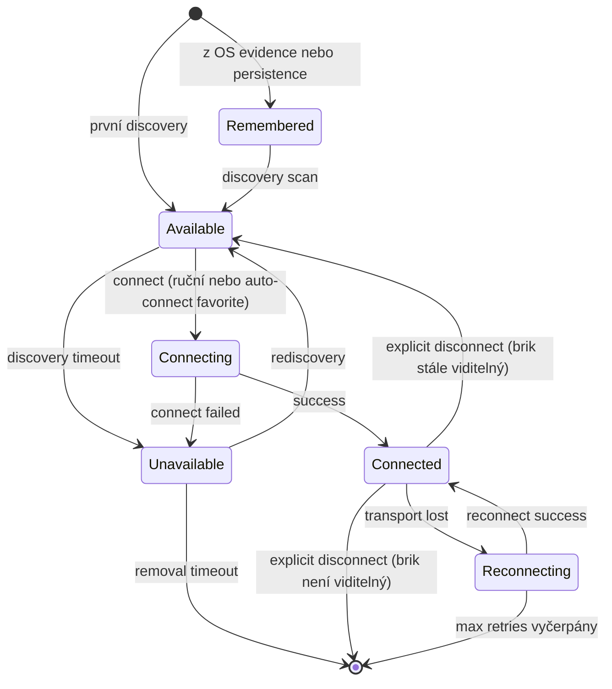

---
tags:
  - ev3-cockpit
  - koncept
koncept: Presence State Machine
---

# Presence State Machine

Stavový automat pro discovery — popisuje, co systém ví o každém briku.

## Presence stavy

| Stav | Popis |
| ---- | ----- |
| `remembered` | Systém ví o briku (z OS evidence nebo persistence), ale brik není vidět |
| `available` | Brik je aktuálně viditelný v discovery |
| `unavailable` | Brik byl viditelný, dočasně zmizel; systém čeká na návrat |
| `removed` | Timeout z `unavailable`; záznam zahozen |

`remembered` a `removed` jsou z pohledu uživatele ekvivalentní — brik "neexistuje". Rozdíl je technický: `remembered` pochází z evidence, `removed` z timeoutu.

## Diagram

## Přechody

| Z → Do | Podmínka |
| ------ | -------- |
| `[*] → available` | První discovery scan najde brik |
| `[*] → remembered` | OS evidence nebo persistence při startu |
| `remembered → available` | Discovery scan najde brik |
| `available → unavailable` | Discovery timeout (brik přestal odpovídat) |
| `unavailable → available` | Brik se znovu objevil v discovery |
| `unavailable → removed` | Removal timeout vyprší |
| `available → connecting` | Uživatel klikne Connect (nebo auto-connect favorite) |
| `connecting → connected` | Transport provider úspěšně připojí |
| `connecting → unavailable` | Connect selže |
| `connected → reconnecting` | Transport selže (heartbeat miss, I/O error) |
| `reconnecting → connected` | Reconnect uspěje |
| `reconnecting → removed` | Max retry attempts vyčerpány |

## Auto-connect pravidla

Favorite brik se automaticky připojí při přechodu z "neexistuje" na `available`:

1. **První discovery v session** → `[*] → available` nebo `remembered → available`
2. **Rediscovery v session** → `removed → available`

**Suppression:** Po explicit disconnect je auto-connect pro daný brik potlačen do konce VS Code session.  
Reset: při novém spuštění VS Code.

## TTL a timeouty

Různé transporty mají různé timeouty (z `transportConstants.ts`):

| Transport | TTL (available → unavailable) | Removal timeout |
| --------- | ----------------------------- | --------------- |
| USB | ~3 scany (~1.5s) | ~10s |
| TCP | ~3 scany | ~15s |
| BT | delší (BT scan je pomalejší) | ~45s |
| Mock | ∞ (pokud simulace neodpojí) | — |

Připojené briky nejsou nikdy reaped — session je cennější než discovery záznam.

## Implementace

- **DiscoveryScheduler** (`src/runtime/discoveryScheduler.ts`) — per-brick state machine, TTL management
- **PresenceAggregator** (`src/runtime/presenceAggregator.ts`) — merge z DiscoveryScheduler + remembered z persistence, unified discovery list

## Viz také

- [[moduly/Runtime]] — implementace
- [[koncepty/BrickKey]] — identita v state machine
- [[fáze/Fáze 1 - Transport a discovery]] §1.4, §1.5
- [[fáze/Fáze 6 - Persistence]] §6.4 — auto-connect + suppression persistence
