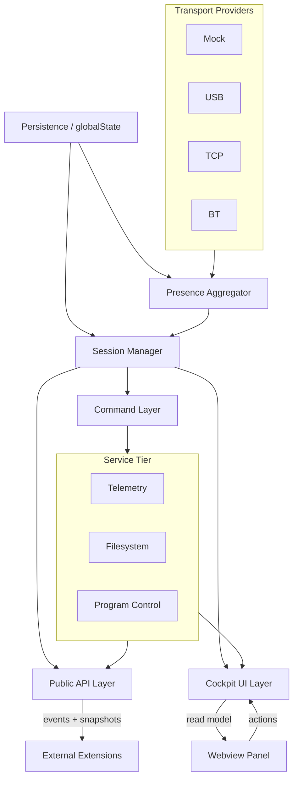
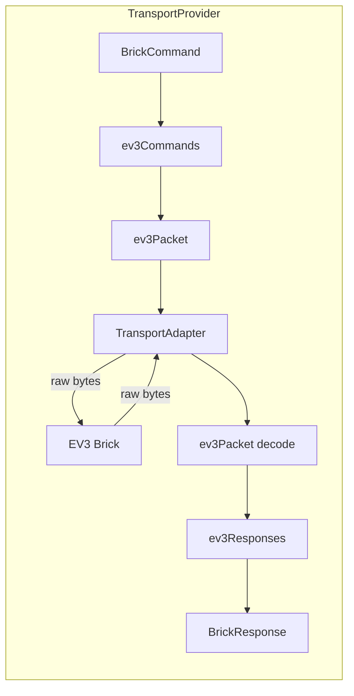
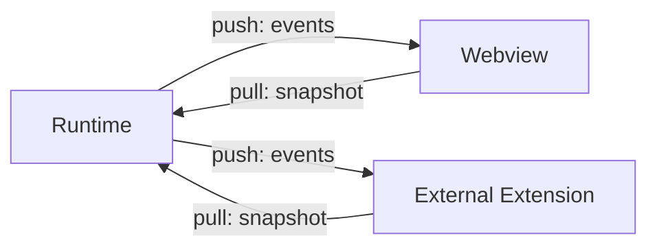
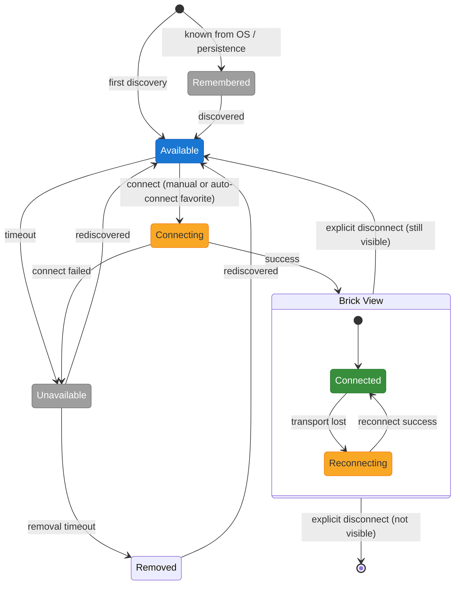
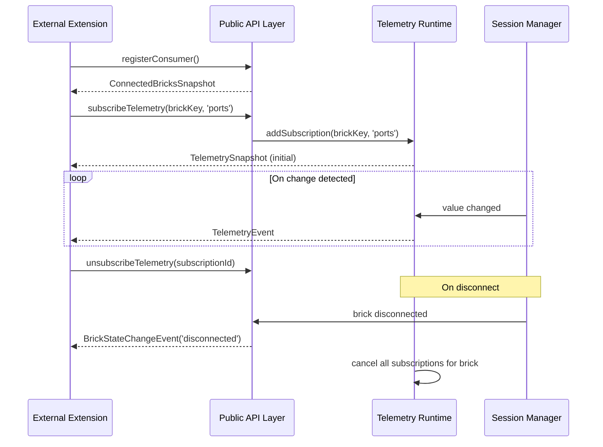

# EVƎ Cockpit - Design

> Version: 2026-04-02
> Status: target design for new implementation
> Input: `REQUIREMENTS.md`

## 1. Design Goal

This document describes the target architecture of EVƎ Cockpit so that it:

- meets the current requirements,
- can be re-implemented from a clean foundation,
- remains extensible for future versions.

## 2. Product Model

EVƎ Cockpit has two primary roles:

- a panel UI for brick discovery, connection, and monitoring,
- a runtime and public API for other extensions.

Cockpit is the sole authority for physical `connect` and `disconnect`.
Other extensions do not communicate with bricks directly — they go through the exported Cockpit API.

### 2.1 Integration of Dependent Extensions

Dependent extensions access the Cockpit API via the standard VS Code mechanism:

- A dependent extension declares Cockpit in `extensionDependencies` in its `package.json`.
- VS Code installs and activates it only after Cockpit.
- The Cockpit API is obtained by calling `vscode.extensions.getExtension('ev3-cockpit')?.exports`.

Consequences:

- A dependent extension cannot be installed without Cockpit.
- A dependent extension will not start if Cockpit is not running.
- Cockpit guarantees that its API is initialized before any consumer begins using it.

## 3. Core Principles

### 3.1 Runtime Is the Source of Truth

The webview is not the source of truth about brick state.

The source of truth is the runtime layer, which manages:

- discovery,
- remembered bricks,
- connected sessions,
- the active brick,
- telemetry,
- the public API,
- metadata persistence.

### 3.2 One Foreground Brick

Cockpit can have at most one foreground brick at any time.

The foreground brick:

- is in the panel foreground,
- receives the fastest scan,
- provides the full read model for the Cockpit UI.

If the discovery tab is in the foreground or the panel is not visible, no brick is foreground.

### 3.3 Multiple Connected Sessions

Multiple bricks can be connected simultaneously, subject to a per-transport session ceiling.
USB, TCP and mock are unbounded. Windows RFCOMM permits one active BT connection, so BT has a
ceiling of one; a connect request beyond a transport's ceiling must fail with a stated reason
rather than queue indefinitely.

Inactive connected bricks:

- stay connected,
- maintain heartbeat and reconnect,
- do not receive a foreground scan,
- may have subscription telemetry for other extensions.

### 3.4 Separation of Cockpit UX and API Telemetry

A clear distinction must be made between:

- Cockpit foreground telemetry for the active tab,
- subscription telemetry for other extensions,
- minimal telemetry for connected bricks without subscriptions.

This is a fundamental architectural rule. The active tab in the panel and API subscriptions are two separate things.

## 4. Architecture Layers

### 4.1 Transport Providers

Each transport implements a shared contract:

- `discover`,
- `connect`,
- `disconnect`,
- `send`,
- `recover`,
- `forget` where applicable.

Supported providers:

- `mock`,
- `usb`,
- `tcp`,
- `bt`.

#### 4.1.1 Internal Structure

Physical transport providers (USB, TCP, BT) share a layered internal structure.
Mock bypasses the protocol and adapter layers because it simulates responses directly.

**Protocol layer** (`src/protocol/`): Pure functions with no I/O.

- `ev3Bytecode` — encoding primitives (local constants, global variables, integer encoding).
- `ev3Packet` — packet framing: `[length:2LE][counter:2LE][type:1B][payload]`. Encode and decode.
- `ev3Commands` — maps `BrickCommand` to EV3 direct/system command bytecode.
- `ev3Responses` — parses raw EV3 reply bytes into typed `BrickResponse`.

**Transport adapter** (`TransportAdapter` interface): Raw I/O only.

- `open()` — establish the physical connection.
- `close()` — release the physical connection.
- `send(packet, options?)` — send framed bytes, receive framed reply. `options` carries
  `timeoutMs`, an `AbortSignal`, and the expected message counter.

Concrete adapters:

- `UsbHidAdapter` — USB HID via `node-hid`. 1025-byte reports (1 byte report ID + 1024 payload).
- `TcpSocketAdapter` — TCP via Node.js `net`. Length-prefixed stream.
- `BtRfcommAdapter` — Bluetooth RFCOMM. Multi-backend on Windows: WinRT StreamSocket (if .NET available) → WinSock2 via `koffi` FFI → SPP via `serialport`. On Linux: BlueZ D-Bus.

**Bulk transfer is not the same ranking as latency.** Round-trip time puts USB far ahead,
but a HID write on Windows delivers only 64 bytes however large a report it is handed, and
the same frame bounds replies. Since the firmware's own buffers are 1024 bytes on every
channel, that makes USB the *most* constrained transport for moving a file and the least
constrained for issuing a command. Verified throughput on a 20 KB round trip with every
byte compared: **TCP 57.3 KB/s, Bluetooth 20.3 KB/s, USB 6.8 KB/s**.

Two consequences. Any transport-preference logic for file transfer must rank TCP first and
USB last, which is the reverse of the telemetry ranking. And reaching the firmware's full
1024 bytes over USB needs the libusb path rather than `node-hid` — the `usb` dependency is
already present for name probing, so this is a change of backend, not of dependency.

This also cost a real defect. The USB adapter discarded what `write()` returned, and the
brick advances its file pointer by the length the host *declares* rather than by what
arrived, so a truncated upload reported success and landed zero padding. Nothing detected
it because every command sent before the filesystem work fit inside 64 bytes.

**Transport guard**: A backstop against a pathological caller (≤ 200 commands/second per
brick), firmware freeze protection (one active transport at a time, 2-second switch
cooldown), degradation tracking. It is deliberately **not** a meter on normal traffic:
commands are strictly serial, so each transport is already self-limiting at its own round
trip — measured at 176, 62 and 11 commands per second for USB, TCP and BT, with no error
and no latency drift at any of them. The guard exists for a retry storm or a runaway
loop, not for the rates a working caller can reach.

**BT connection queue**: Windows RFCOMM allows only one active connection at a time. A serialized queue with 15-second inter-connection cooldown and exponential backoff on errors enforces this constraint.

### 4.2 Presence Aggregator

The Presence Aggregator unifies discovery output from all providers into a single discovery model.

Responsibilities:

- data normalization,
- `available / lost / removed` transitions,
- tracking of remembered devices,
- merging runtime information with persisted metadata,
- stable ordering of the discovery list.

### 4.3 Session Manager

The Session Manager manages physically connected bricks. It is the exclusive owner of the connection state.

Responsibilities:

- establishing sessions (via an internal API for the Cockpit UI),
- reconnect,
- heartbeat,
- explicit disconnect (via an internal API for the Cockpit UI),
- switching between `foreground / subscribed / minimal`.

The Public API is strictly read-only for session management; it cannot trigger `connect` or `disconnect`.

### 4.3a Command Layer

Owns the typed command vocabulary and everything needed to execute one command against
one connected brick: the EV3 codec (`src/protocol/`), message counters, reply matching,
and command-to-response typing.

It sits above the session manager, which owns connections, and below telemetry and the
filesystem, which both orchestrate commands rather than issue them one at a time.

**The transports beneath it carry bytes.** `TransportProvider.sendPacket` takes a packet
and returns a packet; it does not know what a command means. Until this was separated, a
provider accepted a typed `BrickCommand`, which inverted the dependency — the lowest
layer owned the vocabulary every layer above it was defined in terms of, and the codec
lived inside `src/transports/`.

A channel is **session-scoped**, because the message counter is. Two channels over one
connection would hand out colliding counters and match each other's replies. The session
manager builds one per session.

The mock is the single provider that stays at the command level, through an optional
`createCommandChannel`. A mock brick simulates what a command *means*; making it decode
real EV3 framing back into commands would be work in service of nothing.

### 4.3b Service Tier

Between the command layer and the public API sits one tier of peer services: **telemetry**,
**filesystem**, and **program control**. They are siblings, not a chain.

**What earns a service.** Not a command group — a group is not a reason for a layer.
A service exists where a capability needs more than one command, or holds state the
command layer does not:

| Capability | Commands | Why it is or is not a service |
|---|---|---|
| `battery`, `ports`, `buttons` | one each | periodic scheduling, throttling, subscriptions — **telemetry** |
| `info`, brick rename | one each | nothing to orchestrate — straight through, no service |
| filesystem | many, plus a brick handle | chunking, progress, cancellation, handle cleanup — **filesystem** |
| program control | `opFILE/LOAD_IMAGE` then `opPROGRAM_START`; `opPROGRAM_INFO/GET_STATUS` polled | the loaded image's address flows between commands, and run state has no push — **program control** |

So most command groups get no service. A service over `battery` would be a pass-through
with nothing in it; the command layer already delivers that capability whole.

**Why the tier is not folded into the API.** A service must be usable without being a
registered consumer. Tests, the mock, and hardware probes are its first callers and its
most useful ones: the chunked-transfer work was driven straight against
`FileTransferService`, with no API and no consumer registration. Move the orchestration up
into the API and none of that is reachable without the whole entry ceremony, and the API
becomes the only place complex behaviour can live.

**What the API owns instead** (§10): the consumer contract — registration and lifecycle,
the snapshot-and-event model, the active brick, and the safe/full mode policy. It composes
the services rather than containing them.

### 4.4 Telemetry Runtime

The Telemetry Runtime runs over a connected session and schedules individual telemetry loops.

Modes:

- `foreground`,
- `subscribed`,
- `minimal`.

Each mode has its own frequency and priority.

### 4.5 Adaptive Throttling

The speed of telemetry is governed by an **Adaptive Throttling** mechanism.

Goal:

- Cockpit foreground must remain responsive,
- the VS Code editor must not be blocked,
- subscription telemetry should be as fast as possible within the remaining capacity.

The throttling mechanism scales the frequency of requests based on:

- **Response latency**: how long the last command to the brick took to complete.
- **Queue depth**: how many commands are waiting in the per-brick queue.

The throttling applies to telemetry delivery scheduling only — it has no effect on user-facing UI logic or explicit commands.

The current telemetry speed is visible in the Cockpit panel (diagnostic display).

### 4.6 Public API Layer

The Public API layer exports:

- consumer registration,
- snapshot of connected bricks,
- state events,
- active brick,
- subscription telemetry,
- filesystem services.

### 4.6a The `ev3://` Scheme Is Not Cockpit's

The cockpit does **not** register a `vscode.FileSystemProvider` for `ev3://`. Consumers
reach the filesystem through the public API (§10).

A `FileSystemProvider` exists to make a remote filesystem appear inside VS Code — in
editors, `vscode.workspace.fs`, drag and drop. That is a UI-integration concern, and the
consumer that wants it is `ev3-explorer`, whose own design calls itself *"čistě UX
vrstva pro filesystém"*. It registers the scheme over this API.

`ev3-native` does not need it either, which is the case worth recording because it looks
like it might. It compiles a binary and needs it on the brick, but its design asks for a
programmatic API for exactly that (`uploadFile`, `runProgram`) and its usage example calls
that API directly. Its own recommended channel is VS Code commands, not `ev3://`.

**One obligation follows from putting the scheme in a consumer.** `ev3-explorer`'s design
states that safe and full mode are properties of the cockpit and that no consumer may
build a side channel around the guardrails. A consumer can only honour that if the policy
is reachable from the API, so §10 must export it rather than leaving each consumer to
reimplement it.

### 4.7 Cockpit UI Layer

The Cockpit UI layer is a webview panel over runtime read models.

The UI:

- does not create its own brick state,
- only displays the read model and dispatches actions,
- must not contain domain logic for reconnects and lifecycle.

### 4.8 Communication Model

The runtime communicates with the webview and external extensions through a combined model:

Rules:

- **Push**: The runtime emits an event on every state or telemetry change. The webview and dependent extensions subscribe at initialization.
- **Pull**: The webview and dependent extensions can explicitly request a current snapshot at any time — for example after a webview restart or at first initialization.
- Within the runtime, layers communicate via direct calls or shared observable streams.
- Across a process boundary (to the webview or a dependent extension), communication is exclusively through events and snapshots.

## 5. Data Models

### 5.1 Discovery Item

One row in the discovery list represents one `brickKey`.

Minimum fields:

- `brickKey`,
- `displayName`,
- `transport`,
- `presenceState`,
- `remembered`,
- `connected`,
- `favorite`,
- `signalInfo?`,
- `availableTransports`,
- `btVisible?`,
- `lastSeenAt`.

`brickKey` is a stable internal identifier within a given transport. It must not depend on `displayName` (which is user-editable). Its primary purpose is stable ordering within a transport group — without a stable key, the brick order in the list would change on every discovery scan.

Transport-specific `brickKey` definitions:

- **USB**: Serial number (or VID:PID:Serial).
- **BT**: MAC address.
- **TCP**: Serial number reported by the brick, falling back to the IP address when the
  brick reports no serial. Keying on IP alone would break every TCP favorite on a DHCP
  lease change.
- **Mock**: Synthetic identifier from the JSON configuration (e.g., `mock:<id>` where `id` is defined in the config file).

### 5.2 Connected Session

Model of a connected session:

- `brickKey`,
- `displayName`,
- `transport`,
- `connectionState`,
- `activeMode`,
- `lastError?`,
- `subscribedCategories`,
- `heartbeatState`.

### 5.3 Active Brick View Model

Model for the foreground panel:

- brick identity,
- battery state,
- available transports,
- BT visibility if known,
- ports A–D and 1–4,
- peripheral types,
- current values,
- button state,
- system information for config mode,
- favorite state,
- preferred value display style,
- status bar configuration.

### 5.4 Public API Models

The API does not use UI models.

It requires its own explicit models:

- `ConnectedBrickSnapshot`,
- `BrickStateChangeEvent`,
- `ActiveBrickSnapshot`,
- `TelemetrySnapshot`,
- `TelemetryEvent`,
- `FilesystemEvent`.

## 6. State Model

### 6.1 Presence

Presence states:

- `remembered` — the system knows about the brick from OS evidence or Cockpit persistence, but the brick is not currently visible. It exists in the list as an offline entry.
- `available` — the brick is currently visible in discovery.
- `unavailable` — the brick was visible but has temporarily disappeared; the system waits for it to return.
- `removed` — the brick has disappeared definitively (timeout of `unavailable`). The entry is
  retained for the rest of the session so that rediscovery stays distinguishable from a first
  discovery — the two drive different auto-connect triggers. **Not yet implemented**: both
  `discoveryScheduler` and `presenceAggregator` currently delete the entry (plan task 6.4.0).

`remembered` and `removed` are equivalent from the user's perspective: the brick "does not exist". The difference is technical — `remembered` originates from evidence, `removed` from a timeout.

Rules:

- `available -> unavailable` after discovery timeout,
- `unavailable -> available` on rediscovery,
- `unavailable -> removed` after the removal timeout elapses,
- a `remembered` entry may exist without a prior `available` in the current session.

**Auto-connect:**

A brick marked as `favorite` is automatically connected on transition from "non-existent" to `available`. This includes:

- first discovery in a new session (`remembered -> available` or `[*] -> available`),
- rediscovery within a session (`removed -> available`).

After an explicit disconnect, auto-connect for that brick is suppressed for the rest of the current session — it will not re-trigger even if the brick disappears and reappears.

### 6.2 Connection

Connected session states:

- `connecting`,
- `connected`,
- `reconnecting`,
- `disconnected`.

Rules:

- only Cockpit creates sessions via `connect`,
- a transport failure leads to `reconnecting`,
- explicit `disconnect` terminates the session regardless of active subscriptions,
- on explicit disconnect, subscription registries for that brick are cleared.

After explicit disconnect:

- if the brick is still visible in discovery → it transitions to `available`,
- if not visible → it transitions to `removed`.

### 6.3 Activity

Session activity is a separate dimension:

- `foreground`,
- `subscribed`,
- `minimal`,
- `none`.

Transitions:

- at most one session can be `foreground`,
- multiple sessions can be `subscribed`,
- `minimal` means heartbeat without extended telemetry,
- `none` occurs after disconnect.

### 6.4 State Diagram

## 7. Discovery and Remembered Bricks

### 7.1 Discovery List

The discovery tab displays a single unified list of:

- available bricks,
- connected bricks,
- remembered bricks that are out of reach.

Each item stays in the list according to its current state. The UI works with a single read model, not several separate lists.

### 7.2 Ordering

Primary groups:

1. `mock`
2. `usb`
3. `tcp`
4. `bt`

Within a group:

- by `signalInfo` where it exists and is meaningful,
- otherwise by stable `brickKey`,
- never by user-editable `displayName`.

### 7.3 Forget Action

A remembered brick may have a trash action.

Implementation model:

- an OS-specific adapter performs the unpairing or removal from local evidence,
- Cockpit simultaneously removes local persisted metadata (including `favorite`),
- forgetting is only permitted where the provider can safely perform it.

"OS-level evidence" on Windows includes the BT registry entry at
`HKLM\SYSTEM\CurrentControlSet\Services\BTHPORT\Parameters\Devices\{mac}`. Forget must
delete it in addition to BT unpairing, because the `Name` value there goes stale and
survives a rename — measured on two paired bricks whose real names were AAA and BBB while
the registry still held `"EV3"` and `"B"`.

That entry is **not** the source of a USB brick's display name, despite an earlier note here
saying so. USB name resolution reads libusb string descriptors straight off the device and
gets the current name; it is `node-hid`'s cached `product` string that goes stale, reporting
the generic `"Xfer data to and from EV3 brick"` for two of three bricks where libusb
returned AAA, BBB and CCC correctly. So the stale-name problem is real, and it belongs to
the Bluetooth path once BT discovery is wired (1.11.7a).

A related measurement worth recording: an EV3's USB serial number **is** its Bluetooth MAC
with the separators removed — the BTHPORT subkey names matched the USB serials exactly. Any
future cross-transport identity work can relate `usb:001653AABBCC` to `bt:00:16:53:AA:BB:CC`
by normalising the string, with no on-brick probe involved. (Identifiers here are
placeholders on the real LEGO OUI; actual device serials stay out of the repository.)

## 8. Favorites and Persistence

### 8.1 Persistence Location

Cockpit metadata is stored in the standard per-user VS Code extension storage (`ExtensionContext.globalState`).

Reasons:

- it is the natural cross-platform storage,
- it requires no direct work with the registry or a custom per-user database,
- it binds naturally to the extension lifecycle.

OS-specific evidence such as BT pairing remains outside this storage and is read through the provider.

### 8.2 Favorite Rules

Persisted per-brick metadata includes at minimum:

- `favorite`,
- preferred visual style for measured values (`numeric` / `visual`),
- status bar configuration,
- remembered UI metadata.

Rules:

- `star toggle` is available only in the status bar of the connected brick tab — clicking the star toggles `favorite`,
- in the discovery list, the star only indicates state and is not clickable,
- in config mode, the star is not available,
- the trash icon in the discovery list deletes all stored metadata for the brick including `favorite` — this is a deletion, not a toggle.

## 9. Telemetry Design

### 9.1 Categories

Telemetry is divided into categories:

- `ports` — sensors, motors, port mapping, and measured values,
- `filesystem` — filesystem state and events relevant to the API consumer,
- `system` — system information: firmware, battery, available transports.

Categories are an explicit part of the public API and internal scheduling. A dependent extension subscribes only to the categories it needs.

### 9.2 Foreground Telemetry

**Refresh budget.** The foreground rate is bounded from below by the transport, not only from
above by throttling: the per-brick queue is strictly serial and a full frame is four round
trips (`ports`, `battery`, `buttons`, `info`).

Measured on USB, firmware V1.10E: **9 ms** worst case over 40 exchanges, including the
`ports` command's 16 sub-operations. A four-command frame is therefore about 40 ms, or
roughly 25 Hz — far above anything the panel needs. An earlier version of this section put
USB at 0.5 Hz; that came from `USB.COMMAND_RTT_MS: 500`, a constant no code ever read and
which was about 50x pessimistic.

Bluetooth SPP measures at **121 ms** worst case over 30 exchanges, averaging 55-70 ms, so a
four-command frame is about 240 ms or roughly 4 Hz. Slower than USB by an order of magnitude,
and still usable for the panel. The RFCOMM connect itself took 4851 ms, which is the cost
worth designing around on that transport — not the per-command latency.

TCP measures at **58 ms** worst case over 40 exchanges against a brick on Wi-Fi, averaging
33 ms, so a four-command frame is about 130 ms or roughly 7 Hz. Connect plus the VMTP unlock
handshake takes 273 ms.

All three transports are now measured, and in every case the constant that had been sitting
in `transportConstants.ts` was pessimistic by more than an order of magnitude: USB by ~50x,
TCP by ~17x, BT by ~16x. None of them was read by any code, which is why nobody noticed.

**Beacon discovery needs an outbound datagram first.** The brick broadcasts its announcement
to the subnet broadcast address every 5 seconds whenever Wi-Fi is up — the firmware enables
this on AP association and only stops it on shutdown or an AP search, never because a client
is connected. A host firewall that filters unsolicited inbound UDP therefore drops it, and
Windows does exactly that by default: measured here, the brick announced for half an hour
while discovery saw nothing, and an exclusive bind proved no other process held the port.
The provider now sends a one-byte datagram to each interface's broadcast address every few
seconds, which puts its socket in the firewall's stateful table and lets the announcements
through. This changes no firewall configuration; it is the ordinary
outbound-before-inbound pattern, and without it TCP discovery cannot work on a stock
Windows install.

**The transport is the binding constraint, not a guard.** Sustained command rates were
measured per transport over 600 back-to-back commands: **USB 176/s** (6 ms median),
**TCP 62/s** (16 ms), **BT 10.7/s** (102 ms). No transport produced a single error or any
latency drift at its own rate, and all three recovered clean. At four commands per
telemetry frame that is **~44 Hz on USB, ~15 Hz on TCP, ~2.7 Hz on BT**.

This section has now been wrong twice about the same thing, in opposite directions, and the
second time is more instructive than the first.

The first revision measured USB round trips, read 9 ms as "far above anything the panel
needs", and declared the refresh problem solved. Two independent reviewers then caught a
real inconsistency — §4.1 capped a brick at 10 commands per second, which would have made
the reachable frame rate 2.5 Hz everywhere and the transport ceilings irrelevant — and this
section was rewritten to say the guard binds first.

That resolution was wrong, because the 10 came from nowhere. It appeared in
`FIRMWARE_SAFETY` with no recorded basis, was read by a guard that was never wired, and
measurement puts it 17x low on USB and 6x low on TCP. It matches BT only by coincidence:
SPP's round trip happens to land at about ten exchanges a second. **A consistency argument
cannot tell you which of two inconsistent numbers is the wrong one** — the reviewers were
right that the documents contradicted each other, and resolving it toward the unmeasured
side was the error.

Two consequences follow. Phase 3's per-transport target and floor (3.8) derive from the
**measured per-transport rate**, not from one global budget; USB and TCP have ample room and
BT does not. And batching the frame into one multi-opcode command (3.1.5) stays worth doing,
but for a narrower reason than the previous revision claimed: it is what makes **BT**
usable, taking it from ~2.7 Hz to ~10 Hz. On USB and TCP it is an optimisation, not a
prerequisite.

Phase 3 still owes that target and floor, and the panel still owes a degraded-telemetry
indicator below the floor.

Foreground telemetry is for the active brick in the panel only.

Contains:

- port mapping,
- peripheral detection,
- live values,
- button state,
- battery,
- system data needed for the status bar and config mode.

### 9.3 Subscribed Telemetry

Subscribed telemetry runs over an inactive connected brick only when an active API subscription exists.

Rules:

- subscriptions are per category,
- a snapshot is always delivered before events,
- after a subscription ends, the runtime may hold the last snapshot briefly as `stale`,
- subscribed telemetry is slower than foreground.

### 9.4 Minimal Telemetry

Minimal telemetry is the base mode of a connected brick without foreground and without subscriptions.

Contains only:

- heartbeat,
- reconnect state,
- session availability.

### 9.5 Adaptive Throttling

The speed of subscription telemetry is governed by the Adaptive Throttling mechanism described in §4.5.

The throttling applies to telemetry delivery scheduling only — it has no effect on user-facing UI logic or explicit commands.

The current telemetry speed is visible in the Cockpit panel (diagnostic display).

### 9.6 Telemetry Subscription Flow

## 10. Public API Design

### 10.1 Entry Model

A dependent extension:

1. declares Cockpit in `extensionDependencies` and after activation calls `vscode.extensions.getExtension('ev3-cockpit')?.exports`,
2. registers as a consumer,
3. receives a snapshot of connected bricks,
4. subscribes to state change callbacks,
5. optionally creates telemetry subscriptions.

### 10.2 What the API Exports

The first version of the public API exports:

- `registerConsumer`,
- `unregisterConsumer`,
- `getConnectedBricks`,
- `onBrickStateChanged`,
- `getActiveBrick`,
- `onActiveBrickChanged`,
- `subscribeTelemetry`,
- `unsubscribeTelemetry`,
- filesystem operations,
- program control — run, stop, emergency stop, and a running-program query.

Program control is listed because `ev3-native` cannot function without it: it compiles a
binary, puts it on the brick, and runs it. An earlier revision of this list omitted it,
which would have left that consumer with no supported path at all.

### 10.3 What the API Does Not Export

The public API intentionally does not export:

- physical `connect`,
- physical `disconnect`,
- direct access to the discovery list of unconnected bricks.

This keeps responsibility for the session lifecycle in one place.

## 11. Filesystem Design

The Cockpit UI will not contain a file explorer or browse workflow.

The filesystem is designed as a service for API consumers.

The layer covers **every operation the protocol offers**, not a chosen subset. The full
contract — requirements, flows, and the operations deliberately excluded — is
`docs/plans/2026-08-20-1740-feat-filesystem-layer-plan.md`, built on the firmware-verified
survey in `docs/ideation/2026-08-20-filesystem-protocol-survey.md`.

In outline: chunked upload and download with progress and cancellation and no size ceiling;
list, read, exists, size, and free space; make and remove directories; move, which is the
protocol's only rename primitive and has no system command at all.

An earlier revision of this section listed `uploadFile`, `downloadFile`, `executeRbf` and
“basic read/list”. That list came from what seemed obvious rather than from the protocol:
the firmware exposes seventeen system commands and thirty-two `opFILE` subcodes, and rename,
free space, and a real existence check were missing because nobody had looked.

Three operations in range are deliberately excluded because they are not filesystem work:
`ENTERFWUPDATE` (a bricking hazard), `BLUETOOTHPIN` (a pairing credential), and
`WRITEMAILBOX` (VM messaging). Full-folder sync and log tailing are deferred, the latter
with its opcodes declared so the capability is not lost again.

## 12. Cockpit UI Design

The primary users include children from approximately age 10 (see `REQUIREMENTS.md §2`). The UX must be clear and self-explanatory in its basic mode. Advanced features are exposed through settings and configuration mode, not through a separate interface.

### 12.1 Discovery Tab

The discovery tab is the main entry point into Cockpit.

Each row contains:

- a transport icon,
- a color-coded status,
- a name,
- supplementary icons on the right according to state.

Quick actions:

- connect for an available brick,
- focus/open for a connected brick,
- trash for a remembered offline brick (removes all metadata including `favorite`),
- signal indication where available,
- star for a brick with `favorite: true` (indication, not a toggle).

### 12.2 Brick Tab

Each connected brick has its own tab.

**Tab header:**

- transport icon with status color,
- brick name,
- gear icon for config mode,
- X icon for explicit disconnect.

**Status bar** (top row inside the tab):

- left: icons of available transports for the brick (not necessarily the one it is connected through),
- center: battery state,
- right: star — **clickable**, toggles `favorite` on/off; always shown, filled when
  `favorite: true` and outlined otherwise.

**Tab content — normal mode:**

- brick image with interactive buttons,
- above the brick: 4 motor ports (A, B, C, D),
- below the brick: 4 sensor ports (1, 2, 3, 4),
- each port shows a peripheral icon and a measured value.

**Measured value visual style** (configurable per brick, stored with `favorite`):

- **Numeric style**: the exact text value as returned by the sensor.
- **Visual style**: each peripheral type has its own graphical element — a color sensor shows a color target, a touch sensor shows press state, a gyro shows an arc with an indicator, an ultrasonic sensor shows a distance bar, a motor shows schematic rotation, etc. Visual inspiration: makecode.mindstorms.com.

Switching the style is done in config mode and the preference is persisted.

### 12.3 Config Mode

Config mode is part of the same tab — it replaces the normal mode content.

Displays:

- editable brick name,
- system and technical information,
- toggle for the measured value visual style (`numeric` / `visual`),
- status bar configuration.

**Auto-save and Optimistic Updates**: After each edit action (keystroke, checkbox toggle, etc.), a timer starts for that specific field. The change is written to the brick on focus loss or after 1 second from the last action.
- **Optimistic Update**: The Session Manager immediately emits a local event with the new value so the UI and Public API reflect the change instantly.
- **Telemetry Confirmation**: The final source of truth remains the physical brick. Telemetry eventually confirms whether the change was successful or if the value has changed externally (e.g., physically on the brick).

**The star toggle is not available in config mode.**

**Sensor and motor port state is not displayed in config mode.** The brick image with ports is replaced by the configuration form. System information fields (such as brick name) remain live — if a value changes externally, it updates in the form.

## 13. Mock Design

Mock is an equal transport provider.

### 13.1 Mock Runtime

The mock runtime must implement the same contract as physical transports:

- discovery,
- connect,
- reconnect,
- telemetry,
- filesystem API,
- error states.

### 13.2 Mock Configuration

Mock brick definitions are loaded from a JSON configuration file in the workspace.

The format must support:

- brick identity and system parameters,
- connected sensors and motors,
- value dynamics (static values or oscillators).

A GUI editor for this configuration is deferred — see `REQUIREMENTS.md §16`.

## 14. Commands and VS Code Integration

The primary UX is in the panel.

The Command Palette serves only as:

- a fallback,
- diagnostics,
- emergency panel recovery.

Commands can be added or removed in future versions. The design must not rely on them as the primary mode of interaction.

## 15. Non-Functional Requirements

### 15.1 Performance

Cockpit must not significantly degrade the VS Code experience.

Requirements:

- tab switching must remain smooth,
- the text editor must not be blocked,
- webview refresh must be limited,
- separate frequencies for `foreground / subscribed / minimal`.

The system must handle dozens of simultaneously visible devices (as required by `REQUIREMENTS.md §5`). This implies:

- the Presence Aggregator must handle frequent discovery updates without blocking,
- the discovery list UI must render efficiently (consider virtual scrolling for large lists),
- telemetry scheduling must scale with the number of connected bricks without degrading the foreground experience.

### 15.2 Stability

A connected session is more valuable than a transient discovery record.

This means:

- reconnect is preferred over losing a session,
- explicit disconnect takes precedence,
- a failure of one brick must not destabilize other sessions.

**Command queue:**

- each connected brick has its own communication queue,
- the queue is shared across all transport providers for that brick — if a brick is connected via both USB and BT simultaneously, they share one queue,
- this architecture prevents conflicts between transport layers over the same brick.

## 16. Deferred and Maybe Someday

See `REQUIREMENTS.md §4` (deferred to a later version) and `REQUIREMENTS.md §16` (maybe someday). The architecture must not block any of those areas.
