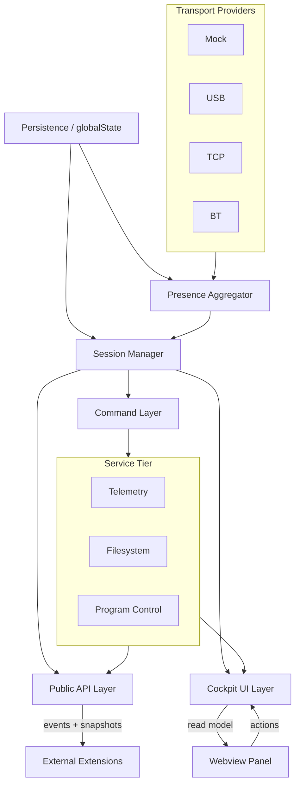
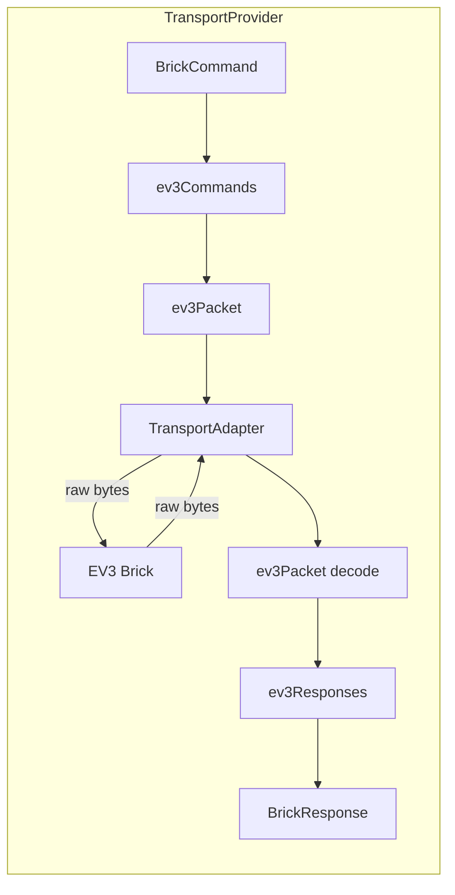
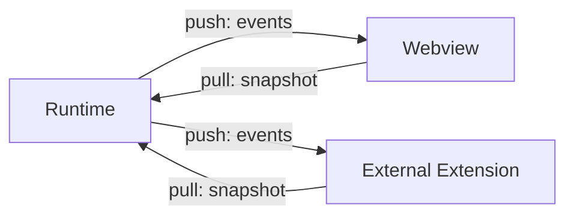
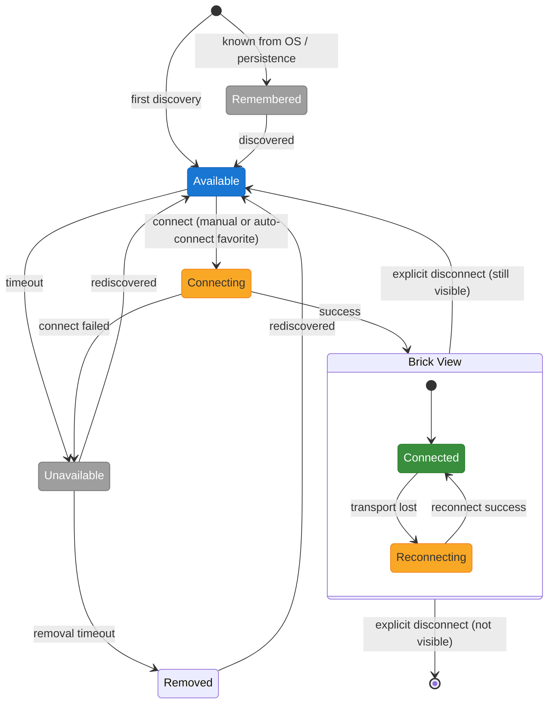
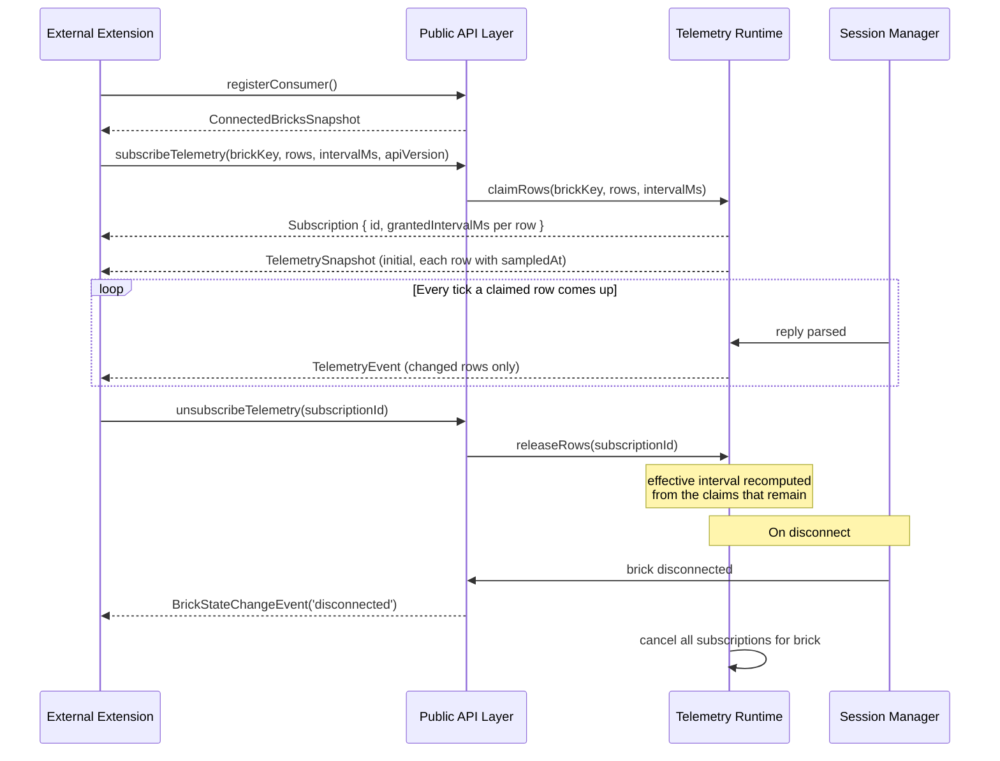

# EVƎ Cockpit - Design

> Version: 2026-04-02
> Status: target design for new implementation
> Input: `REQUIREMENTS.md`

## 1. Design Goal

This document describes the target architecture of EVƎ Cockpit so that it:

- meets the current requirements,
- can be re-implemented from a clean foundation,
- remains extensible for future versions.

## 2. Product Model

EVƎ Cockpit has two primary roles:

- a panel UI for brick discovery, connection, and monitoring,
- a runtime and public API for other extensions.

Cockpit is the sole authority for physical `connect` and `disconnect`.
Other extensions do not communicate with bricks directly — they go through the exported Cockpit API.

### 2.1 Integration of Dependent Extensions

Dependent extensions access the Cockpit API via the standard VS Code mechanism:

- A dependent extension declares Cockpit in `extensionDependencies` in its `package.json`.
- VS Code installs and activates it only after Cockpit.
- The Cockpit API is obtained by calling `vscode.extensions.getExtension('ev3-cockpit')?.exports`.

Consequences:

- A dependent extension cannot be installed without Cockpit.
- A dependent extension will not start if Cockpit is not running.
- Cockpit guarantees that its API is initialized before any consumer begins using it.

## 3. Core Principles

### 3.1 Runtime Is the Source of Truth

The webview is not the source of truth about brick state.

The source of truth is the runtime layer, which manages:

- discovery,
- remembered bricks,
- connected sessions,
- the active brick,
- telemetry,
- the public API,
- metadata persistence.

### 3.2 One Foreground Brick

Cockpit can have at most one foreground brick at any time.

The foreground brick:

- is in the panel foreground,
- receives the fastest scan,
- provides the full read model for the Cockpit UI.

If the discovery tab is in the foreground or the panel is not visible, no brick is foreground.

### 3.3 Multiple Connected Sessions

Multiple bricks can be connected simultaneously, subject to a per-transport session ceiling.
USB, TCP and mock are unbounded. Windows RFCOMM permits one active BT connection, so BT has a
ceiling of one; a connect request beyond a transport's ceiling must fail with a stated reason
rather than queue indefinitely.

Inactive connected bricks:

- stay connected,
- maintain heartbeat and reconnect,
- do not receive a foreground scan,
- may have subscription telemetry for other extensions.

### 3.4 Separation of Cockpit UX and API Telemetry

A clear distinction must be made between:

- Cockpit foreground telemetry for the active tab,
- subscription telemetry for other extensions,
- minimal telemetry for connected bricks without subscriptions.

This is a fundamental architectural rule. The active tab in the panel and API subscriptions are two separate things.

## 4. Architecture Layers



### 4.1 Transport Providers

Each transport implements a shared contract:

- `discover`,
- `connect`,
- `disconnect`,
- `send`,
- `recover`,
- `forget` where applicable.

Supported providers:

- `mock`,
- `usb`,
- `tcp`,
- `bt`.

#### 4.1.1 Internal Structure

Physical transport providers (USB, TCP, BT) share a layered internal structure.
Mock bypasses the protocol and adapter layers because it simulates responses directly.



**Protocol layer** (`src/protocol/`): Pure functions with no I/O.

- `ev3Bytecode` — encoding primitives (local constants, global variables, integer encoding).
- `ev3Packet` — packet framing: `[length:2LE][counter:2LE][type:1B][payload]`. Encode and decode.
- `ev3Commands` — maps `BrickCommand` to EV3 direct/system command bytecode.
- `ev3Responses` — parses raw EV3 reply bytes into typed `BrickResponse`.

**Transport adapter** (`TransportAdapter` interface): Raw I/O only.

- `open()` — establish the physical connection.
- `close()` — release the physical connection.
- `send(packet, options?)` — send framed bytes, receive framed reply. `options` carries
  `timeoutMs`, an `AbortSignal`, and the expected message counter.

Concrete adapters:

- `UsbLibusbAdapter` — USB interrupt endpoints via `usb` (libusb). Reaches the firmware's
  full 1024-byte frame. The preferred USB backend.
- `UsbHidAdapter` — USB HID via `node-hid`. Fallback for when libusb cannot claim the
  interface; delivers 64 bytes per packet.
- `TcpSocketAdapter` — TCP via Node.js `net`. Length-prefixed stream.
- `BtRfcommAdapter` — Bluetooth RFCOMM. Multi-backend on Windows: WinRT StreamSocket (if .NET available) → WinSock2 via `koffi` FFI → SPP via `serialport`. On Linux: BlueZ D-Bus.

#### USB has two backends, and they are not equivalent

**The 64-byte HID ceiling is a defect in the brick's own descriptor.** Its HID report
descriptor declares `Report Count 0` for both the input and the output report, so Windows
derives no usable report length and a write delivers 64 bytes however large a report it is
handed — while the interrupt endpoints underneath advertise `wMaxPacketSize` **1024**.
Nothing above HID can lift that: the ceiling is the descriptor, not `node-hid`.

Going straight at the endpoints through libusb reaches the firmware's real frame. Two
measured quirks shape that path, both invisible in review and fatal in practice:

- **A transfer must be exactly `wMaxPacketSize`.** A 16-byte interrupt write fails with
  `LIBUSB_ERROR_IO`; the same packet padded to 1024 succeeds. Sends are padded.
- **Reads come back full-length too**, so a reply is located by its own length prefix
  rather than by the size of the transfer that carried it.

**Verified throughput, every byte compared:**

| Transport | Write | Read |
|---|---|---|
| USB (libusb) | 200–278 KB/s | 325–330 KB/s |
| TCP | 57.3 KB/s | — |
| Bluetooth | 20.3 KB/s | — |
| USB (HID fallback) | 6.8 KB/s | — |

**This ranking has now inverted twice, in opposite directions.** The plan first assumed USB
was fastest for bulk work; measurement over HID made it the slowest by an order of
magnitude, and that finding is recorded above; measurement over libusb makes it the fastest
by a factor of five. What survives is not a ranking but a method: the number came from the
wire each time, and the two revisions differed only in which wire was being used.

So `maxPacketBytes` is a property of the **live link**, not of the transport — it is read
from the endpoint descriptor at open and travels adapter → provider → session →
`createBrickFilesystem`. Both halves matter: reaching a full frame is what lets `copy` and
`move` be expressed at all, and the figure arriving at `FileTransferService` is what stops
every transfer from chunking to 64 bytes with nothing visibly wrong.

`UsbTransportProvider` prefers libusb and falls back to HID **loudly**, naming the refusal
and what the fallback costs. A silent fallback would look like a working connection and
behave like a broken one: on HID, `copy` and `move` carry two paths and do not fit a packet
at all.

Discovery stays on HID enumeration, which needs no handle. libusb name probing skips a
device whose interface a session holds claimed — identified by bus address, since reading a
serial would mean opening the device discovery is trying to avoid touching.

Unverified: the Linux path (padding should be harmless there, but it has not been run), and
recovery from unplugging mid-transfer.

The HID ceiling also cost a real defect. The USB adapter discarded what `write()` returned,
and the brick advances its file pointer by the length the host *declares* rather than by
what arrived, so a truncated upload reported success and landed zero padding. Nothing
detected it because every command sent before the filesystem work fit inside 64 bytes.

**Transport guard**: A backstop against a pathological caller (≤ 200 commands/second per
brick), firmware freeze protection (one active transport at a time, 2-second switch
cooldown), degradation tracking. It is deliberately **not** a meter on normal traffic:
commands are strictly serial, so each transport is already self-limiting at its own round
trip — measured at 176, 62 and 11 commands per second for USB, TCP and BT, with no error
and no latency drift at any of them. The guard exists for a retry storm or a runaway
loop, not for the rates a working caller can reach.

**BT connection queue**: Windows RFCOMM allows only one active connection at a time. A serialized queue with 15-second inter-connection cooldown and exponential backoff on errors enforces this constraint.

### 4.2 Presence Aggregator

The Presence Aggregator unifies discovery output from all providers into a single discovery model.

Responsibilities:

- data normalization,
- `available / lost / removed` transitions,
- tracking of remembered devices,
- merging runtime information with persisted metadata,
- stable ordering of the discovery list.

### 4.3 Session Manager

The Session Manager manages physically connected bricks. It is the exclusive owner of the connection state.

Responsibilities:

- establishing sessions (via an internal API for the Cockpit UI),
- reconnect,
- heartbeat,
- explicit disconnect (via an internal API for the Cockpit UI),
- switching between `foreground / subscribed / minimal`.

The Public API is strictly read-only for session management; it cannot trigger `connect` or `disconnect`.

### 4.3a Command Layer

Owns the typed command vocabulary and everything needed to execute one command against
one connected brick: the EV3 codec (`src/protocol/`), message counters, reply matching,
and command-to-response typing.

It sits above the session manager, which owns connections, and below telemetry and the
filesystem, which both orchestrate commands rather than issue them one at a time.

**The transports beneath it carry bytes.** `TransportProvider.sendPacket` takes a packet
and returns a packet; it does not know what a command means. Until this was separated, a
provider accepted a typed `BrickCommand`, which inverted the dependency — the lowest
layer owned the vocabulary every layer above it was defined in terms of, and the codec
lived inside `src/transports/`.

A channel is **session-scoped**, because the message counter is. Two channels over one
connection would hand out colliding counters and match each other's replies. The session
manager builds one per session.

The mock is the single provider that stays at the command level, through an optional
`createCommandChannel`. A mock brick simulates what a command *means*; making it decode
real EV3 framing back into commands would be work in service of nothing.

### 4.3b Service Tier

Between the command layer and the public API sits one tier of peer services: **telemetry**,
**filesystem**, and **program control**. They are siblings, not a chain.

**What earns a service.** Not a command group — a group is not a reason for a layer.
A service exists where a capability needs more than one command, or holds state the
command layer does not:

| Capability | Commands | Why it is or is not a service |
|---|---|---|
| `battery`, `ports`, `buttons` | one each | periodic scheduling, throttling, subscriptions — **telemetry** |
| `info`, brick rename | one each | nothing to orchestrate — straight through, no service |
| filesystem | many, plus a brick handle | chunking, progress, cancellation, handle cleanup — **filesystem** |
| program control | `opFILE/LOAD_IMAGE` then `opPROGRAM_START`; `opPROGRAM_INFO/GET_STATUS` polled | the loaded image's address flows between commands, and run state has no push — **program control** |

So most command groups get no service. A service over `battery` would be a pass-through
with nothing in it; the command layer already delivers that capability whole.

**Why the tier is not folded into the API.** A service must be usable without being a
registered consumer. Tests, the mock, and hardware probes are its first callers and its
most useful ones: the chunked-transfer work was driven straight against
`FileTransferService`, with no API and no consumer registration. Move the orchestration up
into the API and none of that is reachable without the whole entry ceremony, and the API
becomes the only place complex behaviour can live.

**What the API owns instead** (§10): the consumer contract — registration and lifecycle,
the snapshot-and-event model, the active brick, and the safe/full mode policy. It composes
the services rather than containing them.

### 4.4 Telemetry Runtime

The Telemetry Runtime runs over a connected session and drives **one base tick per brick**,
composing one command per tick from the rows whose divider comes up. Not one loop per mode —
§9.1b explains why, and an earlier version of this section described three loops with three
frequencies, which contradicted it.

Modes are **interval presets applied to rows**, not separate schedulers:

| Mode | What it means |
|---|---|
| `foreground` | the fastest tick the transport allows; sampled rows on divider 1 |
| `subscribed` | a slower tick; only rows some consumer has claimed come up at all |
| `minimal` | no telemetry rows — heartbeat and reconnect only |

Priority belongs to truncation order within a tick (§9.1b), not to modes. A mode selects how
often the tick fires and which rows are eligible; it never competes with another mode for the
brick, because a brick has exactly one tick.

### 4.5 Adaptive Throttling

The speed of telemetry is governed by an **Adaptive Throttling** mechanism.

Goal:

- Cockpit foreground must remain responsive,
- the VS Code editor must not be blocked,
- subscription telemetry should be as fast as possible within the remaining capacity.

The mechanism scales **the base tick period** (§9.5) — the single knob — based on:

- **Response latency**, as a distribution rather than an average. The measurements in the
  subsection below are why: a brick with an active Wi-Fi stack is 4x slower across the board,
  and one showing Port View stalls the channel periodically, which moves the tail while
  leaving the median alone.
- ~~**Queue depth**~~: retired as an input. With one telemetry frame in flight per brick
  (§9.1b) depth is 0 or 1 by construction, so it measures the invariant, not the brick.

The throttling applies to telemetry delivery scheduling only — it has no effect on user-facing UI logic or explicit commands.

The current telemetry speed is visible in the Cockpit panel (diagnostic display).

#### What the measurements say about those two inputs

The phase gate on this section asked for the concrete degradation throttling prevents,
reproduced rather than assumed. It reproduces — but **not through either input named
above**, and that is the finding.

A full `ports` frame costs 6.0 ms against an idle brick over USB, the same as a
three-operation `battery` read: the cost is the round trip, not the work in it. Two things
change that, and both are properties of the brick rather than of the channel or the queue:

| Cause | Effect | Shape |
|---|---|---|
| Wi-Fi stack running | median 6.0 → 26 ms | steady, ~4× |
| Port View open on the brick's screen | ~34 ms stall, ~7×/s | periodic, median unchanged |

Both were isolated by experiment. Switching Wi-Fi off in software with the adapter still
fitted restored the full rate, so the tax is the running radio stack rather than the
hardware. Moving the on-screen port monitor between bricks moved the stalls with it — a
crossover, which also rules out firmware version.

Three consequences for the design:

- **Latency must be measured as a distribution, not an average.** A brick drawing its own
  port screen keeps a 6.0 ms median and a 37 ms p95. A throttler watching mean latency sees
  a healthy brick; only p95 or a stall count separates it from one.
- **Queue depth has no dynamic range here.** Commands are strictly serial per brick, so
  depth is 0 or 1 unless the scheduler out-runs the brick. Neither cause above moves it.
- **The signal is the brick's own workload**, which the host cannot query and cannot
  control. It is observable only through the host's own latency tail — an argument for
  keeping that tail as the input, not for dropping adaptivity.

Throttling must also be **per brick**: in a three-brick session, one brick with its port
screen open must not slow telemetry for the other two.

### 4.6 Public API Layer

The Public API layer exports:

- consumer registration,
- snapshot of connected bricks,
- state events,
- active brick,
- subscription telemetry,
- filesystem services.

### 4.6a The `ev3://` Scheme Is Not Cockpit's

The cockpit does **not** register a `vscode.FileSystemProvider` for `ev3://`. Consumers
reach the filesystem through the public API (§10).

A `FileSystemProvider` exists to make a remote filesystem appear inside VS Code — in
editors, `vscode.workspace.fs`, drag and drop. That is a UI-integration concern, and the
consumer that wants it is `ev3-explorer`, whose own design calls itself *"čistě UX
vrstva pro filesystém"*. It registers the scheme over this API.

`ev3-native` does not need it either, which is the case worth recording because it looks
like it might. It compiles a binary and needs it on the brick, but its design asks for a
programmatic API for exactly that (`uploadFile`, `runProgram`) and its usage example calls
that API directly. Its own recommended channel is VS Code commands, not `ev3://`.

**One obligation follows from putting the scheme in a consumer.** `ev3-explorer`'s design
states that safe and full mode are properties of the cockpit and that no consumer may
build a side channel around the guardrails. A consumer can only honour that if the policy
is reachable from the API, so §10 must export it rather than leaving each consumer to
reimplement it.

### 4.7 Cockpit UI Layer

The Cockpit UI layer is a webview panel over runtime read models.

The UI:

- does not create its own brick state,
- only displays the read model and dispatches actions,
- must not contain domain logic for reconnects and lifecycle.

### 4.8 Communication Model

The runtime communicates with the webview and external extensions through a combined model:



Rules:

- **Push**: The runtime emits an event on every state or telemetry change. The webview and dependent extensions subscribe at initialization.
- **Pull**: The webview and dependent extensions can explicitly request a current snapshot at any time — for example after a webview restart or at first initialization.
- Within the runtime, layers communicate via direct calls or shared observable streams.
- Across a process boundary (to the webview or a dependent extension), communication is exclusively through events and snapshots.

## 5. Data Models

### 5.1 Discovery Item

One row in the discovery list represents one `brickKey`.

Minimum fields:

- `brickKey`,
- `displayName`,
- `transport`,
- `presenceState`,
- `remembered`,
- `connected`,
- `favorite`,
- `signalInfo?`,
- `availableTransports`,
- `btVisible?`,
- `lastSeenAt`.

`brickKey` is a stable internal identifier within a given transport. It must not depend on `displayName` (which is user-editable). Its primary purpose is stable ordering within a transport group — without a stable key, the brick order in the list would change on every discovery scan.

Transport-specific `brickKey` definitions:

- **USB**: Serial number (or VID:PID:Serial).
- **BT**: MAC address.
- **TCP**: Serial number reported by the brick, falling back to the IP address when the
  brick reports no serial. Keying on IP alone would break every TCP favorite on a DHCP
  lease change.
- **Mock**: Synthetic identifier from the JSON configuration (e.g., `mock:<id>` where `id` is defined in the config file).

### 5.2 Connected Session

Model of a connected session:

- `brickKey`,
- `displayName`,
- `transport`,
- `connectionState`,
- `activeMode`,
- `lastError?`,
- `subscribedCategories`,
- `heartbeatState`.

### 5.3 Active Brick View Model

Model for the foreground panel:

- brick identity,
- battery state,
- available transports,
- BT visibility if known,
- ports A–D and 1–4,
- peripheral types,
- current values,
- button state,
- system information for config mode,
- favorite state,
- preferred value display style,
- status bar configuration.

### 5.4 Public API Models

The API does not use UI models.

It requires its own explicit models:

- `ConnectedBrickSnapshot`,
- `BrickStateChangeEvent`,
- `ActiveBrickSnapshot`,
- `TelemetryRow` — a row's identity and schema: stable id, value type, unit, raw type code,
- `TelemetrySnapshot` — a set of row values, each with its own `sampledAt`,
- `TelemetryEvent` — the rows that changed,
- `TelemetrySubscription` — the handle plus the interval each row was actually granted,
- `FilesystemEvent`.

`TelemetrySnapshot` carries typed row values, not a `data: unknown` payload. A typed surface
that gives up its type at the one point a consumer reads it is not a typed surface.

## 6. State Model

### 6.1 Presence

Presence states:

- `remembered` — the system knows about the brick from OS evidence or Cockpit persistence, but the brick is not currently visible. It exists in the list as an offline entry.
- `available` — the brick is currently visible in discovery.
- `unavailable` — the brick was visible but has temporarily disappeared; the system waits for it to return.
- `removed` — the brick has disappeared definitively (timeout of `unavailable`). The entry is
  retained for the rest of the session so that rediscovery stays distinguishable from a first
  discovery — the two drive different auto-connect triggers. **Not yet implemented**: both
  `discoveryScheduler` and `presenceAggregator` currently delete the entry (plan task 6.4.0).

`remembered` and `removed` are equivalent from the user's perspective: the brick "does not exist". The difference is technical — `remembered` originates from evidence, `removed` from a timeout.

Rules:

- `available -> unavailable` after discovery timeout,
- `unavailable -> available` on rediscovery,
- `unavailable -> removed` after the removal timeout elapses,
- a `remembered` entry may exist without a prior `available` in the current session.

**Auto-connect:**

A brick marked as `favorite` is automatically connected on transition from "non-existent" to `available`. This includes:

- first discovery in a new session (`remembered -> available` or `[*] -> available`),
- rediscovery within a session (`removed -> available`).

After an explicit disconnect, auto-connect for that brick is suppressed for the rest of the current session — it will not re-trigger even if the brick disappears and reappears.

### 6.2 Connection

**Two independent states, and confusing them is what made recovery unpredictable.**

- **Signed in** is the user's intent. Only the user changes it, by signing a brick in or out
  in the cockpit.
- **Available** is the world's doing. Only discovery changes it, by seeing the brick or not.

Everything else follows from the pair:

```
telemetry runs  ⟺  signed in  ∧  available
```

The vocabulary matters because the old one collapsed both into "disconnect", which meant a
pulled cable and a user's decision at once. **Unplug** is a cable; **sign out** is a choice.

Connected session states, which describe the link and not the intent:

- `connecting`,
- `connected`,
- `reconnecting`,
- `disconnected`.

Rules:

- only Cockpit creates sessions via `connect`,
- a transport failure leads to `reconnecting`,
- **a signed-in session keeps trying for as long as the sign-in stands.** There is no attempt
  ceiling, because a ceiling counted in attempts is a time limit nobody chose: ten attempts
  spanned about three minutes, and a brick unplugged for longer was never picked up again —
  measured on a brick, it came back 35 seconds after the session had given up, while discovery
  had been seeing it the whole time. The backoff caps at `RECONNECT_MAX_MS` and repeats; the
  sighting itself makes the next attempt immediate (§4.3),
- signing out terminates the session regardless of active subscriptions,
- on sign-out, subscription registries for that brick are cleared.

The cockpit never signs a brick in by itself. At startup every brick is *available* and none
is signed in, so a brick in range that the user has not asked for is never connected to — and
a brick the user signed out of stays signed out when its cable goes back in.

Sign-in has **no persistence**: it lives in the extension host's memory and nowhere else.
Closing the cockpit signs every brick out, which is what makes the startup rule above true
rather than merely usual.

After sign-out:

- if the brick is still visible in discovery → it transitions to `available`,
- if not visible → it transitions to `removed`.

### 6.3 Activity

Session activity is a separate dimension:

- `foreground`,
- `subscribed`,
- `minimal`,
- `none`.

Transitions:

- at most one session can be `foreground`,
- multiple sessions can be `subscribed`,
- `minimal` means heartbeat without extended telemetry,
- `none` occurs after disconnect.

### 6.4 State Diagram



## 7. Discovery and Remembered Bricks

### 7.1 Discovery List

The discovery tab displays a single unified list of:

- available bricks,
- connected bricks,
- remembered bricks that are out of reach.

Each item stays in the list according to its current state. The UI works with a single read model, not several separate lists.

### 7.2 Ordering

Primary groups:

1. `mock`
2. `usb`
3. `tcp`
4. `bt`

Within a group:

- by `signalInfo` where it exists and is meaningful,
- otherwise by stable `brickKey`,
- never by user-editable `displayName`.

### 7.3 Forget Action

A remembered brick may have a trash action.

Implementation model:

- an OS-specific adapter performs the unpairing or removal from local evidence,
- Cockpit simultaneously removes local persisted metadata (including `favorite`),
- forgetting is only permitted where the provider can safely perform it.

"OS-level evidence" on Windows includes the BT registry entry at
`HKLM\SYSTEM\CurrentControlSet\Services\BTHPORT\Parameters\Devices\{mac}`. Forget must
delete it in addition to BT unpairing, because the `Name` value there goes stale and
survives a rename — measured on two paired bricks whose real names were AAA and BBB while
the registry still held `"EV3"` and `"B"`.

That entry is **not** the source of a USB brick's display name, despite an earlier note here
saying so. USB name resolution reads libusb string descriptors straight off the device and
gets the current name; it is `node-hid`'s cached `product` string that goes stale, reporting
the generic `"Xfer data to and from EV3 brick"` for two of three bricks where libusb
returned AAA, BBB and CCC correctly. So the stale-name problem is real, and it belongs to
the Bluetooth path once BT discovery is wired (1.11.7a).

A related measurement worth recording: an EV3's USB serial number **is** its Bluetooth MAC
with the separators removed — the BTHPORT subkey names matched the USB serials exactly. Any
future cross-transport identity work can relate `usb:001653AABBCC` to `bt:00:16:53:AA:BB:CC`
by normalising the string, with no on-brick probe involved. (Identifiers here are
placeholders on the real LEGO OUI; actual device serials stay out of the repository.)

## 8. Favorites and Persistence

### 8.1 Persistence Location

Cockpit metadata is stored in the standard per-user VS Code extension storage (`ExtensionContext.globalState`).

Reasons:

- it is the natural cross-platform storage,
- it requires no direct work with the registry or a custom per-user database,
- it binds naturally to the extension lifecycle.

OS-specific evidence such as BT pairing remains outside this storage and is read through the provider.

### 8.2 Favorite Rules

Persisted per-brick metadata includes at minimum:

- `favorite`,
- preferred visual style for measured values (`numeric` / `visual`),
- status bar configuration,
- remembered UI metadata.

Rules:

- `star toggle` is available only in the status bar of the connected brick tab — clicking the star toggles `favorite`,
- in the discovery list, the star only indicates state and is not clickable,
- in config mode, the star is not available,
- the trash icon in the discovery list deletes all stored metadata for the brick including `favorite` — this is a deletion, not a toggle.

## 9. Telemetry Design

### 9.1 What telemetry is, and what it costs

A direct command is not a query — it is a short bytecode program the brick runs, where each
instruction names the offset in a reply buffer to write its result to. The brick executes it
top to bottom and returns that buffer. **One round trip carries many values.**

Measured against a brick, one row up to the full catalogue of twenty-six, all in one run so
the brick's own state cannot drift between the readings:

| Rows | Request | Reply | Median round trip |
|---|---|---|---|
| 1 | 10 B | 6 B | 10.1 ms |
| 3 | 25 B | 17 B | 10.9 ms |
| 14 (the sampled tier) | 77 B | 43 B | 10.9 ms |
| 26 (everything) | 159 B | 96 B | 11.9 ms |

**Twenty-six times the values for eighteen percent more time.** The control row is what makes
that readable: the same brick measured 6.0 ms on a different day (§4.5), so without a
one-row baseline in the same run the full frame would have looked twice as expensive as a
narrow command rather than marginally so.

The scarce resource is therefore **round trips, not bytes** — with one exception that is not
about width at all. A row addressing a device that is still settling makes the firmware
re-execute the instruction for up to 1.2 s (§9.1c), which is why the value rows are gated on
port state rather than composed freely.

The buffers are large enough that this rarely binds:

| | Limit | Source |
|---|---|---|
| Reply buffer (= global variables) | 1021 B | `MAX_COMMAND_GLOBALS` |
| — of which usable by the assembler | **1019 B** | the reply is globals + 5 B, unchecked |
| Whole message, either direction | 1024 B | `MAX_MSG_SIZE` |
| Locals | 64 B | `MAX_COMMAND_LOCALS` |

The reply is always *declared* globals + 5 bytes on the wire, whatever the program wrote, and
the firmware validates globals on the way in but never re-checks the reply against
`MAX_MSG_SIZE`. So 1019 is the assembler's hard cap, not 1021.

Today's `ports` command uses 99 bytes of request and 48 of reply. A frame carrying *every* row
measures **159 and 96** — an earlier revision projected 250 and 120, which was high by more
than half on the request. Either way it is a tenth of the budget, so on a link that carries
1024 bytes there is nothing to leave out.

**The exception is the HID fallback at 64 bytes per packet.** Measured with the same
catalogue: **eleven rows of twenty-six fit**, at 62 bytes of request and 40 of reply. That is
where leaving something out becomes a real question, and why truncation has to rotate (§9.1b)
rather than pick the same winners every tick.

Whether a reply longer than 64 bytes fragments across HID reports or is truncated is still
unmeasured — nothing we send has crossed it, and the assembler refuses to declare more than
the link can carry rather than find out by accident (plan 3.1.13).

### 9.1a Categories and cadence

Telemetry values differ by **how they change**, and that decides how they are read:

| Tier | Rows | Read |
|---|---|---|
| **Sampled** | sensor values · motor tacho · buttons | at a rate |
| **Event-ish** | port occupancy · brick name + battery · connectivity (BT, Wi-Fi) · filesystem usage | at a slower rate |
| **Static** | firmware and Linux version · serial number | once, at connect |

Each row carries its own interval and its own switch. **Interval 0 means never read** — no
special case in the scheduler, the row simply never falls due. Battery sits in the event
tier deliberately: it is dynamic, but nothing needs its instantaneous value.

The tiers cut *across* commands as well as categories, which is why cadence cannot be a
per-category or per-command property. `info` alone returns a firmware version (static) and a
brick name (mutable, since renaming is a feature).

Rows are the **subscription surface** — the one third parties build against, which §9.3 and
§10.2 spell out. The panel's switches are the cockpit's own subscription, and a dependent
extension has its own. The effective interval for a row is the **fastest any subscriber asks
for**, so turning a row off in the panel means "I do not want it", never "nobody gets it".

**Port occupancy is a row like any other**, with its own interval — it is not a mandatory
header on every frame. An earlier version of §9.1c required reading every port's type in
every frame; that contradicted this table, and on the 64-byte HID path it cost ~48 of the 57
available bytes, leaving room for a single value and starving every other row permanently.

The consequence to accept deliberately: a hot-plug is noticed when the occupancy row next
falls due, not instantly. At a sub-second occupancy interval that is invisible next to the
1–2 seconds the device itself spends reporting `TYPE_UNKNOWN` while it identifies.

A row whose value depends on a port being occupied is **registered against that port** and
only falls due while the port is in the *known* state (§9.1c). Occupancy is therefore what
gates the value rows, at its own cadence, rather than being re-read for their benefit.

### 9.1b Composing a frame

The scheduler is a **base tick with integer dividers**. Each row's interval is expressed as a
whole number of ticks; a row with divider *n* is included every *n*-th tick, and **divider 0
means never**.

A row's divider does not have to be the whole story. The static tier needs *once*, which
divider 0 cannot express, so a row carries one of three lifetimes: **off** (divider 0),
**repeating** (divider *n*), or **one-shot** — included on the first tick after connect and
then retired. One-shot is a state, not an interval, which is why it needs saying: the earlier
version of this section had only intervals and would have either skipped the firmware version
or polled it forever. Worth noting the references chose differently and read even nominally
static values repeatedly — Device Manager re-reads the firmware version every fifth tick, on a
product that can flash firmware in-session. If in-session flashing ever becomes ours to
support, the affected rows move from one-shot to repeating; the mechanism already allows it.

On each tick the scheduler composes **one command** from the rows that come up,
and hands it to the per-brick `commandQueue` so telemetry interleaves with the heartbeat and
with explicit commands rather than racing them.

This is what both mature implementations do, and an earlier version of this section did not.
LEGO's own Device Manager runs a 200 ms tick with `_checkDeviceInfoCounter = 5` for its slow
tier; LEGOev3 awaits each reply *before* its 100 ms delay, so its "100 ms" is a gap rather
than a period. The version this replaces held per-row next-due times and fired on wall-clock,
which bought nothing and gave up three things:

- **At most one telemetry frame is in flight per brick.** A tick that arrives while the
  previous frame is outstanding is **skipped**, not queued — Device Manager guards exactly
  this with an `Interlocked` counter. Without it a stalled brick lets frames pile up behind a
  serial queue until the heartbeat misses its window and trips reconnect on a healthy brick.
  Since a single unsettled device can hold a frame for 1.2 s (§9.1c) while Bluetooth sustains
  only 10.7 commands/second, this is a routine case, not a corner one.
- **The tick is the only clock.** Phase comes from the tick, so no row drifts and none can be
  pulled forward. "Nearly due" needed a bound nobody could state; a divider needs none.
- **A skipped tick costs latency, and for a slow row it can cost a sample.** A divider-1 row
  simply comes up again on the next tick. A divider-5 row whose turn fell on a skipped tick
  waits for the next multiple of five, because phase is anchored to the tick counter and the
  counter keeps running while the scheduler stands down — so that row's series has a gap.

  That is the price of a clock nothing can drift against, and it is a divergence from LEGO's
  Device Manager, which decrements its slow-tier counter only inside a tick that actually ran:
  its slow tier is delayed by a stall but never skips. Ours is the right trade while stalls
  are rare and the slow tier is battery and occupancy; it would be the wrong one if a slow row
  ever carried something whose every sample matters.

One rule genuinely follows from round trips being scarce, and it survives:

- **Compose widely within a tick.** Every row coming up on this tick rides in one command.
  What does *not* follow is pulling rows forward from future ticks: neither reference does it,
  and it is what made the HID budget unmanageable while letting intervals ratchet shorter.
  The slow tier keeps its **own command** on its own ticks rather than being merged into the
  fast one — again as Device Manager does, calling `GetDeviceInfo()` outside `CheckSensors()`.
- **Priority is a truncation rule, not the scheduling principle.** It decides what survives
  when a tick's rows genuinely cannot fit one command — in practice the HID fallback.
  Truncation must be **rotating, not static**: a row that loses this tick is carried to the
  front of the next one. Static priority on a tight budget starves the losers for good, which
  is how the first version of this design produced a panel that could show ports appearing and
  disappearing but never a single sensor value.
  With occupancy now a row rather than a mandatory header, and the slow tier in its own
  command, the HID budget is no longer routinely exhausted — but the rule has to hold anyway,
  because a user with eight populated ports on HID can still overrun a tick.
- **The assembler owns the offsets.** A row declares how many bytes its result needs; it does
  not pick where. It lays 32-bit results out 4-byte aligned — the Communication Developer Kit
  states it as "float/32bits first and 8 bits last".

  **How strictly the brick enforces that depends on the opcode**, which took two measurements
  to establish and one wrong conclusion in between:

  | Instruction | 32-bit result at offset 2 | Reply |
  |---|---|---|
  | `opINPUT_READSI` (0x9d) | **rejected** | `DIRECT_REPLY_ERROR` (0x04) |
  | `opINPUT_DEVICE` / `READY_SI` (0x99, sub 29) | **accepted**, correct value | `DIRECT_REPLY` (0x02) |

  Both measured 3 of 3 on a brick with a gyro on port 2. The second row is LEGOev3's shipped
  layout — type at 0, mode at 1, SI float at 2, RAW int32 at 6, PCT at 10 — which is
  unaligned in six of its eight ports and works. So alignment is not a property of the
  global buffer; it is a property of the instruction writing into it.

  We use `opINPUT_READSI`, so the rule binds on us and the assembler must keep it. But state
  it as what it is: a constraint of the opcodes we chose, not a law of the firmware. Switching
  a row to the `READY_*` subcodes would lift the padding at the cost of one byte per
  instruction — worth weighing when the HID budget is tight, not before.

  When it does bind, the rejection is not silent. The brick answers `DIRECT_REPLY_ERROR`, and
  `c_com.c` copies the full declared global buffer into that error reply exactly as into a
  successful one — so the payload is whatever the *previous* command left there. It reads as
  data only to a parser that ignores the reply-type byte. Ours checks it (`validateReply` in
  `ev3Responses.ts`), which is why shipped code was never exposed; the earlier claim that the
  brick "skips the command silently" came from a probe of mine that did not check it.

- **The assembler must bound the reply, not just the request.** The reply on the wire is
  always *declared globals + 5 bytes*, however few bytes the program actually wrote, and the
  firmware never checks it against `MAX_MSG_SIZE`. So the usable ceiling is 1019 B, not the
  1021 B of `MAX_COMMAND_GLOBALS` — and on the 64-byte HID fallback the declaration must stay
  under 59 B, which alignment padding can breach before the instruction count does.

The assembler also has to **refuse conflicts rather than merge them**: two *modes* of the same
UART sensor cannot share a command. Asking for both returns `DATAF_NAN` and leaves the sensor
unsettled, including in the mode that worked a moment earlier.

Two reads of the same mode are not a conflict — LEGOev3 takes SI, RAW and PCT off one port in
one frame. The constraint is the mode switch, not the number of reads.

### 9.1c Port state is five-valued

Port type is read by the **occupancy row**, on that row's own divider (§9.1a) — not in every
frame. It is what gates the value rows: a value is read only when the port's last known state
was *known*, so the state is one tick stale by construction and that is a property to state,
not a defect to hide.

| State | Code | Value | What the panel shows |
|---|---|---|---|
| empty | 126 | — | nothing attached |
| identifying | **125** | — | attached, being identified |
| known | a device type | read | the device and its reading |
| error | 127 | — | attached, faulty |
| terminal | 124 | — | a console, not a peripheral |

Anything else at or above 124 that is not a recognised device code is displayed as
not-readable rather than guessed at.

`TYPE_UNKNOWN` is information, not noise: every device plugged in while running reports it
for a second or two, and showing it is how the panel says "working on it" instead of showing
a blank.

The reason not to read its value is **not** stale data. `c_input.c` pops the remaining
parameters and writes the type-appropriate NAN into each — `DATA8_NAN`, `DATA32_NAN` or
`DATAF_NAN` — so an absent or faulty port reports its own absence, and that NAN is the
authoritative answer rather than something to be second-guessed host-side.

The real reason is that an *identifying* port is not absent. Its connection is a live value,
so the read takes the device-present path, and if the device is still settling the firmware
does `SetObjectIp(TmpIp - 1); SetDispatchStatus(BUSYBREAK)` — it re-executes the instruction,
blocking the VM thread for up to `MAX_DEVICE_BUSY_TIME`, **1200 ms**. Since everything rides
in one command, one unsettled port holds up every other value in the frame, the heartbeat,
and every explicit command queued behind it.

`GET_TYPEMODE` never blocks; it reads `DeviceType` and `DeviceMode` straight out of memory.
So the occupancy row is safe at any divider. It is only the value read that can stall — which
is the second reason the two are separate rows rather than one mandatory sweep plus optional
values.

Two consequences of gating on the previous tick's state, both worth stating rather than
discovering later: a freshly known port shows no value for one extra tick, and a port that has
just gone empty had a slot allocated for it in the frame already in flight. Neither is a
defect; the panel shows *identifying* in the first case and a NAN it can recognise in the
second.

**One stall window stays open, deliberately.** A port nothing has reported on yet is treated
as readable, so a device plugged in seconds before connect — still reporting 125 — has its
value read on the very first frame of the session and can hold it for 1.2 s. Closing the
window means gating on unknown as well, which costs every port one tick of silence at every
connect. Since the occupancy rows come up on tick 0 anyway, the window is one frame wide and
only opens on a connect that races a hot-plug, while the silence would be paid every time.
Worth revisiting if the first frame after connect ever matters more than that.

**Mode ownership spans ticks.** At most one active mode row per port at any time. Two rows
asking for two modes of one UART sensor cannot be fixed by putting them in different frames:
each frame would force a mode change, and `cInputSetDeviceType` sets Busy with a timeout of
`MAX_DEVICE_BUSY_TIME`, so both rows would read NAN indefinitely — worse than the in-frame
conflict the rule was written to prevent. Changing a row's mode is therefore an explicit
switch-and-settle: change it, then discard readings until one comes back non-NAN.

Two reads of the *same* mode are not a conflict. LEGOev3 takes SI, RAW and PCT off one port in
one frame, and our own measurement reproduced it.

### 9.2 Foreground Telemetry

**Refresh budget.** The foreground rate is bounded from below by the transport, not only from
above by throttling: the per-brick queue is strictly serial, so the frame rate is the round
trip time times the number of commands per frame.

The per-command figures below are measured. The **frame** figures are arithmetic on top of
them, against a frame of four commands (`ports`, `battery`, `buttons`, `info`) — what the
cockpit happened to send at the time, not a considered baseline. Both reference
implementations already compose one command, so four was never the state of the art; it was
our own starting point.

§9.1b replaces it with a single composed command. That does **not** license dividing every
figure by four: the composed frame has not been measured, and it is wider than any of the four
it replaces. What the division gives is an upper bound on the improvement, not a prediction.

Both an average and a worst case are given below, because mixing them was how this section
previously reported a Bluetooth frame at 240 ms while quoting a 121 ms worst-case command.

Measured on USB, firmware V1.10E: **9 ms** worst case over 40 exchanges, including the
`ports` command's 16 sub-operations. Four such commands is about 40 ms — roughly 25 Hz, far
above anything the panel needs. An earlier version of this section put USB at 0.5 Hz; that
came from `USB.COMMAND_RTT_MS: 500`, a constant no code ever read and which was about 50x
pessimistic. Sustained rate: **176 commands/second**.

Bluetooth SPP measures at **121 ms** worst case over 30 exchanges, averaging 55-70 ms. Four
commands is therefore ~240 ms (≈4 Hz) on average and ~484 ms (≈2 Hz) worst case. Slower than
USB by an order of magnitude, and still usable for the panel. The RFCOMM connect itself took
4851 ms, which is the cost worth designing around on that transport — not the per-command
latency. Sustained rate: **10.7 commands/second**, which is worth stating plainly: a target of
"10 Hz on Bluetooth" would consume the brick's entire measured capacity, leaving nothing for
the heartbeat or for anything the user does.

TCP measures at **58 ms** worst case over 40 exchanges against a brick on Wi-Fi, averaging
33 ms, so four commands is about 130 ms (≈7 Hz) on average and ~232 ms (≈4 Hz) worst case.
Connect plus the VMTP unlock handshake takes 273 ms. Sustained rate: **62 commands/second**.

All three transports are now measured, and in every case the constant that had been sitting
in `transportConstants.ts` was pessimistic by more than an order of magnitude: USB by ~50x,
TCP by ~17x, BT by ~16x. None of them was read by any code, which is why nobody noticed.

**Beacon discovery needs an outbound datagram first.** The brick broadcasts its announcement
to the subnet broadcast address every 5 seconds whenever Wi-Fi is up — the firmware enables
this on AP association and only stops it on shutdown or an AP search, never because a client
is connected. A host firewall that filters unsolicited inbound UDP therefore drops it, and
Windows does exactly that by default: measured here, the brick announced for half an hour
while discovery saw nothing, and an exclusive bind proved no other process held the port.
The provider now sends a one-byte datagram to each interface's broadcast address every few
seconds, which puts its socket in the firewall's stateful table and lets the announcements
through. This changes no firewall configuration; it is the ordinary
outbound-before-inbound pattern, and without it TCP discovery cannot work on a stock
Windows install.

**The transport is the binding constraint, not a guard.** Sustained command rates were
measured per transport over 600 back-to-back commands: **USB 176/s** (6 ms median),
**TCP 62/s** (16 ms), **BT 10.7/s** (102 ms). No transport produced a single error or any
latency drift at its own rate, and all three recovered clean. At four commands per
telemetry frame that is **~44 Hz on USB, ~15 Hz on TCP, ~2.7 Hz on BT**.

This section has now been wrong twice about the same thing, in opposite directions, and the
second time is more instructive than the first.

The first revision measured USB round trips, read 9 ms as "far above anything the panel
needs", and declared the refresh problem solved. Two independent reviewers then caught a
real inconsistency — §4.1 capped a brick at 10 commands per second, which would have made
the reachable frame rate 2.5 Hz everywhere and the transport ceilings irrelevant — and this
section was rewritten to say the guard binds first.

That resolution was wrong, because the 10 came from nowhere. It appeared in
`FIRMWARE_SAFETY` with no recorded basis, was read by a guard that was never wired, and
measurement puts it 17x low on USB and 6x low on TCP. It matches BT only by coincidence:
SPP's round trip happens to land at about ten exchanges a second. **A consistency argument
cannot tell you which of two inconsistent numbers is the wrong one** — the reviewers were
right that the documents contradicted each other, and resolving it toward the unmeasured
side was the error.

Two consequences follow. Phase 3's per-transport target and floor (3.8) derive from the
**measured per-transport rate**, not from one global budget; USB and TCP have ample room and
BT does not. And batching the frame into one multi-opcode command (3.1.5) stays worth doing,
but for a narrower reason than the previous revision claimed: it is what makes **BT**
usable, taking it from ~2.7 Hz to ~10 Hz. On USB and TCP it is an optimisation, not a
prerequisite.

Phase 3 still owes that target and floor, and the panel still owes a degraded-telemetry
indicator below the floor.

Foreground telemetry is for the active brick in the panel only.

Contains:

- port mapping,
- peripheral detection,
- live values,
- button state,
- battery,
- system data needed for the status bar and config mode.

### 9.3 Subscribed Telemetry

Subscribed telemetry runs over an inactive connected brick only when an active API subscription exists.

Rules:

- **subscriptions are per row.** A category is a convenience bundle that expands to a set of
  rows at subscribe time and is never a unit of cadence — §9.1a explains why cadence cannot be
  a per-category property, and an earlier version of this section contradicted it,
- a snapshot is always delivered before events,
- after a subscription ends, the runtime may hold the last snapshot briefly as `stale`,
- subscribed telemetry is slower than foreground.

**What a row must carry to be a contract.** Rows are the surface third parties build on, so
each needs more than a value:

| | Why a consumer needs it |
|---|---|
| stable **row id** in a namespace | to name a row across versions; `ports.1.value`, not an index into an array |
| **`apiVersion`** on the subscription call | to detect that the row vocabulary changed |
| **`sampledAt`** per row value | rows in one snapshot come from different ticks; without this a consumer cannot tell fresh from carried-over |
| the **granted interval** | what the consumer asked for is a request, not a guarantee — see below |
| raw type code beside the resolved name | a closed vocabulary cannot name a device we have not heard of; the code lets a consumer recognise one anyway |

**Subscribing is a negotiation, not an assignment.** "Fastest subscriber wins" is the
reconciliation rule, but not without limits: a request faster than the transport's floor
(§9.2) is **clamped**, not honoured, and the subscribe call returns the interval the row
actually got. Without that, one extension asking for 10 Hz on Bluetooth would consume the
brick's entire measured capacity of 10.7 commands/second and every other consumer — and the
heartbeat — would pay for it silently.

Subscribers are identified by an opaque handle returned from subscribe, so unsubscribing
releases exactly one claim on a row and the effective interval is recomputed from those that
remain. This is what makes §9.1a's promise real: switching a row off in the panel drops the
cockpit's claim, never anyone else's.

**Registering a row rejects, rather than documents, what will not fit.** A third party adding
a row does not need to know about 4-byte alignment for `opINPUT_READSI`, the 1019-byte reply
ceiling, or 57 bytes of declared globals on HID (§9.1b). Registration validates against them
and fails there — the alternative is a constraint published as API and breached at runtime as
a corrupt frame.

### 9.4 Minimal Telemetry

Minimal telemetry is the base mode of a connected brick without foreground and without subscriptions.

Contains only:

- heartbeat,
- reconnect state,
- session availability.

### 9.5 Adaptive Throttling

Throttling adjusts **one knob: the base tick period** (§9.1b). Row dividers stay fixed, so
every row slows in proportion and their phase relationships are preserved — which is the
practical reason to throttle the tick rather than the intervals. There is no other quantity to
scale: under §9.1a telemetry has no single speed, and the earlier wording here pointed at §4.5
as though it did.

The tick period is floored per transport (§9.2) and clamped so it can never grow past the
heartbeat's window.

Of §4.5's two named inputs, only one survives its own measurements: **latency**, and as a
distribution rather than an average. Queue depth has no dynamic range here — with one frame in
flight per brick (§9.1b) it is 0 or 1 by construction, so it reports the invariant holding
rather than the brick struggling.

The throttling applies to telemetry delivery scheduling only — it has no effect on user-facing UI logic or explicit commands.

The current telemetry speed is visible in the Cockpit panel (diagnostic display).

### 9.6 Telemetry Subscription Flow



## 10. Public API Design

### 10.1 Entry Model

A dependent extension:

1. declares Cockpit in `extensionDependencies` and after activation calls `vscode.extensions.getExtension('ev3-cockpit')?.exports`,
2. registers as a consumer,
3. receives a snapshot of connected bricks,
4. subscribes to state change callbacks,
5. optionally creates telemetry subscriptions.

### 10.2 What the API Exports

The first version of the public API exports:

- `registerConsumer`,
- `unregisterConsumer`,
- `getConnectedBricks`,
- `onBrickStateChanged`,
- `getActiveBrick`,
- `onActiveBrickChanged`,
- `listTelemetryRows` — the row vocabulary and its `apiVersion`, so a consumer can discover
  what exists rather than hard-coding ids,
- `subscribeTelemetry` — takes rows and a requested interval, returns the granted one,
- `unsubscribeTelemetry`,
- filesystem operations,
- program control — run, stop, emergency stop, and a running-program query.

Program control is listed because `ev3-native` cannot function without it: it compiles a
binary, puts it on the brick, and runs it. An earlier revision of this list omitted it,
which would have left that consumer with no supported path at all.

### 10.3 What the API Does Not Export

The public API intentionally does not export:

- physical `connect`,
- physical `disconnect`,
- direct access to the discovery list of unconnected bricks.

This keeps responsibility for the session lifecycle in one place.

## 11. Filesystem Design

The Cockpit UI will not contain a file explorer or browse workflow.

The filesystem is designed as a service for API consumers.

The layer covers **every operation the protocol offers**, not a chosen subset. The full
contract — requirements, flows, and the operations deliberately excluded — is
`docs/plans/2026-08-20-1740-feat-filesystem-layer-plan.md`, built on the firmware-verified
survey in `docs/ideation/2026-08-20-filesystem-protocol-survey.md`.

In outline: chunked upload and download with progress and cancellation and no size ceiling;
list, read, exists, size, and free space; make and remove directories; move, which is the
protocol's only rename primitive and has no system command at all.

An earlier revision of this section listed `uploadFile`, `downloadFile`, `executeRbf` and
“basic read/list”. That list came from what seemed obvious rather than from the protocol:
the firmware exposes seventeen system commands and thirty-two `opFILE` subcodes, and rename,
free space, and a real existence check were missing because nobody had looked.

Three operations in range are deliberately excluded because they are not filesystem work:
`ENTERFWUPDATE` (a bricking hazard), `BLUETOOTHPIN` (a pairing credential), and
`WRITEMAILBOX` (VM messaging). Full-folder sync and log tailing are deferred, the latter
with its opcodes declared so the capability is not lost again.

## 12. Cockpit UI Design

The primary users include children from approximately age 10 (see `REQUIREMENTS.md §2`). The UX must be clear and self-explanatory in its basic mode. Advanced features are exposed through settings and configuration mode, not through a separate interface.

### 12.1 Discovery Tab

The discovery tab is the main entry point into Cockpit.

Each row contains:

- a transport icon,
- a color-coded status,
- a name,
- supplementary icons on the right according to state.

Quick actions:

- connect for an available brick,
- focus/open for a connected brick,
- trash for a remembered offline brick (removes all metadata including `favorite`),
- signal indication where available,
- star for a brick with `favorite: true` (indication, not a toggle).

### 12.2 Brick Tab

Each connected brick has its own tab.

**Tab header:**

- transport icon with status color,
- brick name,
- gear icon for config mode,
- X icon for explicit disconnect.

**Status bar** (top row inside the tab):

- left: icons of available transports for the brick (not necessarily the one it is connected through),
- center: battery state,
- right: star — **clickable**, toggles `favorite` on/off; always shown, filled when
  `favorite: true` and outlined otherwise.

**Tab content — normal mode:**

- brick image with interactive buttons,
- above the brick: 4 motor ports (A, B, C, D),
- below the brick: 4 sensor ports (1, 2, 3, 4),
- each port shows a peripheral icon and a measured value.

**Measured value visual style** (configurable per brick, stored with `favorite`):

- **Numeric style**: the exact text value as returned by the sensor.
- **Visual style**: each peripheral type has its own graphical element — a color sensor shows a color target, a touch sensor shows press state, a gyro shows an arc with an indicator, an ultrasonic sensor shows a distance bar, a motor shows schematic rotation, etc. Visual inspiration: makecode.mindstorms.com.

Switching the style is done in config mode and the preference is persisted.

### 12.3 Config Mode

Config mode is part of the same tab — it replaces the normal mode content.

Displays:

- editable brick name,
- system and technical information,
- toggle for the measured value visual style (`numeric` / `visual`),
- status bar configuration.

**Auto-save and Optimistic Updates**: After each edit action (keystroke, checkbox toggle, etc.), a timer starts for that specific field. The change is written to the brick on focus loss or after 1 second from the last action.
- **Optimistic Update**: The Session Manager immediately emits a local event with the new value so the UI and Public API reflect the change instantly.
- **Telemetry Confirmation**: The final source of truth remains the physical brick. Telemetry eventually confirms whether the change was successful or if the value has changed externally (e.g., physically on the brick).

**The star toggle is not available in config mode.**

**Sensor and motor port state is not displayed in config mode.** The brick image with ports is replaced by the configuration form. System information fields (such as brick name) remain live — if a value changes externally, it updates in the form.

## 13. Mock Design

Mock is an equal transport provider.

### 13.1 Mock Runtime

The mock runtime must implement the same contract as physical transports:

- discovery,
- connect,
- reconnect,
- telemetry,
- filesystem API,
- error states.

### 13.2 Mock Configuration

Mock brick definitions are loaded from a JSON configuration file in the workspace.

The format must support:

- brick identity and system parameters,
- connected sensors and motors,
- value dynamics (static values or oscillators).

A GUI editor for this configuration is deferred — see `REQUIREMENTS.md §16`.

## 14. Commands and VS Code Integration

The primary UX is in the panel.

The Command Palette serves only as:

- a fallback,
- diagnostics,
- emergency panel recovery.

Commands can be added or removed in future versions. The design must not rely on them as the primary mode of interaction.

## 15. Non-Functional Requirements

### 15.1 Performance

Cockpit must not significantly degrade the VS Code experience.

Requirements:

- tab switching must remain smooth,
- the text editor must not be blocked,
- webview refresh must be limited,
- separate frequencies for `foreground / subscribed / minimal`.

The system must handle dozens of simultaneously visible devices (as required by `REQUIREMENTS.md §5`). This implies:

- the Presence Aggregator must handle frequent discovery updates without blocking,
- the discovery list UI must render efficiently (consider virtual scrolling for large lists),
- telemetry scheduling must scale with the number of connected bricks without degrading the foreground experience.

### 15.2 Stability

A connected session is more valuable than a transient discovery record.

This means:

- reconnect is preferred over losing a session,
- explicit disconnect takes precedence,
- a failure of one brick must not destabilize other sessions.

**Command queue:**

- each connected brick has its own communication queue,
- the queue is shared across all transport providers for that brick — if a brick is connected via both USB and BT simultaneously, they share one queue,
- this architecture prevents conflicts between transport layers over the same brick.

## 16. Deferred and Maybe Someday

See `REQUIREMENTS.md §4` (deferred to a later version) and `REQUIREMENTS.md §16` (maybe someday). The architecture must not block any of those areas.
