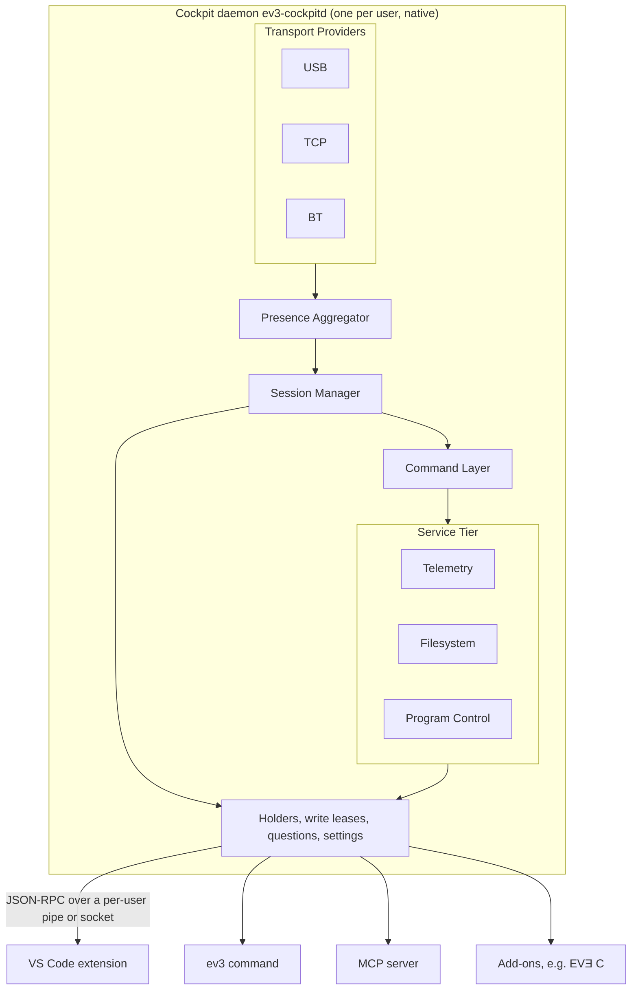

# EVƎ Cockpit

EVƎ Cockpit works with LEGO Mindstorms EV3 bricks from Visual Studio Code, a terminal or an AI
agent. It discovers bricks over USB, Bluetooth and TCP/Wi-Fi, connects one or several at once,
moves files, runs and stops programs, and reads telemetry. One cockpit daemon per user holds the
bricks; VS Code, the `ev3` command, the MCP server and add-ons such as EVƎ C are its clients, so a
brick is never pulled at by two programs. It is not a program editor: writing programs is left to
add-ons that use the cockpit.

Screenshots of the panel will go here once the UI layer exists.

## Installation

_Coming soon — the extension is not yet packaged for distribution._

## Using it

**In VS Code**, from the Command Palette:

- "Connect a Brick", "Disconnect a Brick", "Forget a Brick", "Clear a Brick's Bluetooth List";
- `EVƎ: Settings` for the cockpit's settings, which live in the daemon, not in VS Code's settings;
- "Restart the Cockpit Daemon".

**In a terminal**, with the `ev3` command:

```text
ev3 list                      bricks, with how each is reached and who holds it
ev3 connect CCC               connect CCC and keep it connected until "ev3 disconnect CCC"
ev3 put robot.rbf /home/root/lms2012/prjs/Robot/robot.rbf --brick CCC
ev3 run /home/root/lms2012/prjs/Robot/robot.rbf --brick CCC
ev3 stop CCC                  (and ev3 estop CCC for an emergency stop)
ev3 telemetry --brick CCC     one reading; name rows to read only those, --watch until Ctrl+C, --list
ev3 config list               the settings; ev3 config set access-mode full asks first
ev3 status                    the daemon, its clients, and who writes to which brick
ev3 daemon restart | log
```

`--json` gives machine-readable output for scripts, and `ev3 help` lists the exit codes. An
add-on's own commands run as `ev3 <name>` (the `ev3-<name>` program on the PATH).

**For an AI agent**, `ev3 mcp` is an MCP server over stdio with tools for bricks, files,
programs, telemetry and settings: point the agent at the command `ev3` with the argument `mcp`.

Connecting a brick from a terminal or an agent does not start telemetry: the daemon reads a brick
only for VS Code's panel showing it, or while `ev3 telemetry` or the `read_telemetry` tool runs. Forgetting a brick, clearing its Bluetooth list and switching to `full` run
only after the user says yes in VS Code or a terminal, where the question names the agent; with
nobody there to ask, the tool answers with the `ev3` command the user can run.

**Access mode.** In `safe` mode, the default, clients write, delete and run only in the brick's user
areas. `full` opens the whole brick, the shell included. Only a person can switch it on, in VS Code
or the `ev3` command, and it lasts until the daemon ends.

## Architecture



The daemon is a native Rust binary (the Cargo workspace in `daemon/`) for Windows and Linux on x64,
arm64 and 32-bit x86; it needs no Node runtime. VS Code has no 32-bit build, so 32-bit x86 gets the
`ev3` command from npm only. The VS Code extension and the client library are TypeScript,
and both sides are generated from one contract, the JSON Schema in `contract/`. macOS is not
supported yet.

The VS Code panel (Phase 5) is the next layer to be built. For the layers and their status see
[`docs/ARCHITECTURE.md`](docs/ARCHITECTURE.md); for the reasons behind them, [`DESIGN.md`](DESIGN.md);
for product scope, [`REQUIREMENTS.md`](REQUIREMENTS.md).

## Documentation

- [`REQUIREMENTS.md`](REQUIREMENTS.md): product scope
- [`DESIGN.md`](DESIGN.md): architecture decisions and their reasons
- [`docs/ARCHITECTURE.md`](docs/ARCHITECTURE.md): the layers one by one, with their status
- [`docs/protocol.md`](docs/protocol.md): the daemon's protocol
- [`docs/channel.md`](docs/channel.md): how a client finds the daemon and proves itself
- [`docs/api-for-consumers.md`](docs/api-for-consumers.md): writing an add-on with the client library
- [`IMPLEMENTATION_PLAN.md`](IMPLEMENTATION_PLAN.md): execution order and hardware findings
