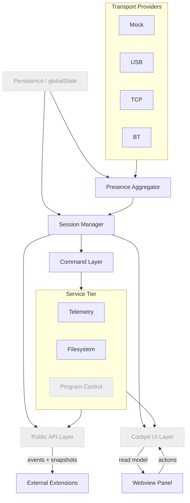

# EVƎ Cockpit

A Visual Studio Code extension for LEGO Mindstorms EV3 bricks. Cockpit discovers bricks over
USB, Bluetooth and TCP/Wi-Fi, connects one or several at once, and exposes a stable API so
other extensions can build on top of it without talking to a brick's wire protocol
themselves. It is not a program editor — connecting, monitoring and exposing bricks is the
whole job; writing and running programs is left to extensions that consume Cockpit's API.

Screenshots of the panel will go here once the UI layer exists.

## Installation

_Coming soon — the extension is not yet packaged for distribution._

## Architecture

Solid boxes are implemented; dimmed, dashed boxes are designed but not yet built. For the
layer-by-layer breakdown — what each one does, its current status, and per-layer diagrams
such as a brick's connection lifecycle — see [`docs/ARCHITECTURE.md`](docs/ARCHITECTURE.md).
For the design rationale behind these layers, see [`DESIGN.md`](DESIGN.md); for product scope,
[`REQUIREMENTS.md`](REQUIREMENTS.md).

## Documentation

- [`REQUIREMENTS.md`](REQUIREMENTS.md) — product scope
- [`DESIGN.md`](DESIGN.md) — architecture decisions and rationale
- [`docs/ARCHITECTURE.md`](docs/ARCHITECTURE.md) — layer-by-layer breakdown with implementation status
- [`IMPLEMENTATION_PLAN.md`](IMPLEMENTATION_PLAN.md) — execution order and hardware findings
