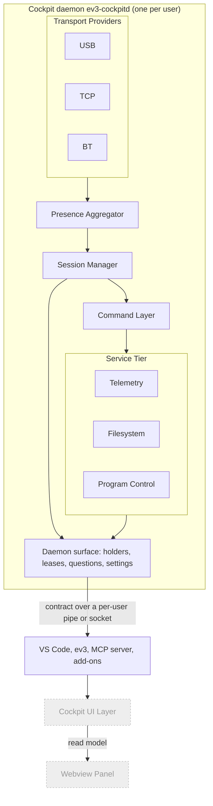
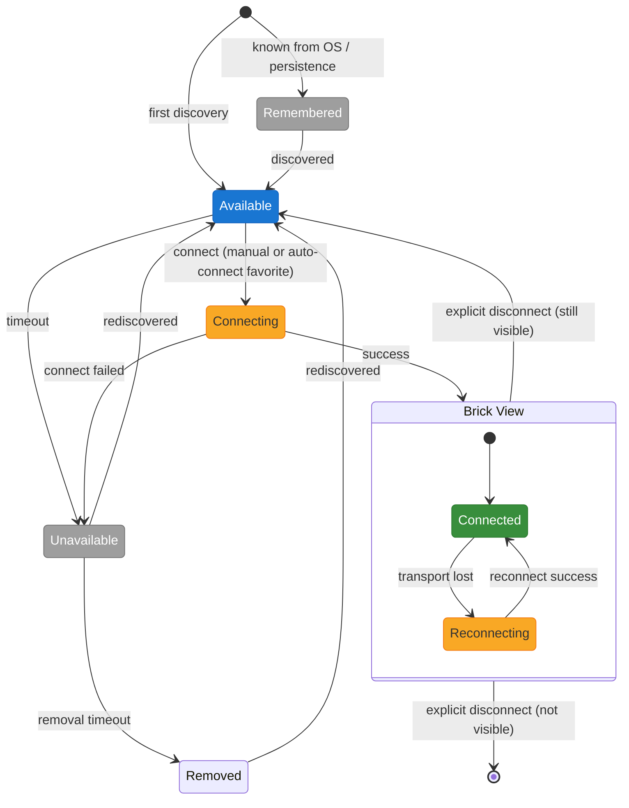

# Architecture

Cockpit is a stack of layers, each owning one concern and built to be usable — and testable
— on its own, without the layers above it. The diagram below is the current, honest state:
solid boxes are implemented; dimmed, dashed boxes are designed (see `DESIGN.md`) but not yet
built. This document expands on `DESIGN.md` §4 with an implementation-status view; `DESIGN.md`
remains the source of truth for the design rationale itself.

Everything inside the daemon is Rust, the Cargo workspace in `daemon/`; the clients above it are
TypeScript (`src/`), except the native `ev3` command (`daemon/crates/cli`). Each section below names
the crate that holds its layer.

## 1. Protocol layer

**Status: ✅ implemented** (`daemon/crates/protocol`).

Pure encode/decode functions, no I/O at all: packet framing, the EV3 direct/system command
bytecode, and reply parsing. It has no idea a USB cable or a Bluetooth radio exists — feed
it a `BrickCommand`, it hands back bytes; feed it bytes, it hands back a typed response.

## 2. Transport providers

**Status: ✅ implemented for USB, TCP and Bluetooth on Windows and Linux**
(`daemon/crates/transports`). Simulated bricks are deferred; recorded brick sessions replayed at
the provider trait (`daemon/fixtures/`) stand in for hardware in tests. macOS is not supported
yet (GitHub issue #1).

A **transport provider** implements the one contract every transport shares (`TransportProvider`):
`discover`, `connect`, `disconnect`, `send_packet`, and where the transport has them `recover`,
`forget`, `pair` and `check_presence`. It carries bytes and knows nothing about what a command
means. This is the layer where discovery and communication live *together* — a USB provider both
finds USB bricks and talks to them once connected.

USB has two links, because the "obvious" one carries a real cost: USB's HID path caps every
packet at 64 bytes (a defect in the brick's own descriptor, not a library limitation), so the
provider prefers libusb, which reaches the firmware's real 1024-byte frame, and falls back to HID
loudly rather than silently. Bluetooth on Windows is a Winsock RFCOMM socket, with presence over
uncached SDP and pairing through WinRT, all inside the daemon. On Linux it is an RFCOMM socket
through libc, with BlueZ reached over D-Bus (`zbus`) for discovery, pairing, presence and forget
(DESIGN §4.1.1, "Bluetooth on Linux"). Every operation that pages the radio takes its turn in one
Bluetooth connection queue.

## 3. Presence aggregator

**Status: ✅ implemented** (`daemon/crates/runtime`, `discovery.rs`, `presence.rs`).

Sits above every transport provider and merges their individual `discover()` results into
one unified, deduplicated list — a brick reachable over both USB and Bluetooth appears once,
not twice. It owns the presence state machine (`available` / `unavailable` / `removed` /
`remembered`) and folds in persisted metadata (favorites, last-seen) so a brick the user
cares about shows up as a known, offline entry even before it is ever seen again. This is
the layer that answers "what's out there right now", across every transport at once — the
Session Manager below only ever sees a brick after this layer has already found it.

## 4. Session manager

**Status: ✅ implemented** (`daemon/crates/runtime`, `session.rs`, and the brick layer above it,
`bricks.rs`).

The exclusive owner of *connection* state, as opposed to presence. Cockpit distinguishes two
independent things a user or the world can do to a brick — **signed in** (the user's
decision) and **available** (the world's doing, from discovery) — and telemetry only ever
runs when both are true. Losing a link (cable pulled, radio out of range, Wi-Fi turned off)
is never itself a sign-out; it moves a session to `reconnecting`, and a signed-in session
keeps retrying for as long as the sign-in stands, with no attempt ceiling — a brick that
comes back after several minutes is still picked up.

Only the daemon creates a session. A client asks for one with `bricks/connect`, which runs the
brick layer's own sign-in and makes the client one of the brick's holders; the brick stays
connected while it has a holder (`docs/protocol.md`).

## 5. Command layer

**Status: ✅ implemented** (`daemon/crates/runtime`: the codec and message counter per link in
`session.rs`, the per-session FIFO in `queue.rs`, the firmware guard in `guard.rs`).

Owns the typed command vocabulary for one connected brick: turning a `BrickCommand` into
protocol bytes, matching replies by message counter, typing the result. It sits directly
above the Session Manager (which owns the connection itself) and below the Service Tier
(which orchestrates several commands into something bigger). A channel is scoped to one
session, because the message counter is — two channels sharing a connection would hand out
colliding counters and steal each other's replies.

## 6. Service tier

**Status: ✅ implemented** (`daemon/crates/runtime`: `telemetry/`, `fs.rs`, `transfer.rs`,
`ledger.rs`, `programs.rs`, `deploy.rs`).

Three peer services sit side by side above the Command Layer, each earning its place by
needing more than a single pass-through command:

- **Telemetry** (✅) — schedules one composed frame per tick per brick (ports, sensors,
  battery, buttons), adapts its own pace to what the brick and the channel can actually
  sustain, and serves both the foreground panel and other extensions' subscriptions from the
  same tick rather than running a separate loop per consumer.
- **Filesystem** (✅) — chunked reads/writes, transfer progress and cancellation, and the
  handle bookkeeping a brick's filesystem needs across several commands. Reaches the
  firmware's real 1024-byte frame over the libusb USB adapter, which is what makes multi-byte
  operations like `copy`/`move` possible at all.
- **Program control** (✅) — starts a program in the user slot and follows its run state;
  stop and emergency stop never wait their turn. Deploy-and-run (check, upload, start) is one
  operation under one write lease.

A capability that fits in a single command — reading `battery`, renaming a brick — never
gets a service; the Command Layer already delivers it whole.

## 7. Daemon and clients

**Status: ✅ implemented** (`daemon/crates/daemon`, the native daemon plan
`docs/plans/2026-11-20-1845-refactor-native-daemon-plan.md`; hardware sign-off U16 open).

One daemon per user runs everything above, and every client reaches it over one contract
(`contract/`, `docs/protocol.md`, `docs/channel.md`): the VS Code extension, the `ev3` command, the
MCP server and add-ons through the client library (`src/client/`). The daemon adds what several
clients need: holders per brick, a write lease per request, questions for a person, the settings,
and replacement by a newer release. It composes the Session Manager and the Service Tier rather
than containing their logic.

## 8. Cockpit UI layer

**Status: ⬜ not yet implemented.**

The webview panel a user actually sees — the brick list, the active brick's live state,
configuration. A client of the daemon like the others: it reads the brick list, the active
brick and telemetry through the contract and sends user actions back.

## 9. Persistence

**Status: ⬜ not yet implemented.**

Backs the Presence Aggregator and Session Manager with data that survives a restart —
favorites, remembered bricks, last-known metadata. The daemon already keeps its settings, the
transfer debts and the bricks held with `ev3 connect` in its per-user state folder; favorites and
remembered bricks are not built yet.
