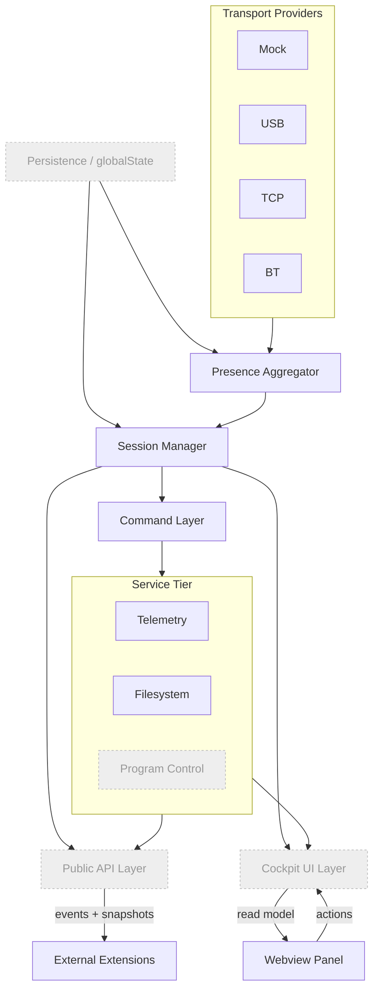
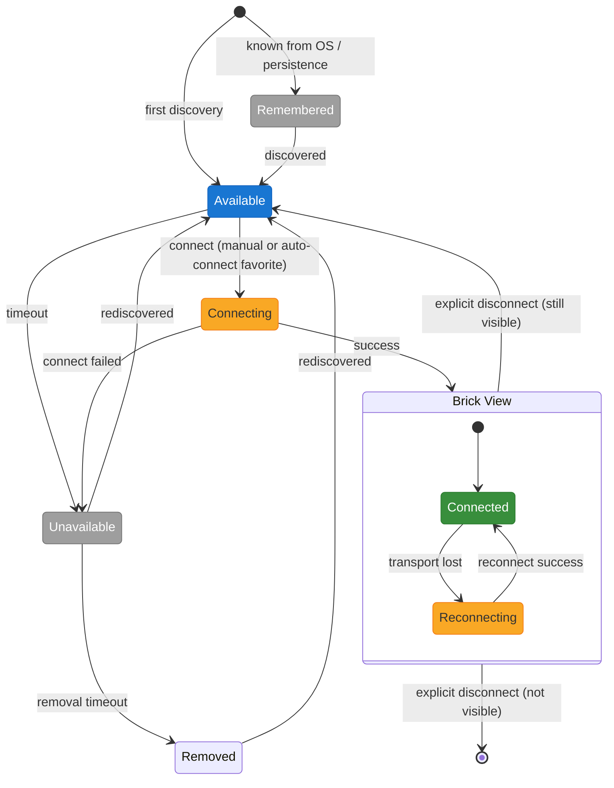

# Architecture

Cockpit is a stack of layers, each owning one concern and built to be usable — and testable
— on its own, without the layers above it. The diagram below is the current, honest state:
solid boxes are implemented; dimmed, dashed boxes are designed (see `DESIGN.md`) but not yet
built. This document expands on `DESIGN.md` §4 with an implementation-status view; `DESIGN.md`
remains the source of truth for the design rationale itself.

## 1. Protocol layer

**Status: ✅ implemented.**

Pure encode/decode functions, no I/O at all: packet framing, the EV3 direct/system command
bytecode, and reply parsing. It has no idea a USB cable or a Bluetooth radio exists — feed
it a `BrickCommand`, it hands back bytes; feed it bytes, it hands back a typed response.
Every transport adapter and the mock both sit on top of the same protocol code, which is
what keeps a mocked brick's replies shaped exactly like a real one's.

## 2. Transport adapters & providers

**Status: ✅ implemented for USB, TCP and Bluetooth** (Bluetooth carries two known open
items: an intermittent connect failure under investigation, and pairing-from-Cockpit is
proven to work but not yet wired into the extension — see `IMPLEMENTATION_PLAN.md` 2.8.16
and 2.8.18).

A **transport adapter** does raw I/O only — open, close, send framed bytes, receive framed
bytes — for one physical channel (USB, Bluetooth, TCP) or the mock. USB and Bluetooth each
have two adapter implementations, because the "obvious" one carries a real cost: USB's HID
path caps every packet at 64 bytes (a defect in the brick's own descriptor, not a library
limitation), so the extension prefers a libusb adapter that reaches the firmware's real
1024-byte frame and falls back to HID loudly rather than silently. Bluetooth's two adapters
were chosen the same way — measured against live bricks, not assumed.

A **transport provider** composes an adapter with the protocol layer and implements the one
contract every transport shares: `discover`, `connect`, `disconnect`, `send`, `recover`,
`forget`. This is the layer where discovery and communication live *together*, in the same
object — a USB provider both finds USB bricks and talks to them once connected. There is no
separate "discovery layer" below "communication"; the provider is both, per transport.

## 3. Presence aggregator

**Status: ✅ implemented.**

Sits above every transport provider and merges their individual `discover()` results into
one unified, deduplicated list — a brick reachable over both USB and Bluetooth appears once,
not twice. It owns the presence state machine (`available` / `unavailable` / `removed` /
`remembered`) and folds in persisted metadata (favorites, last-seen) so a brick the user
cares about shows up as a known, offline entry even before it is ever seen again. This is
the layer that answers "what's out there right now", across every transport at once — the
Session Manager below only ever sees a brick after this layer has already found it.

## 4. Session manager

**Status: ✅ implemented.**

The exclusive owner of *connection* state, as opposed to presence. Cockpit distinguishes two
independent things a user or the world can do to a brick — **signed in** (the user's
decision) and **available** (the world's doing, from discovery) — and telemetry only ever
runs when both are true. Losing a link (cable pulled, radio out of range, Wi-Fi turned off)
is never itself a sign-out; it moves a session to `reconnecting`, and a signed-in session
keeps retrying for as long as the sign-in stands, with no attempt ceiling — a brick that
comes back after several minutes is still picked up.

Only Cockpit itself can create a session — the Public API is read-only for connection
management, so another extension can observe a brick's state but can never connect or
disconnect one behind the user's back.

## 5. Command layer

**Status: ✅ implemented.**

Owns the typed command vocabulary for one connected brick: turning a `BrickCommand` into
protocol bytes, matching replies by message counter, typing the result. It sits directly
above the Session Manager (which owns the connection itself) and below the Service Tier
(which orchestrates several commands into something bigger). A channel is scoped to one
session, because the message counter is — two channels sharing a connection would hand out
colliding counters and steal each other's replies.

## 6. Service tier

**Status: ⚠ partially implemented — Telemetry and Filesystem are built; Program Control is
not started.**

Three peer services sit side by side above the Command Layer, each earning its place by
needing more than a single pass-through command:

- **Telemetry** (✅) — schedules one composed frame per tick per brick (ports, sensors,
  battery, buttons), adapts its own pace to what the brick and the channel can actually
  sustain, and serves both the foreground panel and other extensions' subscriptions from the
  same tick rather than running a separate loop per consumer.
- **Filesystem** (✅) — chunked reads/writes, transfer progress and cancellation, and the
  handle bookkeeping a brick's filesystem needs across several commands. Reaches the
  firmware's real 1024-byte frame over the libusb USB adapter, which is what makes multi-byte
  operations like `copy`/`move` possible at all.
- **Program control** (⬜) — not started. Will own loading a program image and polling its
  run state, the two things that need to track state across more than one command.

A capability that fits in a single command — reading `battery`, renaming a brick — never
gets a service; the Command Layer already delivers it whole.

## 7. Public API layer

**Status: ⬜ not yet implemented.**

Will be the contract other VS Code extensions actually consume: registration, a snapshot of
connected bricks, state events, the active brick, and subscription telemetry. It composes
the Session Manager and the Service Tier rather than containing their logic — a filesystem
transfer can already be driven directly against the Filesystem service today, with no API
and no registered consumer, which is deliberate: the API's job is the consumer contract, not
being the only place real behaviour lives.

## 8. Cockpit UI layer

**Status: ⬜ not yet implemented.**

The webview panel a user actually sees — the brick list, the active brick's live state,
configuration. Reads from the same Session Manager and Service Tier the Public API composes,
through its own read model, and sends user actions back down.

## 9. Persistence

**Status: ⬜ not yet implemented.**

Backs the Presence Aggregator and Session Manager with data that survives a restart —
favorites, remembered bricks, last-known metadata — via VS Code's `globalState`. Until this
lands, everything the Presence Aggregator and Session Manager track is live-session-only.
