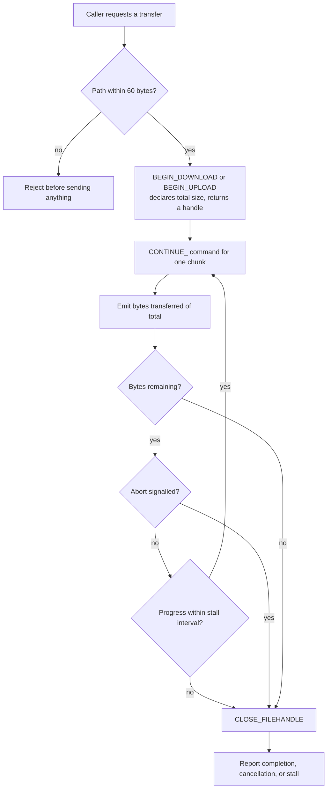

# EV3 Filesystem Layer - Plan

## Goal Capsule

- **Objective:** A consuming extension can read, write, move, and remove files and directories on a connected brick, and can transfer a file of any size with visible progress and the ability to cancel — over USB, TCP, or Bluetooth, with the same semantics on each.
- **Means:** A `FileTransferService` above the command layer owns chunking; the command layer stays one-command-one-reply.
- **Product authority:** `REQUIREMENTS.md` (scope), `DESIGN.md` §11 (filesystem design), `docs/ideation/2026-08-20-filesystem-protocol-survey.md` (what the protocol actually offers, verified against firmware sources).
- **Open blockers:** Q1 only. Q2 is answered — see Outstanding Questions.

---

## Product Contract

### Summary

Build the filesystem layer as a service above the command layer, covering every operation the protocol offers rather than the five the plan previously scoped. Transfers report progress and accept cancellation, with no size ceiling. Destructive operations refuse to recurse unless the caller asks.

### Problem Frame

`fs:write` and `fs:read` are declared and wired but do not work. `BEGIN_DOWNLOAD` and `BEGIN_UPLOAD` are sent; `CONTINUE_DOWNLOAD` and `CONTINUE_UPLOAD` never are. So a write silently drops everything past the first chunk and a read silently truncates — both report success. Nothing above the protocol layer knows a transfer is partial.

Separately, the operations the layer offers were chosen from what seemed obvious rather than from what the protocol has. The firmware exposes seventeen system commands and thirty-two `opFILE` subcodes; the contract declares five operations. Rename, free space, and a real existence check were absent not because they were rejected but because nobody looked.

The `10 commands/second` figure that governed transfer feasibility turned out to have no recorded basis, no reader, and — on measurement — to be seventeen times pessimistic on USB. That number was the reason a chunked transfer looked infeasible.

### Key Decisions

- KD1. **Chunking lives in a service above the command layer, not in the adapters.** (session-settled: user-approved — chosen over adapter-level chunking: a transport should move one packet, not own a multi-command protocol.) Governs R1, R2, R3.
- KD2. **The layer covers every operation the protocol offers.** (session-settled: user-directed — chosen over the five operations in `IMPLEMENTATION_PLAN.md` §4.6: that list came from what seemed obvious, not from the protocol.) Governs R4–R12.
- KD3. **System commands are authoritative for transfer and the core operations; `opFILE` and `opFILENAME` fill only the gaps.** Rename, existence, and size have no system command at all, so this is a division dictated by what exists rather than an architectural choice. Governs R4, R7, R9, R10.
- KD4. **Transfers are unbounded, observable, and cancellable.** (session-settled: user-directed — chosen over a soft warning, transport preference, and a hard Bluetooth size limit: how long is too long is the consumer's judgement, not this layer's. The decision was taken against an estimate of ~11 KB/s over Bluetooth; measurement later put it at 20.3 KB/s, which only strengthens it.) Governs R2, R3.
- KD5. **Destructive operations refuse to recurse unless asked.** (session-settled: user-directed — chosen over always-recursive, never-recursive, and recursive-with-dry-run: the brick has no trash can.) Governs R11, R12.
- KD6. **The transfer deadline is a stall detector, not a total-time budget.** With progress reporting in place, "no progress for N seconds" is the signal that matters; a cap on total duration would reject legitimate slow transfers. Supersedes the framing of task 1.8.5b. Governs R3.
- KD7. **The rate guard is a backstop against a pathological caller, not a meter on normal traffic.** Commands are strictly serial, so each transport self-limits at its own round trip. Governs R14.

### Requirements

**Transfer service**

- R1. A `FileTransferService` above the command layer performs chunked upload and download by issuing `BEGIN_DOWNLOAD`/`CONTINUE_DOWNLOAD` and `BEGIN_UPLOAD`/`CONTINUE_UPLOAD` until the transfer completes, and closes the handle on every exit path including failure and cancellation.
- R2. A transfer reports progress as bytes transferred against total bytes, at least once per chunk.
- R3. A transfer accepts an `AbortSignal` and stops within one chunk of cancellation. A transfer that makes no progress for a per-transport stall interval fails with a timeout naming the stall.
- R4. Chunk size is a per-transport constant, taking the lower of two ceilings: the firmware's 1024-byte buffer, and whatever the host transport actually delivers. On USB the second binds hard — a HID write delivers 64 bytes however large a report it is given, and the same frame bounds replies — so USB carries 57 payload bytes per write and 52 per read against 1017 and 1012 on TCP and Bluetooth.

The sequence R1–R4 describe, including the two exits that currently do not exist:

Today the loop runs once: `CONTINUE_DOWNLOAD` and `CONTINUE_UPLOAD` are never sent, so the path goes `BEGIN` straight to a success report, dropping or truncating everything past the first chunk. The cancel and stall exits do not exist at all.

**Read and metadata**

- R5. `list` returns a directory's entries, following `CONTINUE_LIST_FILES` when the listing exceeds one packet, and distinguishes files from directories.
- R6. `read` returns a file's full contents for a file of any size.
- R7. `exists` answers from `opFILENAME/EXIST` rather than by listing the parent and searching it.
- R8. `size` returns a file's byte length without listing its parent, via `opFILENAME/TOTALSIZE`.
- R9. `freeSpace` reports the brick's available storage via `opFILE/GET_POOL`.

**Write and structure**

- R10. `move` renames or relocates a file or directory via `opFILE/MOVE`, the only primitive the protocol offers for it.
- R11. `makeDirectory` creates a directory. `removeDirectory` removes an empty one.
- R12. `remove` deletes a file or an empty directory. Applied to a populated directory it fails with an error naming the reason and removes nothing. A separate recursive removal is available and is never the default.

**Safety and integration**

- R13. Every path is rejected before transmission when its byte length exceeds the firmware's 60-byte buffer, because the firmware truncates silently and would then act on a different path than the caller named.
- R14. A command rate exceeding the per-transport backstop fails rather than being silently paced, so a runaway caller surfaces as an error instead of as latency. This resolves task 1.8.4a in favour of rejecting: measurement showed no transport can be pushed past its own round trip, so pacing would only mask a caller bug.
- R15. The mock provider implements the same service surface, including partial-transfer failure, cancellation, a populated-directory removal refusal, and an over-length path rejection.
- R16. The Phase 4 API (`IMPLEMENTATION_PLAN.md` §4.6) exposes the service; the service does not reach into session lifecycle or transport selection.

### Actors

- A1. **Consuming extension** — calls the filesystem API, observes progress, may cancel.
- A2. **FileTransferService** — sequences multi-command operations, owns chunking, progress, cancellation, and stall detection.
- A3. **Command layer** — one command, one reply. Unchanged by this work.
- A4. **Brick firmware** — holds file handles, enforces its own path buffer and permissions.

### Key Flows

- F1. Upload a file
  - **Trigger:** A1 requests a write of a local file to a remote path.
  - **Actors:** A1, A2, A3, A4
  - **Steps:** A2 rejects an over-length path; opens the transfer with `BEGIN_DOWNLOAD` carrying the total size; sends `CONTINUE_DOWNLOAD` per chunk, emitting progress after each; closes the handle; reports completion.
  - **Outcome:** The file exists on the brick with the byte length the caller supplied.
  - **Covered by:** R1, R2, R3, R4, R13
- F2. Cancel a transfer mid-flight
  - **Trigger:** A1 aborts the signal passed to an in-progress transfer.
  - **Actors:** A1, A2, A4
  - **Steps:** A2 stops after the current chunk's reply, closes the file handle, and fails the operation with a cancellation error.
  - **Outcome:** No handle is left open on the brick; the partial file's state is reported, not hidden.
  - **Covered by:** R1, R3
- F3. Remove a populated directory
  - **Trigger:** A1 calls `remove` on a directory containing files.
  - **Actors:** A1, A2, A4
  - **Steps:** A2 issues `DELETE_FILE`; the firmware refuses; A2 translates the status into an error naming the directory as non-empty and pointing at the recursive variant.
  - **Outcome:** Nothing is removed.
  - **Covered by:** R12

### Acceptance Examples

- AE1. **Covers R1, R6.** **Given** a 40 KB file on the brick, **when** a consumer reads it, **then** the returned content is 40 KB, not the first chunk.
- AE2. **Covers R1.** **Given** a 40 KB local file, **when** a consumer writes it, **then** reading it back returns the same 40 KB.
- AE3. **Covers R3.** **Given** a transfer in progress, **when** the caller aborts, **then** the operation rejects with a cancellation error and no file handle remains open.
- AE4. **Covers R3.** **Given** a transfer whose replies stop arriving, **when** the stall interval elapses, **then** the operation fails naming the stall rather than continuing to wait per-chunk indefinitely.
- AE5. **Covers R12.** **Given** a directory containing one file, **when** a consumer calls `remove` on the directory, **then** the call fails, the message names the directory as non-empty, and the file still exists.
- AE6. **Covers R12.** **Given** the same directory, **when** a consumer calls the recursive removal, **then** the directory and its contents are gone.
- AE7. **Covers R13.** **Given** a path of 61 bytes, **when** any operation is called with it, **then** the call fails before a packet is sent.
- AE8. **Covers R5.** **Given** a directory whose listing exceeds one packet, **when** a consumer lists it, **then** every entry is returned.
- AE9. **Covers R15.** **Given** the mock provider, **when** a consumer runs AE3, AE5, and AE7 against it, **then** the observable behavior matches a real brick.

### Success Criteria

- A transfer completes at the verified throughput for its transport: TCP 57 KB/s, Bluetooth 20 KB/s, USB 6.8 KB/s (measured on a 20 KB round trip with every byte compared). A 1 MB upload is therefore about 18 seconds over TCP, 50 over Bluetooth, and two and a half minutes over USB.
- No filesystem operation reports success for work it did not complete.
- A consumer can implement deploy-and-run against the mock alone and have it work against hardware unchanged.

### Scope Boundaries

**Deferred for later**

- Log tailing via `BEGIN_GETFILE`/`CONTINUE_GETFILE`. The opcodes are declared so the capability is not lost, but reading a file while a program writes it waits for a consumer that wants it.
- The datalog subsystem (`OPEN_LOG`, `WRITE_LOG`, `CLOSE_LOG`, `GET_LOG_NAME`, log sync time).
- The brick file cache (`GET_CACHE_FILES`, `PUT_CACHE_FILE`, `GET_CACHE_FILE`, `DEL_CACHE_FILE`) and image handling (`LOAD_IMAGE`, `GET_IMAGE`).
- Folder enumeration by index (`GET_FOLDERS`, `GET_SUBFOLDER_NAME`) — `LIST_FILES` covers the need.
- Path manipulation on the brick (`SPLIT`, `MERGE`, `PACK`, `UNPACK`, `CHECK`).

**Outside this layer's identity**

- `ENTERFWUPDATE` — reboots the brick into firmware-update mode. A bricking hazard behind a plausible-looking call, and not a filesystem operation.
- `BLUETOOTHPIN` — moves a pairing credential. Belongs to pairing, not to files.
- `SETBUNDLEID` and `SETBUNDLESEEDID` — mode2 provisioning with no consumer.
- `WRITEMAILBOX` — VM messaging. A legitimate capability on a messaging surface, not this one.
- A file explorer in the Cockpit panel. `REQUIREMENTS.md` already excludes it; this layer is a service and an API.

### Dependencies / Assumptions

- Depends on the command layer's typed error split (`ProtocolError` versus transport failure) so a mid-transfer parse failure does not read as a dead link.
- Depends on the per-transport rates recorded in `DESIGN.md` §9.2 for the stall intervals in R3 and the throughput expectations in Success Criteria.
- Assumes the firmware's 60-byte path buffer applies to every system command that names a path, not only `DELETE_FILE` where it was read.
- Bluetooth is **not** bandwidth-bound at the 11 KB/s its 115200 baud configuration implies: measured throughput is 20.3 KB/s, so the SPP link runs faster than the adapter's nominal baud rate. An earlier revision of this plan reasoned from the nominal figure.
- Assumes `DELETE_FILE` removes an empty directory, from the firmware's use of POSIX `remove()`. Verified in source, not yet on hardware.

### Outstanding Questions

**Resolve before planning**

- Q1. Do the verified throughputs hold on a loaded brick — a running program, live telemetry, and a transfer at once? Everything measured so far used an idle brick.

**Answered**

- Q2. **The firmware's buffers are 1024 bytes on every channel** (`c_com.c` sets both RX and TX unconditionally), so a `CONTINUE_DOWNLOAD` payload tops out at 1017 — there is no larger chunk to be had on any transport. But the host side can be tighter, and on USB it is: a HID write delivers 64 bytes whatever report length it is handed, and the same frame bounds replies. That inverts this plan's original premise, which assumed USB was the roomiest transport and the stream-framed ones were firmware-capped. Verified throughput puts USB last by a factor of three. Reaching the full 1024 bytes over USB needs the libusb path rather than node-hid; the `usb` dependency is already present for name probing. Recorded as a follow-up, not a blocker — transfers are correct on USB, only slow.

**Deferred to planning**

- Q3. Whether `remove` and the recursive variant are two methods or one method with a flag.
- Q4. Whether the service surfaces file handles to consumers at all, or keeps them entirely internal.
- Q5. Where the rate backstop is enforced now that `TransportGuard` is still unwired (task 1.8.4).

### Sources / Research

- `docs/ideation/2026-08-20-filesystem-protocol-survey.md` — the seventeen system commands and thirty-two `opFILE` subcodes, verified against firmware headers and `c_com.c`, plus the operations deliberately excluded and why.
- `DESIGN.md` §9.2 — measured per-transport round trips and sustained command rates, and the record of this section having been wrong twice in opposite directions.
- `src/protocol/ev3Packet.ts` — the nine system commands currently declared.
- `src/contracts/transport.ts` — the five filesystem operations currently in the command contract.
- `IMPLEMENTATION_PLAN.md` §4.6 — the previous five-operation scope this plan supersedes; tasks 1.8.4, 1.8.4a, and 1.8.5b for the guard and deadline threads.
