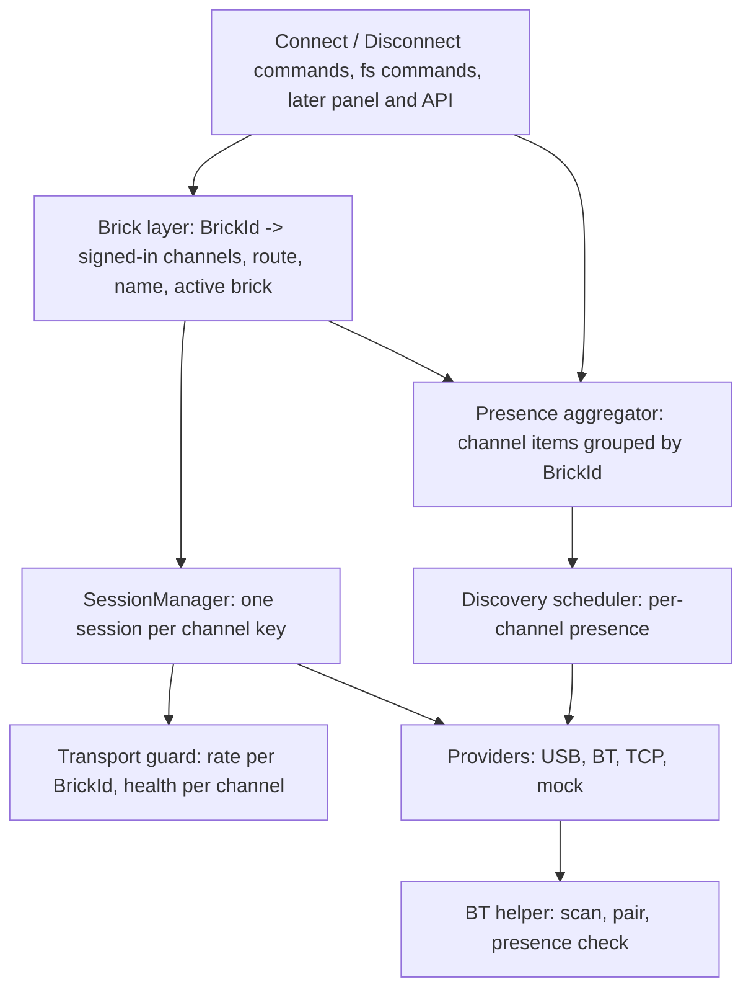
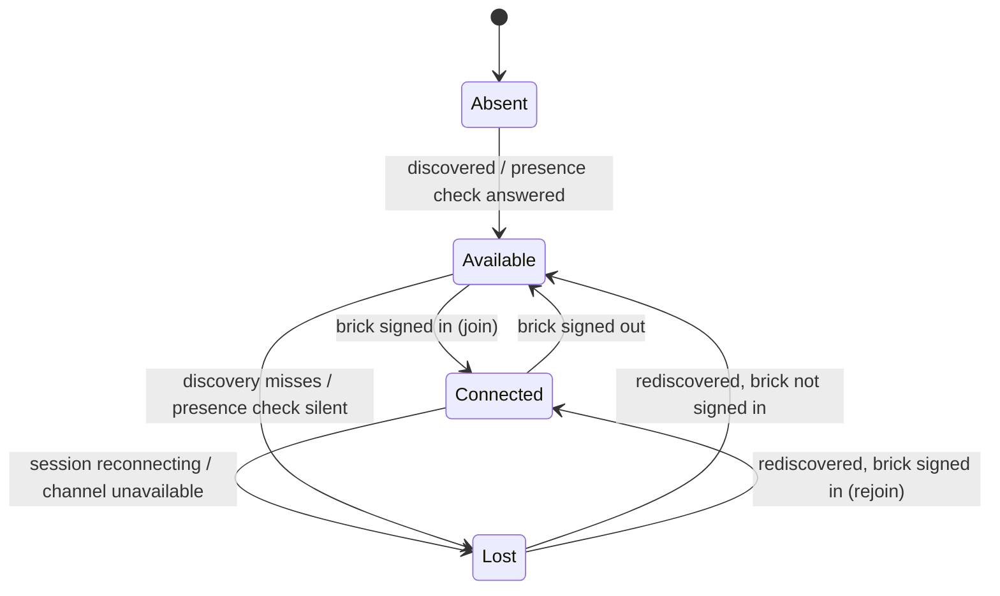

# Step 2: one brick, many channels - Plan

## Goal Capsule

- **Objective:** a user sees each EV3 brick once, under the name written on the brick, connects it with one action, and keeps working with it while cables come and go — USB at the desk, Bluetooth in the arena, back to USB at the desk — without touching the cockpit.
- **Means:** a per-brick layer above the per-channel `SessionManager` that groups channels by the brick's hardware identity and routes traffic over the best live one (KTD1, KTD2, KTD5).
- **Authority:** owner decisions in this plan's Key Decisions and in the step-1 plan §6 (D2, D3, D5) > `DESIGN.md` > this plan's KTDs > existing code. Where `DESIGN.md` disagrees with a Key Decision here, U11 changes `DESIGN.md`.
- **Stop conditions:**
  - Stop and ask the owner if a hardware measurement contradicts a Key Decision. For example, two open links freeze a brick under file transfer.
  - Stop and ask if U6 finds no method that tells an on brick from an off one. In that case U6's fallback applies, and the owner confirms it.
  - Never restart `bthserv`, and never offer a recovery path that needs a PC reboot (standing rule).
- **Execution profile:** units land as topic commits (D4). Each feature-bearing unit is proven by a test that fails without its change. U6 and U10 need the owner at the bricks: beep and send a notification, then wait for the reply.
- **Finishes and ships:** Claude implements and commits; the owner runs the hardware sessions with Claude.

---

## Product Contract

### Summary

The cockpit stops treating each channel as a separate brick. One brick has one row and one connect action, and that action opens every channel the brick is reachable on. Traffic goes over USB, then Bluetooth, then TCP, and switches by itself as channels appear and disappear. The row carries the brick's real name, read from the brick, and each channel's state. Bluetooth bricks are found and checked for presence in the background. One "Connect a Brick" command replaces the Bluetooth-only one.

### Problem Frame

Today the same brick appears once per channel: CCC on USB is `CCC`, and on Bluetooth it is `EV3 [00:16:53:42:D9:F2]`. Nothing ties the two together (plan 2.8.13). A pulled USB cable ends the session even when Bluetooth to the same brick is open and healthy. On 29.10.2026 the cable-pull run measured exactly that: Bluetooth on standby lost nothing, and the next USB call failed at once with `LIBUSB_ERROR_IO`. The extension can connect only over Bluetooth, through a palette picker. No command opens a USB or TCP brick at all, and nothing ever sets the active brick, so `listProjects` and `showStorage` can only report "no active brick".

Names are unreliable too. The USB product string is fixed when the cable goes in. Windows' Bluetooth record catches up only at the next Bluetooth connection. Only the brick's own `info` reply and the TCP beacon carry the current name (step-1 plan §4a).

Windows lists every paired brick whether it is switched on or not. A brick that has never been paired shows up only while the Bluetooth picker is open. A user at a competition with a hundred bricks in the room can tell neither which of their own bricks are on nor which new ones are near.

The transport guard also contradicts D2. It enforces "one active transport per brick", a rule that U4.4 measured to have no basis. Its brick id is the transport-local string (`00165342D9F2` from USB against `00:16:53:42:D9:F2` from Bluetooth), so it never recognised one brick across two transports anyway.

### Requirements

**Identity and the list**

- R1. A brick reachable over several channels is one entry, keyed by the twelve hex digits that are both its USB serial and its Bluetooth address. A TCP brick announcing that serial joins the same entry.
- R2. Each entry reports every channel's state: absent, available, connected or lost. A channel is lost when it was available or connected this session and is not now. A paired Bluetooth channel counts as seen from the Windows device cache, so a paired brick that does not answer its presence check is lost, shown to the user as "not heard".
- R3. Each entry reports the data D5 orders by: whether the brick is on USB, whether it is paired with this computer, and a signal reading where one exists.
- R4. A brick without a hardware identity (mock bricks, a TCP brick known only by IP) stays a single-channel entry.

**Connecting and routing**

- R5. One action connects a brick, and it opens every channel available at that moment.
- R6. While a brick is connected, a channel that becomes available joins by itself. A channel that was lost reconnects by itself.
- R7. Traffic goes over the highest-priority connected channel in the order USB → Bluetooth → TCP. It moves up when a better channel connects and down when the current one is lost.
- R8. A command in flight on a channel that fails ends with an error and is not repeated. Later commands go over the next channel. Telemetry continues on its next tick.
- R9. A multi-step operation fails as a whole if the channel it started on is lost, read or write alike. When a better channel joins meanwhile, the operation finishes on its own channel and other commands follow the new route. File transfers are the case today.
- R10. Disconnecting is per brick. It closes every channel, and the brick does not reconnect by itself until the user connects it again.
- R11. Connecting a brick makes it the active brick, so the brick commands act on it.

**Name**

- R12. The entry shows the name the brick itself reports, as soon as any exact source has it. The entry is marked unconfirmed while only a stale-capable source has spoken.
- R13. A brick that appears on USB has its name read from the brick without being connected.
- R14. After the cockpit renames a brick, the entry shows the new name without waiting for a reconnect.

**Bluetooth presence**

- R15. A brick never seen before appears in the list by itself within one background scan cycle, without anyone opening a picker.
- R16. A paired brick that is not connected is checked from time to time. One that does not answer is shown as not heard, and one that answers is shown as available.
- R17. A paired brick that has not been heard stays in the list and can still be connected. A failed attempt leaves it in the list.

**Extension surface**

- R18. One "Connect a Brick" command lists every brick from every channel in D5 order, with its channels and name, including bricks found by a live scan while the list is open. It pairs an unpaired Bluetooth brick first, as today.
- R19. A "Disconnect a Brick" command signs a connected brick out.

### Key Decisions

- KD1. **Connecting a brick opens all of its available channels; there is no per-channel connect.** Governs R5, R6, R10. (session-settled: user-directed — chosen over the earlier sketch where clicking a channel icon connects only that channel: "nejlepší bude, když se automaticky připojí všechny dostupné kanály … klikání na ikony … pravděpodobně ho nebudeme dělat vůbec")
- KD2. **A channel that appears after connecting joins, and if it ranks higher, traffic moves to it.** Governs R6, R7. (session-settled: user-directed — chosen over leaving a new channel blue until clicked)
- KD3. **A failed channel mid-operation: move to a worse channel and carry on; writes fail and stop; file and other long operations fail whether reading or writing; telemetry repeats on the next tick. Offering a retry over another channel waits for after the release.** Governs R8, R9. (session-settled: user-directed — chosen over retrying pure reads once on the next channel)
- KD4. **The name is the most important thing in discovery; use any safe, exact way to read it, USB included, without connecting.** Governs R12, R13, R14. (session-settled: user-directed — chosen over reading the name only on connect and from the TCP beacon)
- KD5. **Bluetooth presence needs both a background inquiry, for new bricks, and a periodic check of paired bricks, against Windows listing switched-off ones. Both are in this step, measured on the bricks first.** Governs R15, R16, R17. (session-settled: user-directed — chosen over deferring live presence to after the release)
- KD6. **A paired brick nobody has heard stays in the list; connecting it is tried and may time out.** This applies to Bluetooth only; USB and TCP have no such state. Governs R17. (session-settled: user-directed — chosen over hiding unheard paired bricks)
- KD7. **Disconnect is per brick, and a disconnected brick stays disconnected until connected again.** Governs R10. (session-settled: user-approved — proposed with the per-channel alternative already dropped by KD1; the owner put the step in scope without objecting)
- KD9. **A running transfer finishes on the channel it started on when a better channel joins; it fails only when its own channel is lost.** Governs R9. (session-settled: user-directed — chosen over aborting the transfer on any channel change, which would make plugging the cable back in after the arena break a slow Bluetooth transfer)
- KD10. **The paired-brick presence check is the uncached SDP query, read with hysteresis: one answer makes a brick heard, three misses in a row make it not heard; checks about once a minute, only for paired bricks without a session, never beside a connect.** Governs R16. (session-settled: user-directed — chosen over showing only "last heard" with no not-heard state, and over the fallback without a check; after U6 showed the query is one-sided on this adapter)
- KD8. **Order (D5): on USB first, then paired without USB, then unpaired; by name within a group.** Unpaired bricks go by name until signal ordering is measured. Governs R3, R18. (decided in the step-1 plan §6 D5)
- KD11. **Mock bricks are a development aid behind a setting, `ev3-cockpit.mockBricks`: on while the cockpit is being developed, off in the production build.** Unset, the extension shows them only while it runs from source (F5, `ExtensionMode.Development`), so an installed build never lists bricks that are not there; set, the setting wins either way. Off, no mock provider is registered at all. Governs no requirement; added 30.10.2026 after the mock bricks filled the log during the hand run. (session-settled: user-directed — "v tuto chvíli zapnuté ale do produkční verze je vypneme", with the mechanism left to the implementer; chosen over commenting the mock configuration out)

### Success Criteria

- The arena scenario works in the shipped runtime on AAA, BBB and CCC:
  - USB and Bluetooth connected, traffic on USB;
  - cable out: commands continue over Bluetooth, and the first command fails at most once;
  - cable in: traffic is back on USB within one USB discovery cycle plus one open (about 2 s measured).
- After a rename the row shows the new name without the user doing anything else.
- With all three bricks paired, switching one off turns its Bluetooth state to not heard within one presence-check interval, and switching it on turns it back.

### Scope Boundaries

- The webview panel, its icons and colours, and click-vs-double-click: Phase 5. This step delivers the data the row needs and a QuickPick that shows it as text.
- The public API and its identity shape (4.9.3): Phase 4. The brick identity introduced here is what it should expose; recorded as a note on 4.9.3.
- Favorites and persistence: Phase 6. 6.2.1 and 6.3.4 still say "per (brickKey, transport)"; U11 rewrites them to per brick, but nothing is persisted here.
- Ordering unpaired bricks by smoothed signal with hysteresis (D5 group 3): needs its own measurement; post-release list (step-1 plan §8).
- Daisy chain (3.1.4g): the identity introduced here must not rule a layer out, nothing more.
- Considered and not built: retrying a failed read on the next channel. KD3 chose failure, and telemetry and heartbeat repeat by their nature. Evidence that would change this: a user-visible command that fails on cable pull often enough to matter.
- Considered and not built: a per-brick command queue spanning channels. Each channel keeps its own queue (KTD5). One frame in flight per channel is preserved, and two frames to one brick on two channels were measured safe (U4.4). Evidence that would change this: a freeze with traffic on two channels at once.

#### Deferred to Follow-Up Work

- Offer to repeat a failed operation over another channel (KD3, post-release).
- Wire `TelemetryService` into the extension (Phase 3). U4 makes the brick layer satisfy its host interface; starting it is Phase 3's job.

---

## Planning Contract

### Key Technical Decisions

- KTD1. **A brick layer above `SessionManager`; `SessionManager` stays per channel.** It already owns per-link connect, heartbeat, reconnect without an attempt ceiling, and discovery-triggered fast reconnect, all covered by `sessionRuntime.test.ts`. The new layer holds, per brick, which channels are signed in, which one carries traffic, the name and the events. Rewriting `SessionManager` around bricks would re-derive all of that for no behaviour the layer above cannot add.
- KTD2. **Identity is a normalised `BrickId`: twelve upper-case hex digits, no separators.** One function maps any channel key to it (`usb:00165342D9F2`, `bt:00:16:53:42:D9:F2`, `tcp:00165342d9f2` all map to `00165342D9F2`). A key with no hardware identity maps to itself (R4). It is a distinct branded type, not `BrickKey`, so the compiler finds every call site that switches from a channel key to a brick. `BrickKey` keeps its meaning: one channel to one brick.
- KTD3. **Transport guard: the rate limit is per brick, health is per channel, and "one active transport" and the switch cooldown are removed.**
  - The rate limit is keyed by `BrickId`, because firmware stress is a property of the brick.
  - Failure counting and degradation are keyed by channel. Keyed by brick, a pulled cable's failures would degrade the brick and block the healthy Bluetooth standby — the failover this step exists for.
  - "One active transport" and `TRANSPORT_SWITCH_COOLDOWN_MS` go. U4.4 and the cable-pull run found no freeze with both links open and commands in flight on both. The rule's cited incident record does not exist (lab `testlab-inventory.md` §1).
  - Closing one channel no longer resets the whole brick's health.
- KTD4. **Read model: the scheduler keeps tracking channels; each channel's state is one state machine, the same for every transport; the aggregator groups channels into bricks.** A `BrickChannel` (one brick on one transport) owns its state and its valid transitions, the way `SessionEntry` already owns the connection state machine: an invalid transition throws instead of being silently derived. There is one `BrickChannel` class, not one per transport, because the machine is identical for USB, BT and TCP; everything that differs lives in the transport's provider (KTD10). The machine sits behind a small interface (events in: seen, gone, connected, disconnected, check unanswered; state and change event out) with one base implementation that every current transport gets. `BrickChannel` and the brick layer know only the interface, so a future transport that needs other states supplies its own implementation without touching them. The hook through which a provider would supply one is not built until such a transport exists. (session-settled: user-directed — chosen over a machine hardwired into `BrickChannel`: "navrhni nějakého předka stavového automatu, nějakou základní implementaci … a těm kanálům přiděl tuto implementaci", while doubting any transport will need another) Presence events from the scheduler (available, unavailable, removed), session state changes and presence-check answers are the inputs that drive transitions. The scheduler's miss counting stays as it is.
  - absent: the channel was never seen this session;
  - available: seen and not connected;
  - connected: a live session;
  - lost: unavailable, removed or reconnecting after having been seen, or a paired Bluetooth channel whose latest presence check went unanswered ("not heard", R2).

  The presence verdict travels with the scan, not beside it: the BT provider's `discover()` keeps reporting every paired brick and carries a `heard` flag from the last check, so the verdict survives `rebuildFromScheduler` and a paired brick is never dropped (KD6). `DiscoveryItem` changes shape now, while the API (Phase 4) and the panel (Phase 5) have no consumers. A per-brick item carries the channel map; the old `transport`/`availableTransports` pair cannot say lost or connected.
- KTD5. **Routing chooses a channel between commands; each channel keeps its own queue.**
  - A command goes to the queue of the highest-priority connected channel at the moment it is dispatched. Priority comes from each channel's provider (KTD10), USB → BT → TCP → mock, so a single-channel brick (mock, TCP known only by IP) always routes to its one channel.
  - A failure in flight surfaces to the caller (R8). A link-level failure on the route channel (any error that is not a `ProtocolError`, the heartbeat's own `isLinkFailure` rule) drops that channel from routing at once and triggers an immediate heartbeat probe; the session still reaches Reconnecting through the existing path. Waiting for the heartbeat instead would leave the route on a dead cable for two missed beats, about 6 s, and the cable-pull run showed the first USB call fails at once (`LIBUSB_ERROR_IO`).
  - The route is recomputed on every session state change and on every such drop. It is never pinned by a caller, except by the transfer rule below.
  - Multi-step operations pin the channel they start on and send every step over it, bypassing the route (KD9). A step fails with a "channel changed" error only when that channel has left Connected (R9). `maxPacketBytes` is read from the pinned channel at the moment the operation starts, so a transfer never chunks for one channel and sends over another.
  - Telemetry takes its cadence, packet size and frame support from the route's transport, and restarts its loop on every route change. A loop started at USB's 100 ms would otherwise keep that period over Bluetooth, whose floor is 250 ms.
- KTD6. **Every connected channel keeps its heartbeat, standby included.** A standby channel that dies is noticed and shown as lost before traffic needs it. Its cost is one battery read every 3 s per channel, inside the shared per-brick rate limit.
- KTD7. **The name has an order of trust, and confirmation is a property of the source:**
  1. `info` from a session or from the USB name probe — confirmed;
  2. TCP beacon — confirmed (measured 29.10.2026 to follow a rename within 4–12 s);
  3. USB product string — unconfirmed;
  4. Windows Bluetooth record — unconfirmed;
  5. `EV3 [mac]` — unconfirmed.

  The USB name probe is a provider operation, not a session: open the device, send one `info`, close it, all inside the provider. It never creates a `usb:` session. A user's connect a moment later therefore never meets "already connected". It runs when a serial first appears on the bus. It is skipped when the brick is signed in, because the join's own `info` covers the name. Inside the provider, probe and connect are serialised per serial: a connect waits for an in-flight probe to close, and the probe's device counts as in use while it runs. Without that, a connect racing the probe loses the libusb claim and silently falls back to 64-byte HID.
- KTD8. **Bluetooth presence goes through the existing helper and the connection queue, and its method is chosen by measurement.**
  - Background inquiry reuses the helper's scan mode on a timer, so new bricks enter discovery without a picker.
  - The paired-brick check has two candidates. One is an inquiry that includes paired devices, which the helper's existing `--watch-raw` mode can already run (`scripts/presence-signal-probe.js`). On 29.10.2026 it reported nothing for any paired brick (step-1 plan §4a), so it is the weaker candidate. The other is an uncached SDP query per address (`GetRfcommServicesAsync(BluetoothCacheMode.Uncached)`), the only new helper mode.
  - Microsoft documents neither method's behaviour toward a switched-off device, so U6 measures them before U7 builds one.
  - Both run through `BtConnectionQueue`, so they never race a connect or a pairing. They hold the slot for mutual exclusion only. Releasing it does not arm the 15 s inter-connection cooldown, and an unanswered check is a result, not an error, so it never arms the 30 s error backoff. Only the post-check gap U6 measures applies before the next connect. The inquiry window stays well below `QUEUE_ACQUIRE_TIMEOUT_MS` (45 s). Otherwise one presence round of three paired bricks plus an inquiry would hold the queue for about a minute, and a user connect behind it would time out.
  - An RFCOMM connect is not a candidate: on the weak adapter it fails half the time with the brick on, and a reconnect too soon after a close locks the brick out for minutes (D3).
- KTD10. **What differs between transports lives only behind the `TransportProvider` interface, and that includes priority.** Each provider declares its channel priority (USB highest, then BT, then TCP, mock lowest) and the brick layer orders channels by it, with no transport named in the routing code. A new transport is then one more implementation of the interface, with no edit to the brick layer, the channel state machine or the route. (session-settled: user-directed — chosen over a priority list hardcoded in the brick layer: "kanál komunikace bude nějaký interface … jednotlivé instance usb, bt a tcp budou pouze implementovat ten interface, budou mít nějakou prioritu … stavový automat bude taky vlastností toho interface")
- KTD9. **The runtime is composed in one function that the extension and the hardware harness both call.** Today the composition is inline in `activate()`. U10 must run the shipped wiring, not a hand-written copy, because a probe has diverged from the shipped code five times before (memory: the probe is more suspect than the shipped code).

### High-Level Technical Design

Layering after this step:



Channel state inside one brick entry:



Route selection on every session state change of a signed-in brick (directional):

```text
connected = channels whose session is Connected and not dropped by a link failure
route     = channel in connected with the highest provider priority, else none
if route changed: bump route token, fire route-change event
for each channel in Available and brick signed in: join (KD2)
```

### Sequencing

U1 → U2 → U3 → U4 → U5 lands the runtime model, unit-tested with fake providers. U6 is a hardware session that can run in parallel with U3–U5. U7 depends on U6's verdict. U8 depends on U3. U9 depends on U4, U5, U8 and, for live scan rows, U7. U10 needs U9. U11 closes the docs.

### Risks

| Risk | Mitigation |
|---|---|
| Background inquiry slows connects on the weak Realtek adapter | Inquiry goes through the queue; U6 measures connect success with a periodic inquiry running; the interval comes from that measurement |
| The SDP check triggers the same minutes-long lock-out as a too-fast RFCOMM reconnect | U6 measures connects right after a check; a lock-out disqualifies the method |
| The USB name probe fights another program holding the brick (LEGO software) | A failed claim is a skipped probe and a debug log line; the name falls back to the product string, marked unconfirmed |
| Two links to one brick misbehave under file transfer or full-rate telemetry (not measured in U4.4) | A transfer pins its route (KTD5); U10 runs a transfer and telemetry with both links up, and a freeze stops the step |
| `DiscoveryItem` reshape ripples through tests and the mock | Done in one unit (U3) with the compiler finding call sites |

---

## Implementation Units

### U1. Brick identity

- **Goal:** one function maps every channel key to the brick it belongs to.
- **Requirements:** R1, R4.
- **Dependencies:** none.
- **Files:** `src/contracts/brickKey.ts`, `src/contracts/index.ts`, `src/__tests__/contracts.test.ts`.
- **Approach:** add the `BrickId` brand and a normaliser (KTD2). Strip separators, require exactly twelve hex digits and upper-case them. Anything else returns the channel key itself. Keep `makeBrickKey`'s case rules untouched.
- **Patterns to follow:** `brickKeyId`/`brickKeyTransport` in the same file; `isLegoMac` in the BT provider for MAC handling.
- **Test scenarios:**
  - `usb:00165342D9F2`, `bt:00:16:53:42:D9:F2` and `tcp:00165342d9f2` all yield `00165342D9F2`.
  - `tcp:192.168.1.20` yields itself; `mock:brick-a` yields itself.
  - A malformed key (`bt:00:16:53`) yields itself, never a truncated id.
  - Two different bricks never collide (AAA, BBB, CCC addresses from the bench).
- **Verification:** the scenarios pass, and one of them fails when the normaliser keeps separators.

### U2. Transport guard per brick and per channel

- **Goal:** the guard stops blocking a healthy channel because another channel of the same brick failed.
- **Requirements:** R7, R8.
- **Dependencies:** U1.
- **Files:** `src/transports/transportGuard.ts`, `src/runtime/sessionManager.ts`, `src/transports/transportConstants.ts`, `src/__tests__/transportInfra.test.ts`, `src/__tests__/sessionRuntime.test.ts`.
- **Approach:**
  1. Rate limit keyed by `BrickId`; failures, degradation and RTT keyed by channel key (KTD3).
  2. Remove `openTransport`'s one-at-a-time check and the switch cooldown, with `TRANSPORT_SWITCH_COOLDOWN_MS`. Rewrite the tests that pinned them so they assert the opposite, citing U4.4; do not just delete them.
  3. `SessionManager` passes both ids. Disconnecting one channel resets only that channel's health.
  4. A channel's session moving from Reconnecting to Connected resets that channel's health too (failures, degradation, RTT; the per-brick rate window stays). Today only a disconnect clears `degraded`, so a cable that comes back after failing three times would be refused forever and never carry traffic again.
  5. Correct the `SessionManager` comment that claims the guard protected a brick across transports.
- **Test scenarios:**
  - USB and BT sessions to the same brick open at once without an error.
  - Three failures on the USB channel degrade USB; a send on the BT channel of the same brick still goes through.
  - Three failures degrade USB, USB reconnects, and the next send on USB goes through.
  - Eleven commands within a second across both channels of one brick hit the per-brick limit; the same load split across two bricks does not.
  - Disconnecting the USB channel leaves the BT channel's failure count intact.
- **Verification:** each scenario fails against the old guard, shown by reverting the change with a reverse patch.

### U3. Brick read model

- **Goal:** the discovery list holds one entry per brick with every channel's state, the name with its trust, and the ordering data.
- **Requirements:** R1, R2, R3, R4, R12.
- **Dependencies:** U1.
- **Files:** `src/contracts/models.ts`, `src/contracts/transport.ts`, `src/runtime/brickChannel.ts` (new), `src/runtime/presenceAggregator.ts`, `src/transports/btTransportProvider.ts`, `src/transports/usbTransportProvider.ts`, `src/transports/tcpTransportProvider.ts`, `src/mock/mockTransportProvider.ts`, `src/__tests__/brickChannel.test.ts` (new), `src/__tests__/presenceAggregator.test.ts`, `src/__tests__/discoveryScheduler.test.ts`.
- **Approach:**
  1. `TransportProvider` gains a declared channel priority (KTD10); each provider sets its own.
  2. The channel state machine interface and its base implementation with the transition table (KTD4), modelled on `SessionEntry`'s `VALID_TRANSITIONS`; `BrickChannel` holds it through the interface.
  3. Reshape `DiscoveryItem` into a per-brick item. It holds a `BrickId`; a per-channel record with its channel key, state, last seen and signal; a name with its source and a confirmed flag; and `paired`. It keeps `favorite` and `remembered`.
  4. Providers report `paired` (BT, from the device cache's remembered flag) and their name source.
  5. The aggregator merges channel items by `BrickId` into bricks made of `BrickChannel`s, feeds them presence events and applies KTD7's name precedence.
  6. Session state reaches each channel through the existing `updateBrick` path, now per channel.
- **Patterns to follow:** `SessionEntry` for the state machine; `mergeLocalMetadata` for local-owned fields; the scheduler's `PresenceChangeEvent` stays per channel.
- **Test scenarios:**
  - Every valid channel transition in the HTD diagram is accepted; an invalid one (absent → connected) throws.
  - A `BrickChannel` given a stub machine through the interface reports the stub's state, so nothing outside the base implementation depends on its states.
  - A fake provider declaring a priority between USB and BT orders between them, with no change outside the fake.
  - A USB item and a BT item of CCC produce one entry with both channels available.
  - The USB channel going unavailable turns that channel lost while BT stays available.
  - A channel never seen this session is absent, not lost.
  - A name from the TCP beacon replaces a USB product name and becomes confirmed; a later Bluetooth-cache name does not replace it.
  - A TCP brick known only by IP is its own entry with one channel.
  - A mock brick is unchanged in behaviour: one entry, one channel.
- **Verification:** the aggregator tests pass; the compiler reports no remaining reader of the old `transport`/`availableTransports` fields.

### U4. Brick layer: connect all, route, fail over

- **Goal:** one call connects a brick over every available channel, traffic follows the best live channel, and the active brick is a brick.
- **Requirements:** R5, R6, R7, R8, R9, R10, R11; KD1, KD2, KD3, KD7.
- **Dependencies:** U2, U3.
- **Files:** `src/runtime/brickManager.ts` (new), `src/runtime/index.ts`, `src/runtime/sessionManager.ts`, `src/fs/brickFilesystem.ts`, `src/fs/fileTransferService.ts`, `src/telemetry/telemetryService.ts`, `src/telemetry/brickTelemetry.ts`, `src/__tests__/brickManager.test.ts` (new), `src/__tests__/fileTransfer.test.ts`, `src/__tests__/brickTelemetry.test.ts`.
- **Approach:**
  1. The brick layer keeps, per `BrickId`, a signed-in flag. It joins every available channel through `SessionManager.connect` on sign-in, and later whenever the aggregator reports a channel available for a signed-in brick (KD2). A failed USB or TCP join is retried on `SessionManager`'s reconnect backoff (`RECONNECT_BASE_MS` to `RECONNECT_MAX_MS`) for as long as the channel stays available. Discovery fires only on state changes, so evidence alone would never retry a cable that stays in. A failed BT join is retried only on new evidence (rediscovery or a presence answer), never on a timer, because of D3.
  2. Route per KTD5, including the immediate drop on a link-level failure. `send` and `maxPacketBytes` resolve the route at call time. A route-change event fires on every change.
  3. Sign-out disconnects every channel explicitly, so `SessionManager`'s suppression covers each one (KD7).
  4. The active brick moves here; `SessionManager`'s activity calls follow the route channel.
  5. The brick layer satisfies `BrickSender` (fs) and the telemetry host interface keyed by `BrickId`. `telemetryService.ts` and `brickTelemetry.ts` take the route's transport from the host instead of parsing it out of the key, and the service restarts the active brick's loop on every route-change event (KTD5).
  6. `FileTransferService` pins a channel at the start of a transfer, reads its packet size then, and fails only when that channel is lost (KTD5, KD9). The brick layer offers a send on a pinned channel beside the routed send.
- **Execution note:** write the fake-provider failover test first. It is the behaviour the step exists for.
- **Test scenarios:**
  - Covers R5. Sign-in with USB and BT available opens both sessions; the route is USB.
  - Covers R7. The USB session goes reconnecting; the route becomes BT; the next `send` reaches the BT fake.
  - Covers R7. The USB fake rejects one user command with a link error; the very next command reaches the BT fake before any heartbeat tick.
  - A USB join that fails once joins on the backoff without the cable being replugged.
  - A single-channel mock brick routes to its one channel.
  - A USB→BT route change restarts the telemetry loop at BT cadence.
  - Covers R8. A command in flight on USB when the USB fake starts failing rejects with that error and is not resent over BT.
  - Covers R6. USB becomes available again and its session reconnects; the route returns to USB.
  - Covers R6. A brick signed in over BT only: a USB channel appearing later joins by itself and takes the route.
  - Covers R9. A transfer started over USB fails with "channel changed" when the USB channel is lost mid-transfer.
  - Covers R9. A transfer started over BT completes over BT when USB joins mid-transfer, while a command issued meanwhile goes over USB.
  - Covers R10. Sign-out closes both sessions; the USB channel becoming available afterwards does not join.
  - Covers R17. Sign-in where the BT join times out: USB connects, BT stays available, nothing retries until BT is rediscovered.
  - Covers R11. Sign-in makes the brick active; signing out the active brick clears it.
- **Verification:** each Covers scenario fails with its rule removed (reverse patch); `brickFilesystem.test.ts` and the telemetry tests pass against the brick layer.

### U5. Confirmed name

- **Goal:** the entry carries the name the brick reports, read without connecting when the brick is on USB.
- **Requirements:** R12, R13, R14; KD4.
- **Dependencies:** U3, U4.
- **Files:** `src/contracts/transport.ts`, `src/transports/usbTransportProvider.ts`, `src/runtime/brickManager.ts`, `src/runtime/presenceAggregator.ts`, `src/__tests__/usbDiscoveryNames.test.ts`, `src/__tests__/brickManager.test.ts`.
- **Approach:**
  1. An optional provider operation reads a brick's name without creating a session (KTD7); USB implements it over a short-lived libusb link, serialised with `connect` per serial.
  2. The aggregator, or a small helper beside it, runs it once per newly seen USB serial of a brick that is not signed in, and records the result as confirmed.
  3. Every channel join reads `info`, and the result is recorded as confirmed.
  4. After a `brick:setName` through the brick layer, the name is read back and recorded.
- **Patterns to follow:** `UsbTransportProvider.nameBySerial` and its comment on why a name read once stays useful; `tryLibusb` for opening the device.
- **Test scenarios:**
  - A new serial on the bus triggers one probe; its `info` name becomes the entry's confirmed name.
  - The probe is skipped for a signed-in brick; its USB join reads the name instead.
  - A probe that cannot claim the device leaves the product string, unconfirmed, and logs once.
  - A connect started while a probe is in flight waits for it and lands on libusb, not HID; no "already connected".
  - A rename through the brick layer updates the entry from the read-back reply.
- **Verification:** scenarios pass; the connect-during-probe scenario fails without the per-serial serialisation.

### U6. Measure Bluetooth presence methods (hardware, with the owner)

- **Goal:** know which method tells a paired brick that is on from one that is off, at what cost, before building one.
- **Requirements:** R15, R16; KD5.
- **Dependencies:** none (helper and scripts only).
- **Files:** `native/bt-pairing-helper/Program.cs` (diagnostic modes), `scripts/bt-presence-probe.js` (new), results recorded in this plan's Appendix.
- **Approach:**
  1. Add one helper mode, an uncached SDP query to one address with a timeout. For the inquiry candidate, reuse `--watch-raw` with the all-devices selector from `scripts/presence-signal-probe.js`, plus the device cache's last-seen time.
  2. The probe script runs each method against AAA, BBB and CCC in three states: on and visible, on and not visible, off. It repeats each method several times and records the answer time.
  3. Right after each check it runs one `info` connect, to catch a lock-out.
  4. It runs one round of connects with a periodic inquiry in the background.
- **Decision rule, written before the run:**
  - A method qualifies when it separates on from off in every repetition on all three bricks, answers within 6 s, and causes no failed connect in the following minute beyond the adapter's usual rate.
  - Prefer the method that also works with visibility off.
  - If none qualifies, U6's fallback applies and the owner confirms it: paired bricks are shown as known, not heard; R16 and the third success criterion are not met in this step; and U7 builds only the background inquiry (R15).
- **Execution note:** follow the hardware-session rules: check for hung node processes before and after; beep and send a notification before every action the owner performs at the bricks; wait for the owner's reply.
- **Test expectation:** none — a measurement unit; its output is the verdict and the interval for U7.
- **Verification:** the Appendix holds the table and the verdict, committed with the probe.

### U7. Bluetooth presence in discovery

- **Goal:** new Bluetooth bricks appear without a picker, and paired bricks show whether they are heard.
- **Requirements:** R15, R16, R17; KD5, KD6.
- **Dependencies:** U3, U6.
- **Files:** `native/bt-pairing-helper/Program.cs`, `src/transports/btPairingHelper.ts`, `src/transports/btClassicDiscovery.ts`, `src/transports/btTransportProvider.ts`, `src/transports/transportConstants.ts`, `src/__tests__/btPairingHelper.test.ts`, `src/__tests__/btClassicDiscovery.test.ts`, `src/__tests__/btBackendSelection.test.ts`.
- **Approach:**
  1. A background inquiry on the interval U6 chose feeds unpaired bricks, with their signal, into BT discovery.
  2. The presence check from U6's winning method runs for paired bricks without a BT session. Its answer sets the `heard` flag that the BT provider's `discover()` reports (KTD4).
  3. Both acquire `BtConnectionQueue` for mutual exclusion only (KTD8) and are skipped, not queued twice, if the previous round is still running.
  4. A paired brick that has never answered stays listed as not heard (KD6).
- **Patterns to follow:** `scanForBricks` for helper lifecycle and cancellation; the scheduler's in-flight guard for overlapping scans.
- **Test scenarios:**
  - A scan emitting an unpaired brick adds a BT channel to discovery, with its signal.
  - A paired brick whose check fails is reported with `heard` false, and its BT channel is lost (shown as not heard); one whose check answers is available. The verdict survives the next scheduled scan.
  - A round still running when the next tick fires is not started again.
  - A check waiting on the queue does not delay a user connect that was queued first.
  - A user connect queued behind a full presence round, with one paired brick switched off, is granted within the measured post-check gap, with no 15 s or 30 s cooldown and no acquire timeout.
  - Helper missing from the install: discovery falls back to the device cache and reports why once.
- **Verification:** scenarios pass; U10 confirms on hardware.

### U8. D5 order

- **Goal:** one comparator orders brick entries the way D5 says, for the picker now and the panel later.
- **Requirements:** R3, R18; KD8.
- **Dependencies:** U3.
- **Files:** `src/ui/brickOrder.ts` (new), `src/__tests__/brickOrder.test.ts` (new).
- **Approach:** group 1 is any brick with a USB channel available or connected; group 2 is paired without USB; group 3 is everything else. Within a group, order by confirmed or best name, case-insensitive, with `BrickId` as the tiebreaker so equal names never swap. The comparator lives in the UI layer (memory: sorting is a UI concern); the aggregator stays unordered.
- **Test scenarios:**
  - A USB brick that is also paired sorts above a paired brick without USB.
  - A paired, not-heard brick sorts above an unpaired one.
  - Two bricks both named `EV3` keep a stable order across calls.
  - A brick losing USB moves from group 1 to group 2.
- **Verification:** scenarios pass.

### U9. Extension: one connect command, one disconnect command

- **Goal:** a user connects and disconnects any brick from the palette, and the brick commands act on it.
- **Requirements:** R11, R18, R19.
- **Dependencies:** U4, U5, U8; U7 for live scan rows.
- **Files:** `src/runtime/createRuntime.ts` (new, KTD9), `src/extension.ts`, `package.json`.
- **Approach:**
  1. Move the runtime composition out of `activate()` into one function (KTD9).
  2. Replace `connectBluetoothBrick` with `connectBrick`. Its QuickPick shows aggregator entries in U8 order, plus live scan results. Each row carries the name, an "unconfirmed" marker when it applies, and its channels as text with their states.
  3. Picking a row signs the brick in; an unpaired Bluetooth-only row pairs first (existing flow).
  4. Add `disconnectBrick`, listing signed-in bricks.
  5. `listProjects`/`showStorage` use the active brick.
- **Patterns to follow:** the current picker's focus-preserving re-sort and its scan error handling in `extension.ts`.
- **Test expectation:** the composition function gets a smoke test that builds the runtime with stub providers and signs in a mock brick. The QuickPick itself is verified by hand in U10.
- **Verification:** the extension host starts, and the palette shows both commands. Connecting the mock brick makes `showStorage` answer from it.

### U10. Hardware verification with the owner

- **Goal:** the step's success criteria hold on the bench, through the shipped runtime.
- **Requirements:** Success Criteria; R5–R17.
- **Dependencies:** U9.
- **Files:** `scripts/arena-scenario.js` (new; drives `createRuntime`, not hand-made providers), results in this plan's Appendix.
- **Approach:**
  1. Run through the harness, then once by hand in the Extension Development Host:
     - arena scenario on AAA, BBB and CCC (cable out and in, commands running);
     - rename read-back;
     - Bluetooth switched off on a paired brick and back on;
     - a new brick appearing without a picker (BBB unpaired for the run, then re-paired);
     - one file transfer and the telemetry loop with USB and BT both up.
  2. Record the time to switch each way and any failed command.
- **Execution note:** beep repeatedly and send a notification before each owner action; the owner may be away from the desk, so wait for an explicit reply. Check for hung node processes before and after.
- **Test expectation:** none — hardware verification.
- **Verification:** the Appendix table shows each success criterion met, or the step stops on the deviation (Goal Capsule stop conditions).

### U11. Docs and plan

- **Goal:** the design documents describe one brick with many channels.
- **Requirements:** all; carries the Key Decisions into the source of truth.
- **Dependencies:** U4, U7, U8.
- **Files:** `DESIGN.md` (§4.1 guard bullet, §4.1.1 last bullet, §4.2, §5.1, §6.2 sign-in per brick, §6.4 diagram, §7.2 ordering, §12.1), `IMPLEMENTATION_PLAN.md` (2.8.13 closed, 2.8.12 two-transport-loss scenario, 5.3.2/5.3.3/5.3.6, 6.2.1/6.3.4 per brick, a note on 4.9.3), `docs/plans/2026-10-29-1200-step1-close-historical-gaps.md` (§6 D2: per-channel click dropped, pointer here), `wiki/` articles that describe the guard or the discovery item.
- **Approach:** replace superseded text in place; no "previously" layers.
- **Test expectation:** none — documentation.
- **Verification:** a grep for "one active transport", "per (brickKey, transport)" and "within a given transport" finds no live claim.

---

## Verification Contract

| Gate | Command / action | When |
|---|---|---|
| Types, lint, unit tests | `npm run compile`, `npm run lint`, `npm run test:ci` (434 unit + 4 integration at the start of this step) | before every commit |
| Test discriminates | revert the unit's change with a reverse patch, recompile with `npx tsc -p .` (the runner reads `out/`), and see the named scenario fail | once per feature-bearing unit |
| Commit stands alone | check out each commit in a worktree with a junction to `node_modules` and run the unit tests | each topic commit (D4) |
| Hardware | U6 and U10 with the owner, hung-process check before and after | U6, U10 |
| Review | `ce-code-review` on the step's diff before the last push | end of step |

## Definition of Done

- R1–R19 are each covered by a passing test or by a U10 Appendix row.
- The success criteria are met on AAA, BBB and CCC, recorded in the Appendix.
- `DESIGN.md` and `IMPLEMENTATION_PLAN.md` match the code (U11's grep is clean).
- No diagnostic code is left behind from abandoned approaches. Helper diagnostic modes that U6 used stay only if U7 or a script calls them.
- All commits are pushed, the tree is clean, and the project status memory names the next step.

## Appendix

U6 and U10 record their tables and verdicts here.

### U6 — Bluetooth presence methods, measured 30.10.2026 (psk1, Realtek adapter)

`scripts/bt-presence-probe.js`, helper `--sdp` (uncached RFCOMM service query) and `--watch-raw` with the all-devices selector. Each brick put by the owner in one state per run; after every SDP query one Bluetooth connect + `info` through the shipped provider.

| run | brick | state | SDP: link / services | SDP time | connect right after | live inquiry |
|---|---|---|---|---|---|---|
| 1 | AAA | on, visible | (not logged) | 0.6–5.4 s | 2/3 | 0/3 |
| 1 | BBB | off | (not logged) | 5.3–5.5 s | 0/3 | 0/3 |
| 1 | CCC | on, hidden | (not logged) | 0.6–5.5 s | 2/3 | 0/3 |
| 2 | AAA | off | Disconnected/0 ×4 | 5.3–5.5 s | 0/4 | — |
| 2 | BBB | on, hidden | Connected/1 ×4 | 0.5–2.0 s | 4/4 | — |
| 2 | CCC | on, visible | Connected/1 ×2, Disconnected/0 ×2 | 1.1–5.2 s | 2/4 | — |

- The query's own `Success` means nothing: Windows answers it for a brick that is off too, after about 5.3 s. What separates is the link status and the service count.
- **Connected with one service only ever came from a brick that was on** (0 of 7 queries to an off brick). Disconnected came from every off brick and also from on bricks, 2 of 4 for CCC in run 2; each time the connect right after failed with WSA 10060 too, which is this adapter's usual paging failure (2.8.16), not the method.
- It works with visibility off (BBB 4/4). The live inquiry heard nobody, an on and visible brick included, confirming 29.10.2026: it is not a candidate.
- No lock-out: every connect after a query that reached the brick opened. A query to an off brick costs about 5.3 s of radio.
- Not measured separately: connects under a background inquiry. U7 holds the connection queue for the inquiry, so a connect never overlaps one.

**Verdict against the rule written before the run (U6):** the SDP query does not separate on from off in every repetition, so it does not qualify as written. It is one-sided: an answer proves the brick is on; silence is "off, or the adapter missed it". Taken to the owner (Goal Capsule stop condition), who chose to use it with hysteresis (KD10): on an adapter that misses an on brick about half the time, three misses in a row happen about one round in eight to fifteen, so a brick that is on may briefly read "not heard" and recover at its next answer.

### U10 — success criteria on the bench, 30.10.2026 (psk1, Realtek adapter)

`scripts/arena-scenario.js`, which builds the runtime through `createRuntime` exactly as the extension does, with background Bluetooth presence on. The owner pulled and replugged cables and switched Bluetooth on the brick on cue.

| brick | cable out: failed commands / first Bluetooth answer after the failure | cable in: failed commands / traffic on USB after USB was seen again | commands in the run |
|---|---|---|---|
| CCC | 1 / 308 ms (`LIBUSB_ERROR_IO`) | 0 / 112 ms | 78 |
| AAA | 1 / 311 ms (`LIBUSB_TRANSFER_CANCELLED`) | 0 / 0 ms | 160 |
| BBB | 1 / 310 ms (`LIBUSB_ERROR_IO`) | 0 / 102 ms | 127 |

| CCC | result |
|---|---|
| 64 KB written and read back over USB with Bluetooth also up, telemetry loop running | 495 ms, identical, 4 frames, 0 frame errors, brick answering afterwards |
| rename to ArenaTest and back, through the brick layer | list showed each name 121 / 122 ms after the rename, confirmed by the brick |
| Bluetooth switched off on the brick (signed out, presence on) | "not heard" 126 s after the cue |
| Bluetooth switched back on | available again 114 s after the cue |

- All three success criteria hold on all three bricks.
- A Bluetooth join that failed at sign-in (WSA 10060, this adapter) rejoined by itself after the next presence answer, 40–60 s later, as designed (D3, KD10).
- Harness lesson: phases run in separate processes reconnected Bluetooth seconds after the previous process had closed it, the too-soon reconnect that locks a brick out for minutes (D3); the provider's gap lives in the process. Phases now share one process. In the extension, one process, this does not arise; a window reload right after a disconnect could hit it.
- Fixed on the way: a channel that will not join is now logged with its error; the USB provider no longer warns of a fallback to HID on every reconnect attempt while the cable is out, only when a HID link actually opens.

### U10 gap — the extension host crashed, 30.10.2026 (psk1, three bricks on USB)

The criteria above were proven in a Node 26 harness. The extension host is Electron 43.7.7 on Node 24.21, and it never ran libusb before the owner pressed F5: the host died with an access violation in node-usb, on connect and later 0.5 s after activation.

Rule written before the fix: the cause is accepted only if it shows on every read, without waiting for a crash (the crash came and went over the evening, so a clean run proved nothing).

| check | before | after |
|---|---|---|
| node-usb built from source with a linker map, crash symbolized | fault in `memcpy` under libusb `hid_copy_transfer_data`, event thread | — |
| bare node-usb, 1024-byte read into a window of a larger buffer, byte past the window (Node 26 and Electron) | overwritten in 20 / 20 reads, `actualLength` 1025 | 1025-byte read: 0 / 20 |
| shipped adapter, three bricks asked their names 50 rounds at once, Electron with forced GC every 2 ms | crashed (bare loop: 1 of 3) | 4 / 4 clean |
| Extension Development Host launched with all three bricks on USB | crashed in 5 of 11 launches | 0 / 5 |

- Verdict: the cause holds. libusb on Windows reaches the brick through its HID backend, reads the report id with the data and copies the whole count, id included, into the caller's buffer from one byte in: one byte past every read. Under Node it landed in slack. The adapter now asks for one byte more on Windows (`READ_OVERRUN_SLACK`).
- A second, separate bug found on the way: `getDeviceList()` hands out one shared `Device` per device, so any opener's `close()` closed the handle for every holder; discovery and three name probes opened bricks over each other. Every device opening now runs alone on the bus, and a device stays in use until its link has closed.
- The earlier fix (f9eb636, close waits for transfers in flight) was argued from the first crash and was not its cause; it stays, because node-usb refuses to close a device with a request pending.
- Lesson: a harness on another runtime does not verify the shipped one. Hardware checks of the extension run in the Extension Development Host from now on.

### U9 — the commands by hand in the Extension Development Host, 30.10.2026 (psk1, after fb0ca8c)

The owner ran the palette commands in the Extension Development Host, the shipped runtime, after the crash fix. Times are from the extension's log.

| action | result |
|---|---|
| Connect a Brick → CCC | connected; the host stayed up |
| Show Storage on Active Brick | `4640 KB free of 6000 KB (1360 KB used)` from CCC |
| List Projects on Active Brick | CCC's four projects |
| Disconnect a Brick → CCC | signed out without an error |
| CCC connected again, cable out, List Projects | route USB → BT 2.8 s after USB went unavailable; the listing answered over Bluetooth |
| cable back in | route BT → USB 26 ms after USB was seen again |
| second run: Connect a Brick → BBB | connected over USB and active at once; BT joined 13 s later in the background |
| Connect a Brick → CCC with the cable out (paired, BT only) | failed with WSA 10060 and said so; CCC stayed in the list. The message now reads "did not answer" (b2a9a16) |
| Disconnect a Brick → BBB | both channels closed, no route, no active brick |

- R18: the rows (every brick once, D5 order, name, unconfirmed mark, each channel's state, new, signed-in tick) are tested in `brickPickRows.test.ts` and the order in `brickOrder.test.ts`; the picker around them is the run above. The two parts this run did not reach are tested in `connectBrick.test.ts` over the real scheduler, aggregator, brick layer, Bluetooth discovery and presence monitor, with the picker, the notifications and the radio faked:
  - a live-scan row: a brick the picker's inquiry hears appears in the open list, marked new, through the monitor's change hook and a scan, and the highlight stays on the brick it was on;
  - pairing from the picker: a brick only an inquiry has heard is paired (its address, the prompt on `found`) and then connected, the list knowing it as paired by then; a failed pairing connects nothing and says why; a paired brick is not paired again.

  Mutations of each of those steps fail a test. By hand, both are still unexercised; the owner moved that check to the joint testing with the GUI (31.10.2026).
- R19: signing out is tested in `brickManager.test.ts` ("signing out"); the command is the run above.
