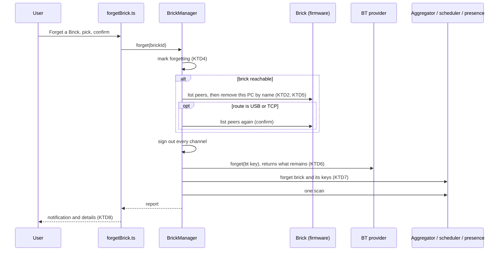

# Step 3: forget a brick - Plan

## Goal Capsule

- **Objective:** a user can make this computer forget a brick it has paired with or remembers. Afterwards the cockpit and Windows no longer treat the brick as known, the brick no longer lists this computer when it was reachable, and the user is told exactly which records are left and where they are.
- **Means:** one brick-level `forget` in the brick layer, reused later by the panel (KD5, KTD1). It clears the cockpit's memory, unpairs through supported Windows APIs, and removes this computer from the brick's own list over a live channel (KTD2–KTD7).
- **Authority:** owner decisions in this plan's Key Decisions > `DESIGN.md` > this plan's KTDs > existing code. Where `IMPLEMENTATION_PLAN.md` 6.6.4 disagrees with KD3, U6 rewrites 6.6.4.
- **Stop conditions:**
  - Stop and ask the owner if the hardware session shows the name the brick stores for this computer differs from the Windows radio name on a computer that was never renamed (KTD3 then needs another source).
  - Stop and ask if forgetting over the Bluetooth link leaves the brick or the host in a state that needs anything more than a menu power-off of the brick to recover.
  - Never take ownership of, change the ACL of, or delete the `BTHPORT` registry key, never elevate, never restart `bthserv`, and never offer a step that needs a PC reboot (KD3, standing rule).
- **Execution profile:** units land as topic commits. Each feature-bearing unit is proven by a test that fails without its change, and its key assertions are mutation-checked. U7 needs the owner at the bricks: beep, check for hung node probe processes before and after, then wait for the owner.
- **Finishes and ships:** Claude implements, commits and pushes; the owner runs the hardware session (U7) with Claude.

---

## Product Contract

### Summary

A new palette command, "Forget a Brick", lists the bricks this computer has paired with or remembers and forgets the chosen one after a confirmation. Forgetting signs the brick out and clears everything the cockpit holds about it. It removes the Windows pairing, and when the brick is reachable at that moment it removes this computer from the brick's own pairing list. The result message says what was removed. It names the records that remain: the Windows registry key with its exact path, Windows' in-memory device record, and the brick-side change if it still needs the brick switched off from its menu to persist. The Linux backend is not built. Its forget hook is shaped so BlueZ can fill it in, and one section of `IMPLEMENTATION_PLAN.md` lists everything Linux still needs.

### Problem Frame

Today `BtTransportProvider.forget()` can unpair through `BluetoothRemoveDevice`, but nothing calls it: there is no command and no brick-level forget. A brick the user wants gone keeps its row in the cockpit's list. The aggregator's `paired` flag is sticky, so even an unpaired brick would stay listed as paired.

Unpairing on Windows alone does not make a brick unknown. The brick keeps this computer in its own pairing list (`IMPLEMENTATION_PLAN.md` 3.1.4k), and a one-sided record poisons the next pairing: the name lookup returns `"????"` and connecting does nothing (3.1.4l). Windows also keeps a record under `HKLM\SYSTEM\CurrentControlSet\Services\BTHPORT\Parameters\Devices\<mac>` that survives `BluetoothRemoveDevice` and Settings' Remove (1.11.14, DESIGN §7.3). That key is owned by `SYSTEM`, and it lets Windows answer a cache pass for the brick in milliseconds.

Because of that, discovery of a brick this computer has never met (2.8.18's one unverified path, under 2.8.12) cannot be tested on the bench: every bench brick is known to this computer.

### Requirements

**The command**

- R1. "Forget a Brick" lists every brick this computer is paired with over Bluetooth or the cockpit remembers. Bricks heard only by an inquiry and never paired are not offered.
- R2. Forgetting asks for confirmation first, naming the brick and saying it will be disconnected and unpaired.

**Forgetting**

- R3. Forgetting acts on the whole brick: every channel is signed out, and nothing reconnects, pages or probes it while the forget runs.
- R4. Afterwards the cockpit holds no record of the brick. If the brick is still physically reachable (a cable, an inquiry that hears it), it comes back as a new, unpaired brick, not as the forgotten one.
- R5. The Windows pairing is removed through a supported API. A pairing that is already gone counts as removed; a refusal is reported with Windows' reason.
- R6. The cockpit never takes ownership of, changes the ACL of, or deletes the `BTHPORT` registry key. It never elevates, never restarts `bthserv` and never asks for a reboot.

**The brick's own list**

- R7. When the brick is reachable at the moment of forgetting, this computer's entry is removed from the brick's pairing list. The entry is found by an exact match on this computer's Bluetooth name.
- R8. When the brick is not reachable, or no entry matches exactly, nothing is done on the brick, and the report says why. When the list was read, the report gives the names the brick holds.
- R9. A removal is reported as confirmed only when the list read back afterwards no longer holds the entry. A removal sent over the Bluetooth link it cuts is reported as sent, not confirmed.

**The report**

- R10. The result says, part by part, what happened: the cockpit's memory, the Windows pairing, and the brick's list.
- R11. The result names every record the cockpit could not remove, with its exact location, so the user can remove it themselves:
  - the registry key, with this brick's address filled in, and that Windows protects it;
  - Windows' in-memory device record, which ends with the next Windows restart;
  - when the brick's list changed, that the brick saves it only when switched off from its own menu, and that pulling the battery brings the entry back.
  The guidance gives the path and the reason. It does not include a procedure for taking ownership of a system key.

**Platforms and follow-on**

- R12. The forget path is shaped so a Linux provider can supply its own unpair and its own list of residue, with no change to the brick layer or the command.
- R13. `IMPLEMENTATION_PLAN.md` carries one section, "What Linux needs", listing every item that a working Linux cockpit still lacks.
- R14. Once forget ships, the never-met discovery check (2.8.18's open path) runs on hardware. It runs either with a brick this computer has never met, or after the owner removes the registry record by hand.

### Key Decisions

- KD1. **Forget acts on a whole brick across all its channels: sign out, drop the cockpit's memory, unpair at OS level through supported APIs only.** Governs R3, R4, R5. (session-settled: user-directed — chosen over a per-channel forget: „pokud je kostka známá a historicky byla spárovaná, tak by ji cockpit měl umět zapomenout. tzn. vymazat všechny záznamy o spárovaném bt zařízení")
- KD2. **Clear the brick side too when the brick is reachable; when it is not, do nothing on the brick.** Governs R7, R8, R9. (session-settled: user-directed — chosen over a Windows-only forget: „pokud kostka je - pak smazat i na kostce. pokud není, tak nedělat nic")
- KD3. **Tell the user plainly which records the cockpit cannot remove, with their exact location; never work around Windows' protection.** Governs R6, R11. (session-settled: user-directed — chosen over silently leaving the key, and over elevating or taking ownership: „uživateli říct na rovinu, které části nedokážeme smazat. a klidně mu poskytnout návod aby si je mohl smazat sám (čili řáct přesné znění klíče v registru…)"; the owner's security policy forbids bypassing OS protection, so the guidance names the path and stops there)
- KD4. **Linux is wanted and not blocking: build the seam now, BlueZ when a Linux host exists, and keep one list of what Linux needs.** Governs R12, R13. (session-settled: user-directed — chosen over writing unverifiable BlueZ code now: „zapiš, že to chceme a jakmile budeme mít linux k dispozici, tak to doprogramujeme … chci mít někde zapsaný výčet věcí")
- KD5. **A palette command with a confirmation; the panel's trash action (Phase 5/6) reuses the same brick-level call.** Governs R1, R2. (session-settled: user-approved — proposed in the scoping summary with the panel deferred; the owner confirmed: „souhlasím. potvrzuji rozsah")
- KD6. **Only bricks this computer knows are offered; a brick only an inquiry heard has nothing to forget.** Governs R1. (session-settled: user-approved — proposed in the scoping summary against offering every listed brick; the owner confirmed the scope)

### Success Criteria

- On CCC over USB: after forgetting, the brick's list read back no longer holds this computer, Windows no longer lists the brick as paired, and the cockpit lists CCC only as an unpaired USB brick. The brick then needs a menu power-off; after it boots again, the list still lacks this computer.
- On a brick reachable only over Bluetooth, forgetting completes, reports the brick-side removal as sent and not confirmed, and leaves no session reconnecting.
- The result message for each run names the registry key with that brick's address, and the owner can find the key at that exact path.

### Scope Boundaries

- The panel and its trash icon: Phase 5/6. This step delivers the brick-level call they will use.
- Persisted favourites and remembered bricks: Phase 6. `src/persistence/` is empty, so "the cockpit's memory" today is the in-memory list, the scheduler, Bluetooth presence and the brick layer.
- BlueZ unpair and BlueZ residue: wait for a Linux host (KD4, U6 lists them).
- Considered and not built: deleting the `BTHPORT` key in any way, elevated or not. KD3 and the owner's security policy forbid it, and no evidence would change that.
- Considered and not built: WinRT `DeviceInformationPairing.UnpairAsync` in place of `BluetoothRemoveDevice`. The latter is measured working (1.11.13) and is a supported API. Evidence that would change this: a case where `BluetoothRemoveDevice` leaves a pairing that WinRT removes.
- Considered and not built: switching the brick's Bluetooth on when it is off so the removal can run. The removal silently does nothing then; verification catches it and the report says so. Evidence that would change this: users who forget bricks with Bluetooth off often enough to matter.
- Considered and not built: removing brick-side entries other than this computer's current name, such as one stored under a former computer name (3.1.4l). See Open Questions.

#### Deferred to Follow-Up Work

- Wiring forget into the panel (6.6.1) and into persistence (6.6.2), Phase 5/6.

### Open Questions

- Deferred, for the owner: a brick on USB that this computer has already unpaired but that still lists it (3.1.4k) is not offered, because KD6 offers only known bricks. Should the command also offer a brick on USB to clear its list alone?
- Deferred, for the owner: when the brick holds an entry under a former name of this computer (3.1.4l), the report lists that name and leaves it. Should the cockpit offer to remove a named entry the user picks?

---

## Planning Contract

### Key Technical Decisions

- KTD1. **`BrickManager.forget(brickId)` owns the order; a `vscode`-free `src/ui/forgetBrick.ts` owns the command flow and the message text.** This follows the step-2 split (`connectBrick.ts`), so the flow is testable without VS Code, and the panel calls the same `forget`. The order:
  1. mark the brick as forgetting, which stops every path that opens or probes a link for it (KTD4);
  2. clear the brick side over a live channel when there is one (KTD2, KTD5);
  3. sign out;
  4. call `forget` on the provider of every channel whose provider supports it (KTD6);
  5. wait for any discovery scan already in flight on the brick's transports to settle, then clear the cockpit's memory (KTD7); a scan that read Windows' cache before the unpair would otherwise re-track the brick as paired after the memory was cleared;
  6. clear the forgetting mark and run one discovery scan, so a brick still in reach returns as a stranger (R4).
  The call resolves with a report value; it does not show anything itself.
- KTD2. **Two new brick commands: list the Bluetooth peers, and remove one by name.** Listing is `opCOM_GET` `FAVOUR_ITEMS` (10) for the count, then `FAVOUR_ITEM` (11) for each index from 0 to count − 1, each returning name, paired, connected and type (`c_com.c` 4585–4688). The firmware does not bounds-check the index, so the code never asks past the count. Removing is `opCOM_REMOVE` (0xD6) with hardware `BT` (2) and the peer's name (`c_com.c` 5554–5606, `c_bt.c` 3594–3656). The command builder refuses an empty or whitespace-only name: the firmware treats an empty name as a wildcard and removes the first named entry instead (`c_bt.c` 2205–2211). The mock provider answers both commands from a per-brick peer list.
- KTD3. **This computer's Bluetooth name comes from the radio, through `bthprops` (`BluetoothFindFirstRadio` + `BluetoothGetRadioInfo`).** The brick stores a peer under the name the peer's radio reports (`c_bt.c` 3148–3314), and the firmware matches it exactly and case-sensitively. No opcode reads a peer's address, so the name is the only key. The hook lives beside `unpair` in `BtClassicDiscovery`; BlueZ's adapter `Alias` is the Linux source (U6 lists it). U7 checks on hardware that the radio name equals the name `FAVOUR_ITEM` returns.
- KTD4. **While a brick is being forgotten, nothing may open, re-open or probe a link to it.** Every path that opens a link checks the forgetting mark, and a failure on the brick's route is not treated as a link failure:
  - `signIn` refuses (the forget's own opening of the removal channel, KTD5, does not go through `signIn`);
  - `reconcile` and `scheduleRejoin` add nothing;
  - `notifyBrickAvailable` is not forwarded and `probeName` does not run;
  - `send`'s failover does not drop the channel from routing, because the drop is expected.
  The Bluetooth presence check skips the brick, because it reads its targets from sessions and the provider's paired list, which change in the same forget. Step 2 found its races in exactly these paths (connect, `attemptReconnect`, `recover`, `notifyBrickAvailable`), so the unit tests drive each one during a forget.
- KTD5. **The brick-side removal goes over the best live channel, and only USB or TCP can confirm it.** `opCOM_REMOVE` closes the RFCOMM socket of the peer it removes before any reply (`c_bt.c` 3609–3612), and its handler never sets a dispatch status (`c_com.c` 5567–5606). So:
  - over USB or TCP, first close the brick's Bluetooth sessions explicitly, because the removal cuts that link and `SessionManager` would otherwise reconnect it to a brick that has just dropped this computer; then send the removal and read the list back; confirmed if the entry is gone, failed if it is still there;
  - over Bluetooth only, the removal is the last command on that link; a drop or timeout is "sent, not confirmed". A normal reply with the link still up means the firmware did not run the removal (Bluetooth off or HCI busy), so read the list back over that link and report confirmed or failed as over USB.
  A brick with no connected channel but an available one gets that one channel opened for the forget: the best available, USB before TCP before Bluetooth, opened directly through the session manager and not through `signIn`, which would join every available channel. A failed open means the brick is not reachable (R8); the channel is closed at step 3. The removal blocks the brick's VM until BlueZ answers, so it gets the normal command timeout, and a timeout is reported, not retried.
- KTD6. **The OS unpair stays `BluetoothRemoveDevice`, and `forget` reports what it leaves behind.** `BluetoothRemoveDevice`'s "not found" result counts as already unpaired (R5); check the exact code against the Win32 documentation when implementing. `TransportProvider.forget` returns the records it could not remove (location and a one-line reason). The Windows Bluetooth provider returns the `BTHPORT` key with the brick's address and Windows' in-memory record. A BlueZ provider will return its own paths, so the brick layer and the message never know which OS they run on (R12). This changes `forget`'s return type from `void`, which has no consumers outside the provider tests yet.
- KTD7. **Each layer that holds memory of a brick gets its own `forget`.**
  - `PresenceAggregator` deletes the brick's record. A paired flag set with `||=` can only be cleared by dropping the record.
  - `DiscoveryScheduler` stops tracking the brick's channel keys, so `rebuildFromScheduler` cannot recreate the record from a tracked item that still says paired.
  - `BtPresenceMonitor` drops the brick's paired state and unpaired sighting.
  - `BtTransportProvider` drops `lastPaired`, `closedAt` and the preferred backend for the address.
  - `BrickManager` drops `dropped`, `probing` and `probeFailuresReported` for the brick's channels.
  The integration test runs a real `scanOnce` after forget and checks the brick does not come back as paired.
- KTD8. **The message is built from the report by a pure function and shown as a notification with a "Show details" action.** The notification states the outcome in two or three lines. The details go to the output channel: every part's outcome, the exact registry path, the brick's peer names when read, and the menu power-off note. The registry path is written the way Windows stores it; U7 checks the casing of the address on this host.

### High-Level Technical Design

### Assumptions

- `FAVOUR_ITEM` returns the name this computer's radio reports, and `BluetoothGetRadioInfo` returns that same name. U7 confirms both on hardware; if they differ, the first stop condition applies.
- The brick's `nonvolbt` file is written only at an orderly VM exit (`c_bt.c` 483–486), so a menu power-off persists the removal and a battery pull undoes it. U7 confirms on CCC.

---

## Implementation Units

### U1. Brick commands for the Bluetooth peer list

- **Goal:** the cockpit can read a brick's Bluetooth pairing list and remove one entry by name.
- **Requirements:** R7, R8, R9
- **Dependencies:** none
- **Files:**
  - `src/contracts/transport.ts`
  - `src/protocol/ev3Packet.ts`
  - `src/protocol/ev3Commands.ts`
  - `src/protocol/ev3Responses.ts`
  - `src/mock/mockTransportProvider.ts`
  - `src/__tests__/ev3Protocol.test.ts`
  - `src/__tests__/mockTransport.test.ts`
- **Approach:**
  1. Add the subcodes `FAVOUR_ITEMS` and `FAVOUR_ITEM` to `COM_GET_SUB` and the opcode `COM_REMOVE` (0xD6), each cited to `bytecodes.h`.
  2. Add the two command kinds and their reply shapes to `BrickCommand` (KTD2).
  3. Build and parse them beside `brick:setBluetooth`. The remove builder throws on an empty or whitespace name and applies no other check: not `BRICK_NAME_PATTERN`, because a computer's Bluetooth name may hold spaces, dots or diacritics, and the firmware compares the bytes as stored.
  4. Give mock bricks a peer list and answer both commands, so the mock behaves like the brick for these commands, as step 2 required for `recover()`.
- **Patterns to follow:** `buildComSetFlagCommand` and the `GET_BRICKNAME` read in `src/protocol/ev3Commands.ts`.
- **Test scenarios:**
  - The count command encodes `opCOM_GET`, `FAVOUR_ITEMS`, hardware 2 and one global byte; a reply of 3 parses to 3.
  - The item command for index 1 encodes the index and the name length, and parses name, paired, connected and type.
  - The remove command encodes `opCOM_REMOVE`, hardware 2 and the name as an LCS string.
  - The remove builder throws on `''` and on `'   '`, and sends nothing.
  - A name with a space and a diacritic (`Petrův PC`) encodes to its UTF-8 bytes and is not rejected.
  - The mock lists its peers, removes one by exact name, and leaves the list unchanged for a name that differs only in case.
- **Verification:** the protocol tests fail without the new builders, and removing the empty-name guard makes its test fail.

### U2. This computer's radio name, a tolerant unpair, and residue from `forget`

- **Goal:** the Bluetooth provider can tell the brick layer this computer's Bluetooth name, unpair a brick that may already be unpaired, and say what it leaves behind.
- **Requirements:** R5, R6, R11, R12
- **Dependencies:** none
- **Files:**
  - `src/transports/windowsBluetooth.ts`
  - `src/transports/btClassicDiscovery.ts`
  - `src/transports/btTransportProvider.ts`
  - `src/contracts/transport.ts`
  - `src/runtime/createRuntime.ts`
  - `src/__tests__/btClassicDiscovery.test.ts`
  - `src/__tests__/btBackendSelection.test.ts`
- **Approach:**
  1. Bind `BluetoothFindFirstRadio`, `BluetoothGetRadioInfo` and the radio close call in the existing `bthprops` loader. Expose the radio's name through `BtClassicDiscovery` as an injectable hook (KTD3).
  2. Treat `BluetoothRemoveDevice`'s not-found result as success (KTD6).
  3. Change `TransportProvider.forget` to return the records left behind. The Bluetooth provider returns the registry key built from the address and Windows' in-memory record, each with a one-line reason.
  4. Make `BtTransportProvider.forget` drop `lastPaired`, `closedAt` and the preferred backend for the address (KTD7).
  5. Expose the radio-name hook to the brick layer through `createRuntime`. It is absent on a host without `bthprops`, and the brick side then reports "this computer's Bluetooth name is unknown".
- **Patterns to follow:** `removeBluetoothDevice` and the injectable `unpairDevice` in `BtClassicDiscovery`.
- **Test scenarios:**
  - An unpair that returns the not-found code reports success; any other code reports failure with that code.
  - `forget` returns the registry path with the brick's address filled in.
  - After `forget`, the next `discover()` does not list the address from `lastPaired`, and a connect to it is not held back by `closedAt`.
  - The radio-name hook returns the injected name, and an absent binding returns undefined, not a guessed host name.
- **Verification:** the tests fail without each change; the existing forget tests still pass with the new return type.

### U3. Forgetting in each memory layer

- **Goal:** the list, the scheduler and Bluetooth presence each forget a brick on request.
- **Requirements:** R4
- **Dependencies:** none
- **Files:**
  - `src/runtime/presenceAggregator.ts`
  - `src/runtime/discoveryScheduler.ts`
  - `src/transports/btPresence.ts`
  - `src/__tests__/presenceAggregator.test.ts`
  - `src/__tests__/discoveryScheduler.test.ts`
  - `src/__tests__/btPresence.test.ts`
- **Approach:** add a `forget` to each layer (KTD7). The aggregator deletes the record and fires a list change. The scheduler deletes the tracked keys without firing presence events, because the brick layer is already forgetting the brick, and gains a way to await the scans in flight (KTD1 step 5). Presence drops the address from both maps.
- **Test scenarios:**
  - The aggregator forgets a remembered, paired brick: `getBrick` returns undefined and the list change fires once.
  - The next scan that lists the same USB key brings the brick back unpaired and not remembered.
  - The scheduler, after forgetting a BT key, does not return it from `getTrackedBricks`, and a later scan that lists it fires a first-discovery event.
  - Presence, after forgetting an address, returns undefined from `presenceOf` and omits it from `unpairedBricks`.
  - Awaiting in-flight scans resolves only after a slow provider's `discover` finishes, and at once when none is running.
- **Verification:** each test fails when its layer's `forget` is a no-op.

### U4. `BrickManager.forget`

- **Goal:** one call forgets a brick across all layers in the order KTD1 sets, and returns a report.
- **Requirements:** R3, R4, R5, R7, R8, R9, R10, R12
- **Dependencies:** U1, U2, U3
- **Files:**
  - `src/runtime/brickManager.ts`
  - `src/runtime/createRuntime.ts`
  - `src/__tests__/brickManager.test.ts`
  - `src/__tests__/forgetBrick.test.ts`
- **Approach:**
  1. Add the forgetting mark and the guards KTD4 lists.
  2. Run the brick side as KTD5 describes, using the radio-name hook from U2. No name, no list, or no exact match skips the removal and records why.
  3. Sign out and call each provider's `forget`.
  4. Await the scans in flight (U3), then call U3's layer `forget`s and drop the brick layer's own sets (KTD7).
  5. Clear the mark and run one `scanOnce`.
  6. Return a report with one outcome per part plus the providers' residue lists (KTD6).
  An error in one part is recorded in the report and the remaining parts still run. A brick that is half-forgotten and says so is better than one whose Windows pairing survives because the brick side timed out.
- **Execution note:** write the integration test first, on the real aggregator, scheduler and brick layer with a fake Bluetooth provider and a mock brick, the way `connectBrick.test.ts` builds its world.
- **Patterns to follow:** `signOut` and `forgetSignIn` in `src/runtime/brickManager.ts`. The test world comes from `src/__tests__/connectBrick.test.ts`.
- **Test scenarios:**
  - Covers R7, R9. A brick signed in over USB with this computer in its peer list: the removal is sent, the list is read back without the entry, and the report says confirmed.
  - Covers R9. A brick reachable only over Bluetooth, where the removal's reply never comes: the report says sent, not confirmed. No reconnect is scheduled, and the channel's session ends disconnected.
  - Covers R8. A brick whose list holds only other names: no removal is sent, and the report lists the names it holds.
  - Covers R8. A brick with no available channel: nothing is sent to it, and the Windows unpair and memory clearing still run.
  - The radio name is unknown: no removal is sent, and the report says why.
  - Covers R3. During a forget, a presence event for the brick's channel does not reach `notifyBrickAvailable` and does not start a name probe, and a `signIn` call from outside the forget is refused.
  - Covers R7. A brick with no session but available over USB and Bluetooth: the forget opens only the USB channel, removes and confirms over it, and no Bluetooth connect reaches the provider.
  - Covers R3. A brick signed in over USB and Bluetooth: the Bluetooth session is closed before the removal, and when the mock's removal drops the Bluetooth link no reconnect attempt reaches the provider.
  - Covers R9. A brick reachable only over Bluetooth whose removal gets a normal reply and keeps the entry: the list is read back over that link and the report says failed.
  - Covers R4. A Bluetooth `discover` that started before the unpair resolves after `forget` was called, still listing the brick as remembered: the brick does not come back as paired.
  - Covers R3. A session state change to disconnected during the forget does not start a rejoin.
  - Covers R4. After forget, a real `scanOnce` whose BT provider no longer lists the brick leaves it out of the list. One whose USB provider still lists it shows it as unpaired and not remembered.
  - Covers R5. The provider refuses the unpair: the report carries Windows' reason, and the memory is still cleared.
  - The report carries the provider's residue entries unchanged.
- **Verification:** the integration test fails without `forget`. Mutations that remove each KTD4 guard, the read-back, or the `scheduler.forget` call each fail a named test.

### U5. The "Forget a Brick" command and its message

- **Goal:** a user forgets a brick from the palette and reads what happened.
- **Requirements:** R1, R2, R10, R11
- **Dependencies:** U4
- **Files:**
  - `src/ui/forgetBrick.ts`
  - `src/extension.ts`
  - `package.json`
  - `src/__tests__/forgetBrick.test.ts`
- **Approach:**
  1. Choose the candidates: bricks in the list whose entry has `paired` or `remembered` set (today both come from Windows' paired-device list; persisted memory joins in Phase 6), in D5 order, as rows like `brickPickRows`.
  2. Confirm with a modal warning that names the brick and has one "Forget" action (R2).
  3. Call `BrickManager.forget` under a progress notification.
  4. Build the message and the details text from the report in pure functions (KTD8).
  5. Register `ev3-cockpit.forgetBrick` in `package.json` under the "EV3 Cockpit" category with the title "Forget a Brick". The presentation text says "EVƎ Cockpit".
  Write the guidance text with `ce-noslop`, and check it carries no take-ownership steps (R11).
- **Patterns to follow:** `src/ui/connectBrick.ts` and the `connectBrick` registration in `src/extension.ts`.
- **Test scenarios:**
  - The candidates include a paired brick that is switched off and a remembered one, and leave out an unpaired brick only an inquiry heard.
  - An empty candidate list shows an information message and opens no picker.
  - Declining the confirmation calls nothing.
  - Covers R10, R11. A report with a confirmed removal, a removed pairing and the registry residue produces details naming the exact key path with the brick's address and the menu power-off note.
  - A report with the brick unreachable says nothing was changed on the brick.
  - A report with no exact match lists the names the brick holds.
  - The details contain no ACL, ownership or `takeown`/`icacls` instruction.
- **Verification:** the tests fail without the command flow. The command appears in the palette in the Extension Development Host.

### U6. Plan and design documents

- **Goal:** the documents say what forget does and does not do, and what Linux needs.
- **Requirements:** R13, R14
- **Dependencies:** U4
- **Files:**
  - `IMPLEMENTATION_PLAN.md`
  - `DESIGN.md`
- **Approach:**
  1. Check 6.6.6 (done in 1.11.13).
  2. Rewrite 6.6.4: the `BTHPORT` key is not deleted, by design; its path is reported to the user (KD3).
  3. Answer 1.11.14 with KD3, and mark 6.6.3 and 6.6.5 built by this step.
  4. Note on 3.1.4k and 3.1.4l that the brick side is cleared when reachable.
  5. Add the section "What Linux needs" with: 1.11.11 `BtBluezBackend` (RFCOMM over D-Bus); pairing (the `bt-pairing-helper.exe` WinRT helper is Windows-only; BlueZ needs an agent); Bluetooth presence and inquiry; the device cache and the COM-port scan (`bthprops` through `koffi`); the Winsock RFCOMM backend (`ws2_32`); forget through `org.bluez.Adapter1.RemoveDevice`, with its residue under `/var/lib/bluetooth/<adapter>/<mac>` and `cache/<mac>` verified on a host; this computer's radio name from the adapter `Alias`; 4.6.16 libusb on Linux (udev rules, permissions); the unverified Linux padding path (DESIGN line 240); the libusb read-overrun slack set for Windows only. Grep once more for Windows-only pieces when writing it.
  6. Update DESIGN §7.3 with what forget leaves and how it is reported.
  7. Keep 2.8.12's open path, and add that it can now run after a forget plus the owner's hand removal of the key (R14).
- **Test expectation:** none — documentation only.
- **Verification:** the section exists, every item names its blocker, and no plan line still says the cockpit deletes the registry key.

### U7. Hardware session

- **Goal:** the assumptions behind KTD3 and KTD5 hold on real bricks, and the never-met discovery path is checked when its precondition is met.
- **Requirements:** R7, R9, R11, R14
- **Dependencies:** U4, U5
- **Files:**
  - `docs/plans/2026-10-31-2133-step3-forget-a-brick.md` (appendix with the results)
- **Approach:**
  1. Before each step that needs the owner at a brick: beep, and check for hung node probe processes; check again after each Bluetooth step.
  2. On CCC over USB: read the peer list and compare this computer's entry with the radio name (KTD3). Forget, read back, and record the registry path the message gives against the key on this host, including its casing.
  3. Ask the owner to switch CCC off from its menu and back on. Read the list again; the entry must stay gone.
  4. On a brick reachable only over Bluetooth: forget, and record the report and that no session is reconnecting.
  5. Never-met discovery (R14), only when a brick this computer has never met is at hand, or after the owner has removed the registry key by hand. Run an inquiry, pair from the picker, and connect. A `found` under about 100 ms is a cache pass and does not count. Claude neither removes the key nor scripts its removal.
  6. Record the verdicts in this plan's appendix, against the success criteria.
  7. Find the brick's own menu path for removing a paired device and add it to the message only once seen on a brick.
- **Test expectation:** none — hardware verification; the results are recorded in the appendix.
- **Verification:** each success criterion has a verdict in the appendix; any stop condition that fired is reported to the owner.

---

## Verification Contract

| Gate | Command | Applies to |
|---|---|---|
| Types, lint, unit and host tests | `npm run test:ci` | every unit before its commit |
| One test file | `node --require ./scripts/test-setup.cjs --test <compiled test>` | while iterating |
| Mutation check | the scratchpad mutation scripts (`mutate_*.py` pattern) | U1–U5 key assertions |
| Extension Development Host | F5, run "Forget a Brick" on a mock brick | U5 |
| Hardware | U7 session with the owner | U7 |

---

## Definition of Done

- R1–R13 hold in the shipped extension, and each has a test that fails without it (U1–U5), except R13, which is documentation (U6).
- The U7 appendix has a verdict for each success criterion. R14 is either run or recorded as waiting for its precondition.
- No code path changes the `BTHPORT` key, asks for elevation, restarts `bthserv` or tells the user to reboot; a grep for `takeown`, `icacls`, `RegDeleteKey` and `runas` in `src/` finds nothing.
- `npm run test:ci` is green, and code from abandoned attempts is removed from the diff.
- `IMPLEMENTATION_PLAN.md` has "What Linux needs", and 6.6.4, 6.6.6 and 1.11.14 match what was built.

---

## Appendix

### Firmware facts the plan rests on

Source: `../ev3-resources/11_Firmware/ev3_firmware_109d_developer_edition`, read 31.10.2026.

- `opCOM_REMOVE` takes `HARDWARE` (DATA8) and the remote name (string), `lms2012/source/bytecodes.c` 360, `c_com/source/c_com.c` 5554–5575. For Bluetooth it calls `cBtDeleteFavourItem` (`c_com.c` 5585). The handler never calls `SetDispatchStatus`.
- `cBtDeleteFavourItem` (`c_bt.c` 3594–3656) does nothing unless the HCI layer is idle or failed and Bluetooth is on. It finds the entry by an exact `strcmp` on the name (`c_bt.c` 2215). An empty name matches the first named entry (`c_bt.c` 2205–2211). It closes the peer's RFCOMM channel if connected, removes the device from BlueZ over D-Bus with no timeout (`c_bt.c` 4063–4134), and drops the entry from the in-RAM list.
- `FAVOUR_ITEMS` returns the entry count. `FAVOUR_ITEM` takes the index, a length and returns the name plus paired (always 1), connected and type; the index is not bounds-checked (`c_com.c` 4585–4688, `c_bt.c` 3555–3567).
- No subcode returns a peer's address; `GET_ID` returns only the brick's own.
- The list is stored in `settings/nonvolbt` (`c_bt.h` 33), read at start and written only at an orderly VM exit (`c_bt.c` 422–426, 483–486).

### Hardware results

Filled in by U7.
