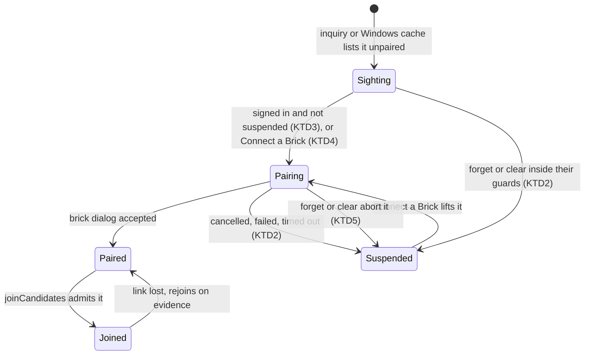
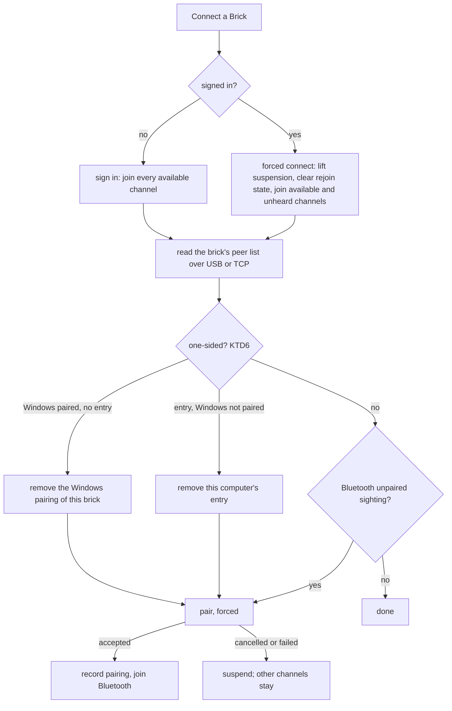

# Step 4: pairing becomes part of connecting - Plan

## Goal Capsule

- **Objective:** a user who connects a brick gets every channel that can work, Bluetooth included, without a separate pairing step and without breaking the channels already open. Consent is the brick's own pairing dialog. A pairing that is broken on one side is repaired when USB or TCP reaches the brick, and explained when nothing does.
- **Means:** one pairing owner in the brick layer that "Connect a Brick" and an automatic trigger for signed-in bricks share (KTD1), a per-brick suspension that stops a declined or failed pairing from repeating (KTD2), and a one-sided check that runs over USB or TCP after the brick's peer list is read (KTD6).
- **Authority:** owner decisions in this plan's Key Decisions > `DESIGN.md` > this plan's KTDs > the step-3 plan > existing code. KTD10 rewrites the part of step-3 KTD12 this plan supersedes.
- **Stop conditions:**
  - Stop and ask the owner if the hardware session shows that cancelling on the brick, or a one-sided pairing, leaves the brick or Windows in a state that only a PC reboot, a `bthserv` restart or a change to the `BTHPORT` key would clear.
  - Stop and ask if automatic pairing shows the brick's dialog again within one sign-in after the user cancelled it, in any interleaving the tests or the hardware session find.
  - Never take ownership of, change the ACL of, or delete the `BTHPORT` registry key, never elevate, never restart `bthserv`, and never offer a step that needs a PC reboot (standing rule).
- **Execution profile:** units land as topic commits on master, each proven by a test that fails without it, key assertions mutation-checked. U10 needs the owner at the bricks: beep, check for hung node probe processes before and after each Bluetooth step, mock bricks off, then wait for the owner.
- **Finishes and ships:** Claude implements, commits and pushes; the owner runs the hardware session (U10) with Claude.

---

## Product Contract

### Summary

"Connect a Brick" connects a brick over every channel that can work. A Bluetooth channel nobody has paired is paired on the way: the other channels connect first, then the brick shows its pairing dialog, and the Bluetooth channel joins once the user accepts. While a brick stays signed in, a channel that appears later joins without asking, and a Bluetooth sighting starts the pairing by itself. A cancelled or failed pairing, a cleared list and a forget stop the automatic pairing for that brick until the user connects it again. When USB or TCP reaches a brick whose pairing is broken on one side, the cockpit removes the half that is left and pairs again; over Bluetooth alone it says what to plug in. The cockpit also reads the brick's list of paired computers at these moments and keeps it for the panel.

### Problem Frame

Pairing is a side effect of "Connect a Brick" today, and only for a brick nothing else reaches (`src/ui/connectBrick.ts`, `onlyNewBluetooth`). A brick on USB cannot be paired without disconnecting it, and a signed-in brick ignores an unpaired Bluetooth channel for good (step-3 KTD12). The same Bluetooth state therefore behaves differently depending on whether USB is plugged in, which the owner rejected.

A pairing can also be one-sided: Windows paired while the brick forgot this computer, or the reverse. Windows' helper then reports "already paired" and shows no dialog, connecting fails with a Winsock error that says nothing about why, and the next pairing is poisoned (`IMPLEMENTATION_PLAN.md` 3.1.4k, 3.1.4l). The user has no way to tell this from a brick that is simply out of range.

The step-3 hardware session (U7, 01.11.2026) added two gaps: the long wait before the brick shows its dialog is not measurable, because pairing events are logged at debug level without phase times, and changes between "heard" and "not heard" are not logged at all.

### Requirements

**Connecting means every channel**

- R1. "Connect a Brick" on a brick that is not signed in connects every available channel and, when the brick's Bluetooth channel is a new unpaired sighting, pairs it whatever else reaches the brick: the other channels connect first, the pairing runs next, and the Bluetooth channel joins once it succeeds.
- R2. "Connect a Brick" on a signed-in brick retries every channel that is not connected: available channels, a paired Bluetooth channel the presence checks did not hear, and an unpaired Bluetooth sighting through pairing.
- R3. A signed-in brick joins a channel that becomes available later without asking, as since step 2, and pairs a new unpaired Bluetooth sighting by itself.

**Consent and its limits**

- R4. The brick's pairing dialog is the only consent: the cockpit never joins a Bluetooth channel nobody has paired, and while it pairs on its own it shows a notification telling the user to confirm on the brick.
- R5. A cancelled or failed pairing, "Clear a Brick's Bluetooth List" and "Forget a Brick" suspend automatic pairing of that brick until the user runs "Connect a Brick" on it again; the channels already connected stay connected.

**One-sided pairing**

- R6. When USB or TCP is connected and this computer's Bluetooth name is known, a one-sided pairing is repaired: the half that is left is removed (this computer's entry on this brick, or the Windows pairing of this brick) and the brick is paired again, and the user is told what was found and done.
- R7. When a Bluetooth connect to a paired brick fails and no USB or TCP channel to the brick is connected, the message says the brick may be out of reach and, if it keeps failing, that the pairing may be one-sided and connecting USB or TCP and running "Connect a Brick" again repairs it; it never states that the pairing is broken.

**Information and diagnostics**

- R8. The brick's list of paired computers (each name and its connected mark) is read when a channel to the brick joins, after a pairing, a forget or a clear, and on request; it is kept per brick for the panel and never polled.
- R9. A change between "heard" and "not heard" on a Bluetooth channel is logged, and each pairing logs its phases with times, so the wait seen in the step-3 hardware session can be located.

### Key Decisions

- KD1. **Connecting means every channel that can work, and an unpaired Bluetooth channel is paired on the way; there is no separate pairing command.** Governs R1, R2, R3. (session-settled: user-directed — chosen over a notification with a "Pair over Bluetooth too" button and over a separate pairing command: „taky se mi moc nelíbí ta dualita chování … připojit usb a vyvolat na kostce párovací dialog“, „abychom neměli na každou blbost samostatný příkaz“)
- KD2. **The brick's dialog is the consent; a decline, a clear or a forget suspends automatic pairing until the next "Connect a Brick", which shows the dialog again.** Governs R4, R5. (session-settled: user-approved — proposed against pairing on every sighting, which would loop after a decline and right after a clear: „máš pravdu. to by vedlo k opakovanému párovacímu dialogu … vynucené připojení by ten párovací dialog melo vynuceně zobrazit“)
- KD3. **Connecting a picked brick also tries its paired Bluetooth channel when the presence checks did not hear it.** Governs R2. (session-settled: user-approved — proposed after the step-3 hardware session found the checks miss bricks next to the computer: „souhlasím“)
- KD4. **A connection goes only to a paired brick.** Governs R4. (session-settled: user-approved — step-3 KTD12, accepted 02.11.2026: „připojení musí být vždy proti spárované kostce“)
- KD5. **With USB or TCP, a one-sided pairing is repaired automatically and a new pairing forced; without them, the message names USB or TCP as the fix.** Governs R6, R7. (session-settled: user-directed — chosen over an error with a "Repair" button: „s usb chci variantu B. automaticky opraví chybné spárování a vynutí nové“, „pokud to jde přes tcp, tak do hlášky uveď 'připoj USB nebo TCP'“)
- KD6. **The brick's list of paired computers is read on events and kept for the panel beside the firmware version; removing only some entries is decided later.** Governs R8. (session-settled: user-directed — „bylo by pěkné, kdyby kostka uměla poskytnout seznam svých spárovaných počítačů … někde u verze firmware“, then „ano zapsat“ to reading it on events rather than polling)
- KD7. **Unpairing only this computer's Bluetooth while USB stays connected is documented and deferred.** (session-settled: user-approved — proposed against adding it now, since Forget and Clear exist and automatic pairing would undo it unless it suspended: „souhlasím. popiš tu situaci do dokumentace a odložíme ji“)

### Success Criteria

- On a brick on USB with Bluetooth on, visible and unpaired, "Connect a Brick" connects USB at once, then the brick shows its pairing dialog; accepting it joins Bluetooth, cancelling it leaves USB connected and no dialog returns until the next "Connect a Brick".
- On a brick signed in over USB alone, switching its Bluetooth on and visible brings the pairing dialog without any action on the computer.
- A one-sided pairing made on purpose on a brick on USB is repaired by "Connect a Brick" and ends with a working Bluetooth channel; the same brick over Bluetooth alone gets the message that names USB or TCP.
- The hardware session records the Windows status of a cancel on the brick, the Winsock code of a connect on a one-sided pairing, and where the wait before the brick's dialog goes.

### Scope Boundaries

- Showing the paired list, the firmware version or any of this in the panel: Phase 5 (5.7.3, 3.5.6); this plan keeps the data and an event.
- Removing chosen entries of other computers or bricks from the brick's list, from the panel: decided later (KD6). The one-sided repair's removal of this computer's own entry (KTD6) is in scope.
- Making pairing faster: this plan only measures where it waits (R9, U10).
- A user-initiated unpairing of only this computer's Bluetooth with USB connected: deferred (KD7); U11 describes the situation in `IMPLEMENTATION_PLAN.md`. The one-sided repair's removal of the Windows pairing (KTD6) is in scope, because R6 requires it.
- Switching the brick's Bluetooth visibility on over USB so an invisible brick can be paired: not decided by the owner; an invisible brick gets no sighting and is not paired: a brick on USB with Bluetooth on but invisible and unpaired connects over USB alone (the owner's walk-through of 02.11.2026).
- Considered and not built:
  - A pre-check that skips pairing when the brick's list marks another device connected (its page scan is then off, `c_bt.c` 3013–3016): the pairing fails and suspends (R5), which is visible and cheap; build it if the hardware session shows such failures are common.
  - A computer-side "Cancel" for a pairing in progress: the brick's Cancel is the consent and ends it; forget and clear cancel it internally (KTD5).
  - Telling a cancel apart from other failures to suspend only on a cancel: every failure suspends (KTD2), so the distinction changes nothing a user sees.

---

## Planning Contract

### Key Technical Decisions

- KTD1. **`BrickManager` owns pairing, one run per brick.** It gains the pairing function and the presence monitor as dependencies, and a `pair(brickId, { forced })` that returns the run in flight when one exists. On success it records the pairing as `connectPickedBrick` does today (`aggregator.markPaired`, `presence.notePaired`, KTD11 of step 3). After the pairing resolves it checks again that the brick is still signed in or being connected, not forgetting, not clearing, not suspended by a forget or clear, and that the manager is not disposed; otherwise it records nothing. `connectPickedBrick` and the automatic trigger (KTD3) both call it, so one brick never shows two dialogs. Implements KD1, KD2 (R1–R5).
- KTD2. **Every failed pairing suspends automatic pairing, not only a cancel.** The cancel's Windows status is unmeasured, and NotFound, a brick whose page scan is off while linked to another device, and the 45 s queue timeout would otherwise retry on every list change, each time holding the radio for up to 120 s. The suspension is a set in `BrickManager` keyed by `BrickId`, because forget deletes the brick's list record. It is set by a failed pairing, and by forget and clear inside their guard window, before `releaseGuards`, so the scan that relists the brick unpaired from Windows' cache cannot start a pairing. Only "Connect a Brick" of that brick lifts it, signed in or not. `PairingResult` gains the helper's raw `status` for the log and for U10's measurement; suspension does not read it. Implements KD2 (R5).
- KTD3. **Automatic pairing hangs off the same triggers as `reconcile`, behind a guard that is cheap to evaluate on every list change.** It starts a pairing when the brick is signed in, not forgetting, clearing or being forgotten, not suspended, has no pairing in flight, no "Connect a Brick" running, is unpaired, and its Bluetooth channel is an available sighting, and, when USB or TCP is connected, once the one-sided check (KTD6) has run on a peer list read since that channel joined. Without the last two, a USB join inside sign-in fires `onListChanged` and starts the pairing before the check can remove a stale half. `onListChanged` fires on nearly every scan, so the guard and KTD1's single run are what keep it from repeating. Implements KD1 (R3).
- KTD4. **"Connect a Brick" connects the other channels first, then pairs, then joins Bluetooth.** Sign-in resolves on the first channel, so USB or TCP is usable while the person confirms on the brick. On a signed-in brick it is a forced connect: it lifts the suspension, clears the rejoin state of channels that are not connected (`awaitingEvidence`, retry timers, backoff), joins `joinCandidates` plus the paired channel the presence checks lost (`unheardBluetooth`, KD3), and pairs an unpaired sighting. It awaits the joins it starts and rejects with the first failure when no channel ends up connected, so the message of R7 can reach the user; `reconcile` swallows join failures and cannot serve here. Implements KD1, KD3 (R1, R2).
- KTD5. **Forget and clear cancel a pairing in flight before they go on.** `runHelper` already returns a cancel (`src/transports/btPairingHelper.ts`), which `createHelperPairing` drops; `BtClassicDiscovery.pair` gains an abort signal that reaches it. Forget and clear set the suspension, abort the pairing, and wait for it to settle within the helper's kill grace. A pairing that completed in Windows first is then removed by forget's own unpair (step-3 KTD6), so no one-sided record is left. Implements KD2 (R5).
- KTD6. **The one-sided check runs right after the brick's peer list is read over USB or TCP, and before any pairing.** It compares the list, by exact radio name (step-3 KTD3), with Windows' pairing as discovery tracks it: the scheduler's tracked Bluetooth item for the brick, which `notePaired` and `forget` fence against the cockpit's own pairings and unpairs (step-3 KTD11). It reads neither the list's sticky `paired` flag nor the provider's raw `lastPaired`, which learns of a pairing the cockpit made only at the next scan and would make every fresh pairing look one-sided. A brick with no tracked Bluetooth item counts as not paired in Windows. `BrickManager`'s discovery option widens to include `getTrackedBricks`.
  - Windows paired and no entry under this computer's name: remove the Windows pairing of this brick only, keeping the other channels (the step-3 `forgetBluetoothChannel` path), then pair.
  - Entry present and Windows not paired: remove the entry over USB or TCP (`removePeer`), then pair.
  - The pairing is forced, since the brick's dialog is the consent (KD5). The repair lifts a suspension only inside "Connect a Brick", which lifts it anyway (KTD4); outside it, a suspended brick gets neither a removal nor a pairing, and the one-sided state waits in the log for the next "Connect a Brick" (KD2).
  - The check does not run without a known radio name, over Bluetooth alone, before a Bluetooth scan has completed since start, while a pairing of the brick is in flight, or on the lists a forget or a clear reads.
  Implements KD5 (R6).
  - A brick is repaired automatically once until its next "Connect a Brick". If the next join over USB or TCP still finds it one-sided, the repair did not help, and repeating it would show the brick's dialog on every join. The cockpit then leaves the pairing alone and warns each time, naming "Forget a Brick" and then "Connect a Brick". The warning repeats on purpose: a one-sided pairing is a fault, and a user who keeps seeing it fixes it sooner. (Owner decision, 09.11.2026: „pokud je kostka jednostranně odpárovaná, pak je to chybový stav a čím víc budeme uživatele otravovat, tím dřív tento stav napraví“.)
  - Bluetooth waits for the check as pairing does (KTD3), joins too: while a USB or TCP channel is joining, connected and not yet checked, or a repair removes a half, the brick's Bluetooth channel is held, and joined once the check ends, whichever way it ends (both halves, no radio name, a read that fails, the USB or TCP channel gone, its join failed). A held channel the repair unpaired is not joined; the pairing makes it a candidate again. A sign-in or "Connect a Brick" whose USB and TCP joins all fail tries the held Bluetooth at once. The wait sits inside the Bluetooth join itself, so sign-in, "Connect a Brick" and a rejoin share one gate; a USB or TCP join that is a retry after a failure holds nothing. (A first design held Bluetooth at each call site and kept the held keys aside; two review rounds found three defects in it, one made by the fix before, and it was replaced rather than patched again, 10.11.2026.) (Found in U10, 09.11.2026: a Bluetooth connect started 20 ms after USB, failed after 23 s on the one-sided pairing, and the queue's 30 s recovery pause after it ran the repair's pairing past its 45 s wait.)
- KTD7. **Over Bluetooth alone, a failed connect to a paired brick adds a hedged hint, and the Winsock code travels with the error.** No code path today tells an authentication failure from a timeout (`src/transports/btWinsockAdapter.ts` maps only 10060/10064/10065), and the code a one-sided pairing produces is unmeasured. The error carries the numeric code so U10 can measure it and a later step can sharpen the rule. Implements KD5 (R7).
- KTD8. **The peer list lives in `BrickManager` per `BrickId`, with an event.** The entry holds the names, connected marks, the channel it was read over, and when. It is filled after a join (beside `readNameOverSession`), after a pairing, from the forget and clear reports, and by a request method, and it goes when the brick is forgotten. Reading over Bluetooth is allowed; reading never opens a channel by itself. Implements KD6 (R8).
- KTD9. **The "heard" flip is logged where the list sees it.** `PresenceAggregator.applyHeard` reports the flip and the aggregator fires an event that `createRuntime` logs at info, since that is the change the picker shows ("BT not heard"). Pairing phases (queued, slot acquired, helper started, each helper event, result) are logged at info with their times through an `onEvent` wired in `createRuntime`, because pairing is rare and human-paced. Implements R9.
- KTD10. **Step-3 KTD12 keeps its rule and loses one sentence.** "A connection goes only to a paired brick" stands (KD4); "pairing is always the user's own act, through Connect a Brick" is replaced by this plan: pairing also starts by itself for a signed-in brick, with the brick's dialog as consent. U11 rewrites the step-3 entry and the `joinCandidates` doc comment.
- KTD11. **Automatic pairing shows the same progress notification as "Connect a Brick".** The brick layer has no `vscode`, so it fires a pairing-started event with a way to report progress, and `extension.ts` shows "pairing <brick> — confirm on the brick's display" until the run settles. Implements R4.
- KTD12. **One background pairing may hold the radio while a person decides; that cost is accepted.** The pairing runs inside the Bluetooth connection queue for up to 120 s, longer than the 45 s a connect waits for a slot, so another brick's Bluetooth join can fail meanwhile. It rejoins on the next evidence (`rejoinOnEvidenceOnly`), and the queue already serialises pairings. Splitting the human wait out of the queue is deferred until U10 shows where the time goes.
- KTD13. **The Bluetooth queue never fails a wait for its own recovery pause.** A waiter's 45 s run out only while another operation holds the slot; when they end with the slot free and only the pause after a release left, the wait goes on until the grant. The message "(0/1 in use) … Bluetooth is busy" described an idle radio (U10, 09.11.2026).
- KTD14. **Every notification is written to the log too**, prefixed "Shown:", progress titles included (owner, 09.11.2026): the person at the bench watches the brick, not the screen, and the log has to say what they were told.

### High-Level Technical Design

The Bluetooth channel of one brick, as the brick layer drives it:

"Connect a Brick" on a brick that USB or TCP reaches:

### Risks & Dependencies

- `fRemembered`, which the provider reports as `paired`, is assumed to mean Windows holds a link key. `fAuthenticated` is read and dropped today (`src/transports/btClassicDiscovery.ts`). KTD6 depends on it through discovery's tracked item; U10 checks it, and if they disagree the one-sided check switches to the helper's bonded lookup before step 4 closes (Definition of Done).
- A brick that lists this computer under a former name looks, to KTD6, like one that lacks it; the repair then pairs again beside the stale entry. 3.1.4l shows stale entries poison pairing between bricks; whether they do between a brick and this computer is unmeasured. The repair's message names any other entries it saw and that "Clear a Brick's Bluetooth List" removes them all.
- The brick's dialog appears on its display over whatever it is running. A user running a program on the brick while signed in over USB with Bluetooth visible gets the dialog when the sighting arrives; cancelling it suspends automatic pairing until the next "Connect a Brick" (R5, KD2).

---

## Implementation Units

| U-ID | Title | Files touched | Depends on |
|---|---|---|---|
| U1 | Pairing result, cancel and phase log | `src/transports/btPairingHelper.ts`, `src/transports/btClassicDiscovery.ts`, `src/runtime/createRuntime.ts` | — |
| U2 | One pairing owner in the brick layer | `src/runtime/brickManager.ts`, `src/ui/connectBrick.ts`, `src/runtime/createRuntime.ts`, `src/extension.ts` | U1 |
| U3 | Suspension, and forget and clear cancelling a pairing | `src/runtime/brickManager.ts` | U2 |
| U4 | Automatic pairing of a signed-in brick | `src/runtime/brickManager.ts`, `src/extension.ts` | U3 |
| U5 | "Connect a Brick" means every channel | `src/ui/connectBrick.ts`, `src/runtime/brickManager.ts` | U3 |
| U6 | The brick's peer list, kept per brick | `src/runtime/brickManager.ts`, `src/contracts/models.ts` | U2 |
| U7 | One-sided pairing check and repair | `src/runtime/brickManager.ts`, `src/runtime/forgetReport.ts` | U5, U6 |
| U8 | Hint for a failed Bluetooth-only connect | `src/transports/btWinsockAdapter.ts`, `src/ui/connectBrick.ts` | U5 |
| U9 | Logging the heard flip | `src/runtime/presenceAggregator.ts`, `src/runtime/createRuntime.ts` | — |
| U10 | Hardware session | `docs/plans/2026-11-02-0113-step4-pairing-on-connect.md` | U1–U9 |
| U11 | Documents | `docs/plans/2026-10-31-2133-step3-forget-a-brick.md`, `IMPLEMENTATION_PLAN.md`, `DESIGN.md`, `REQUIREMENTS.md`, `src/runtime/brickManager.ts` | U4 |

### U1. Pairing result, cancel and phase log

- **Goal:** a pairing reports the helper's raw status, can be aborted from outside, and logs its phases with times.
- **Requirements:** R5, R9
- **Dependencies:** none
- **Files:**
  - `src/transports/btPairingHelper.ts`
  - `src/transports/btClassicDiscovery.ts`
  - `src/runtime/createRuntime.ts`
  - `src/__tests__/btPairingHelper.test.ts`
  - `src/__tests__/btClassicDiscovery.test.ts`
- **Approach:**
  1. Carry the helper's `status` string into `PairingResult` next to `ok` and `reason` (KTD2).
  2. Expose the `cancel` that `runHelper` already returns through `createHelperPairing` and give `BtClassicDiscovery.pair` an abort signal that reaches it; an abort while waiting for a queue slot leaves the queue (KTD5).
  3. Wire an `onEvent` in `createRuntime` that logs queued, slot acquired, helper started, each helper event and the result at info, each with the time since the pairing began (KTD9).
- **Patterns to follow:** the existing helper outcome tests in `src/__tests__/btPairingHelper.test.ts`; the queue tests in `src/__tests__/btClassicDiscovery.test.ts`.
- **Test scenarios:**
  - A helper `result` line with status `Paired` gives `ok: true, status: 'Paired'`; with `Failed` gives `ok: false, status: 'Failed'`.
  - An `AuthenticationTimeout` and a `NotFound` result keep their raw status besides the English reason.
  - Aborting a pairing kills the helper within the kill grace and resolves `ok: false` with an aborted reason.
  - Aborting while the pairing waits for a queue slot resolves at once and never starts the helper.
  - The phase log names each phase once, in order, with non-decreasing times.
- **Verification:** the tests fail when `status` is dropped, when the abort does not reach `cancel`, and when the queued abort still starts the helper.

### U2. One pairing owner in the brick layer

- **Goal:** `BrickManager` runs at most one pairing per brick and records its success; "Connect a Brick" pairs through it.
- **Requirements:** R1, R4
- **Dependencies:** U1
- **Files:**
  - `src/runtime/brickManager.ts`
  - `src/ui/connectBrick.ts`
  - `src/runtime/createRuntime.ts`
  - `src/extension.ts`
  - `src/__tests__/brickManager.test.ts`
  - `src/__tests__/connectBrick.test.ts`
- **Approach:**
  1. Add the pairing function and the presence monitor to `BrickManager`'s options, wired in `createRuntime`.
  2. Add the per-brick pairing run of KTD1, with the re-check after it settles.
  3. Fire a pairing-started event carrying a progress reporter (KTD11); `extension.ts` shows it the way `connectPickedBrick` shows its own progress today.
  4. Make `connectPickedBrick` pair through `BrickManager` instead of calling the pairing function and `markPaired` itself.
- **Execution note:** start with a failing test where two callers pair the same brick at once and the fake pairing counts its calls.
- **Patterns to follow:** `forget()`'s single run per brick (`this.forgets`) in `src/runtime/brickManager.ts`; the pairing world in `src/__tests__/connectBrick.test.ts`.
- **Test scenarios:**
  - Two pairings of one brick started together run the pairing function once and both resolve with its result.
  - A successful pairing lists the brick paired and its Bluetooth channel available, and drops the presence checks from before it.
  - A pairing that resolves after the brick was forgotten records nothing: the brick stays out of the list.
  - A pairing that resolves after `dispose` records nothing and throws nothing.
  - The pairing-started event fires once per run, and its progress reporter is called with the confirm-on-the-brick text when the helper reports the brick found.
  - "Connect a Brick" on an unpaired Bluetooth-only brick still pairs and connects (the existing tests, now through the brick layer).
- **Verification:** the existing connect tests pass unchanged in outcome, and the double-pairing and late-result tests fail without the single run and the re-check.

### U3. Suspension, and forget and clear cancelling a pairing

- **Goal:** a failed pairing, a forget and a clear stop automatic pairing of that brick until "Connect a Brick" runs on it, and neither forget nor clear lets a pairing in flight finish behind them.
- **Requirements:** R5
- **Dependencies:** U2
- **Files:**
  - `src/runtime/brickManager.ts`
  - `src/__tests__/brickManager.test.ts`
  - `src/__tests__/forgetBrick.test.ts`
- **Approach:**
  1. Add the suspension set of KTD2; a failed pairing adds the brick.
  2. In forget, right after holding the guards and before reading the brick's list, add the brick to it and abort a pairing in flight, waiting for it to settle (KTD5); in clear, do the same right after the guards are held, before the removals. A pairing that adds this computer's entry while forget reads the list would otherwise be left on the brick.
  3. Lifting it is U5's; nothing else removes a brick from the set, and forget leaves it set after the brick's record is gone.
- **Execution note:** write the forget test with the pairing gated mid-flight first; it shows the one-sided record this unit prevents.
- **Patterns to follow:** `holdGuards`/`releaseGuards` and the `clearing` set in `src/runtime/brickManager.ts`; the `world()` fixture in `src/__tests__/forgetBrick.test.ts`, with a `pair` added the way `connectBrick.test.ts` fakes it.
- **Test scenarios:**
  - A pairing that fails suspends the brick, and a later list change starts no pairing.
  - A forget while a pairing is in flight aborts it before reading the brick's list; when the gated pairing completes as it is aborted, the brick ends unpaired in Windows, without this computer's entry on its list, and with its record gone.
  - A clear that removes this computer's entry leaves the brick suspended, and Windows' cache relisting it unpaired (`cachedAfterUnpair`) starts no pairing.
  - The suspension is in place before forget releases its guards: a scan landing between the release and forget's own scan starts no pairing.
- **Verification:** the tests fail when the suspension is set after `releaseGuards`, when forget does not abort the pairing, and when a failure does not suspend.

### U4. Automatic pairing of a signed-in brick

- **Goal:** a signed-in brick pairs a new unpaired Bluetooth sighting by itself, once, and joins it on success.
- **Requirements:** R3, R4
- **Dependencies:** U3
- **Files:**
  - `src/runtime/brickManager.ts`
  - `src/extension.ts`
  - `src/__tests__/brickManager.test.ts`
  - `src/__tests__/forgetBrick.test.ts`
- **Approach:**
  1. Add the guard of KTD3 and call it from the paths that call `reconcile` (list change, presence change, session drop, rejoin timer).
  2. On success the existing `markPaired` list change reconciles and joins the Bluetooth channel; no extra join call.
  3. `joinCandidates` keeps excluding an unpaired Bluetooth channel (KD4).
- **Execution note:** start with the case this exists for: a brick signed in over USB whose Bluetooth sighting appears afterwards.
- **Patterns to follow:** `reconcile` and `takeAnswersAsEvidence` in `src/runtime/brickManager.ts`; `signedInOver` in `src/__tests__/forgetBrick.test.ts`.
- **Test scenarios:**
  - A brick signed in over USB pairs when an unpaired Bluetooth sighting appears, then joins Bluetooth; USB stays connected throughout.
  - Ten list changes while the pairing waits start one pairing.
  - A brick that is not signed in does not pair from a sighting.
  - A suspended brick does not pair from a sighting.
  - A brick being forgotten, or whose list a clear is reading before the user confirms, does not pair from a sighting.
  - A paired brick whose Bluetooth channel the presence checks lost does not start a pairing.
  - The pairing-started event fires for an automatic pairing.
  - "Connect a Brick" on a brick that is not signed in, with USB available, an unpaired sighting and this computer's entry on the brick while Windows is unpaired: the list is read and the stale entry removed before the pairing function is called.
- **Verification:** the tests fail when the guard drops the signed-in, suspended, clearing, single-run, running-connect or checked-list condition.

### U5. "Connect a Brick" means every channel

- **Goal:** "Connect a Brick" pairs a new Bluetooth sighting whatever else reaches the brick, after the other channels, and on a signed-in brick retries everything not connected.
- **Requirements:** R1, R2, R5
- **Dependencies:** U3
- **Files:**
  - `src/ui/connectBrick.ts`
  - `src/runtime/brickManager.ts`
  - `src/__tests__/connectBrick.test.ts`
  - `src/__tests__/brickManager.test.ts`
- **Approach:**
  1. Replace the `onlyNewBluetooth` gate: sign in first when another channel is available, then pair through U2 when the Bluetooth channel is an unpaired sighting (KTD4).
  2. Add the forced connect of KTD4 to `BrickManager`, awaiting its joins and rejecting with the first failure when no channel ends up connected, and call it from `connectPickedBrick` for a signed-in brick instead of only making it active.
  3. Both paths lift the brick's suspension.
- **Patterns to follow:** `signIn` and `unheardBluetooth` in `src/runtime/brickManager.ts`; the "lost other channel" test in `src/__tests__/connectBrick.test.ts`.
- **Test scenarios:**
  - A brick with USB available and an unpaired Bluetooth sighting: USB connects before the pairing starts, the pairing runs, Bluetooth joins.
  - The same brick when the pairing is cancelled: USB stays connected, the error names the pairing, and the brick is suspended.
  - A suspended, signed-in brick: "Connect a Brick" lifts the suspension and pairs again.
  - A signed-in brick whose USB rejoin waits for evidence and whose paired Bluetooth is not heard: "Connect a Brick" tries both at once.
  - A signed-in brick with every channel connected: "Connect a Brick" makes it active and starts nothing.
  - A signed-in brick whose only channel left is a paired Bluetooth one that fails to connect: "Connect a Brick" reports the failure.
  - A brick nothing but an unpaired Bluetooth sighting reaches: pairs, then connects (unchanged).
- **Verification:** the tests fail when USB waits for the pairing, when a signed-in brick only becomes active, and when the suspension survives "Connect a Brick".

### U6. The brick's peer list, kept per brick

- **Goal:** the brick layer keeps the brick's list of paired computers, refreshed on the events KD6 names, and tells listeners when it changes.
- **Requirements:** R8
- **Dependencies:** U2
- **Files:**
  - `src/runtime/brickManager.ts`
  - `src/contracts/models.ts`
  - `src/__tests__/brickManager.test.ts`
  - `src/__tests__/forgetBrick.test.ts`
- **Approach:**
  1. Add the per-brick entry and change event of KTD8, and a read method for on-request refreshes.
  2. Read it after a join, after a successful pairing, and take it from the forget and clear reports instead of reading again.
  3. Drop the entry when the brick is forgotten.
- **Patterns to follow:** `readPeers` and `readNameOverSession` in `src/runtime/brickManager.ts`.
- **Test scenarios:**
  - A brick signed in over USB has its list read once after the join, with names and connected marks as the mock brick holds them.
  - A pairing that succeeds refreshes the list.
  - A clear leaves the list the clear read back; a forget leaves no entry.
  - A read that fails keeps the previous entry and does not throw into the join.
  - The change event fires when the names change and not when a read returns the same list.
  - No timer reads the list: with the brick idle, the mock brick receives no peer-list command.
- **Verification:** the tests fail when the join does not read, when forget leaves the entry, and when an unchanged read fires the event.

### U7. One-sided pairing check and repair

- **Goal:** over USB or TCP, a pairing broken on one side is found and repaired before any new pairing, and the user is told what was done.
- **Requirements:** R6
- **Dependencies:** U5, U6
- **Files:**
  - `src/runtime/brickManager.ts`
  - `src/runtime/forgetReport.ts`
  - `src/extension.ts`
  - `src/__tests__/forgetBrick.test.ts`
  - `src/__tests__/brickManager.test.ts`
- **Approach:**
  1. After U6's read over a USB or TCP channel, compare as KTD6 sets out, against discovery's tracked Bluetooth item.
  2. Repair the side that is left, keeping the other channels, then pair through U2; the suspension is lifted only inside "Connect a Brick" (KTD6).
  3. Report the case and the action as a small report the extension shows as a notification; name any other entries the list holds and that "Clear a Brick's Bluetooth List" removes them.
- **Execution note:** start with "Windows paired, brick lacks this computer", the case where the helper's `alreadyPaired` hides the problem today.
- **Patterns to follow:** `forgetBluetoothChannel`, `removePeer` and `closeBluetoothSessions` in `src/runtime/brickManager.ts`; the report builders in `src/ui/forgetBrick.ts`.
- **Test scenarios:**
  - Windows paired, the brick's list without this computer's name: the Windows pairing of this brick is removed, USB stays, a pairing is forced and Bluetooth joins.
  - The brick's list holds this computer's name, Windows not paired: the entry is removed over USB and read back gone, then a pairing is forced.
  - Both halves present: nothing is removed and no pairing starts.
  - Radio name unknown: the check does not run and nothing is removed.
  - Only Bluetooth reaches the brick: the check does not run.
  - The list holds another entry besides the missing one: the report names it and the Clear command.
  - The repair's pairing is cancelled: the brick is suspended and the half removed stays removed.
  - A pairing the cockpit just made over USB: the read after it finds both halves, removes nothing and starts no second pairing.
  - A suspended brick whose USB rejoins in a one-sided state: nothing is removed and no pairing starts.
- **Verification:** the tests fail when the check runs over Bluetooth, when it reads the sticky `paired` flag or the provider's raw discovery instead of discovery's tracked item, when the repair skips the forced pairing, and when it lifts a suspension outside "Connect a Brick".

### U8. Hint for a failed Bluetooth-only connect

- **Goal:** a failed Bluetooth connect to a paired brick that nothing else reaches says what may be wrong and what to plug in, without claiming a broken pairing.
- **Requirements:** R7
- **Dependencies:** U5
- **Files:**
  - `src/transports/btWinsockAdapter.ts`
  - `src/errors/CockpitError.ts`
  - `src/ui/connectBrick.ts`
  - `src/__tests__/connectBrick.test.ts`
  - `src/__tests__/btWinsockAdapter.test.ts`
- **Approach:**
  1. Carry the numeric Winsock code on the error the adapter throws, besides the text (KTD7).
  2. In `connectPickedBrick`, when the failed join was Bluetooth, the brick is paired and no USB or TCP channel is connected, add the hedged hint of R7 to the message.
- **Patterns to follow:** the "did not answer" message in `src/ui/connectBrick.ts`.
- **Test scenarios:**
  - A paired Bluetooth-only brick whose connect fails: the message says it may be out of reach and names USB or TCP and "Connect a Brick" for a one-sided pairing, without "broken".
  - The same failure with USB connected: no hint.
  - A signed-in brick whose only channel left is a paired Bluetooth one: the forced connect's failure carries the hint.
  - An unpaired brick whose pairing failed: the pairing message, not this hint.
  - A Winsock failure carries its numeric code on the error.
- **Verification:** the tests fail when the hint appears with USB connected or is missing over Bluetooth alone.

### U9. Logging the heard flip

- **Goal:** the log shows when a Bluetooth channel turns "not heard" and when it is heard again.
- **Requirements:** R9
- **Dependencies:** none
- **Files:**
  - `src/runtime/presenceAggregator.ts`
  - `src/runtime/createRuntime.ts`
  - `src/__tests__/presenceAggregator.test.ts`
- **Approach:** have `applyHeard` report the state change it makes, fire an event from the aggregator, and log it at info in `createRuntime` beside the presence log (KTD9).
- **Patterns to follow:** the presence log in `src/runtime/createRuntime.ts`.
- **Test scenarios:**
  - A paired channel whose checks stop hearing it fires one "not heard" event.
  - A fresh answer that makes a lost channel available fires one "heard" event.
  - A rebuild that repeats an unchanged flag fires nothing.
- **Verification:** the tests fail when the event fires on an unchanged flag or not at all.

### U10. Hardware session

- **Goal:** the behaviour holds on real bricks, and the unknowns this plan rests on are measured.
- **Requirements:** R1–R9
- **Dependencies:** U1–U9
- **Files:**
  - `docs/plans/2026-11-02-0113-step4-pairing-on-connect.md` (appendix with the results)
- **Approach:**
  1. Run in the Extension Development Host with mock bricks off; beep before each step at a brick and check for hung node probe processes before and after each Bluetooth step.
  2. Run the success criteria on a brick on USB with Bluetooth visible and unpaired: accept, then cancel, then a forced connect; then sign in over USB with Bluetooth off and switch it on.
  3. Make a one-sided pairing on purpose in each direction with a probe script that uses the cockpit's own protocol and Windows' supported unpair, and run "Connect a Brick" with USB and then over Bluetooth alone.
  4. Record the Windows status of a cancel on the brick, the Winsock code of the one-sided connect, whether `fRemembered` agrees with the helper's bonded lookup, whether a brick linked over Bluetooth to another device as a slave refuses a pairing from this computer, and the phase times of three pairings.
- **Test expectation:** none — hardware verification; results go to the appendix.
- **Verification:** each success criterion has a verdict in the appendix, and each measurement has a value or a reason it could not be taken.

### U11. Documents

- **Goal:** the documents say what step 4 changed and what it deferred.
- **Requirements:** KD4, KD7
- **Dependencies:** U4
- **Files:**
  - `docs/plans/2026-10-31-2133-step3-forget-a-brick.md`
  - `IMPLEMENTATION_PLAN.md`
  - `DESIGN.md`
  - `REQUIREMENTS.md`
  - `src/runtime/brickManager.ts`
- **Approach:**
  1. Rewrite step-3 KTD12 as KTD10 says, and the `joinCandidates` doc comment with it.
  2. In `IMPLEMENTATION_PLAN.md`, replace the 02.11.2026 decision list under step 3 with a step-4 entry, and describe the deferred keep-USB unpair: the situation, why Forget and Clear do more, and that automatic pairing would undo it unless it suspended (KD7).
  3. Add the pairing rules to `DESIGN.md` beside the step-2 sign-in rules.
  4. Bring `REQUIREMENTS.md` in line with R1–R9: connecting over every channel, the brick's dialog as consent, the suspension, the one-sided repair and the peer list.
- **Test expectation:** none — documentation.
- **Verification:** a grep for "user's own act" finds nothing outside history, and the deferred item reads on its own.

---

## Verification Contract

| Gate | Command | Applies to |
|---|---|---|
| Types, lint, unit and host tests | `npm run test:ci` | every unit before its commit |
| One test file | `node --require ./scripts/test-setup.cjs --test <compiled test>` | while iterating |
| Mutation check | the scratchpad `mutate.py` pattern, one mutation per key assertion | U1–U9 |
| Extension Development Host | launched with a workspace whose settings turn `ev3-cockpit.mockBricks` off | U10 |
| Hardware | U10 session with the owner | U10 |

---

## Definition of Done

- R1–R9 hold in the shipped extension, each with a test that fails without it.
- The U10 appendix has a verdict for each success criterion and a value for each measurement, or the reason it is missing; if `fRemembered` and the helper's bonded lookup disagree, the one-sided check uses the bonded lookup.
- No code path changes the `BTHPORT` key, asks for elevation, restarts `bthserv` or tells the user to reboot.
- `npm run test:ci` is green and code from abandoned attempts is removed from the diff.
- Step-3 KTD12, the `joinCandidates` comment, `IMPLEMENTATION_PLAN.md`, `DESIGN.md` and `REQUIREMENTS.md` match what was built (U11).

---

## Appendix

### Facts the plan rests on

- Firmware (`../ev3-resources/11_Firmware/ev3_firmware_109d_developer_edition/c_com/source/c_bt.c`):
  - Visibility sets only inquiry scan; page scan stays on while idle (`BtIssueHciVisible`, 2131–2151; `I_AM_IN_IDLE`, 588–595).
  - Once one device is connected over Bluetooth, page scan goes off: "Now connected to one device -> Disable incoming connect requests" (3013–3016). The comment speaks of master mode; whether a brick linked as a slave also refuses a second device is measured in U10. An inquiry still hears such a brick.
  - Page scan returns on disconnect when no device is left (3269–3276).
- Helper (`native/bt-pairing-helper/Program.cs`): a brick Windows already has bonded returns `alreadyPaired` with no dialog (140–149), so a one-sided "Windows paired" record must be unpaired before a pairing can show the dialog.
- Queue: a pairing holds the Bluetooth slot for up to 120 s (`src/transports/btPairingHelper.ts`), a connect waits at most 45 s for it (`src/transports/btConnectionQueue.ts`), and a success arms the 15 s cooldown (`src/transports/transportConstants.ts`).
- Brick information: `info` already decodes firmware and OS versions (`src/protocol/ev3Responses.ts`), which `readNameOverSession` drops; Phase 5 shows system information in 5.7.3 and 3.5.6.

### Review (08.11.2026)

ce-code-review on `b7bc822..32a9395` (src/): correctness, project-standards, testing,
maintainability, reliability, and an independent cross-model pass (codex). Verdict "Ready with
fixes".

| # | Finding | Severity | Agreement | Outcome |
|---|---|---|---|---|
| 1 | A one-sided repair could pair the brick again under a clear that began during its removal, or after a clear the user declined | P1 | correctness, reliability, codex | fixed in `96f2c5f`: no pairing starts while a forget or a clear holds the brick; the repair pairs only a brick that is not suspended |
| 2 | A missed discovery scan would remove a working pairing | P1 | codex | rejected: the Bluetooth provider lists every paired brick on every scan, heard or not (`btTransportProvider.ts`), so a paired item turns unavailable only when Windows stops listing it |
| 3 | No test of "Connect a Brick" joining a USB channel waiting out a backoff (R2) | P2 | testing | test added in `96f2c5f` |
| 4 | `BrickPeer` and `BrickPeerList` indented with spaces | P3 | project-standards | left: the whole of `src/contracts/models.ts` is space-indented; a reformat belongs in its own change |
| 5 | `connectAgain` left a channel's old retry timer running, so a failed forced join retried twice as often (KTD4 says it clears the rejoin state) | P3 | correctness | fixed in `96f2c5f` |
| 6 | Not in the plan: one automatic repair per brick until the next "Connect a Brick", then only a "still one-sided" notice | P3 | report | owner decision 09.11.2026: the rule stays and the warning comes on every USB or TCP join of such a brick; written into KTD6 |

Every fix has a test that fails without it (mutation-checked, 4 of 4). A confirmation round on
`96f2c5f` (codex) found nothing: READY. Residual risks the review named, not acted on: a pairing
aborted while queued in the Bluetooth connection queue still takes its slot later and stamps the
cooldown; the helper may report a cancel for a pairing Windows completed as it closed;
`brickManager.ts` grew to about 1,600 lines, and extracting the peer list and the one-sided check
is worth doing after U10.

### Review of the U10 fixes (09.–10.11.2026)

Codex on the diffs of KTD6's addendum, KTD13 and KTD14, after each fix: tests RED first, every key
assertion mutation-checked.

| Round | Finding | Severity | Outcome |
|---|---|---|---|
| 1 | `reconcile` decided the hold before starting USB joins | major | confirmed in code, not reachable with today's transports; superseded by the rewrite |
| 1 | held Bluetooth lost while the repair's pairing waits | major | rejected: a successful pairing marks the channel available (`markPaired`), so it is a candidate again |
| 1 | progress messages and the modal confirmation were not logged | minor | fixed |
| 2 | a key both held and a candidate was joined twice | minor | confirmed, a regression from round 1; superseded by the rewrite |
| 2 | "Connect a Brick" failed at once while a USB join was in flight | major | confirmed; superseded by the rewrite |
| 2 | a held candidate that turns lost is never tried | major | rejected: a lost channel joins only through "Connect a Brick" (KD3), as before |
| — | hold at each call site | — | **replaced**: three defects in two rounds, one made by the fix before, is the owner's signal to change the approach; the wait moved into the Bluetooth join itself |
| 3 | a repair whose pairing fails or is cancelled woke no held join; "Connect a Brick" hung | major | confirmed: the wake had been removed because no test told it apart; restored with a test that fails without it |

Mutation check of the final state: 14 of 14 killed. `npm run test:ci` 758/758. Round 4 not run:
the owner decides between another round and the hardware rerun.

### Hardware results

Session 1, 09.11.2026, 20:59–22:18, with the owner at the bench (AAA `001653F00A0A`, BBB
`001653F00B0B`, CCC `001653F00C0C`), in the Extension Development Host with mock bricks off,
bundle from `a9a684e`. Beep before each step at a brick; no hung helper or probe process before
or after any Bluetooth step. Starting state from `scripts/pairing-state-probe.js` over USB: BBB
paired on both sides (its list `HOSTA`, `HOSTB`), AAA and CCC paired on neither.

| Criterion / measurement | Verdict | Evidence |
|---|---|---|
| Criterion 1 (AAA): USB at once, the brick's dialog, a cancel keeps USB and no dialog returns, a forced connect shows it again, accepting joins Bluetooth | **holds** | 21:29:41 Connect, cancelled → `AuthenticationNotAllowed`; no pairing from 21:30:06 to 21:33:21 while AAA's sighting stayed and the list changed; 21:35:20 Connect → dialog → accepted, Bluetooth joined 21:36:08 |
| Windows status of a cancel on the brick | **`AuthenticationNotAllowed`** | twice (21:21:47, 21:30:06) |
| Criterion 2 (CCC): signed in over USB with Bluetooth off, switching it on brings the dialog without any action on the computer | **holds on the second run**; first run no dialog | 21:49:33 automatic pairing started on the sighting, `AuthenticationTimeout` at +31 s, the owner watched the display for 60 s and saw no dialog; rerun 21:58:35, dialog about 10 s after the start, paired. Cause of the first run not found (1 of 2) |
| R7 (BBB, one-sided "Windows paired", Bluetooth alone) | **holds** | "BBB did not answer. Check that it is switched on and in range, then try again. If it keeps failing while it is in range, its pairing may be one-sided: connect it over USB or TCP and run "Connect a Brick" again, which repairs it." |
| Winsock code of a connect on a one-sided pairing | **10060** (timeout) | 22:10:57; the same code as an out-of-range brick and as CCC's first join after a fresh pairing, so no code tells them apart and the hint stays hedged (KTD7 holds) |
| Criterion 3 (BBB, repair over USB) | **failed, fixed, to be rerun** | 22:14:03 the sign-in started a Bluetooth connect beside USB; the repair removed Windows' pairing (Windows then offered its own "Add device" for BBB) and queued its pairing; the connect failed after 23 s, the queue's 30 s recovery pause followed, and the pairing failed at 45 s "(0/1 in use) … busy" without running. Fixed by KTD6's addendum (Bluetooth joins after the check) and KTD13 |
| `fRemembered` against the helper's bonded lookup | **agree** so far | the probe read both for BBB (paired: both true) and AAA, CCC (unpaired: both false); a one-sided state is still to be read |
| Phase times | three pairings | from the start: slot 8.8 s / 9.9 s / 5.1 s, found +0.2–0.7 s, the brick's dialog about 4–8 s after found; `pairingRequested` comes after the person accepts on the brick, not when the dialog shows; paired 0.2–4.3 s after it |

Found, not acted on yet:

- Every pairing started by "Connect a Brick" waited 7–10 s for the queue's slot; one started by a
  sighting 3.9–5.1 s. Something holds the queue right after a Connect.
- The first Bluetooth join after a fresh pairing failed with 10060 twice of three (CCC, BBB) and
  joined by itself 40–50 s later.
- Unpaired Bluetooth rows (AAA, CCC) turn unavailable and removed and come back every 3–4 minutes
  while the bricks stay visible; after a forget AAA and CCC were both gone for 2–4 minutes.
- Forget reported this computer's entry on AAA "sent, not confirmed" and "may still be there"
  because the reply took over 1000 ms; the probe read the list empty.
- `AuthenticationTimeout` is reported as "The brick asked for confirmation and nobody accepted in
  time", which was false on CCC's first run.
- In the first cancel run AAA showed the dialog twice; not reproduced.

Remaining: criterion 3 rerun, the one-sided pairing in the other direction (AAA), and the brick
linked to another device (brick to brick, phone).
