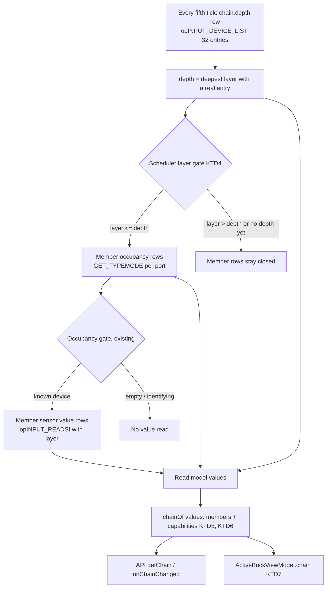

# Step 8 — the daisy chain (IMPLEMENTATION_PLAN 3.1.4f, 3.1.4g, 3.1.4j, 3.2.3) - Plan

## Goal Capsule

- **Objective:** with up to four bricks chained over USB, a user and every consumer extension see the chain of the brick the cockpit reads: which further bricks hang below it and the sensors and motors on each, each port named by its brick in the chain and its port. A brick whose firmware one day carries more across the chain shows that through the same API.
- **Means:** everything goes through the master's existing session with the firmware's `LAYER` argument (KTD1). Members are found from one device-list row (KTD2). Each member's ports are rows of their own, gated on the member being there (KTD3, KTD4). The chain reaches the API as its own concept, derived from what the telemetry reads (KTD6).
- **Authority:** owner decisions (Key Decisions below) > IMPLEMENTATION_PLAN 3.1.4f–3.1.4j and the measurements of U0 > this plan's KTDs > existing code.
- **Not in this step:** the panel (Phase 5); driving motors through the API, which the API does not offer even for the master today; bricks linked brick-to-brick over Bluetooth (3.1.4j: not a chain, no ports cross); joining a member that is also reachable on its own radio with its chain entry.
- **Stop conditions:** stop and ask the owner when U0 finds a motor entry on any remote port with no motor plugged in (Open Questions, Q1), or that the chain cannot be read when the master is on Bluetooth, or on Wi-Fi through a hub (Assumptions).
- **Execution profile:** one PR's worth of work on `master`, committed unit by unit and pushed when each unit's review is READY (the owner allows pushing at any time). U0 and U7 need the owner at three chained bricks, one instruction at a time; the session reads the logs itself.
- **Finishes and ships:** this Windows session builds, reviews (codex, verdict rounds until READY) and pushes. The owner runs the hardware steps.

---

## What is measured already

From IMPLEMENTATION_PLAN 3.1.4f, 3.1.4i and 3.1.4j (three bricks chained over USB, 23.08.2026), and from the firmware source of 1.09D (`ev3-resources/11_Firmware/ev3_firmware_109d_developer_edition`), read 17.11.2026.

| Fact | Source |
|---|---|
| A chained brick is addressed by the `LAYER` argument of an ordinary direct command (0 = master, 1–3 = members down the chain). The master's firmware routes it. | 3.1.4f, hardware |
| Sensor type, sensor value and motor occupancy cross the chain on both remote layers. | 3.1.4f, hardware |
| Motor type on layer 1 was correct. On layer 2 it was wrong in the one test so far. Two remote layers once reported byte-identical motor data. | 3.1.4f, 3.1.4i, hardware |
| Motor tacho never crosses: a frozen number (111616, later 43192). `opOUTPUT_READ` returns zeros for remote layers. | 3.1.4f, hardware |
| Writing to a remote motor works (`opOUTPUT_TIME_SPEED`, the port argument a bitfield). | 3.1.4i, hardware |
| USB discovery sees only the master. A Bluetooth brick-to-brick link carries no ports. | 3.1.4g, 3.1.4j, hardware |
| The master keeps the type of every port of the whole chain in one array, `DeviceType[32]`, and refreshes all 32 entries periodically, remote ones from the daisy buffers. | `c_input.c` `cInputDcmUpdate` 3071–3190 |
| Index layout of that array: 0–15 are sensor ports (layer × 4 + port), 16–31 motor ports (16 + layer × 4 + port). | `c_input.c` 410–447 |
| A remote port whose layer has no brick, and an empty port of a brick that is there, both read `TYPE_NONE` (126). | `c_input.c` 3147–3168 |
| `opINPUT_DEVICE_LIST` (0x98; `LENGTH`, `ARRAY`, `CHANGED`) copies that array in one instruction and leaves the dispatch status unchanged. Reading `CHANGED` resets it for the program slot that asked. | `c_input.c` 3736–3776 |
| The chain is at most four bricks deep (`DAISY_MAX_LAYER_DEPT` 4). | `c_daisy.h` 135 |
| No host operation that reads a brick's name, files or programs takes a layer: `opCOM_GET` has none, and system commands have none. | `bytecodes.c`, `c_com.c` |
| Emergency stop already sends `opINPUT_DEVICE STOP_ALL` with layer −1, which the firmware defines as every brick in the chain. | `src/protocol/ev3Commands.ts` `program:emergencyStop`; `ev3Packet.ts` `STOP_ALL` |

U0 measured the rest on 17.11.2026 (AAA master, BBB layer 1, CCC layer 2, firmware 1.10E); the full record is in IMPLEMENTATION_PLAN 3.1.4f.

| Fact | Source |
|---|---|
| The device list puts sensors at layer × 4 + port and motors at 16 + layer × 4 + port, and agrees with `GET_TYPEMODE` on every port. | U0, hardware |
| Motor types are right on layers 1 and 2 in three rewirings, and no motor entry appeared on a port with nothing plugged in (Q1: no). | U0, hardware |
| An empty member and no member read the same, `TYPE_NONE` everywhere (R2 holds). | U0, hardware |
| Devices plugged into a member while the chain runs show on the next read; a member's sensor switches mode with one `NaN` read, as on the master. | U0, hardware |
| The chain reads the same over USB, Bluetooth and Wi-Fi. Wi-Fi needs a hub on the master's host port, and the master finds a member behind the hub only after it restarts. | U0, hardware |
| Emergency stop stops a member's motor. | U0, hardware |
| Plugging a lower member back in while the chain runs kills the whole chain until the master restarts; unplugging alone does not. | U0, hardware |

## Where the code is (17.11.2026, checked against the repo)

- `src/telemetry/ev3Rows.ts` — the row catalogue. Every port row hard-codes `LAYER_SELF = 0`. Port names `'1'–'4'` and `'A'–'D'`. `allEv3Rows()` is the truncation priority order.
- `src/telemetry/rowRegistry.ts` — validates rows against the 64-byte HID bound (59 bytes of globals, 57 of bytecode). `RowDescriptor` is what the API lists. Sensor value rows register modes by port.
- `src/telemetry/telemetryScheduler.ts` — the occupancy gate: a value row comes up only while its port's last occupancy code is a known device; an unreported port reads as known. Mode settling is per port id.
- `src/telemetry/telemetryClaims.ts` — the foreground claims every registered row; sampled rows at the transport's foreground cadence, event rows every fifth tick. Modes are claimed per port id.
- `src/telemetry/activeBrickView.ts` — builds `ActiveBrickViewModel`. `PortState.layer` is a constant 0 (owner decision D3: "0 until chains are supported").
- `src/contracts/models.ts` — `PortState` already has `layer` and `typeCode`.
- `src/api/cockpitApi.ts` — `ApiBrick`, `listTelemetryRows`, `subscribeTelemetry`. `followProgramRow` (`src/programs/programService.ts`) is the pattern for an API notification that holds its own telemetry claim.
- `src/mock/mockFrameInterpreter.ts` — interprets telemetry frames; any layer other than 0 answers `TYPE_NONE`. `src/mock/mockConfig.ts` validates `parentId` only against itself and unknown ids, so a two-brick cycle passes. `src/mock/defaultConfig.ts` makes T800 and T1000 both children of SkyNet: a tree, not a chain. No test or script depends on T800 or T1000.

---

## Product Contract

### Summary

The cockpit reads the chain below the brick it already reads. The master reports the type of every port on every member. The cockpit uses that list to find the members, then reads each member's ports through the master. The API offers the chain as its own concept: a list of members, what each member can do, and a notification when the chain changes. A member's motors show their type and never a position, because the firmware does not carry the position across the chain.

### Problem Frame

Three chained bricks were measured in August, and the cockpit still sees only the master (3.1.4g). A user who builds a robot from two or three bricks gets half of it in the cockpit. Consumer extensions have no way to ask what hangs below a brick. Today's firmware carries only sensor data, motor types and motor commands across the chain. The owner may extend the firmware, so what a member can do has to come from the brick, not from a firmware version table.

### Key Decisions

- **Full chain support before Phase 5, and the chain is a separate concept with members** (session-settled: user-directed — chosen over "a layer is part of the brick key" and "a layer is a property of the session": the owner may extend the firmware, and a full chain will then be worth having; for now it looks like the master plus further ports by layer). Governs R1, R7, R8.
- **Out of scope: a motor API, Bluetooth brick-to-brick links, the panel** (session-settled: user-approved — scope summary confirmed 17.11.2026). Governs R1, R5.

### Requirements

**Finding the chain**

- R1. When bricks are chained over USB, the cockpit reports the members below the brick it reads, by layer 1–3, from what that brick answers.
- R2. A member is reported while any of its ports reports a device. An empty member below the deepest member with a device is not reported: the firmware answers the same for it as for no brick. An empty member above a member with a device is reported, because a chain has no gaps.
- R3. A brick with no chain keeps its telemetry: the same rows, ids and cadence for layer 0, plus one event-tier row.

**Ports of members**

- R4. Each member's sensor ports report type, raw type code, mode and value. Its motor ports report type and raw type code. Every port is identified by layer and port.
- R5. A member's motor port never reports a position or tacho value.
- R6. A consumer claims a member's sensor mode the same way as a master's: the first claim on a port holds it.

**The API**

- R7. The API offers a brick's chain as its own concept: its members, and a notification when the members change. Existing calls and row ids keep their meaning.
- R8. Each member reports what it can do: sensors, motor types, motor readout, files, programs, name. A capability the brick does not offer is false. A firmware that later offers one turns it on without a change of API shape.

**Simulation and verification**

- R9. The mock simulates a chain from `parentId`: linear, at most three members deep, members not discoverable as bricks of their own, remote tacho frozen as the firmware does.
- R10. The chain is verified on three bricks chained over USB, with the master read over USB and Bluetooth (narrowed from USB, Wi-Fi and Bluetooth by the owner 17.11.2026, see Q3).

### Scope Boundaries

- A member also connected to this computer on its own (Bluetooth, Wi-Fi) appears twice: as a member of the chain and as a brick of its own. Joining them needs a name or serial, and neither crosses the chain. Not built. What would change it: a firmware that answers a member's name (R8 then reports `name`).
- No guard against reading a chain over Bluetooth's 10.7 commands per second budget beyond the gating in KTD4. The member rows come up only while members exist, and the throttle built in Step 6 (IMPLEMENTATION_PLAN 3.3) already slows the loop under load. Not built; a measured stall in U7 would change it.
- The chain is not shown on the HID fallback (KTD9). Not built: HID is the fallback when libusb is missing, and the chain would cost layer 0 its cadence there. A user who needs the chain over USB without libusb would change it.
- No caching of the chain across sessions. The chain is read again at each connection; a cached chain would describe wiring that may have changed.

#### Deferred to Follow-Up Work

- A motor API (drive a member's motor), with the member's capability `motorControl` beside it.
- The panel's drawing of the chain (Phase 5), from `ActiveBrickViewModel.chain`.

---

## Planning Contract

### Key Technical Decisions

- KTD1. **No new brick, key or session for a member.** Every member is reached through the master's session with the layer argument (3.1.4f: the master routes). A member has no `BrickKey`, no `CommandQueue` and no heartbeat of its own. The firmware offers no other way in (3.1.4g), and the brick layer stays untouched.
- KTD2. **Members are found from `opINPUT_DEVICE_LIST` in one row, `chain.depth`.** It is event tier, registered for every brick.
  - **Why it can be trusted:** it copies the same `DeviceType[]` that `opINPUT_DEVICE GET_TYPEMODE` reads, and `GET_TYPEMODE` was verified on remote sensors (3.1.4f).
  - **What it reports:** the depth, meaning the deepest layer with a real entry; layers above it are members because a chain has no gaps (R2).
  - **Which entries count:** sensor and motor entries alike, unless U0 finds a motor entry on a remote port with no motor plugged in (Q1).
  - **What it ignores:** the `CHANGED` byte. Reading it resets it for the asking slot, so a second reader would steal it. Changes are found by comparing the depth.
  - **Encoding detail:** `LENGTH` 32 needs a one-byte constant (LC1), since a short constant only reaches 31.
  - **Cost:** 33 bytes of globals every fifth tick.
- KTD3. **A member's ports are rows of their own, read per port.**
  - **Row ids:** `chain.<layer>.sensor.<port>.occupancy`, `chain.<layer>.sensor.<port>.value` and `chain.<layer>.motor.<port>.occupancy`.
  - **Port ids:** `'<layer>:<port>'`, for example `'2:B'`. Layer-0 ids and port ids stay as they are, so the API change is additive and `API_VERSION` stays 1. `RowDescriptor` gains `layer`.
  - **No tacho row for a member** (R5).
  - **Chosen over** parsing the device list into per-port occupancy. Per-port `GET_TYPEMODE` rows reuse the existing occupancy gate unchanged and bring the mode. Their cost applies only while a member exists (KTD4). The parsing alternative would make one row report occupancy for 24 ports, a new concept in the scheduler.
- KTD4. **A layer gate in the scheduler.**
  - A row with `layer > 0` comes up only while the last `chain.depth` is at least its layer.
  - Before `chain.depth` first reports, every member row is closed. A brick with no chain then never pays for member rows (R3).
  - A member value row comes up only after its own port's occupancy has reported a known device. An unreported member port is closed, unlike layer 0, where an unreported port reads as known so a cold start does not wait (`TelemetryScheduler.isReadable`). Otherwise up to twelve member value rows would go out on the ticks before the event-tier occupancy rows report.
  - When the depth drops below a layer, that layer's occupancy, commanded modes and settling are forgotten, as when a port stops being known. Its value rows then wait for occupancy again.
- KTD5. **Capabilities live in one module, `src/telemetry/chainCapabilities.ts`. Today they are fixed from measured facts, because stock firmware offers nothing to probe.** What is read from the brick today is which members exist and the types on their ports. Everything else is set from measurements:
  - `sensors` is true for every member found, because sensor types and values cross.
  - `motorTypes` is true for a layer only when U0 reads the right motor type there in every one of at least three rewirings, with motors of different types. U0 did so for layers 1 and 2. Layer 3, which a three-brick rig cannot reach, is false.
  - `motorReadout`, `files`, `programs` and `name` are false. No host operation addresses them to a layer (What is measured already), so nothing can be asked.
  - A firmware that answers one of them gets its probe added in this module, and that capability is then read from the brick. The API shape stays (R8). How such a firmware makes itself known is Q2.
- KTD6. **The chain is derived, never stored.**
  - `chainOf(values)` is a pure function over one brick's read-model values: depth, members, capabilities.
  - The API's `getChain(brick)` reads it from the snapshot and says whether the chain was read at all (`read: false` when `chain.depth` has no value yet).
  - `onChainChanged(brick, listener)` holds its own claim on `chain.depth`, as `followProgramRow` does for the program state, and calls the listener when the member list, a capability or the staleness changes.
  - A claim on any member row also reads the rows that open it: `chain.depth`, and for a value its port's occupancy, at the event cadence. Without them a member row claimed alone on a brick that is not the active one would never come up (code review, 17.11.2026).
- KTD7. **The view model gains `chain`.** `ActiveBrickViewModel.chain` lists members, each with its capabilities, `sensorPorts` and `motorPorts`. `PortState.layer` is the real layer. A member's motor `PortState` never carries `value`, `unit` or `timestamp` (R5).
- KTD8. **The mock chain is linear and built from `parentId`.**
  - **Validation:** no cycles, at most one child per brick, at most three members below a root. A brick's layer is its depth.
  - **Discovery:** members are left out of discovery (R9).
  - **Frame interpreter:** answers `INPUT_DEVICE_LIST` and remote ports from the member bricks. A remote `OUTPUT_GET_COUNT` answers a frozen constant, not the live value, so a test that trusts a member's tacho fails here as on a brick.
  - **Default config:** T1000 moves under T800.
- KTD9. **The chain is not read on the HID fallback.** While the scheduler's frame limits are the 64-byte HID packet, `chain.depth` and every row with `layer > 0` are not readable; the check sits beside the layer gate in `isReadable`. Reason: `chain.depth` takes 33 of the 59 bytes a HID frame carries, and the scheduler orders rows by urgency, not by their place in `allEv3Rows()` (`candidatesFor`). A divider-5 row that keeps waiting reaches the front by its fifth tick and pushes layer 0's sampled rows out of that frame. HID is the fallback when libusb is missing; the chain is not shown there (Scope Boundaries).

### High-Level Technical Design

How a chain becomes visible, from one tick to the API:

### Assumptions

- The chain reads the same with the master on Wi-Fi or Bluetooth as on USB. Confirmed by U0. Wi-Fi needs a USB hub on the master's one host port, carrying both the dongle and the chain cable.
- Changing a member's sensor mode through `opINPUT_READSI` with its layer works as on the master. Confirmed by U0.

---

## Implementation Units

### U0. Measurements before code (owner at three chained bricks, HOSTA)

- **Goal:** settle what the KTDs leave to the brick before any product code depends on it.
- **Requirements:** R1, R2, R4, R10; Q1.
- **Dependencies:** none.
- **Files:** a probe in the scratchpad, not in `src/`. Results go to IMPLEMENTATION_PLAN 3.1.4f and to this plan's "What is measured already".
- **Approach:** AAA is the master on USB to HOSTA, BBB is layer 1, CCC is layer 2. Needed: one sensor (a colour sensor, for its modes), two motors of different types (large and medium), and a USB hub for step 5's Wi-Fi leg (Assumptions). One instruction at a time; each step says what to plug where.
  1. Sensors on layers 1 and 2: the device list carries them at index layer × 4 + port.
  2. Empty member against no member: remove the devices from CCC, then unplug CCC. Both read `TYPE_NONE` throughout (R2).
  3. Motors alone, with CCC attached and empty: a large motor alone on layer 1, then swapped to a medium motor alone on layer 2, then motors of different types on both. Three rewirings in all. In each, check every motor type and whether a motor entry appears on any port with no motor plugged in (Q1; KTD5's `motorTypes`; closes 3.1.4f's open layer-2 motor type).
  4. A member's sensor mode: read the colour sensor on layer 1 in two modes, one after the other, with a settle pause between. The value changes with the mode.
  5. The master over Wi-Fi (dongle and chain cable through the hub), then over Bluetooth: steps 1 and 4 again.
  6. Emergency stop: drive a member's motor with a long `opOUTPUT_TIME_SPEED`, send the `program:emergencyStop` bytes, and see whether it stops.
- **Execution note:** follow the hardware protocol: one instruction, wait for "hotovo", read the probe's output. Beep before a step where the owner watches the brick.
- **Test expectation:** none — measurement only, no product code.
- **Verification:** every step has a recorded answer; Q1 is answered; the motor-type row of 3.1.4f's table is filled in for layer 2.

### U1. Chain rows — `src/telemetry/ev3Rows.ts`, `src/telemetry/rowRegistry.ts`

- **Goal:** the rows of KTD2 and KTD3 exist, validate against the HID bound, and parse.
- **Requirements:** R1, R3, R4, R5, R6.
- **Dependencies:** U0 (which entries count, Q1).
- **Files:** `src/telemetry/ev3Rows.ts`, `src/telemetry/telemetryRow.ts` (a `layer` field), `src/telemetry/rowRegistry.ts` (`RowDescriptor.layer`), `src/__tests__/rowRegistry.test.ts`, `src/__tests__/portsTelemetry.test.ts`.
- **Approach:**
  1. `chainDepthRow()`: `INPUT_DEVICE_LIST` with LC1 32, 33 globals, parsing to the depth (KTD2).
  2. Member rows per KTD3, built from the same encoders as layer 0 with the layer as a parameter, so one encoder serves both.
  3. In `allEv3Rows()`, member rows go after layer 0's rows of the same kind and `chain.depth` last. The order breaks ties only; the scheduler orders by urgency (KTD9).
  4. The registry registers modes for member sensor value rows under their port ids, and `list()` carries each row's `layer`.
- **Patterns to follow:** `sensorOccupancyRow`, `sensorValueRow` and `radioRow` in `ev3Rows.ts`; the alignment comment at the head of the file (32-bit globals on a 4-byte boundary, 3.1.4h).
- **Test scenarios:**
  - `chain.depth` emits `0x98`, an LC1 32, then a global reference, and declares 33 globals.
  - A device list with a sensor at index 9 parses to depth 2.
  - A device list with only motor entries at index 20–23 parses to depth 1 (or 0, as Q1 decides).
  - A device list of all `TYPE_NONE` parses to depth 0.
  - An entry of `TYPE_UNKNOWN` (125) on layer 1 counts as a device: a sensor being identified is there.
  - A member sensor occupancy row for layer 2, port 3 emits layer 2 and port 2 in its bytecode; its value row does the same for `opINPUT_READSI`.
  - No row with id `chain.*.motor.*.tacho` is registered.
  - Every new row passes registration against the 64-byte HID bound.
  - Layer-0 rows emit exactly the bytes they emitted before (snapshot of the existing encodings).
- **Verification:** the registry lists the new rows with `layer`; layer-0 bytes unchanged.

### U2. A mock chain — `src/mock/`

- **Goal:** the mock behaves as a chain does on a brick, so U3–U6 are tested against it.
- **Requirements:** R9.
- **Dependencies:** U1 (the opcodes the rows emit).
- **Files:** `src/mock/mockConfig.ts`, `src/mock/mockTransportProvider.ts`, `src/mock/mockFrameInterpreter.ts`, `src/mock/defaultConfig.ts`, `src/__tests__/mockTransport.test.ts`, `src/__tests__/mockConfigFile.test.ts`, `src/__tests__/mockTelemetry.test.ts`.
- **Approach:**
  1. Validation per KTD8, with an error naming the brick and the rule it breaks.
  2. The provider leaves members out of discovery and gives the frame interpreter the root's chain.
  3. The interpreter answers `INPUT_DEVICE_LIST` and remote `GET_TYPEMODE` / `INPUT_READ_SI` from the member at that depth; a remote `OUTPUT_GET_COUNT` answers a frozen constant.
  4. T1000's `parentId` becomes `t800`.
- **Patterns to follow:** `executeTelemetryFrame`'s refusal of anything it does not interpret.
- **Test scenarios:**
  - A config where A's parent is B and B's parent is A is refused as a cycle.
  - Two bricks with the same parent are refused: a chain has one brick per layer.
  - A chain four members below its root is refused.
  - The default config validates, and discovery lists four bricks: SkyNet without T800 and T1000.
  - A frame reading the device list of SkyNet answers T800's sensors at layer 1 and T1000's at layer 2.
  - A frame reading layer 1, port 1 of SkyNet answers T800's touch sensor; layer 3 answers `TYPE_NONE`.
  - A remote tacho read answers the same number on two reads while T800's motor moves.
  - A layer-0 read answers as before.
- **Verification:** the existing mock tests pass unchanged apart from the brick count.

### U3. The layer gate — `src/telemetry/telemetryScheduler.ts`, `src/telemetry/telemetryClaims.ts`

- **Goal:** member rows cost nothing without a chain and come up per KTD4.
- **Requirements:** R3, R6.
- **Dependencies:** U1, U2.
- **Files:** `src/telemetry/telemetryScheduler.ts`, `src/telemetry/telemetryClaims.ts`, `src/__tests__/telemetryScheduler.test.ts`, `src/__tests__/telemetryClaims.test.ts`, `src/__tests__/frameAssembler.test.ts` (the HID scenario).
- **Approach:** the scheduler keeps the last depth from `chain.depth`'s reply; the gate checks the row's layer before its port's occupancy. Claims accept member port ids for modes.
- **Patterns to follow:** the occupancy gate and its forgetting of commanded modes when a port stops being known (`telemetryScheduler.ts`).
- **Test scenarios:**
  - Before `chain.depth` has replied, no member row is in any frame.
  - Depth 1: layer-1 occupancy rows come up, layer-2 rows do not.
  - Depth drops from 2 to 1: layer-2 rows leave the next frame, and a commanded mode on `'2:1'` is forgotten.
  - Depth 1 reported, layer-1 occupancy not yet reported: no layer-1 value row is in the frame.
  - A layer-1 sensor value row comes up only once its occupancy reports a known device, and again only after occupancy reports anew when the depth drops and returns.
  - A claim with modes `{ '1:3': 2 }` is granted; a second claim asking `{ '1:3': 4 }` is refused with `mode_conflict`; `{ '3': 4 }` on the master's port 3 is independent.
  - On HID limits with a mock chain of depth 3, no frame carries `chain.depth` or a member row, and the frames match those of a brick without a chain (KTD9).
- **Execution note:** check that the gate test discriminates: in a temporary worktree, remove the layer check and see the "before `chain.depth`" scenario fail.
- **Verification:** a brick with no chain sends the same frames as before plus `chain.depth` every fifth tick.

### U4. The chain model and capabilities — `src/telemetry/chainModel.ts`, `src/telemetry/chainCapabilities.ts`

- **Goal:** one pure function says what the chain is, from a brick's read values (KTD5, KTD6).
- **Requirements:** R1, R2, R8.
- **Dependencies:** U1.
- **Files:** `src/telemetry/chainModel.ts`, `src/telemetry/chainCapabilities.ts`, `src/contracts/models.ts` (`ChainMember`, `ChainMemberCapabilities`), `src/__tests__/chainModel.test.ts`.
- **Approach:** `chainOf(values)` returns `undefined` when `chain.depth` has no value, else the members 1..depth with their capabilities from `chainCapabilities.ts`.
- **Test scenarios:**
  - No `chain.depth` value: the chain is unknown, not empty.
  - Depth 0: known and empty.
  - Depth 2: two members, layers 1 and 2, each with `sensors: true` and `motorReadout`, `files`, `programs` and `name` false.
  - `motorTypes` per layer matches U0's result, and is false for layer 3.
  - A stale `chain.depth` value marks the chain stale.
- **Verification:** the capabilities come from one module; no firmware version string is read anywhere in it.

### U5. The view model — `src/telemetry/activeBrickView.ts`

- **Goal:** `ActiveBrickViewModel.chain` per KTD7, ready for the panel.
- **Requirements:** R4, R5, R7.
- **Dependencies:** U4.
- **Files:** `src/telemetry/activeBrickView.ts`, `src/contracts/models.ts`, `src/__tests__/activeBrickView.test.ts`.
- **Approach:** members from `chainOf`; ports from the member rows, built with the existing `portView`; the layer constant goes.
- **Test scenarios:**
  - Values of a depth-1 chain with a touch sensor on layer 1, port 2: one member, its port 2 `known` with type and value, layer 1.
  - A large motor on layer 1, port A with a tacho value present in the values (a stray value): the motor port has its type and no `value`, `unit` or `timestamp`.
  - The master's ports carry layer 0 and are otherwise unchanged.
  - No `chain.depth` value: `chain` is absent.
- **Verification:** the view of a brick whose depth reads 0 differs from today's only by `chain: []`; a brick whose depth has not been read has no `chain` field.

### U6. The chain in the API — `src/api/cockpitApi.ts`

- **Goal:** consumers ask for a brick's chain and hear when it changes (R7).
- **Requirements:** R7, R8.
- **Dependencies:** U3, U4.
- **Files:** `src/api/cockpitApi.ts`, `src/programs/programService.ts` (if `followProgramRow`'s claim helper is shared), `src/__tests__/cockpitApiChain.test.ts`.
- **Approach:** `getChain(brick)` and `onChainChanged(brick, listener)` per KTD6. The listener hears the chain, not raw rows. A brick that goes ends the notification as a telemetry subscription ends.
- **Patterns to follow:** `followProgramRow` (`src/programs/programService.ts`), `TelemetryDelivery` for ordering, `resolve()` for `'active'`.
- **Test scenarios:**
  - On the mock, `getChain('active')` on SkyNet after one depth reading answers two members with their capabilities.
  - `getChain` on a brick whose chain has not been read answers `read: false` and no members.
  - `onChainChanged` fires once when the depth goes from 2 to 1, and not on ticks where nothing changed.
  - Disposing the notification releases its claim; the brick's rows fall back to what other claims want.
  - `listTelemetryRows()` lists `chain.1.sensor.1.value` with `layer: 1` and `port: '1:1'`.
  - Every existing API test passes unchanged.
- **Verification:** `API_VERSION` is still 1; the change is additive.

### U7. Hardware verification of the built cockpit (owner, the U0 rig)

- **Goal:** R10 on the real cockpit, through the API a consumer uses.
- **Requirements:** R1, R2, R4, R5, R10.
- **Dependencies:** U1–U6.
- **Files:** `scripts/api-check/extension.js` (a chain section), `scripts/hardware-matrix.js` (a depth row if the matrix lists rows).
- **Approach:** the api-check VSIX on HOSTA prints `getChain`, the `onChainChanged` events, and a telemetry subscription to every member row: type, raw type code, mode and value of sensor ports, and type of motor ports, with no position for any member motor. Steps, one at a time:
  1. AAA on USB: members and ports.
  2. Unplug the device on CCC: one event, one member.
  3. Unplug CCC: no event.
  4. Plug CCC back with its device attached: one event, two members.
  5. AAA on Wi-Fi through the hub: steps 1 and 2 again.
  6. AAA on Bluetooth: steps 1 and 2 again.
- **Test expectation:** none — hardware verification; the unit tests of U1–U6 hold the behaviour.
- **Verification:** each step's output recorded in IMPLEMENTATION_PLAN 3.1.4g; the log shows no frame failure while the chain is read.

### U8. Documents

- **Goal:** the documents say what the code does.
- **Requirements:** R1–R10.
- **Dependencies:** U7.
- **Files:** `IMPLEMENTATION_PLAN.md` (3.1.4f, 3.1.4g, 3.1.4j, 3.2.3, 3.5.2), `DESIGN.md` (the port model and the API section), `REQUIREMENTS.md` (the daisy-chain line).
- **Approach:** 3.1.4g and 3.2.3 get their check marks with the commit; DESIGN states KTD2–KTD6 once and the plan cites them; D3's "0 until chains are supported" is replaced, not struck through.
- **Test expectation:** none — documentation only.
- **Verification:** a grep for "until chains are supported" finds nothing.

---

## Open Questions

- Q1 (answered by U0: no). No motor entry appeared on a port with nothing plugged in, in three rewirings. Motor entries count towards the depth, and a member with only motors attached is found.
- Q3 (answered by the owner 17.11.2026: narrowed to USB and Bluetooth). Wi-Fi is not tested with a chain; it is expected to behave as USB and Bluetooth do, since the chain is read the same way on every transport, but practice has not confirmed it. That does not hold up further work. Raised by the code review 17.11.2026: R10 holds through the built cockpit on USB only. Wi-Fi: the master with the dongle and the chain on one hub froze twice, so the recommendation is to narrow R10 to USB and Bluetooth. Bluetooth: blocked by the cockpit defect recorded under IMPLEMENTATION_PLAN 2.8.12, so U7 step 6 runs again once that is fixed (next backend item); the chain read over both radios in U0.
- Q2 (deferred, does not block). How will an extended firmware make its new abilities known? Recommended: an answer the stock firmware does not give, such as a layer argument on a name read that today's firmware rejects. A version string would be a firmware table, which the owner ruled out. KTD5 adds the probe once the answer exists.

## Risks

- **Bluetooth budget.** A chain of three members with every port in use adds up to 36 rows to the foreground. Gating keeps it to what is plugged in, and the throttle built in Step 6 slows the loop. U7's Bluetooth step measures it.
- **A replugged member kills or freezes the chain.** Plugging a lower member back in while the chain runs empties every layer (U0) or freezes the chain's last types and values (U7) until the master restarts. An empty chain reads as depth 0, which is true; a frozen one reads as alive, and nothing the host can read tells it from a still one. Telling the user to restart the master after rewiring belongs to the panel (Phase 5).
- **Wi-Fi with a chain is unstable.** With the dongle and the chain cable on one hub the master froze twice within minutes, once with no host traffic (U7). A chain is for a master on USB or Bluetooth.
- **The depth can flap.** The firmware zeroes every layer's buffers on a downstream resync and flags a port FAIL after a failed mode write (`c_daisy.c` 2046, 2133, 2397, 2530); FAIL reads as `TYPE_NONE` (`c_input.c` 3153–3163). A bottom member with one device can then drop out and return, firing `onChainChanged` twice and re-sending a claimed mode. Not debounced: U0 and U7 watch for it, and a flap seen there adds a hold of one reading before a drop takes effect.
- **Remote values lag.** The daisy relay refreshes about every 100 ms (Hardware Developer Kit), so a member's value can be one relay period older than its `sampledAt` says. Not corrected; `sampledAt` keeps meaning the time the reply arrived.
- **Firmware variants.** Measurements are from 1.09H and 1.10E. A brick on another build may relay differently. Members and port types are read from the brick, so a difference there shows. The fixed capabilities of KTD5 would not show it: on such a build they can be wrong until a probe exists.

---

## Verification Contract

| Gate | Command or check | When |
|---|---|---|
| Build, lint, unit and host tests | `npm run test:ci` (never `test:unit` alone: a stale `out/` hid failures before) | every unit |
| A test that discriminates | the fix removed by reverse patch in a temporary worktree (`scratchpad/revcheck.ps1` or `revrun.ps1`), the new test fails | U1, U2, U3, U6 |
| Review | codex, read-only, the unit's diff and the cited KTDs inline; rounds until READY; three rounds with findings in one area means the approach is questioned | every unit |
| Public repo hygiene | the identifier scan before every push (AAA/BBB/CCC and HOSTA–HOSTD only) | every push |
| Hardware | U0 and U7 with the owner | as listed |

## Definition of Done

- R1–R10 hold, each traced to a unit's test or to U7's record.
- Layer-0 telemetry bytes, row ids and API calls are as before (U1, U6 tests).
- U0's answers are in IMPLEMENTATION_PLAN 3.1.4f; U7's in 3.1.4g.
- No probe code from U0 is left in `src/`; no abandoned approach is left in the diff.
- Every unit is reviewed READY and pushed.
