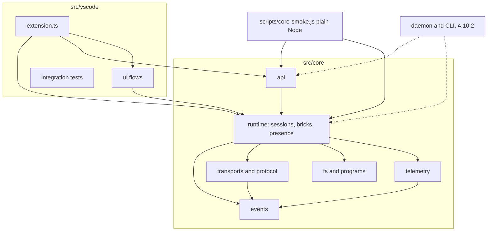

# The Cockpit Core Without VS Code - Plan

## Goal Capsule

- **Objective:** the cockpit's work with bricks runs as an ordinary Node process, proven on real bricks, so the daemon and CLI (IMPLEMENTATION_PLAN 4.10.2) can be built on it and a programmer can drive bricks from Claude Code with no VS Code, while a VS Code user notices nothing.
- **Means:** the core gets its own event primitives (KTD1, KTD2), then the sources split into `src/core/` and `src/vscode/` (KTD3, KTD4), the boundary is enforced (KTD5), and a plain-Node runner proves it on hardware (KTD6).
- **Authority:** the owner, then this plan, then IMPLEMENTATION_PLAN 4.10 and DESIGN. Where this plan and the code disagree about existing behaviour, the code and its tests win and the plan is corrected.
- **Stop conditions:** stop and ask the owner when the characterization (U1) shows VS Code's event delivery cannot be matched without changing what some core code relies on, when the move (U3) cannot keep the bundle equivalent (R2), or when the hardware run (U5) fails in a way the extension does not.
- **Execution profile:** commits on `master`, one unit at a time, in the order U1 → U2 → U3 → U4 → U5 → U6. The owner asked for a slow and careful pace: each unit gets its own codex review (inline packet) and a green suite before the next starts. Push after each reviewed unit.
- **Who finishes:** Claude implements and reviews; the owner runs the hardware check in U5 on HOSTA.

---

## Product Contract

### Summary

Make the cockpit core independent of VS Code without changing the extension's behaviour: give it its own event primitives, split the sources into a core folder and a VS Code folder with an enforced boundary, and prove on real bricks over USB, Bluetooth and TCP that the core runs in plain Node. The same runner then serves the Mac visit.

### Problem Frame

On 18.11.2026 the owner decided that the cockpit must also work outside VS Code: an experienced programmer wants to drive bricks from Claude Code with no editor open. The chosen model is adb's, a background daemon that holds the bricks with a thin CLI over it, and VS Code and an MCP server as further clients (IMPLEMENTATION_PLAN 4.10). All of that needs a core that does not load the `vscode` module.

The core is closer to that than it looks. Measured on master `a1259b1`:

- outside `src/extension.ts`, ten core files import `vscode`, and only for `EventEmitter`, `Event` and `Disposable`: `src/events/index.ts`, `src/contracts/transport.ts`, `src/transports/providerRegistry.ts`, `src/runtime/brickManager.ts`, `src/runtime/createRuntime.ts`, `src/runtime/discoveryScheduler.ts`, `src/runtime/presenceAggregator.ts`, `src/runtime/sessionManager.ts`, `src/telemetry/telemetryReadModel.ts`, `src/telemetry/telemetryService.ts`;
- settings and logging already arrive from outside: `RuntimeOptions` takes the telemetry, throttle, program and transfer settings as values and a `RuntimeLog`, and `telemetrySettingsFromPackage` already serves code outside VS Code;
- `src/ui/` imports no `vscode`; `src/integration/index.ts` is the extension-host test entry and is VS Code by nature;
- about eighteen probe scripts in `scripts/` already run the core in plain Node with the native modules on real bricks, through a `vscode` stub (`src/test/vscodeStub.cjs`), on Windows and Linux.

The stub hides a real difference. It rethrows a listener's error and stops delivery, while VS Code's emitter catches the error, reports it and goes on to the next listener. The unit suite therefore runs core events under semantics production never had, and a core without `vscode` must pick one deliberately.

Two things the Mac visit needs sit outside this plan. The VSIX build has no macOS target (`scripts/packaging.cjs` lists win32-x64, linux-x64, linux-arm64), and there is no macOS Bluetooth backend. They belong to item 8 (Mac).

### Requirements

**Core independence**

- R1. Nothing under the core imports `vscode`, at compile time or at run time.
- R2. The extension behaves as it does today: the same commands, log lines, API answers and event delivery; the bundle `out/extension.js` differs from today's only in module paths and in the event primitive's own code.
- R3. The public API v1 (`src/api/cockpitApi.ts`, `docs/api-for-consumers.md`) keeps its types and behaviour; `apiVersion` stays 1.
- R4. Core events deliver as VS Code's emitter does, including that a listener which throws does not stop the others and its error is reported, not swallowed.

**Structure**

- R5. The sources are split into `src/core/` (works anywhere) and `src/vscode/` (the extension host, its integration tests, and the `ui` flows, which stay there until 4.10.2 decides where the CLI's flows live), and a lint rule plus a test fail when core code depends on `vscode` or on `src/vscode/`.
- R6. Every tool keeps working after the move: `tsc`, the bundle, unit and extension-host tests, the VSIX build and its checks, the probe scripts, and the API check extension.

**Plain-Node proof**

- R7. A runner starts the core in plain Node with no `vscode` stub loaded, connects a real brick over USB, Bluetooth and TCP in turn, and reads its name, battery and storage; it runs on Windows in this plan and is the tool for the Mac visit.

**Documentation**

- R8. The wiki, the `src/` module map in `AGENTS.md` and IMPLEMENTATION_PLAN 4.10.1 name the new paths; earlier IMPLEMENTATION_PLAN entries keep the paths they were written with, with one note on the move.

### Key Decisions

- **The adb model, in this order: core, then the Mac visit, then the daemon and CLI, then Phase 5 over the daemon.** (session-settled: user-approved — chosen over a standalone CLI that reconnects per command and over an MCP server first: a brick needs a long-lived connection, and a CLI is usable outside Claude.) Governs R1, R7.
- **Split the sources into folders now.** (session-settled: user-directed — chosen over keeping the files in place with only a lint rule: the owner judged the folder structure cleaner; it lands as its own mechanical step after the decoupling.) Governs R5, R6.
- **The extension keeps reading VS Code settings and hands values to the core; no configuration file in this plan.** (session-settled: user-approved — chosen over a profile configuration file now: that file belongs to the daemon, 4.10.2.) Governs R2.

### Scope Boundaries

- Not here: the daemon, the CLI, the CLI–daemon protocol, an MCP server, a configuration file in the user profile (all 4.10.2–4.10.3).
- Not here: a separate npm package or workspace for the core; it stays one package until the daemon needs to depend on it.
- Not here: any behaviour change in the extension or the API, renaming public types, or renaming the `extensionPath` runtime option.
- Not here: a macOS VSIX target or a macOS Bluetooth backend (item 8).

#### Deferred to Follow-Up Work

- The flows in `src/ui/` (connect, forget, clear a brick's list) are host-neutral today; they may move to a shared layer when the CLI needs the same flows (4.10.2).
- The empty placeholder folders `src/diagnostics/` and `src/persistence/` (Phase 6/7) are left where they are and placed when their phases start.

---

## Planning Contract

### Key Technical Decisions

- KTD1. **Own event primitives, characterized against VS Code's.** The core gets its own emitter, event and disposable in `src/events/` with the delivery semantics of `vscode.EventEmitter`. The semantics are pinned by a characterization test that runs the same scenarios against the real `vscode.EventEmitter` in the extension host and against the core's emitter (U1). Where a listener's error goes cannot be observed on the real emitter (it has no error hook; the host routes the error internally), so that part is a decision of this plan, not a copy: the core reports a listener's error through a replaceable handler that writes to the console by default, and delivery continues. Rejected: Node's `EventEmitter`, which would turn a mechanical change into a rewrite of every subscription; keeping the stub's semantics, under which the tests pass while production behaves differently (R4).
- KTD2. **The core's event type keeps VS Code's call shape** (a listener, optional `this`, optional disposables collection, returning a disposable), so the extension can hand a core event to a VS Code API that expects `vscode.Event` without an adapter. This also keeps U2 a type substitution.
- KTD3. **Decouple in place, then move, then fence.** U1–U2 change code where it lives, so their diffs show only real changes; U3 is a pure move with import-path edits and nothing else; U4 adds the boundary once the folder exists. (session-settled: user-approved — chosen over moving and changing in one step: a move mixed with edits cannot be reviewed.)
- KTD4. **Layout:** `src/core/` holds `api`, `commands`, `contracts`, `errors`, `events`, `fs`, `mock`, `programs`, `protocol`, `runtime`, `telemetry`, `transports`; `src/vscode/` holds `extension.ts`, `ui` and `integration`. Tests stay in one suite in `src/__tests__/`, and `src/test/vscodeStub.cjs` stays where the probe scripts and the test preload find it. The bundle keeps its output `out/extension.js`, so `package.json` `main`, `.vscodeignore` and the VSIX allow-list do not change. Today `tsc` also writes `out/extension.js` (rootDir `src`), and `test:ci` runs the extension-host tests on that compile output without bundling; after the move `tsc` writes `out/vscode/extension.js`, so `test:host` builds the bundle before launching VS Code and the host tests run the shipped file.
- KTD5. **The boundary is enforced statically and at run time.** Statically: under `src/core/`, lint forbids imports, re-exports and type-only references of `vscode` and of anything under `src/vscode/`, and forbids `require('vscode')` calls, the form the core already uses for lazily loaded optional modules. At run time: a unit test scans the text of every compiled `out/core/**/*.js` for a `vscode` require (an `import` compiles to one too), and starts a fresh Node process without the stub preload that loads the core entry modules `runtime/index`, `transports/index` and `api/cockpitApi` (R1, R5).
- KTD6. **The proof is a probe-style script, not the CLI:** `scripts/core-smoke.js` loads the compiled core directly, as the other probes do, but without the `vscode` stub; it builds the runtime with the defaults `package.json` declares and logs to the console. It is not shipped in the VSIX.

### High-Level Technical Design

Where the layers stand after this plan, and what 4.10.2 adds:



Nothing in `src/core` points into `src/vscode`; the reverse is the only direction (checked during research: no core file imports `ui`, `integration` or `extension`).

### Output Structure

```text
src/
  core/
    api/  commands/  contracts/  errors/  events/  fs/
    mock/  programs/  protocol/  runtime/  telemetry/  transports/
  vscode/
    extension.ts
    ui/
    integration/
  __tests__/          one suite for both
  test/vscodeStub.cjs probe scripts and the test preload
scripts/
  core-smoke.js       new: the plain-Node proof
```

### Risks

| Risk | Mitigation |
|---|---|
| VS Code's emitter has delivery details (re-entrant fire, listeners added or removed during fire) that the core's emitter misses | U1 characterizes them against the real emitter in the extension host before the core switches |
| Tests that passed because the stub rethrows a listener's error now pass or fail differently | U2 runs the suite after the switch and examines every changed result; a test that relied on rethrow is rewritten to the production semantics, not the emitter bent back |
| The move breaks something no test covers: a probe script's `out(...)` path, a path written as a string in a test, the host test entry | U3 deletes `out/` before every post-move check, so a missed path fails instead of resolving to stale compiled code; it then checks every `out(...)` target, runs the host tests, builds the VSIX with its checks and loads the natives from staging |
| Listener errors are no longer rethrown, so an assertion inside a listener in a test stops failing that test | U2 makes the test preload install the core's error handler as a recorder that fails the running test (production keeps the console handler) |
| An unmerged worktree conflicts with the move | none open: the only other worktree, `ev3-cockpit-wt-linux`, is a detached old checkout with no branch to merge |

---

## Implementation Units

### U1. Core event primitives, characterized against VS Code

**Goal:** the core has an emitter, event and disposable of its own that deliver exactly as `vscode.EventEmitter` does.

**Requirements:** R4; KTD1, KTD2.

**Dependencies:** none.

**Files:**
- `src/events/index.ts` (the emitter, event and disposable types beside the existing `createTypedEvent` and `DisposableStore`)
- `src/__tests__/events.test.ts` (new)
- `src/integration/index.ts` (characterization scenarios run against the real `vscode.EventEmitter` and the core's)

**Approach:**
1. Write the characterization scenarios first and run them in the extension host against the real `vscode.EventEmitter`, recording what it does.
2. Implement the core's emitter to the recorded behaviour, with the listener-error handler KTD1 decides.
3. Run the same scenarios against the core's emitter in the host and in the unit suite.

**Execution note:** characterization first: what VS Code's emitter does is learned from the real one in the host, not assumed.

**Patterns to follow:** the host test shape in `src/integration/index.ts`; `DisposableStore` in `src/events/index.ts`.

**Test scenarios:**
- Listeners are called in subscription order with the fired value.
- Disposing a subscription stops its deliveries and leaves the others.
- A listener that throws, on both emitters: fire does not throw and the remaining listeners of that fire are still called.
- A listener that throws, on the core emitter only: the replaceable error handler receives that error exactly once.
- A listener added during a fire: whether it is called in that same fire matches VS Code.
- A listener removed during a fire before its turn: whether it is still called matches VS Code.
- A fire from inside a listener of the same emitter: the order of deliveries matches VS Code.
- After the emitter is disposed, fire does nothing and subscribing returns a disposable that does nothing.
- The optional disposables collection receives the subscription, and the optional `this` binds the listener.

**Verification:** the scenarios shared by both emitters pass against both in the extension host, the core-only scenario passes, and the unit tests pass in plain Node.

### U2. The core uses its own events

**Goal:** no core file imports `vscode`; the extension still runs unchanged.

**Requirements:** R1, R2, R3, R4; KTD1, KTD2.

**Dependencies:** U1.

**Files:**
- `src/contracts/transport.ts`, `src/transports/providerRegistry.ts`
- `src/runtime/brickManager.ts`, `src/runtime/createRuntime.ts`, `src/runtime/discoveryScheduler.ts`, `src/runtime/presenceAggregator.ts`, `src/runtime/sessionManager.ts`
- `src/telemetry/telemetryReadModel.ts`, `src/telemetry/telemetryService.ts`
- `src/__tests__/telemetryReadModel.test.ts` (the one test that builds a `vscode.EventEmitter` itself)
- `src/__tests__/sessionRuntime.test.ts` or the nearest existing runtime test, for the integration scenario below
- `scripts/test-setup.cjs` (the listener-error recorder)

**Approach:**
1. Replace the `vscode` event and disposable types with the core's in each file; no other edit.
2. Make the unit-test preload install the core's error handler as a recorder that fails the running test when a listener threw, so an assertion inside a listener still guards its test (production keeps the console handler).
3. Run the whole suite and examine every result that changes; rewrite a test only when it relied on the old rethrow, never bend the emitter back.
4. Confirm with a search that no file outside `src/extension.ts` and `src/integration/` imports `vscode`.

**Patterns to follow:** the existing `createTypedEvent` call sites.

**Test scenarios:**
- Integration: a session state change with two subscribers, the first of which throws, still reaches the second, and the error is reported (a behaviour the extension already had in production).
- An assertion that fails inside an event listener in a unit test fails that test.
- The existing suite passes unchanged apart from tests that relied on the stub's rethrow, each named in the commit message with the reason.

**Verification:** the suite is green, the extension-host tests pass, and the extension started in the development host logs the same start-up lines as before.

### U3. Split the sources into src/core and src/vscode

**Goal:** the folders show the boundary; nothing else changes.

**Requirements:** R2, R5, R6; KTD3, KTD4.

**Dependencies:** U2.

**Files:**
- every file under `src/` except `src/__tests__/` and `src/test/`, moved per KTD4
- `src/__tests__/*.ts` (import paths, and compiled paths written as strings, such as the child-process require of `out/transports/bluezBluetooth.js` in `src/__tests__/bluezBluetooth.test.ts`)
- `package.json` (the esbuild entry in `bundle`, `build:dev`, `watch:bundle`; `test:host` builds the bundle first, KTD4)
- `scripts/runTests.js` (the host test entry path)
- the probe scripts in `scripts/` that load `out/...` (their path helper), and any other `out/<folder>/` string a search of `src/__tests__/` and `scripts/` finds
- `scripts/api-check/` only if it loads a compiled path (it uses the public API today)

**Approach:**
1. Before the move, build the bundle and keep a copy of `out/extension.js` outside `out/` as the baseline.
2. Move with git so history follows; change only paths and the script entries named above.
3. Delete `out/`, then compile and bundle; every check below runs on that clean output, so a missed path fails instead of resolving to stale code.
4. Compare the new bundle with the baseline after normalizing module path comments: they must match (R2).
5. Check that every `out(...)` target named in `scripts/` exists, and load a few probe scripts far enough to import the core without touching a brick.

**Execution note:** mostly mechanical; prove it by equivalence (bundle comparison, the full suite, the host tests, the VSIX checks), not by new unit tests.

**Test expectation:** none -- a pure move; the existing suite, the host tests and the VSIX checks are the proof.

**Verification:** from a deleted `out/`, `npm run test:ci` passes (compile, lint, unit and host tests); the bundle comparison shows no difference beyond paths; the win32-x64 VSIX builds, passes its packaging checks and its native modules load from the staging folder.

### U4. Enforce the boundary

**Goal:** a change that makes the core import `vscode` fails lint and the test suite.

**Requirements:** R1, R5; KTD5.

**Dependencies:** U3.

**Files:**
- `.eslintrc.json` (an override for `src/core/**`, per KTD5)
- `src/__tests__/coreBoundary.test.ts` (new)

**Approach:**
1. Add the lint override KTD5 describes.
2. Add the test KTD5 describes: the text scan of compiled core output, then the fresh-process load of the entry modules.

**Test scenarios:**
- The core entry modules load in a fresh Node process with no `vscode` module available, and no compiled core file contains a `vscode` require.
- Seen failing before it counts, each by reverse patch, not checkout: a top-level `vscode` import in a core file, a lazy `require('vscode')` inside a function body, and a core import from `src/vscode/` each make lint fail, and the first two also make the test fail.

**Verification:** lint and the new test pass on the real tree and fail on the deliberately broken one.

### U5. Prove the core in plain Node on real bricks

**Goal:** the core connects and talks to a real brick from plain Node, the way the daemon will.

**Requirements:** R7, and the hardware side of R2, R3 and R6; KTD6.

**Dependencies:** U3 (paths); U4 is not required.

**Files:**
- `scripts/core-smoke.js` (new)

**Approach:**
1. Build the runtime with the real transport providers, the defaults from `package.json`, a console log and the repository root as the folder that holds `native/bin`.
2. Sign in to a named brick over the channel the run names (USB, Bluetooth or TCP), read its name, battery and storage, print one line per step, then disconnect; a channel the brick cannot be reached on, or any failed step, exits non-zero.
3. Run it on HOSTA with the owner for each of USB, Bluetooth and TCP (Wi-Fi dongle), with VS Code closed or the cockpit extension disabled so only one process holds the brick.
4. Then install the new win32-x64 VSIX from U3 on HOSTA, reload the window, connect one brick from VS Code and compare the start-up log lines with the pre-move log; run the API check's connect-and-read path once to confirm the public API answers with `apiVersion` 1.

**Execution note:** smoke-first: this unit is proven on hardware, not by unit tests.

**Patterns to follow:** `scripts/hardware-matrix.js` and `scripts/dual-channel-probe.js` for loading the compiled core and naming a brick; drop their `vscode` stub registration.

**Test expectation:** none -- a hardware smoke runner; U4's test covers loading without `vscode`.

**Verification:** on HOSTA the runner reports name, battery and storage for one brick over USB, over Bluetooth and over TCP, with no `vscode` stub loaded; the installed extension starts with the same log lines and connects a brick, and the API check reads it.

### U6. Documentation to the new paths

**Goal:** a reader finds the code where the documents say it is.

**Requirements:** R8.

**Dependencies:** U3, U5.

**Files:**
- `wiki/` articles that cite `src/` paths
- `AGENTS.md` (the `src/` module map)
- `DESIGN.md` and `docs/api-for-consumers.md` where they cite moved paths
- `IMPLEMENTATION_PLAN.md` (4.10.1 checked with the outcome, and one note that sources moved under `src/core/` and `src/vscode/` on this date)

**Approach:** rewrite current-state references; leave dated history in IMPLEMENTATION_PLAN as written.

**Test expectation:** none -- documentation.

**Verification:** a search for old core paths (`src/runtime/`, `src/transports/` and the like) over `AGENTS.md`, `CLAUDE.md`, `DESIGN.md`, `docs/api-for-consumers.md` and the wiki articles finds none. Dated records (earlier plans in `docs/plans/`, `.notes/`, `CHANGELOG.md`, IMPLEMENTATION_PLAN history) keep their paths.

---

## Verification Contract

| Gate | When | What passes |
|---|---|---|
| `npm run compile`, `npm run lint`, `npm run test:unit` | after every unit | all green |
| `npm run test:host` | U1, U2, U3 | extension-host tests green, including U1's characterization; from U3 on it builds the bundle first |
| `npm run test:ci` from a deleted `out/` | U3, U4 | green on a clean output, so no check passes on stale compiled code |
| Reverse-patch check (project rule) | U1, U2, U4 | each new test fails without its change |
| Bundle equivalence | U3 | `out/extension.js` before and after the move match after normalizing module paths |
| `node scripts/package-vsix.cjs win32-x64` and the native load check from `.vsix-staging/win32-x64` | U3 | VSIX builds, passes its checks, `usb`, `node-hid`, `serialport`, `koffi` load |
| Codex review on an inline packet | each unit | READY, no surviving blocker or major |
| Identifier scan of the unpushed range | before each push | no findings |
| Hardware run of `scripts/core-smoke.js` | U5 | USB, Bluetooth and TCP each report name, battery and storage |
| Installed VSIX on HOSTA, then the API check | U5 | same start-up log lines, a brick connects, the API answers with `apiVersion` 1 |

## Definition of Done

- R1–R8 hold, each shown by the unit that owns it.
- The extension on HOSTA, installed from the new VSIX, starts and connects a brick as before.
- Every unit has its codex READY and its commit; nothing from an abandoned attempt is left in the tree.
- IMPLEMENTATION_PLAN 4.10.1 is checked with the outcome and the commits.
