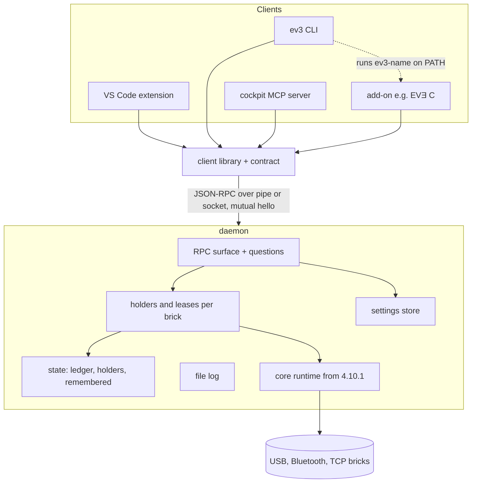
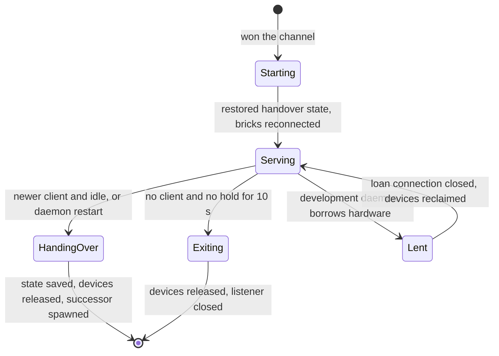
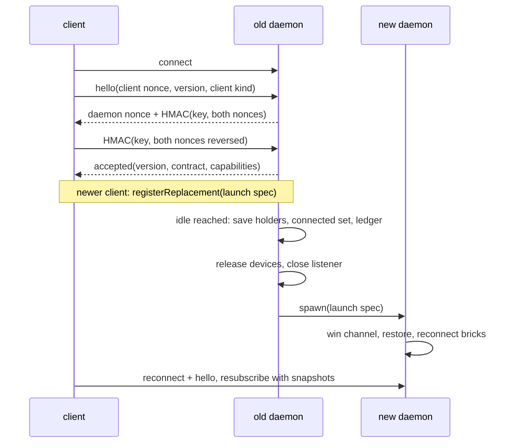

# Cockpit Daemon and Clients - Plan

## Goal Capsule

- **Objective:** Any tool on a user's computer — VS Code, a terminal command, a script, a Claude Code agent, an add-on such as EVƎ C — works with the user's EV3 bricks through one cockpit, and an add-on is written once for all of those environments.
- **Means:** A per-user cockpit daemon that alone holds the bricks and the settings, one typed client contract with one client library, and three clients built on it: the VS Code extension, the `ev3` CLI and the cockpit MCP server (IMPLEMENTATION_PLAN 4.10.2 and 4.10.3; KTD1–KTD18).
- **Product authority:** The owner, through the decisions of 19.11.2026 recorded below. The EVƎ C session reviews the protocol draft before the daemon's surface is built (see Open Questions).
- **Execution profile:** Deep. One body of work, committed unit by unit on `master` as this repo does, each commit with the pre-commit gate green; pushed only after the identifier scan of the pushed range. No pull-request split.
- **Stop conditions:**
  - U1's measurement fails (the daemon on VS Code's Node dies with VS Code or blocks VS Code or extension updates): stop before U5 and bring the owner the fallback named in KTD1.
  - The EVƎ C review of the protocol draft asks for a contract change that contradicts a Key Decision: stop and ask the owner.
  - Any change would need a computer restart, the BTHPORT ACL, or restarting `bthserv`: stop.
- **Who finishes:** The implementing agent builds and verifies every unit; hardware rounds follow the one-instruction-at-a-time protocol with the owner; the owner commands any publishing.
- **Open blockers:** None.

---

## Product Contract

### Summary

A per-user daemon becomes the only owner of the bricks and of all cockpit settings. One typed contract, published as a package, replaces API v1. One client library implements that contract, and the VS Code extension, the `ev3` CLI with git-style add-on subcommands and the cockpit MCP server all use it. To users the daemon is invisible: they see the cockpit in whatever tool they use.

Product Contract preservation — changed: R5 (holders per client), R20 (one lease per call, compound operations), R23 (safe mode also allows the SD card, as the code does today), R25 (settings move to an own command), R34 (the development daemon borrows the hardware); added R36–R39 and AE12–AE14 — all from the owner's decisions of 19.11.2026 during planning. The five questions deferred to planning are answered by KTD3, KTD11, KTD12, KTD17 and KTD7 and were removed from Outstanding Questions.

### Problem Frame

Today only the VS Code extension can talk to a brick. A terminal command, a script or an agent in Claude Code cannot reach one at all, and two VS Code windows would fight over the same brick. An experienced programmer asked to drive the cockpit from Claude Code without VS Code. EVƎ C, the owner's C toolchain for the brick, has to build, upload and run programs from VS Code, from a shell (`build + upload + run`, printing the run's result), from a Claude Code agent and in CI, always on top of the cockpit. With the core now free of `vscode` (4.10.1, `scripts/core-smoke.js` drives a brick from plain Node), what is missing is a process that holds the bricks for every tool and a contract the tools share.

EVƎ C's hardware acceptance on API v1 also exposed what a shared owner must get right from the start: commands that failed during a momentary route loss, no reconnect event (subscriptions ended on every disconnect), a recursive remove that deletes one level, and interfaces copied by hand because none are published.

### Actors

- A1. User in VS Code — works with bricks through the cockpit extension and add-on extensions such as EVƎ C.
- A2. User in a terminal or script — runs `ev3 …` and add-on subcommands such as `ev3 c run`, often repeatedly.
- A3. AI agent — drives bricks through the cockpit MCP server or the CLI on the user's behalf.
- A4. Add-on — a separate package (EVƎ C first) that is a client of the daemon in every environment.
- A5. Daemon — the per-user process that holds the bricks and the settings.

### Key Decisions

- **The daemon comes before more EVƎ C work.** EVƎ C has to run in every environment the cockpit runs in, and its CLI needs the daemon. (session-settled: user-directed — chosen over continuing EVƎ C on API v1 first: EVƎ C must run in all environments, not only VS Code)
- **Add-ons are separate clients of the daemon, not plugins inside it.** Governs R16, R27. (session-settled: user-approved — chosen over plugins loaded by the daemon: a failing add-on must not take down brick management)
- **One `ev3` command; add-ons are git-style subcommands.** Governs R27. (session-settled: user-directed — chosen over a separate `ev3c` command: one entry point; EVƎ C changes its spec)
- **Each package has its own MCP server, and an add-on's never duplicates the cockpit's tools.** Governs R28. (session-settled: user-approved — chosen over one aggregated MCP server)
- **One daemon per user, started by the first client that needs it.** Governs R1, R2. (session-settled: user-approved — chosen over a system service)
- **The daemon ends with its last client and its last held brick; terminal use holds a brick explicitly with `ev3 connect`.** Governs R3, R5, R6. (session-settled: user-directed — chosen over an idle timeout and over keeping bricks for 60 s after each CLI command: holding is explicit and predictable)
- **Each holder keeps its own claim on a brick; Disconnect drops only the caller's.** Governs R5, R36. (session-settled: user-approved — chosen over disconnecting for everyone as today: a terminal holding a brick through `ev3 connect` would lose it without warning, and closing one VS Code window would take the brick from another)
- **Remembering bricks across daemon restarts is a setting, `wait` by default.** Governs R8. (session-settled: user-directed — chosen over always reconnecting: one user with one brick wants `auto`, users sharing bricks want to pick each time)
- **A replacement is not a user leaving: held and connected bricks carry over.** Governs R37. (session-settled: user-approved — chosen over treating a replacement as the daemon's end: `ev3 daemon restart` would drop a held brick at once, and every update would leave VS Code's bricks disconnected)
- **One repo publishes VSIX and npm packages with the same version; if a client and the daemon differ, the newest wins with a warning.** Governs R11, R31. (session-settled: user-directed — chosen over side-by-side daemons per version: the daemon holds the only hardware connection)
- **A newer client waits until the daemon is idle before replacing it.** Governs R11. (session-settled: user-approved — chosen over asking the user and over replacing at once: no running operation or connection is cut)
- **The daemon holds all settings; VS Code and the CLI change any of them, MCP servers cannot change dangerous ones.** Governs R22, R23. (session-settled: user-directed — chosen over allowing only a human at the CLI to switch to full mode and over letting every client change everything: an agent must never widen its own rights)
- **A dangerous setting needs a confirmation only a person can give.** Governs R22, R23. (session-settled: user-directed — chosen over relying on the agent host's own command approval and over guarding only the MCP path: an agent with a shell can run `ev3 config` itself, and command approvals differ per user — auto mode, allowlists — while a confirmation typed in a real terminal or clicked in VS Code does not)
- **Cockpit settings move out of VS Code Settings to an own command.** Governs R25. (session-settled: user-approved — chosen over mirroring them in VS Code Settings: two sources of truth, a confirmation dialog in every open window, and edits of `settings.json` by an agent reaching the daemon)
- **Reader/writer concurrency with a write lease.** Governs R20. (session-settled: user-approved — chosen over serialising all clients and over silent interleaving)
- **Work of several steps on a brick is one operation under one lease; no lease outlives a call.** Governs R20. (session-settled: user-approved — chosen over leases a client holds across calls: a hung or long-lived client, an MCP server above all, could block the user for hours)
- **Each client has its own active brick.** Governs R38. (session-settled: user-approved — chosen over one active brick shared by all clients: a terminal `ev3 connect` would retarget VS Code, its telemetry and EVƎ C, and an agent's next call could land elsewhere)
- **A question for a person goes to the client that started the operation; no answer leaves things as they are.** Governs R39. (session-settled: user-approved — chosen over broadcasting to every client and over a default answer: a headless "no" would drop a transfer debt for good)
- **The development daemon borrows the hardware from the user's daemon.** Governs R34. (session-settled: user-directed — chosen over simulated bricks only while the user's daemon runs and over a simulation-only development daemon: hardware tests run in the Extension Development Host while the normal VS Code stays open)
- **OS consent is asked in the name of whoever starts the daemon.** Governs R24. (session-settled: user-approved — chosen over a separate consent step)
- **Clients are TypeScript/Node only for now.** Governs R17. (session-settled: user-approved — chosen over a language-neutral schema from the start: every known client is TypeScript; a schema can be generated later)
- **The daemon is reachable only locally, by the same user.** Governs R14. (session-settled: user-approved — chosen over network access now or designed in for later: remote bricks are reached over SSH, as with HOSTD and the Mac)
- **One contract everywhere; API v1 is removed without a transition shim.** Governs R15, R16. (session-settled: user-directed — chosen over keeping API v1 as a shim and over every add-on speaking the raw protocol: EVƎ C is the owner's own project and needs no compatibility period)
- **No in-process fallback when the daemon cannot start.** Governs R10. (session-settled: user-approved — chosen over running the core inside the extension as today: one path to build and test)
- **JSON-RPC 2.0 in the style of LSP.** Governs R13. (session-settled: user-approved — chosen over HTTP over a socket, where events, cancellation and leases fit badly, and over MCP as the daemon's protocol, which is built for model tools rather than a typed API)
- **The daemon, the client library, the VS Code extension, the CLI and the MCP server are one body of work.** (session-settled: user-directed — chosen over the CLI now and the MCP server later)

### Requirements

**Daemon and lifecycle**

- R1. One daemon per user is the only process that holds bricks; every client works through it.
- R2. A client that finds no daemon starts one; two clients starting at the same moment end up with one daemon.
- R3. The daemon runs while at least one client is connected or at least one brick is held through `ev3 connect`, and exits once neither is true.
- R4. The daemon notices a client's departure even when the client crashes or is killed, without any message from it.
- R5. A brick stays connected while it has at least one holder — a client that connected it, an `ev3 connect` hold, or, under R8 `auto`, the daemon's long-lived clients together — and is released when its last holder leaves. Each VS Code window is a holder of its own.
- R6. `ev3 connect <brick>` holds the brick past the command until `ev3 disconnect <brick>`; a command run without a held brick connects only for its own run.
- R36. Disconnect drops only the calling client's hold: when others still hold the brick it stays connected and the client says who holds it, and VS Code offers to disconnect it for everyone. An explicit disconnect also takes the brick off the remembered set of R8.
- R7. While it runs, the daemon does what the cockpit does today: discovery, presence, telemetry of connected bricks, pairing, forgetting, programs and files.
- R8. A setting decides what happens to remembered bricks — those connected when the last long-lived client (the VS Code extension, an MCP server) left or the last held brick was disconnected: `auto` connects them as soon as the daemon sees them while a long-lived client is connected or a brick is held, also after a computer restart, and each belongs to that client as if it had connected it; `wait`, the default, remembers them and connects them only on Connect.
- R37. A daemon replacement — when idle (R11) or on `ev3 daemon restart` — keeps every held and connected brick with its holders: the successor reconnects them before it accepts clients, and R8 applies only when the daemon really ends.
- R9. No client makes the user aware of the daemon as a separate thing to install, start or manage.
- R10. When the daemon cannot start, the client says so with the reason and the path of the daemon's log; the extension does not fall back to running the core itself.
- R33. The daemon keeps each brick's unsettled transfers (firmware slots to close, partial files to delete) in its per-user state, and the next daemon settles them before that brick's next transfer.
- R34. The extension in development or test mode, and any run with simulated bricks, starts its own daemon instance on its own channel; it never reaches the user's daemon as a client, and no version replacement crosses between the two. To use real bricks while the user's daemon runs, the development daemon borrows the hardware: the user's daemon releases its devices and, when the development daemon ends, takes them back and reconnects its bricks.

**Versions**

- R11. On connecting, a client built in this repo (the VS Code extension, the CLI, the cockpit MCP server) and the daemon compare versions: a newer client works with the older daemon, shows a "new version available" notice offering a restart, and replaces the daemon once it is idle — no write lease, no operation in progress, no brick connected; when the daemon is newer, the client shows the same kind of notice recommending an update.
- R35. An add-on carries no daemon: it compares only the contract version, never replaces the daemon, warns only when the daemon's contract cannot serve it, and when no daemon runs it starts the one installed with the cockpit, or tells the user to install the cockpit.

**Protocol and contract**

- R12. Clients and the daemon talk over a per-user local channel: a named pipe on Windows, a unix socket on Linux and macOS.
- R13. Messages are JSON-RPC 2.0 in the style of LSP: requests with responses, server-pushed events, cancellation of a running request, and progress.
- R14. Only processes of the same user on the same computer can connect; the daemon listens on no network port.
- R15. One typed contract, published as a package that add-ons import, replaces API v1; API v1 is removed, and EVƎ C and `scripts/api-check` move to the new contract.
- R16. One client library implements the contract over the protocol, and the VS Code extension, the CLI, the MCP servers and add-ons all use it.
- R17. Clients are TypeScript/Node.
- R18. Beyond what API v1 offers, the contract carries an explicit reconnect event, program-state events delivered to every subscribed client, cancellation of operations, and progress for uploads.
- R19. Subscriptions to program state, presence and telemetry survive a brick's reconnect and a daemon replacement without the client subscribing again.

**Concurrency and robustness**

- R20. Reads run concurrently; a mutating operation on a brick runs under a write lease, a second writer gets `brick_busy` naming the holder, and the lease ends with the operation or when its client leaves. A lease never outlives one call: work of several steps is one contract operation under one lease — deploying files and starting a program, which ends its lease at a verified start; removing a list of paths. Stopping a program and emergency stop are never refused by a lease: they run at once from any client, and the lease holder gets a program-state event naming who stopped it.
- R21. A momentary loss of a brick's route never fails an operation by itself: a command not yet sent waits for the route within the operation's time budget; a command whose reply was lost is not sent again — a file transfer restarts from its first chunk, and a program start is reported as uncertain rather than started again; once the budget is spent, the operation fails with its reason.
- R38. Each client has its own active brick; the daemon keeps none. The CLI and MCP name a brick by id or name, a name that matches several bricks fails with the candidates, and only the CLI uses the one connected brick when none is named.
- R39. When an operation needs a person's answer — releasing a transfer slot left open, clearing a brick's Bluetooth list, granting Bluetooth access on Linux, pairing — the daemon asks the client that started the operation; a client that cannot ask a person leaves things as they are, and the operation ends with a message saying what a person has to do.

**Settings, access and consent**

- R22. The daemon holds every cockpit setting; the VS Code extension and `ev3 config` read and change all of them, access mode `full` included. A dangerous setting (as R23 defines it) changes only after a person confirms it: in VS Code through a confirmation dialog, through `ev3 config` by an answer typed in an interactive terminal; without an interactive terminal, or with `--json`, the change is refused with a message saying a person has to run and confirm it.
- R23. An MCP server, the cockpit's or an add-on's, cannot change a dangerous setting — access mode `full` and anything that widens rights or allows deleting outside the projects folder `/home/root/lms2012/prjs` and the SD card `/media/card` — and shows the user the exact command to run instead.
- R24. OS consent (Bluetooth and local network on macOS, BlueZ access and udev on Linux, Bluetooth on Windows) is asked in the name of whoever starts the daemon.

**Clients**

- R25. The VS Code extension becomes a client of the daemon: its commands and their behaviour stay as they are, and cockpit settings move out of VS Code Settings to an `EVƎ: Settings` command that reads and writes the daemon's settings.
- R26. The `ev3` CLI covers: listing bricks, connect and disconnect (holding), brick info, files (list, read, write, remove), running and stopping a program, `config get|set`, daemon status including held bricks and lease holders, `daemon restart` (replaces the daemon on the user's command even though brick connections are cut; clients reconnect), and the path of the daemon's log; every command offers `--json` and exits non-zero on failure.
- R27. `ev3 <name> …` runs an installed add-on executable named `ev3-<name>`, found only in the directories on PATH — never the current working directory, on every OS — and run by its absolute path; add-ons get no other hook into the CLI.
- R28. The cockpit MCP server exposes the cockpit's operations to an agent as a thin layer over the client library.
- R29. A recursive remove deletes the whole tree on the brick, or reports what it left behind.

**Diagnostics and distribution**

- R30. The daemon writes a leveled, timestamped log file at a documented per-user path, with the client's name on each line, every notification shown to a user, and every failed brick command.
- R31. One repo builds the VSIX and the npm packages at the same version; publishing to the Marketplace or npmjs happens only on the owner's command.
- R32. Started from VS Code, the daemon runs on VS Code's own Node, so a VS Code user installs nothing else; started from the CLI, it runs on the system Node.

### Key Flows

- F1. VS Code session
  - **Trigger:** A1 opens VS Code.
  - **Steps:** The extension finds no daemon and starts one; the daemon discovers bricks as the cockpit does today; A1 connects a brick and works with it; A1 closes VS Code; the daemon releases the brick and, with no other client and no held brick, exits.
  - **Covered by:** R2, R3, R5, R7, R25
- F2. Repeated runs from a terminal or an agent
  - **Trigger:** A2 or A3 wants to run a program several times.
  - **Steps:** `ev3 connect CCC` starts the daemon and holds CCC; each `ev3 c run` connects to the daemon, deploys its files and starts the program in one operation under one lease, waits for the program's end as an event, prints the result and leaves; CCC stays connected between runs; `ev3 disconnect CCC` releases it and the daemon exits.
  - **Covered by:** R3, R6, R20, R26, R27
- F3. VS Code and a terminal on the same brick
  - **Trigger:** A1 has VS Code open on CCC while A2 runs `ev3 c run` on CCC.
  - **Steps:** Both are clients of the same daemon; reads from both proceed; the run's deployment takes the write lease; a write from VS Code during it gets `brick_busy` naming the run; program-state events reach both.
  - **Covered by:** R1, R18, R20
- F4. A newer client meets an older daemon
  - **Trigger:** A2 updates the CLI while VS Code keeps the older daemon busy.
  - **Steps:** The CLI connects, sees the older daemon, works with it and shows that a new version is available; once the daemon is idle, or when A2 runs `ev3 daemon restart`, it is replaced by the newer one, which reconnects the bricks it held; clients reconnect and their subscriptions continue.
  - **Covered by:** R11, R19, R37

### Acceptance Examples

- AE1. **Covers R4, R5.** Given VS Code is the only client and has CCC connected, when the VS Code process is killed, the daemon releases CCC and exits.
- AE2. **Covers R5, R6.** Given CCC is held through `ev3 connect` and VS Code also uses it, when VS Code closes, CCC stays connected and the daemon keeps running.
- AE3. **Covers R8.** Given the setting is `auto` and the user was signed in to CCC, when the computer restarts and the user opens VS Code, CCC connects as soon as the daemon sees it. Given `wait` instead, CCC is listed but stays disconnected until Connect.
- AE4. **Covers R20.** Given a run from the terminal holds the write lease on CCC, when VS Code tries to upload a file to CCC, the upload fails with `brick_busy` naming the terminal client, and reading CCC's files from VS Code still works.
- AE5. **Covers R23.** Given an agent asks the cockpit MCP server to switch to access mode `full`, the server refuses and replies with the exact `ev3 config set access-mode full` command for the user to run.
- AE6. **Covers R11, R26.** Given the daemon has CCC connected, when a newer CLI connects, the CLI works with the older daemon and shows that a new version is available; after CCC is disconnected and nothing runs, or right away on `ev3 daemon restart`, the newer daemon takes over.
- AE7. **Covers R21.** Given CCC's only channel drops for a moment during an upload, the upload continues once the route is back instead of failing with "no connected channel".
- AE8. **Covers R10.** Given the daemon cannot start, VS Code shows why and where its log is, and does not connect to bricks by itself.
- AE9. **Covers R20.** Given a run from the terminal has started its program on CCC, when A1 presses Stop in VS Code, the program stops at once and the terminal run reports that VS Code stopped it.
- AE10. **Covers R21.** Given the reply to a chunk of an upload is lost when CCC's route drops, the daemon does not send that chunk again; once the route is back, the upload starts over from its first chunk.
- AE11. **Covers R22.** Given an agent runs `ev3 config set access-mode full` through its own shell tool, with no interactive terminal, the change is refused, the message says a person has to run and confirm it, and the mode stays `safe`; the same command typed by the user in a terminal asks for confirmation and switches to `full` once confirmed.
- AE12. **Covers R5, R36.** Given two VS Code windows both use CCC, when window A closes, window B keeps CCC connected; when B then presses Disconnect while `ev3 connect CCC` also holds it, CCC stays connected and B says the terminal holds it.
- AE13. **Covers R37, R26.** Given CCC is held through `ev3 connect` and VS Code has BBB connected, when the user runs `ev3 daemon restart`, the new daemon reconnects CCC and BBB, keeps running, and VS Code's subscriptions continue without a Connect.
- AE14. **Covers R34.** Given the normal VS Code has CCC connected over USB, when the Extension Development Host starts with real bricks, the user's daemon releases CCC and the development daemon connects it; when the development host closes, the user's daemon reconnects CCC.

### Success Criteria

- EVƎ C's `ev3 c run` works from a terminal and from a Claude Code agent while VS Code is open on the same brick, without either side failing on the other's activity.
- The VS Code extension behaves as before from the user's point of view: same commands, same results, with its settings now changed through `EVƎ: Settings` and stored by the daemon.
- Hardware runs pass on Windows and Linux over USB, Bluetooth and TCP through the daemon; macOS is covered by the GitHub macOS build and its unit tests, since the borrowed Mac has been returned.

### Scope Boundaries

**Deferred for later**

- Network access to the daemon; remote bricks are reached over SSH.
- Clients in languages other than TypeScript, and a language-neutral schema for them.
- Releasing bricks of a client that stays open but unused, and a time limit for bricks held through `ev3 connect`.
- Installing an add-on's MCP server together with the cockpit's (a Claude Code plugin bundling both).
- The Phase 5 UI, which later replaces the `EVƎ: Settings` command.
- Publishing to the Marketplace and npmjs, and signing and notarising the macOS helper.
- Carrying existing VS Code setting values over to the daemon, and any backward compatibility: the cockpit is in alpha, so old values may be dropped.
- Access rights per client: switching to `full` widens every client at once, agents included.

**Outside this product's identity**

- A system-wide or multi-user daemon, or one running as an OS service.
- Add-ons as plugins loaded inside the daemon.

**Considered and not built**

- A heartbeat between client and daemon: the channel's close already reports a crashed or killed client (R4); it would only matter for a client that hangs while its process lives, which R20's per-call lease already bounds.
- Proving that a person, not a process, answered a terminal confirmation: a same-user process can fake a terminal (ConPTY, `script`, node-pty). R22 is a guardrail against agents' ordinary shell tools and MCP, not a security boundary; evidence of agents routinely faking terminals would change this.
- Per-request tokens beyond the `hello` handshake: after mutual authentication the connection itself is the identity (KTD3).

### Dependencies / Assumptions

- The native modules (`usb`, `node-hid`, `@serialport/bindings-cpp`, `koffi`, all N-API) load under VS Code 1.143's `ELECTRON_RUN_AS_NODE` runtime (Node 24.21, N-API 10) on Windows — measured during planning; Linux and macOS are unmeasured and U1 checks Linux.
- The borrowed Mac is gone; macOS changes are verified by the GitHub macOS workflow (`.github/workflows/vsix-macos.yml`) and unit tests only. Which app macOS attributes Bluetooth and local-network consent to for a daemon outliving its starter is unverified.
- EVƎ C moves to the new contract and the `ev3 c …` command form; its core already talks to the brick through one interface, so the move is one adapter in its own repo.

### Outstanding Questions

**Deferred to Implementation**

- The exact `ev3` subcommand spellings and `--json` field names beyond the shapes KTD13 fixes.
- The final chunk size within KTD11's range, tuned on hardware over Bluetooth.

### Sources / Research

- `IMPLEMENTATION_PLAN.md` 4.10.1, 4.10.1m, 4.10.2, 4.10.3; `docs/plans/2026-11-18-1008-refactor-core-without-vscode-plan.md` (deferrals to 4.10.2).
- `src/core/api/cockpitApi.ts` (API v1: `apiVersion` 1, `registerConsumer`, synchronous reads, events without a reconnect event), `docs/api-for-consumers.md`, `src/vscode/extension.ts` (settings read from `ev3-cockpit` configuration, sweep confirmation wiring), `scripts/api-check/`, `scripts/core-smoke.js` (the composition the daemon grows from).
- EVƎ C's requirements, from its session on 19.11.2026, and its answers on leases and `deployAndRun` the same day; its plan in the ev3-c repo: `docs/plans/2026-11-18-1038-feat-program-run-contract-plan.md`.
- Prior art for the daemon's shape: adb (auto-start, version check, kill-server, and the ping-pong of two versions replacing each other), Watchman and gpg-agent (per-user socket, single instance), LSP (JSON-RPC, cancellation, progress, capabilities), Chrome DevTools Protocol (chunked binary data behind a handle).
- Measured or read during planning (19.11.2026):
  - `vscode-jsonrpc` 10.0.0 (MIT): usable standalone through `vscode-jsonrpc/node`; its pipe helpers serve one peer, so the daemon uses `net.createServer` with a reader/writer pair per socket; `onClose` does not reject pending requests (only `dispose()` does, code -32097); no message size limit; no built-in "request cancelled" reply; codes -32099..-32000 are its own.
  - Windows named pipes created by Node/libuv get the default DACL, which grants Everyone and Anonymous read; Node cannot set a pipe's security descriptor, and `readableAll`/`writableAll` only widen it; pipe names are machine-wide, so a name can be taken first by another user.
  - An elevated process's pipe is owned by Administrators, so the same user's non-elevated clients get read-only access.
  - Unix: a socket in a 0700 directory is user-only; the "probe, unlink stale socket, listen" sequence races between two starters.
  - Windows resolution of `ev3-<name>`: libuv searches the current directory first and ignores PATHEXT, and since CVE-2024-27980 Node refuses to spawn a `.cmd` without a shell.
  - `@modelcontextprotocol/server` 2.4.0 (Apache-2.0, `zod ^4.2.0`, Node ≥ 20) is the maintained MCP line; `@modelcontextprotocol/sdk` 1.x gets fixes only. A thrown tool error becomes an `isError: true` result; progress needs the client's progress token; cancellation arrives as an `AbortSignal`.
  - The repo has no runtime `dependencies`, one esbuild bundle (`out/extension.js`) that `scripts/packaging.cjs` and its test require, a pre-commit hook that bumps the root version on every commit, and a unit-test runner that reads `out/__tests__/*.test.js` only (flat).

---

## Planning Contract

### Key Technical Decisions

- KTD1. **The daemon's runtime is measured before anything is built on it.** Started from VS Code, the daemon is VS Code's own executable (`process.execPath` of the extension host) run with `ELECTRON_RUN_AS_NODE=1`, detached, `windowsHide`, with that variable stripped from every child it starts (R32). Two risks are unmeasured: VS Code may end the daemon when it closes (a Windows job object), and a daemon kept alive by `ev3 connect` may block VS Code or extension updates by holding `Code.exe` or the extension folder's `.node` files and helper. U1 measures both on Windows and Linux. The named fallback, if either fails, is to run the daemon from a versioned per-user copy of its bundle and natives (so no extension folder stays locked) and, if VS Code itself cannot outlive it, the system Node with a clear message when none is installed; that choice goes to the owner. Conflict call-out: R32 is settled; the evidence against it is forum-grade, so it stands until U1 measures otherwise. Governs R32, R9, R10.
- KTD2. **`vscode-jsonrpc` carries the protocol, behind the project's own connection wrapper.** One `net.createServer`, a `SocketMessageReader`/`SocketMessageWriter` pair per accepted socket, LSP-style `$/cancelRequest` and `$/progress`. The wrapper adds what the library lacks: it disposes the connection on close so pending calls reject at once, caps a message at 1 MiB, and answers a cancelled request with the contract's own `cancelled` code. Contract codes stay outside -32099..-32000. (session-settled: user-approved — chosen over an own JSON-RPC layer like the D-Bus client: framing, cancellation and progress are solved and widely used; the wrapper closes its two gaps) Governs R13, R16.
- KTD3. **The channel is per user, and both sides prove themselves in `hello`.** Windows: `\\.\pipe\ev3-cockpit-<sha256 of the user SID, 16 hex>[-<channel>]`. Linux and macOS: a socket in `$XDG_RUNTIME_DIR/ev3-cockpit/` or, without it, `/tmp/ev3-cockpit-<uid>/` (created 0700, owner checked, sticky `/tmp` relied on), path kept under 95 bytes. A 32-byte key lives in a user-only state file (`%LOCALAPPDATA%\ev3-cockpit\key` with an owner-only ACL set through `icacls` at creation, `~/.local/state/ev3-cockpit/key` or `~/Library/Application Support/ev3-cockpit/key` mode 0600). `hello` is a mutual challenge: client nonce → daemon HMAC over both nonces → client HMAC; the daemon sends nothing before the client's proof, so a read-only opener learns nothing, and a client never talks to a pipe squatter that cannot prove the key. On Windows the daemon refuses to start elevated. This answers the deferred access-control question: the channel's rights alone are not enough on Windows. Governs R12, R14.
- KTD4. **Binding the channel is the election; nothing touches hardware before winning it.** Windows: `listen` on the pipe name fails with `EADDRINUSE` for a second starter. Unix: a start lock file next to the socket, then connect-probe, unlink a stale socket, listen, and a self-`hello` that must return this process's instance id. Transports, discovery and presence start only after the daemon has won; on exit or replacement the daemon releases every device before closing its listener. Governs R1, R2.
- KTD5. **The daemon is a small state machine: Starting → Serving → HandingOver | Exiting.** Starting refuses clients until bricks restored from a handover are reconnected (R37). Serving tracks connections, holders and leases. Exiting is entered when R3's condition fails after a 10 s grace from start or from the last client's departure; a `hello` during Exiting is answered "exiting", which the client library treats as "wait, then start a new daemon". HandingOver is KTD7. Readiness for a starting client is connect + `hello` polled with backoff within 15 s; an early exit of the spawned process is reported with the tail of the daemon log (R10). Governs R3, R4, R10.
- KTD6. **Holders and leases live in one per-brick layer above the existing per-brick services.** A brick's holder set has three kinds of member: a client connection, an `ev3 connect` hold, and the long-lived group for R8 `auto` bricks; `signOut` happens when the set empties (R5, R36). A write lease is taken by one contract call and released when that call settles or its connection closes (R20); the holder is named in `brick_busy` the way `telemetryClaims` names a mode conflict's owner. Compound operations — `program.deployAndRun` (files with local path or ≤ 4 KiB inline content, optional skip-if-same-MD5 checked under the lease, a "nothing running" check, start, lease ends at the verified start) and `files.removePaths` — exist so no client needs a lease across calls. `stop` leaves `ProgramService`'s turn so it is not queued behind a run's confirmation loop; `stop` and `emergencyStop` bypass leases and notify the holder (AE9). Governs R5, R20, R36, R37.
- KTD7. **Replacement is a handover started by the older daemon on the newer client's behalf.** Versions compare directionally, so an older client never stops a newer daemon. A newer repo client registers "replace when idle" with its launch spec (runtime, entry, install root); `ev3 daemon restart` asks the same with "now". At handover the old daemon writes holders, the connected set and the transfer ledger to per-user state, answers new `hello`s with "handing over", releases its devices, closes its listener and spawns the successor; the successor restores before it accepts clients. In-flight mutating calls end with `outcome_unknown` and are never retried automatically. Subscriptions are renewed by the client library on reconnect, each with a fresh snapshot, which answers the deferred subscription question (R19). A newer CLI may replace a daemon VS Code started; on macOS the successor may then ask for consent again. Governs R11, R19, R26, R37.
- KTD8. **A question for a person is a contract primitive.** The daemon sends a server→client request carrying the operation it belongs to, a kind (`sweep`, `clearBluetoothList`, `bluetoothAccess`, `pairing`), a 60 s timeout and a withdrawal notice. Answers are `yes`, `no` or `keep`. A client without a person — CLI with `--json` or no terminal, MCP — answers `keep` at once; a timeout or a lost client counts as `keep`, never as `no`, so a transfer debt survives (R33). The question goes only to the connection that started the operation; for a sweep that has no live starter, it goes to the client starting the brick's next transfer. Governs R39.
- KTD9. **The client library keeps a cache of bricks, settings and its own active brick, kept current by events.** Synchronous reads that API v1 and the extension use today (`listBricks`, active brick, access mode, chain, telemetry rows and snapshots) answer from the cache; everything that reaches a brick is async. Governs R16, R18, R38.
- KTD10. **A wire error carries a code and a kind.** The contract keeps today's codes, adds `brick_busy`, `brick_ambiguous`, `needs_person`, `daemon_unavailable`, `outcome_unknown` and `cancelled`, and carries the core error's class as `kind` (`BrickUnreachable`, `LinkLost`, `ChannelChanged`, …) so clients keep deciding by kind as `connectBrick.ts` and `transferLedger.ts` decide by class today. A brick refusing a program (`program_not_found`, `program_running`, `access_denied`) is an error; `deployAndRun` resolves to `started`, `not_seen_running` or `uncertain`. Governs R18, R20, R21.
- KTD11. **File contents travel as base64 chunks of 32–64 KiB behind a transfer handle, or not at all.** A JSON-RPC message never carries a whole file, so stop and emergency stop never wait behind a multi-megabyte message on the same connection. The CLI, MCP and add-ons pass a local path and the daemon reads or writes the file itself (same user, same computer); only the VS Code extension and small inline content use chunks. This answers the deferred file-size question. Governs R18, R20.
- KTD12. **Settings live in one per-user JSON file with their spec in the core, not in `package.json`.** The spec (key, type, range, default, `dangerous`) moves into the core next to `telemetrySettings.ts`'s readers; `package.json` loses `contributes.configuration` and the workspace-trust `restrictedConfigurations` entry. Dangerous today is `accessMode` alone; `transfer.*PacketBytes` stays non-dangerous — it can corrupt a file but widens no right (R23). A change to a dangerous setting needs `confirmedByPerson`, which only the VS Code dialog and the CLI's typed answer on a real terminal send; the daemon refuses it from MCP connections in any case (AE5). When the CLI cannot see a terminal — Git Bash/mintty included — it refuses and points to `EVƎ: Settings`. State and log paths: `%LOCALAPPDATA%\ev3-cockpit\`, `~/Library/Application Support/ev3-cockpit/` with logs in `~/Library/Logs/ev3-cockpit/`, and `$XDG_STATE_HOME/ev3-cockpit/` (default `~/.local/state`); the log rotates at 5 MB keeping three files. This answers the deferred settings and log question. Governs R22, R23, R25, R30.
- KTD13. **The CLI prints for people by default and for programs with `--json`, with fixed exit codes.** `0` success, `1` failure, `2` usage, `3` `brick_busy`, `4` `uncertain` start, `5` `needs_person`, `6` daemon unavailable. A brick is named by id or name; with none named and exactly one brick connected, that one is used (R38). Governs R26, R38.
- KTD14. **Add-ons are resolved by the cockpit's own PATH walk.** Absolute PATH entries only, the name matched against `^[a-z][a-z0-9-]*$`, on Windows only `.exe` and npm `.cmd` shims, and a shim parsed to its Node script and run with the current Node instead of through `cmd.exe`; no shell anywhere. Governs R27.
- KTD15. **The MCP server uses `@modelcontextprotocol/server` 2.x over stdio and connects to the daemon on its first tool call that needs a brick.** An agent session that never uses a brick neither starts the daemon nor connects remembered bricks. It is a long-lived client for R8 while connected. Its tools are the agent-safe subset: list and inspect bricks, files (local paths), deploy-and-run, stop, emergency stop, program status with a bounded wait, settings read; forget, clearing a Bluetooth list, pairing and `daemon restart` are not exposed. A version notice rides in the next tool result. Governs R23, R28.
- KTD16. **The contract and client library ship separately from the daemon.** The source splits into `src/contract/` (types, method names, codes, contract version), `src/client/` (library), `src/daemon/`, `src/cli/` and `src/mcp/`. A staging script builds two npm packages from the root version: `@ev3-cockpit/client` (contract + library, no natives, what add-ons import) and `ev3-cockpit` (daemon, `ev3` and `ev3-cockpit-mcp` executables, natives as optional dependencies). The VSIX ships the daemon bundle next to `out/extension.js`. One version source — the root `package.json` the pre-commit hook bumps — keeps R31 true without workspaces. Governs R15, R16, R31, R35.
- KTD17. **The development daemon runs on its own channel and borrows hardware through a lease tied to its connection.** The channel is chosen by `EV3_COCKPIT_CHANNEL` (`dev`, `dev-<suffix>`; tests use a unique suffix), which the extension sets in Development and Test mode and the client library and CLI honour. To use real bricks the development daemon connects to the user's daemon as a special `hardwareLoan` client: the user's daemon records its connected set as for a handover, releases its devices and stops discovery, and tells its clients that the hardware is lent; when that connection closes — the development daemon ended or crashed — it reclaims the devices and reconnects its bricks. Mock configuration from the workspace goes to the development daemon as a start argument. Governs R34.
- KTD18. **The VS Code extension runs only on the user's machine and stops exporting an API.** `extensionKind: ["ui"]` keeps it with the bricks under Remote-SSH and WSL. Add-on extensions such as EVƎ C use `@ev3-cockpit/client` directly; the extension's `activate` returns nothing. Governs R15, R25.

### High-Level Technical Design

**Components**



**Daemon states**



**Start, `hello` and handover**



**Who answers a question (KTD8)**

| Starter of the operation | Interactive person available | Answer sent |
|---|---|---|
| VS Code window | yes, notification or dialog | `yes` / `no`; dismissed or 60 s → `keep` |
| CLI on a real terminal | yes, typed prompt | `yes` / `no`; Ctrl+C or 60 s → `keep` |
| CLI with `--json` or no terminal | no | `keep` at once, operation ends with `needs_person` |
| MCP server | no | `keep` at once, tool result says what a person has to do |
| Starter gone (sweep before next transfer) | the next transfer's client | as its row above |

### Output Structure

```text
src/
  contract/      types, method and event names, error codes, contract version
  client/        connection, ensureDaemon, cache, resubscription, questions, version notices
  daemon/        main, channel and election, hello auth, state machine, holders and leases,
                 RPC surface, settings store, state files, file log, hardware loan
  cli/           ev3 entry, commands, output and exit codes, add-on resolver
  mcp/           ev3-cockpit-mcp entry, tools
  core/          unchanged layout; settings spec, stop ordering, deployAndRun, removePaths
  vscode/        extension as a daemon client, EVƎ: Settings
scripts/
  daemon-runtime-check.cjs   U1 measurement
  package-npm.cjs            npm staging for @ev3-cockpit/client and ev3-cockpit
```

### Assumptions

- Linux desktops used for hardware rounds have a polkit agent in the session that starts the daemon, as `pkexec` needs today (`src/core/transports/bluezAccess.ts`); a daemon started over SSH without one answers the BlueZ access question with `needs_person`.

### Sequencing

U1 gates everything after it. U2–U4 make the contract and the channel; the protocol draft goes to the EVƎ C session after U3, and U7 waits for its answer. U17 changes the core and can run beside U2–U5. U5–U10 build the daemon and the client library; U11–U13 move the clients onto it; U14–U16 remove API v1, package and document.

### System-Wide Impact

- **EVƎ C:** loses API v1 and the `ev3-cockpit.*` VS Code settings it may read; it moves to `@ev3-cockpit/client` and `deployAndRun` in its own repo, after the protocol review gate.
- **Users of the extension:** cockpit settings disappear from VS Code Settings and old values are not carried over (Scope Boundaries); the extension no longer runs on a remote host under Remote-SSH or WSL (KTD18).
- **Agents:** the MCP server never exposes forget, Bluetooth-list clearing, pairing or daemon restart (KTD15); the CLI exposes them, and the CLI's confirmation is a guardrail, not a boundary.
- **Release tooling:** the VSIX gains a second bundle and its packaging test changes; npm staging is new and publishes nothing (U15).
- **Testing:** host tests and hardware rounds go through a development daemon on its own channel; daemon tests that cover reconnects remove the mock's `recover()`.

### Risks

| Risk | Mitigation |
|---|---|
| VS Code's Node closes the daemon with VS Code, or the daemon blocks VS Code or extension updates (KTD1) | U1 measures first; named fallback goes to the owner |
| `ELECTRON_RUN_AS_NODE` is undocumented for extensions and a fork or future release may disable it | U8 detects a runtime that is not Node and fails with R10's message naming the system Node fallback |
| macOS attributes Bluetooth or local-network consent to another app for a daemon outliving its starter | Tested only through the macOS workflow; listed for the next Mac access; R24 text unchanged |
| Two daemons from an older and a newer client replace each other (adb's loop) | Directional comparison and the handover marker (KTD7); U9's two-version test |
| A hardware loan leaves the user's bricks released after a development daemon hangs without closing | The loan is the connection; a hung but connected development daemon is ended by closing the Extension Development Host; U10 tests the close path |
| The mock implements `recover()` and real transports do not, so reconnect tests stay green on broken code | Every daemon reconnect test removes `recover()` as `createRuntime.test.ts` does |

### Open Questions

- Gate before U7: the EVƎ C session reviews the protocol draft (contract types and method list from U2, `hello` and question shapes from U3). Its changes land in U2/U3 before U7 starts.
- Gate after U1: the measurement result decides whether KTD1 stands; a failure stops the work for the owner's choice of fallback.

---

## Implementation Units

| U-ID | Title | Files touched (key) | Depends on |
|---|---|---|---|
| U1 | Measure the daemon runtime under VS Code | `scripts/daemon-runtime-check.cjs` | — |
| U2 | Contract package | `src/contract/*` | U1 |
| U3 | Protocol connection and mutual `hello` | `src/contract/`, `src/client/connection.ts`, `src/daemon/hello.ts` | U2 |
| U4 | Per-user channel, key and election | `src/daemon/channel.ts`, `src/daemon/paths.ts` | U3 |
| U5 | Daemon host, state machine, log and settings store | `src/daemon/main.ts`, `stateMachine.ts`, `log.ts`, `settingsStore.ts`, `src/core/settings/` | U4 |
| U17 | Core operations the daemon needs: stop ordering, deploy-and-run, route wait, tree remove | `src/core/programs/`, `src/core/fs/`, `src/core/runtime/brickManager.ts` | U1 |
| U6 | Holders and leases | `src/daemon/holders.ts`, `src/daemon/leases.ts` | U5, U17 |
| U7 | Daemon RPC surface, questions and brick resolver | `src/daemon/surface.ts`, `questions.ts`, `brickResolver.ts` | U6, EVƎ C review |
| U8 | Client library | `src/client/*` | U7 |
| U9 | Version replacement and handover | `src/daemon/handover.ts`, `src/client/versions.ts` | U8 |
| U10 | Development channel and hardware loan | `src/daemon/hardwareLoan.ts`, `src/client/channel.ts` | U9 |
| U11 | VS Code extension as a daemon client | `src/vscode/extension.ts`, `src/vscode/ui/*`, `package.json` | U10 |
| U12 | `ev3` CLI and add-on dispatch | `src/cli/*` | U8 |
| U13 | Cockpit MCP server | `src/mcp/*` | U8 |
| U14 | Remove API v1; move api-check and core-smoke | `src/core/api/`, `scripts/api-check/`, `scripts/core-smoke.js`, `docs/api-for-consumers.md` | U11 |
| U15 | Bundles, VSIX and npm packaging | `package.json`, `scripts/packaging.cjs`, `scripts/package-vsix.cjs`, `scripts/package-npm.cjs`, `.github/workflows/*` | U11, U12, U13 |
| U16 | Documentation and plan sync | `IMPLEMENTATION_PLAN.md`, `DESIGN.md`, `AGENTS.md`, `wiki/`, `docs/protocol.md` | U15 |

### U1. Measure the daemon runtime under VS Code

- **Goal:** Know, before building on it, whether a detached process on VS Code's own Node survives VS Code closing and leaves VS Code and extension updates unblocked.
- **Requirements:** R32, R9; KTD1.
- **Dependencies:** none.
- **Files:** `scripts/daemon-runtime-check.cjs` (create).
- **Approach:**
  1. The script, run from a throwaway VS Code extension host (or `code --extensionDevelopmentPath` with a minimal extension), spawns `process.execPath` with `ELECTRON_RUN_AS_NODE=1`, detached, `windowsHide`, `unref`, a child that loads `usb`, `node-hid`, `@serialport/bindings-cpp` and `koffi`, opens a pipe or socket and writes a heartbeat file.
  2. Close every VS Code window; check the heartbeat continues.
  3. On Windows, with the child running, rename the extension folder and the VS Code install folder the way an update does; record which file locks block it.
  4. Repeat steps 1–2 on a Linux machine with VS Code installed, when the owner makes one available; until then KTD1 stands on the Windows result alone and the Linux measurement is listed as open.
  5. Record the result and the measured runtime versions in `IMPLEMENTATION_PLAN.md` 4.10.2.
- **Execution note:** This is a measurement, not product code; prefer runtime evidence over unit tests and stop for the owner on a failure.
- **Test scenarios:** Test expectation: none -- a one-off measurement whose result is recorded, not shipped behaviour.
- **Verification:** The recorded result answers both KTD1 risks for Windows and Linux, with the exact VS Code version used.

### U2. Contract package

- **Goal:** One typed contract every client and the daemon compile against.
- **Requirements:** R15, R16, R17, R18, R38; KTD9, KTD10, KTD16.
- **Dependencies:** U1.
- **Files:**
  - `src/contract/index.ts`, `src/contract/methods.ts`, `src/contract/events.ts`, `src/contract/errors.ts`, `src/contract/version.ts` (create).
  - `src/__tests__/contract.test.ts`, `src/__tests__/coreBoundary.test.ts` (modify: the contract loads with no `vscode` and no native module).
- **Approach:**
  1. Carry over API v1's plain-data types from `src/core/contracts/models.ts` and `src/core/api/cockpitApi.ts`; split `PairingStartedEvent` and `OneSidedRepair`'s promise fields into separate events (pairing started, pairing event, pairing done).
  2. Define the method groups from the research table (bricks, files, programs, shell, telemetry, chain, settings, daemon), the compound operations of KTD6, `hello`, questions (KTD8) and the error codes and kinds of KTD10.
  3. The contract version starts at 1 and is separate from the package version (R35).
- **Patterns to follow:** `src/core/contracts/` plain-data style; `docs/api-for-consumers.md` ordering guarantees, carried into event docs.
- **Test scenarios:**
  - Loading `out/contract/index.js` in a fresh `node -e` with no `vscode` resolvable succeeds and pulls in no native module.
  - Every error code is outside -32099..-32000.
  - Every core error class in `src/core/errors/CockpitError.ts` maps to a `kind`, and an unknown class maps to `kind: "Unknown"` without throwing.
- **Verification:** Clients and the daemon in later units import only from `src/contract/` for shared shapes.

### U3. Protocol connection and mutual `hello`

- **Goal:** A JSON-RPC connection over any duplex stream that cancels, reports progress, rejects pending calls on close, caps message size and authenticates both sides.
- **Requirements:** R13, R14, R18; KTD2, KTD3.
- **Dependencies:** U2.
- **Files:**
  - `src/client/connection.ts`, `src/daemon/hello.ts`, `src/contract/hello.ts` (create).
  - `src/__tests__/protocolConnection.test.ts`, `src/__tests__/hello.test.ts` (create).
  - `package.json` (add `vscode-jsonrpc` as a dependency).
- **Approach:** Wrap `vscode-jsonrpc/node` per KTD2; `hello` per KTD3 with HMAC-SHA256 over the two nonces; the daemon side writes nothing until the client's proof verifies. Test in memory over `duplexPair()` the way `src/__tests__/dbusConnection.test.ts` drives `src/core/transports/dbus/connection.ts`.
- **Test scenarios:**
  - A request and its response round-trip; a notification reaches its handler.
  - A cancelled request ends with code `cancelled` and the handler's `AbortSignal` fires.
  - Progress reports reach the caller in order before the response.
  - Closing the peer rejects every pending call at once with `daemon_unavailable`.
  - A message over 1 MiB closes the connection and is logged.
  - `hello` with the right key succeeds both ways; a client with a wrong key is refused, and the daemon wrote nothing before the refusal.
  - A fake daemon without the key cannot produce a valid proof, and the client refuses it.
- **Verification:** The protocol tests pass with no socket and no daemon.

### U4. Per-user channel, key and election

- **Goal:** One daemon per user wins a per-user channel that other users cannot use.
- **Requirements:** R1, R2, R12, R14; KTD3, KTD4.
- **Dependencies:** U3.
- **Files:**
  - `src/daemon/paths.ts`, `src/daemon/channel.ts`, `src/daemon/key.ts` (create).
  - `src/__tests__/daemonChannel.test.ts`, `src/__tests__/daemonPaths.test.ts` (create).
- **Approach:** Paths per KTD3 and KTD12, computed from injected platform, environment and user id for tests; election per KTD4; Windows elevation check refuses a start in an elevated process; the key file created once and its permissions checked on every start.
- **Test scenarios:**
  - Paths: Windows, macOS and Linux with and without `XDG_RUNTIME_DIR`, and a long home directory, each give a path within the limits and the channel suffix.
  - Two daemons started at once on the same channel: exactly one serves, the other exits with "already running".
  - Unix: a stale socket file left by a killed daemon is replaced; a live one is not.
  - A socket directory owned by another user or with wider mode is refused.
  - A key file readable by others is refused with a message naming the file.
- **Verification:** Socket tests pass on Windows locally and on Linux (HOSTD) and macOS in CI.

### U5. Daemon host, state machine, log and settings store

- **Goal:** A daemon process that composes the core runtime, lives as long as R3 says, logs to its file and owns the settings.
- **Requirements:** R3, R4, R7, R10, R22, R23, R30, R33; KTD5, KTD12.
- **Dependencies:** U4.
- **Files:**
  - `src/daemon/main.ts`, `src/daemon/stateMachine.ts`, `src/daemon/log.ts`, `src/daemon/settingsStore.ts`, `src/daemon/stateStore.ts` (create).
  - `src/core/settings/spec.ts` (create), `src/core/telemetry/telemetrySettings.ts` (modify: read from the spec instead of `package.json`).
  - `src/core/fs/transferLedger.ts` (modify: load and save debts through an injected store).
  - `src/__tests__/daemonLifecycle.test.ts`, `src/__tests__/settingsStore.test.ts`, `src/__tests__/daemonLog.test.ts`, `src/__tests__/transferLedgerPersistence.test.ts` (create).
- **Approach:**
  1. `main.ts` grows from `scripts/core-smoke.js`: `createRuntime` with the daemon's install root as `extensionPath`, the file log as `RuntimeLog`, settings from the store.
  2. The state machine per KTD5 is written test-first against fake clients and a fake runtime before transports are attached.
  3. Each log line carries level, ISO timestamp and the client name when a client caused it; rotation per KTD12.
  4. The settings store validates with the spec's ranges (reusing `usable`/`check*Settings`), fires change events the runtime's `configure*` calls subscribe to, and refuses a dangerous change without `confirmedByPerson`.
  5. The ledger's debts and the remembered set persist in the state directory.
- **Execution note:** Write the state-machine invariants as failing tests first.
- **Patterns to follow:** `scripts/core-smoke.js` composition; `src/__tests__/apiIntegration.test.ts` `world()` factory; `setListenerErrorHandler` as in core-smoke.
- **Test scenarios:**
  - With one client connected, the client's socket closing without a message ends the daemon after the grace (AE1's daemon half).
  - A `hello` during Exiting gets "exiting".
  - A held brick (fake `ev3 connect` hold) keeps the daemon serving with no client.
  - A setting out of range is refused with its range; a valid one fires one change event.
  - `accessMode` → `full` without `confirmedByPerson` is refused with `needs_person`; with it, it applies.
  - A transfer debt recorded before a daemon stop is present and settled before the next transfer after a restart (R33).
  - The log rotates at 5 MB and keeps three files.
- **Verification:** `node out/daemon/main.js` with the simulated bricks serves a client from a test and ends on its own after the client leaves.

### U17. Core operations the daemon needs: stop ordering, deploy-and-run, route wait, tree remove

- **Goal:** The core changes R20, R21 and R29 ask for, made and tested in the core before any daemon wraps them.
- **Requirements:** R20, R21, R29; KTD6, KTD10.
- **Dependencies:** U1.
- **Files:**
  - `src/core/programs/programService.ts` (modify: `stop` outside `inTurn`; start outcome `started` / `not_seen_running` / `uncertain`), `src/core/programs/deployAndRun.ts` (create).
  - `src/core/fs/filesystemService.ts` (modify: tree walk for recursive remove; `removePaths`).
  - `src/core/runtime/brickManager.ts` (modify: `send` waits for a route within the operation's budget instead of throwing `NotConnectedError` at once).
  - `src/__tests__/deployAndRun.test.ts`, `src/__tests__/programStop.test.ts`, `src/__tests__/removeTree.test.ts`, `src/__tests__/routeWait.test.ts` (create).
- **Approach:** `deployAndRun` uploads each file (skipping a file whose MD5 matches, the check made inside the operation), checks nothing runs, starts and confirms; the lease that U6 wraps around it ends where this operation reports the start. The route wait reuses the operation's existing time budget. The tree remove walks with `list` and deletes bottom-up.
- **Execution note:** For the stop and route-wait changes, add the failing test first and confirm it fails with the change reverted in a separate worktree.
- **Patterns to follow:** `fileTransferService.ts` restart-from-first-chunk and ledger debts; `ProgramService.emergencyStop` skipping the turn.
- **Test scenarios:**
  - `stop` during a `run()` confirmation loop reaches the brick before the loop ends (Covers AE9's core half).
  - `deployAndRun` with a program already running fails with `program_running` and uploads nothing.
  - `deployAndRun` with an unchanged file skips its upload and still starts the program.
  - A route that drops and returns within the budget lets a not-yet-sent command through (Covers AE7), with the mock's `recover()` removed.
  - A lost reply mid-transfer restarts the transfer from its first chunk and does not resend the chunk (Covers AE10).
  - A lost start reply yields `uncertain` and no second start.
  - A route that stays down past the budget fails with the route's reason.
  - Recursive remove of a three-level tree deletes everything, or returns the paths left behind.
- **Verification:** The core tests pass on the simulated bricks with `recover()` removed, and the stop and route-wait tests fail with their change reverted.

### U6. Holders and leases

- **Goal:** The per-brick layer that decides who holds a brick and who may write.
- **Requirements:** R5, R6, R20, R36, R37; KTD6.
- **Dependencies:** U5, U17.
- **Files:**
  - `src/daemon/holders.ts`, `src/daemon/leases.ts` (create).
  - `src/__tests__/holders.test.ts`, `src/__tests__/leases.test.ts` (create).
- **Approach:** Holder sets and leases per KTD6, keyed by connection id; holder sets are plain data so U9 can save and restore them; `brick_busy` is built like `telemetryClaims`' conflict message; `stop` and `emergencyStop` pass the lease check and notify the holder.
- **Patterns to follow:** `src/core/telemetry/telemetryClaims.ts` owner naming.
- **Test scenarios:**
  - Two clients hold CCC; one leaves; CCC stays signed in; the other leaves; CCC is signed out.
  - Disconnect from client A while an `ev3 connect` hold exists keeps CCC and returns the remaining holders (Covers AE12).
  - A second writer during `deployAndRun` gets `brick_busy` naming the first; a read during it succeeds (Covers AE4).
  - The lease ends at the verified start: a write from another client right after the start succeeds while the program runs.
  - A client's connection closing mid-operation releases its lease, and the next writer gets through.
  - `stop` from a client without the lease stops the program, and the holder receives a program-state event naming that client (Covers AE9's daemon half).
  - Holder sets saved and restored compare equal.
- **Verification:** The holder and lease tests pass against fake connections and the simulated bricks.

### U7. Daemon RPC surface, questions and brick resolver

- **Goal:** Every contract method and event served by the daemon, with per-client active brick, questions routed by KTD8 and names resolved by one resolver.
- **Requirements:** R7, R18, R22, R23, R38, R39; KTD8, KTD10, KTD15.
- **Dependencies:** U6 and the EVƎ C review gate.
- **Files:**
  - `src/daemon/surface.ts`, `src/daemon/questions.ts`, `src/daemon/brickResolver.ts`, `src/daemon/clients.ts` (create).
  - `src/core/telemetry/telemetryService.ts` (modify: foreground claim per client instead of following the global active brick).
  - `src/__tests__/daemonSurface.test.ts`, `src/__tests__/questions.test.ts`, `src/__tests__/brickResolver.test.ts` (create).
- **Approach:** Map each method to the runtime through the holder and lease layer; translate core events to notifications per connection, keeping today's per-consumer telemetry order; port `setSweepConfirmation`, `ClearListConfirm`, `BluetoothAccessFix.offer` and pairing onto the question primitive; the resolver accepts id or name, returns `brick_ambiguous` with candidates, and implements the CLI's one-connected-brick rule only when the connection says it is a CLI.
- **Test scenarios:**
  - A program-state event reaches every connection subscribed to that brick, including the one that did not start the program.
  - A question to a client that answers `keep` leaves the ledger debt in place (fails with the fix reverted to `no`).
  - A question whose starter disconnected is withdrawn and counts as `keep`.
  - A question that times out after 60 s counts as `keep`.
  - An MCP connection's attempt to set `accessMode` is refused even with `confirmedByPerson` (Covers AE5's daemon half).
  - Two bricks named "EV3": a name lookup returns `brick_ambiguous` with both ids; an id lookup succeeds.
  - A CLI connection with one connected brick and no name targets it; an MCP connection in the same state gets a usage error.
  - Each connection's active brick changes only by its own calls (a second client's connect leaves the first client's active brick unchanged).
- **Verification:** The surface tests drive the daemon through the real protocol connection over a duplex pair.

### U8. Client library

- **Goal:** One library that finds or starts the daemon, keeps a cache, resubscribes after reconnects and surfaces version notices.
- **Requirements:** R2, R9, R10, R11, R16, R19, R35; KTD5, KTD7, KTD9.
- **Dependencies:** U7.
- **Files:**
  - `src/client/index.ts`, `src/client/ensureDaemon.ts`, `src/client/cache.ts`, `src/client/subscriptions.ts`, `src/client/versions.ts`, `src/client/locate.ts` (create).
  - `src/__tests__/clientEnsureDaemon.test.ts`, `src/__tests__/clientResubscribe.test.ts`, `src/__tests__/clientCache.test.ts` (create).
- **Approach:**
  1. `ensureDaemon` connects; on "no daemon" it spawns the launch spec it was given (extension: VS Code's Node per KTD1; CLI: `process.execPath`; add-on: the installed cockpit found by `locate.ts` — the extension's install path recorded in the state directory, else `ev3` on PATH), then polls per KTD5 and returns R10's error with the log path on failure.
  2. Every subscription is recorded and renewed on reconnect with a fresh snapshot.
  3. The cache answers synchronous reads; it starts empty and fills from the first snapshot.
  4. Repo clients compare package versions and add-ons the contract version (R11, R35).
- **Test scenarios:**
  - No daemon: the library spawns one and connects within the budget.
  - Two libraries starting at once end up connected to the same daemon.
  - A spawned daemon that exits at once yields an error carrying the log path and its last lines (Covers AE8's library half).
  - The daemon is killed and restarted: the client reconnects, a telemetry subscription continues with a fresh snapshot and no subscribe call from the caller.
  - A daemon answering "exiting" makes the library wait and start a new one.
  - An add-on with an older contract version than the daemon serves gets no warning; one needing a newer contract gets a warning and no replacement.
- **Verification:** Library tests run against a real daemon process on the simulated bricks.

### U9. Version replacement and handover

- **Goal:** Newest wins without cutting work, and a replacement keeps held and connected bricks.
- **Requirements:** R11, R19, R26, R37; KTD7.
- **Dependencies:** U8.
- **Files:**
  - `src/daemon/handover.ts` (create), `src/daemon/stateMachine.ts` (modify), `src/client/versions.ts` (modify).
  - `src/__tests__/handover.test.ts` (create).
- **Approach:** Registration of a replacement with launch spec; idle check (no lease, no operation, no brick connected) for the idle path; `restart` for the immediate path; order of save → refuse new `hello`s → release devices → close listener → spawn successor; successor restores holders and reconnects bricks in Starting.
- **Test scenarios:**
  - An older client connecting to a newer daemon never triggers a replacement.
  - A newer client with the daemon busy gets the notice; replacement waits until idle, then happens once.
  - `daemon restart` with a held brick and a VS Code-held brick: the successor reconnects both and keeps running (Covers AE13).
  - An older client reconnecting during a handover waits and does not spawn a daemon (no ping-pong).
  - An in-flight `deployAndRun` during `restart` ends with `outcome_unknown` and is not retried.
- **Verification:** A two-version test builds two daemon copies with different versions and runs the handover end to end on the simulated bricks.

### U10. Development channel and hardware loan

- **Goal:** A development or test daemon never touches the user's daemon as a client and borrows the hardware when it needs real bricks.
- **Requirements:** R34; KTD17.
- **Dependencies:** U9.
- **Files:**
  - `src/daemon/hardwareLoan.ts`, `src/client/channel.ts` (create); `src/daemon/stateMachine.ts` (modify: Lent state).
  - `src/__tests__/hardwareLoan.test.ts`, `src/__tests__/devChannel.test.ts` (create).
- **Approach:** Channel from `EV3_COCKPIT_CHANNEL` per KTD17; inside a development channel any version difference replaces the daemon; the loan is a dedicated connection whose close reclaims the hardware; the user's daemon tells its clients the hardware is lent and refuses brick operations with a message saying so.
- **Test scenarios:**
  - A client with `EV3_COCKPIT_CHANNEL=dev-x` never connects to the default channel's daemon.
  - A development daemon starting with real bricks while the user's daemon holds CCC: the user's daemon releases CCC and reports "lent"; on the loan connection closing, it reconnects CCC (Covers AE14).
  - A development daemon killed during the loan: the user's daemon reclaims the hardware.
  - With no user daemon running, the development daemon uses the hardware without a loan.
- **Verification:** Run once on hardware on Windows with the normal VS Code open and the Extension Development Host started.

### U11. VS Code extension as a daemon client

- **Goal:** The extension drives everything through the client library while its commands behave as before.
- **Requirements:** R9, R10, R25, R32, R36, R38, R39; KTD1, KTD12, KTD18.
- **Dependencies:** U10.
- **Files:**
  - `src/vscode/extension.ts` (modify: no `createRuntime`; `ensureDaemon` with VS Code's Node launch spec; dev channel in Development/Test mode).
  - `src/vscode/ui/connectBrick.ts`, `forgetBrick.ts`, `clearBluetoothList.ts`, `bluetoothAccess.ts` (modify: their `Pick<…>` deps satisfied by the client library).
  - `src/vscode/ui/settings.ts` (create: `EVƎ: Settings` QuickPick with the dangerous-change dialog), `src/vscode/ui/questions.ts` (create: KTD8 answers), `src/vscode/ui/disconnect.ts` (modify or create: holders message and "disconnect for everyone").
  - `package.json` (modify: remove `contributes.configuration` and `restrictedConfigurations`, add the settings command, `extensionKind: ["ui"]`).
  - `src/vscode/integration/index.ts`, `src/__tests__/workspaceTrust.test.ts` (modify or remove), `src/__tests__/vscodeSettingsCommand.test.ts` (create).
- **Approach:** Keep the UI flows; replace their dependencies with library calls of the same shape; notifications shown by the extension are also sent to the daemon log through a `log.notice` call (R30); the version notice uses a status-bar item with a Restart action.
- **Test scenarios:**
  - Host test: the extension activates, starts a development daemon on simulated bricks, lists bricks and connects one.
  - The settings command lists every spec key with its value; switching to `full` shows the dialog; declining leaves `safe`.
  - Disconnect while another holder exists shows the holder and the "for everyone" choice.
  - A sweep question shown as a notification and dismissed answers `keep`.
  - `activate` returns `undefined` (no API export).
- **Verification:** Hardware round on Windows: connect over USB, Bluetooth and TCP, upload, run, stop, telemetry, forget, all through the daemon; then close VS Code and see the daemon end (F1).

### U12. `ev3` CLI and add-on dispatch

- **Goal:** A CLI that covers R26 for people and scripts and runs add-ons safely.
- **Requirements:** R6, R22, R26, R27, R38; KTD12, KTD13, KTD14.
- **Dependencies:** U8.
- **Files:**
  - `src/cli/main.ts`, `src/cli/commands/*.ts`, `src/cli/output.ts`, `src/cli/confirm.ts`, `src/cli/addons.ts` (create).
  - `src/__tests__/cliCommands.test.ts`, `src/__tests__/cliConfirm.test.ts`, `src/__tests__/cliAddons.test.ts` (create).
- **Approach:** One command module per R26 group; `--json` on every command; exit codes per KTD13; `confirm.ts` asks only when both stdin and stdout are terminals and refuses otherwise with the `EVƎ: Settings` pointer; `addons.ts` per KTD14.
- **Test scenarios:**
  - `ev3 list --json` prints the brick list shape and exits 0.
  - `ev3 connect CCC` then a second process `ev3 status` shows CCC held by `ev3 connect`; `ev3 disconnect CCC` releases it.
  - A write while another client holds the lease exits 3 and names the holder.
  - `ev3 config set access-mode full` with stdin not a terminal exits 5 and leaves `safe` (Covers AE11's first half).
  - The same command with a fake terminal answering "yes" switches to `full`.
  - `ev3 foo` with `ev3-foo` only in the current directory is not found; with it on PATH it runs by its absolute path.
  - On Windows an npm `.cmd` shim for `ev3-foo` runs its Node script without a shell; a name with `..` or shell characters is rejected.
  - With exactly one connected brick, `ev3 info` targets it; with two, it fails with the candidates.
- **Verification:** On hardware: F2 from a PowerShell terminal and from Git Bash on Windows, and from a shell on HOSTD.

### U13. Cockpit MCP server

- **Goal:** An agent works with bricks through tools that cannot widen its rights.
- **Requirements:** R23, R28, R38; KTD15.
- **Dependencies:** U8.
- **Files:**
  - `src/mcp/main.ts`, `src/mcp/tools.ts` (create); `package.json` (add `@modelcontextprotocol/server` and `zod`).
  - `src/__tests__/mcpTools.test.ts` (create).
- **Approach:** stdio server; lazy daemon connection on the first brick tool; tool results carry `brick_busy`, `uncertain` and `needs_person` as structured results with what to do next ("do not run again; check status first" for `uncertain`); a settings change to a dangerous value returns the exact `ev3 config` command.
- **Test scenarios:**
  - Starting the server and listing tools does not start a daemon.
  - The first `list_bricks` call starts and connects to the daemon.
  - `set_setting accessMode full` returns refusal text containing `ev3 config set access-mode full` (Covers AE5).
  - `deploy_and_run` that ends `uncertain` returns that outcome with the next-step text, not an error.
  - `forget`, `clear_bluetooth_list`, `pair` and `daemon_restart` are not in the tool list.
- **Verification:** A real Claude Code session with the server configured runs F2 on CCC while VS Code is open on it.

### U14. Remove API v1; move api-check and core-smoke

- **Goal:** One contract remains; nothing in the repo uses API v1.
- **Requirements:** R15; KTD18.
- **Dependencies:** U11.
- **Files:**
  - `src/core/api/cockpitApi.ts` (remove the public API wrapper; keep internal per-brick services the daemon uses), `src/__tests__/cockpitApi.test.ts`, `cockpitApiTelemetry.test.ts`, `apiIntegration.test.ts` (move their behavioural cases to daemon surface tests, then remove).
  - `scripts/api-check/extension.js` (rewrite onto `@ev3-cockpit/client`), `scripts/core-smoke.js` (run through the daemon and client library).
  - `docs/api-for-consumers.md` (rewrite for the contract).
- **Approach:** Before removing each API test file, list its scenarios and confirm each has a daemon-level counterpart; the ordering guarantees in `docs/api-for-consumers.md` move to the contract's event documentation.
- **Test scenarios:**
  - Every scenario in the removed API test files has a named counterpart in U6–U8 tests (checked by a list in the commit message, not by code).
  - `scripts/core-smoke.js` on a real brick connects, reads storage and disconnects through the daemon.
- **Verification:** `rg "registerConsumer|API_VERSION" src scripts docs` finds nothing outside history and plans.

### U15. Bundles, VSIX and npm packaging

- **Goal:** The VSIX carries the daemon, and two npm packages build from the same version.
- **Requirements:** R31, R32, R35; KTD16.
- **Dependencies:** U11, U12, U13.
- **Files:**
  - `package.json` (modify: esbuild entries for `out/daemon.js`, `out/cli.js`, `out/mcp.js` with the existing externals).
  - `scripts/packaging.cjs`, `src/__tests__/packaging.test.ts` (modify: allow and require `out/daemon.js`).
  - `scripts/package-vsix.cjs` (modify), `scripts/package-npm.cjs` (create), `src/__tests__/packageNpm.test.ts` (create).
  - `.github/workflows/ci.yml`, `.github/workflows/vsix-macos.yml` (modify: build the new bundles; run daemon tests).
- **Approach:** The staging script writes `dist/npm/client/` and `dist/npm/cockpit/` with versions copied from the root `package.json`, `bin` entries for `ev3` and `ev3-cockpit-mcp`, and natives as optional dependencies of `ev3-cockpit` only; nothing is published.
- **Test scenarios:**
  - The packaging rules accept a VSIX with `out/extension.js` and `out/daemon.js` and reject one missing `out/daemon.js`.
  - Both staged npm packages carry the root version; `@ev3-cockpit/client` has no native dependency.
  - The staged `ev3-cockpit` package's `ev3 --version` prints the root version.
- **Verification:** Load-natives check on each VSIX staging target; the macOS workflow builds a VSIX whose daemon starts in CI on simulated bricks.

### U16. Documentation and plan sync

- **Goal:** The documents describing the current state match the daemon architecture.
- **Requirements:** R15, R30, R31.
- **Dependencies:** U15.
- **Files:** `IMPLEMENTATION_PLAN.md` (4.10.2 and 4.10.3 checkboxes and text: no "quiet spell", MCP in scope), `DESIGN.md`, `AGENTS.md`, `wiki/topics/*`, `docs/protocol.md` (create: the protocol the EVƎ C session reviewed, as built), `README.md` (CLI and settings).
- **Approach:** Count references to removed names (`registerConsumer`, `API_VERSION`, `contributes.configuration`, `ev3-cockpit.accessMode`) in the current-state documents with a script, rewrite them, and count again.
- **Test scenarios:** Test expectation: none -- documentation only.
- **Verification:** The recount finds no stale reference in current-state documents.

---

## Verification Contract

| Gate | Command or check | Applies to |
|---|---|---|
| Type check | `npm run compile` | every unit |
| Lint | `npm run lint` | every unit |
| Unit tests | `npm run test:unit` (new tests live flat in `src/__tests__/`) | every unit |
| Host tests | `npm run test:host` | U11, U14 |
| Core without VS Code | `src/__tests__/coreBoundary.test.ts` extended with `contract`, `client`, `daemon` entry points | U2, U5, U8 |
| Reverse-patch check | In a separate worktree, revert the fix and see its new test fail | U17 stop and route wait, U7 `keep` answer, U9 no ping-pong |
| VSIX | `npm run package:vsix` plus the load-natives check of each staging target | U15 |
| macOS | `.github/workflows/vsix-macos.yml` green | U4, U15 |
| Hardware, Windows | USB, Bluetooth and TCP through the daemon: F1, F2, F3, AE2, AE9, AE13, AE14 | U10–U13 |
| Hardware, Linux | HOSTD over SSH: F2 with `ev3` over USB and Bluetooth | U12 |
| Identifier scan | scan of the pushed range before every push | every push |

The pre-commit hook already runs compile, lint, unit and host tests; a unit is not committed with any of them red.

---

## Definition of Done

- Every unit's Verification holds and every gate in the Verification Contract that applies to it is green.
- The Success Criteria are met: EVƎ C's `ev3 c run` (after its own move to the contract) runs from a terminal and from an agent while VS Code is open on the same brick; the extension's commands behave as before; Windows and Linux hardware rounds pass.
- The EVƎ C session has reviewed the protocol draft and its answer is reflected in `docs/protocol.md`.
- API v1 is gone from code, tests, scripts and current-state documents.
- `IMPLEMENTATION_PLAN.md` marks 4.10.2 and 4.10.3 done with what was measured.
- No experimental or abandoned code remains: U1's script stays only as the documented measurement, and no unused fallback path ships.
