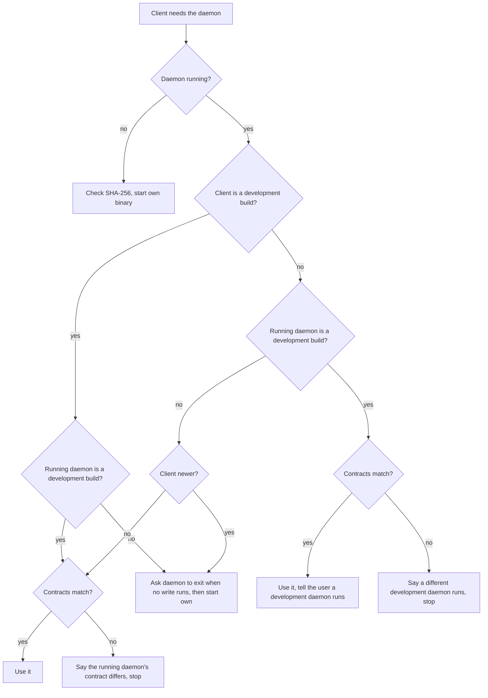
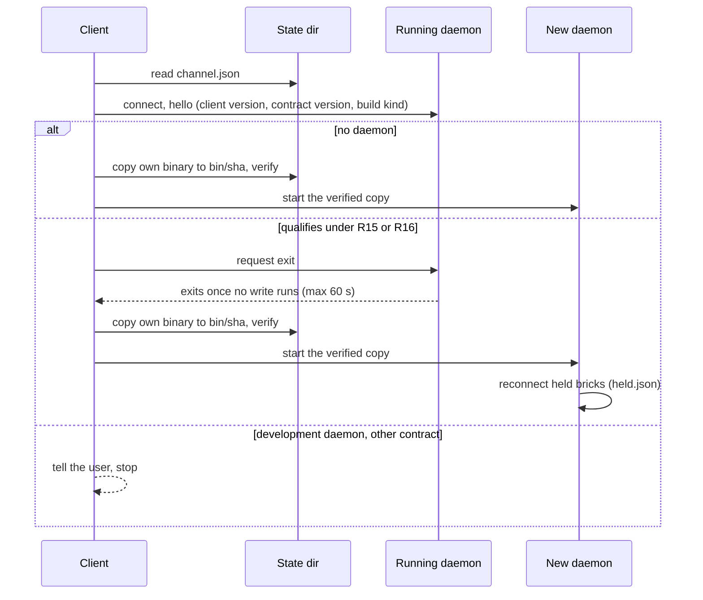
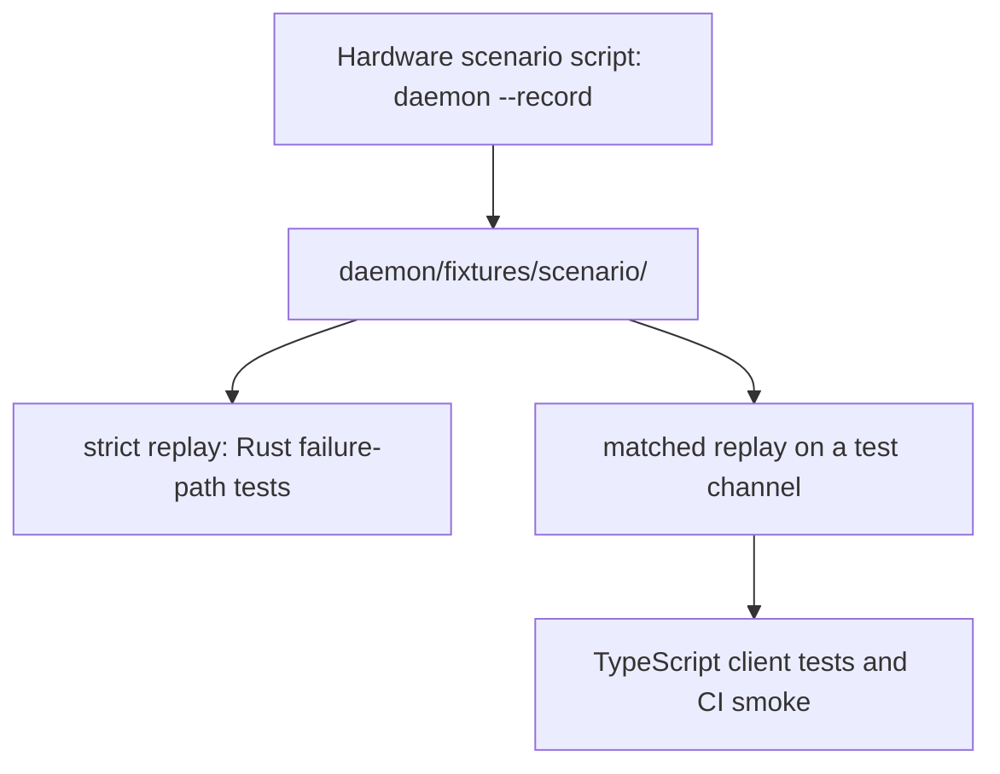

# Native Cockpit Daemon - Plan

## Goal Capsule

- **Objective:** On Windows and Linux, EVƎ Cockpit users get a brick daemon that runs on its own: it is independent of VS Code, needs no Node runtime, and answers on a channel only their account can use. VS Code, the `ev3` command and the MCP server work through it; add-ons such as EVƎ C get the new contract and work once they adopt it.
- **Means:** rewrite the whole per-user daemon as one native Rust binary, a Cargo workspace in `daemon/` of this repository, generated from one contract schema (KTD1), and delete the Node daemon and the TypeScript core once it takes over (U17).
- **Product authority:** owner decisions of 20.11.2026, in this document's Key Decisions, and in the vault note `10-Projekty/ev3-cockpit/Nativní komunikační vrstva — průzkum 2026-11-20` with its decision entry. macOS is not active scope. No backward compatibility is owed to anything, EVƎ C included.
- **Execution profile:** one branch, `feat/native-daemon`, merged into master after U17 (KTD13). The Node daemon stays untouched and working on that branch until U17. **Changed by the owner, 23.11.2026:** the branch was squash-merged into master before U16 and U17, to close this run; U16 (hardware sign-off), U17 (the switch) and the rest of U28 continue on master, and the Node daemon stays working there until U17.
- **Stop conditions:** stop and ask the owner when a U1 spike result rules out a KTD it tests, when a hardware round contradicts a parity rule, or when a unit would need a product decision this plan does not hold.
- **Who finishes:** the agent implements and commits; the owner runs the hardware rounds (U16) and decides on push.
- **Open blockers:** none.

---

## Product Contract

### Summary

The cockpit daemon becomes a single native Rust binary for Windows x64, Linux x64 and Linux arm64. It ships unsigned in the same VSIX and npm packages, at the same version as the rest. One language-neutral schema defines the contract, and both the Rust daemon and the TypeScript clients are generated from it. The TypeScript side keeps only the clients.

### Problem Frame

Since 4.10.2 every client reaches the bricks through one per-user daemon. That daemon is still a Node.js program, a leftover of the cockpit having been a VS Code extension only, and Node costs the product in four places:

- **VS Code updates.** The extension starts the daemon on VS Code's own `Code.exe` through the undocumented `ELECTRON_RUN_AS_NODE`. While the daemon runs, a VS Code update on Windows fails with `EBUSY`.
- **The channel.** Node cannot set a named pipe's security descriptor, so the pipe gets the default DACL. Its name derives from the user's SID, which other accounts can compute.
- **Native modules.** The transports rest on four npm native modules (`usb`, `node-hid`, `serialport`, `koffi`). Recorded failures: a libusb buffer overrun that crashed only under Electron, a koffi callback segfault, and a koffi connect that could not be aborted. Native npm modules are also an active supply-chain target (the 2025–2026 npm worms, one of them through `binding.gyp`).
- **Runtime dependency.** The daemon runs on whichever Node started it: VS Code's `Code.exe` or the Node running `ev3` or the MCP server. A daemon that needs no runtime of its own also serves clients written in other languages (ev3-python). `ev3` and the MCP server stay TypeScript and still need Node themselves.

Speed is not part of the problem. The brick sets the ceiling: 176 commands/s on USB, 62 on TCP and 10.7 on Bluetooth, with a 1 ms interrupt endpoint in the firmware.

### Key Decisions

- **The whole daemon moves to Rust, not only the transports.** Independence from `Code.exe` and the pipe's DACL come only from a native daemon process. (session-settled: user-directed — chosen over a native transport layer under the Node daemon, and over transports first and the rest later: those keep the daemon on `Code.exe`.) Governs R1, R2, R4.
- **Same repository, separate project.** One version and one release for VSIX and npm, and the contract and its tests in one place. Project boundary = language boundary. (session-settled: user-directed — chosen over a separate repository: versions and the contract would have to be synchronized across repositories.) Governs R1, R20.
- **The contract is a language-neutral schema, and both sides are generated.** It is readable by clients in any language later (ev3-python). (session-settled: user-directed — chosen over Rust as the source with generated TypeScript, and over the TypeScript contract mirrored by hand.) Governs R5, R6.
- **No backward compatibility, no parallel operation.** The Node daemon is dead now. Its contract shape, its tests and its open hardware rounds bind nothing. (session-settled: user-directed — chosen over running both daemons and switching per platform or by setting: the owner will not keep two implementations.) Governs R17, R18.
- **Windows and Linux first; macOS waits.** Borrowing a Mac again takes time. (session-settled: user-directed — the owner deferred macOS while keeping it in mind.)
- **Dropped in the rewrite:** the separate development daemon on its own channel, with brick loans and the hardware lock, and the handover to a newer daemon. Development and production never run side by side. (session-settled: user-directed — chosen over carrying both over 1:1.) Governs R13, R15, R16.
- **Every dangerous action is confirmed by a person the daemon asks.** The client-asserted `confirmedByPerson` flag goes. (session-settled: user-approved — chosen over today's mix, where the flag still authorizes `full` and restart: a flag a client sets itself can be forged.) Governs R9.
- **A development build takes the shared channel from a production daemon; a running development daemon stays (R16).** (session-settled: user-approved — chosen over deciding by version number alone: a work-in-progress build can carry a lower version than an installed release.) Governs R16.
- **Simulated bricks are deferred; recorded brick exchanges guard regressions.** (session-settled: user-approved — chosen over unit tests plus hardware only, and over a minimal mock now.) Governs R21.
- **Shipped unsigned.** No paid certificate, ever, and the owner took the research as sufficient without testing first. On Windows, SmartScreen does not apply to files that VS Code or npm extract (no Mark of the Web, measured on HOSTA). Smart App Control on Windows 11 blocks unknown unsigned code. Today that takes USB and Bluetooth (unsigned Node modules) while TCP still runs on the signed `Code.exe`; the unsigned daemon binary loses every transport on such a machine. The owner accepts that until SignPath signs the binary. Governs R11, R12.
- **The wire transport stays as it is.** JSON-RPC 2.0 with `Content-Length` framing over the per-user pipe or socket, with the mutual HMAC hello. Message content may change. The owner left this to the agent. Governs R7, R8.
- **Replacement is not a restart that needs a person.** Installing a newer release or building a development build is the person's own act, and the development mark is fixed at build time; R9's restart means an explicit restart request. (session-settled: user-approved — chosen over asking a person before every replacement: updates would stall whenever only an agent is connected.) Governs R9, R15, R16.
- **The channel name derives from the per-user key.** TypeScript clients have no native code left to check who serves a pipe, and a name other accounts cannot know gives the same protection. (session-settled: user-approved — chosen over a client-side check of the pipe server's owner: impossible from TypeScript without native modules.) Governs R10.
- **Holds survive replacement; recordings also drive a replay daemon.** Holds are the user's explicit intent, and the clients' tests need a daemon without bricks while simulated bricks stay deferred. (session-settled: user-approved — chosen over dropping holds silently, and over client tests with no daemon.) Governs R23, R24.
- **The switch happens before Phase 5 and before any release.** No backward compatibility holds only because nothing is published; Phase 5 UX is built on the new contract. (session-settled: user-approved — chosen over leaving the order to planning: UX on today's contract would be reworked.) Governs R18.

### Requirements

**The daemon**

- R1. One native binary built from Rust replaces the Node daemon on Windows x64, Linux x64 and Linux arm64.
- R2. The binary starts and runs with no Node, .NET or VS Code installed, and it holds no file inside VS Code's installation.
- R3. Pairing, Bluetooth scanning and presence on Windows are done by the daemon itself, with no separate helper process.
- R4. The daemon keeps today's behavior, except the separate development daemon with brick loans and the hardware lock, the handover, and the changes in R9 and R13–R16:
  - discovery and connection over USB, Bluetooth and TCP, with one brick shown once across its channels;
  - filesystem, transfers and the transfer ledger;
  - programs, including deploy-and-run;
  - telemetry with its throttle;
  - holders and a write lease per request;
  - the settings store, and the safe/full access policy;
  - the daemon log file;
  - the Linux BlueZ-group question;
  - ending after its last client leaves while no brick is held through `ev3 connect`.

**Contract**

- R5. The daemon–client contract is defined once, in a language-neutral schema, and Rust and TypeScript types are generated from it. Nothing is mirrored by hand.
- R6. Everything a client reads is typed in the schema. No field is `unknown` that a client then reads as a core TypeScript type, no error carries a TypeScript class name, and no launch description assumes a script interpreter.
- R7. The hello, the daemon's version and build kind (release or development), and the request to exit stay readable by every client and daemon version. A client whose contract differs from the running daemon's says so and stops instead of misbehaving.
- R8. Clients reach the daemon by JSON-RPC 2.0 with `Content-Length` framing over the per-user named pipe (Windows) or unix socket (Linux), after a mutual HMAC hello with the per-user key.

**Security**

- R9. Forget, clearing a brick's Bluetooth list, releasing a stuck transfer slot, switching to `full` and an explicit restart request each run only after the daemon has asked a client with a person (VS Code or a terminal) and received yes. The question names the client that asked for the operation (its name and kind), as a typed field of the contract.
- R10. On Windows, the daemon creates its pipe only as the first instance, with a DACL that admits only the current user, and refuses to serve when the name already exists. The channel's name derives from the per-user key and a value chosen anew at each daemon start, recorded only in an owner-only file, so another account cannot know the name before the daemon creates it, and a name seen once is worthless after the daemon exits. When the name is held all the same, daemon and client both say so. On Linux, the socket lives in a private directory owned by the user and readable by no one else, and the daemon refuses a foreign one.
- R11. Before starting the daemon, a client checks the binary against a SHA-256 shipped in its own package, which catches a corrupt or partial install. On a mismatch of the packaged binary it refuses and says why.
- R12. When Windows Smart App Control blocks the binary, the client tells the user that the cockpit cannot run on this machine while Smart App Control is on, and why, instead of a generic start failure.
- R25. The daemon refuses any local path a client names (to read from or write to) that resolves, through links and junctions, into the cockpit's own state, binary or runtime directories, whoever the client is.

**Lifecycle**

- R13. A user has at most one daemon at a time, on one channel shared by development and production builds. Automated test runs start their daemons on private test channels with their own state, never on the user's channel; the one-daemon rule and R16 apply only to the user's channel.
- R14. A client that finds no daemon starts the binary it carries itself.
- R15. A newer client that finds an older daemon asks it to exit once no write is in progress, then starts its own. Clients reconnect their bricks themselves, and no state is handed over.
- R23. Bricks held through `ev3 connect` stay held across a daemon replacement or crash: the daemon keeps its holds on disk and connects them again when it starts.
- R16. A development build replaces a running production daemon (once no write is in progress), whatever the versions. A running development daemon stays, whichever build it is; switching to another development build is an explicit restart from that build. A production client never replaces a development daemon: when their contracts match it uses it and tells the user a development daemon is running; when they differ it says so and stops (per R7). The development mark is fixed when the binary is built; no environment variable, argument or setting makes a release build count as a development build.

**The TypeScript side**

- R17. TypeScript keeps only the clients: the VS Code extension, the `ev3` command, the MCP server and `@ev3-cockpit/client`. The Node daemon, the TypeScript core and the npm native modules are deleted when the Rust daemon takes over.
- R18. The Node daemon gets no further work. Its open hardware rounds (F1 and F2 from `IMPLEMENTATION_PLAN.md` 4.10.2, `core-smoke` and `api-check` on a brick) are run against the Rust daemon instead.
- R19. The EVƎ C session is told about the new contract before the switch. Updating EVƎ C is that session's work and does not gate the switch.

**Distribution**

- R20. The binary ships in the per-platform VSIX (win32-x64, linux-x64, linux-arm64) and in per-platform npm packages, at the same version as the rest of the release, unsigned.

**Testing**

- R21. Automated tests replay brick exchanges recorded from real bricks during the hardware rounds, so protocol, file, program and telemetry behavior is guarded without hardware. The rounds also record induced failures (cable pulled mid-transfer, Bluetooth dropped, brick switched off during deploy-and-run), checked against the failure cases of today's test suite before the Node daemon is deleted.
- R22. The daemon's wire behavior that needs no brick is tested automatically against the running binary over its real channel. That covers the hello, errors, settings, questions and lifecycle.
- R24. The daemon can run on recorded exchanges instead of hardware, so the clients' automated tests and CI drive a real daemon without bricks. A daemon on a test channel never opens real hardware, and a daemon on the user's channel never runs on recordings. Recording writes only into an owner-only directory, and the hello tells clients which mode the daemon runs in.

### Key Flows

- F1. Development build takes the channel
  - **Trigger:** the developer starts a development build while the production daemon runs.
  - **Steps:** the development build asks the production daemon to exit. The production daemon finishes any write in progress and exits. The development daemon starts, and clients reconnect their bricks.
  - **Outcome:** only the development daemon runs. When it ends, nothing runs until the next client command starts the binary that client carries.
  - **Covered by:** R13, R14, R16
- F2. Release update
  - **Trigger:** VS Code or `ev3` updates and finds an older production daemon.
  - **Steps:** the client asks it to exit once no write is in progress, then starts its own binary after checking its SHA-256.
  - **Covered by:** R11, R14, R15



### Acceptance Examples

- AE1. **Covers R16.** **Given** a development daemon running a lower version than the installed release with the same contract, **when** VS Code from the release connects, **then** it uses the development daemon, shows that one runs, and does not replace it. With a different contract it says so and stops.
- AE6. **Covers R23.** **Given** a brick held through `ev3 connect`, **when** a newer daemon replaces the running one, **then** the new daemon connects that brick again without any client asking.
- AE2. **Covers R15.** **Given** an older production daemon writing a program to a brick, **when** a newer `ev3` asks it to exit, **then** the write completes before the daemon exits, and `ev3` then starts its own binary.
- AE3. **Covers R9.** **Given** only an MCP client connected, **when** it asks to switch to `full`, **then** the daemon finds no person to ask and refuses, naming the command a person runs.
- AE4. **Covers R11.** **Given** a packaged daemon binary whose SHA-256 differs from the one in the client's package, **when** the client would start it, **then** it refuses and names the mismatch. A stale or broken copy in the state directory is replaced, not refused.
- AE5. **Covers R12.** **Given** Windows 11 with Smart App Control on, **when** the extension starts the daemon and Windows blocks it, **then** the user sees that Smart App Control blocked the unsigned cockpit binary and that the cockpit cannot run on this machine while it is on.

### Success Criteria

- Hardware rounds pass on HOSTA (Windows), HOSTD (Linux x64) and the RPi5 (Linux arm64), over USB, Bluetooth and TCP. Each round covers connecting, file operations, deploy-and-run, telemetry, pairing and forget, and each is driven from VS Code, `ev3` and the MCP server.
- A VS Code update on Windows succeeds while the daemon runs.
- The repository no longer contains the Node daemon, the TypeScript core or the npm native modules.

### Scope Boundaries

**Deferred for later**

- macOS on the Rust daemon, including the Swift IOBluetooth helper and its TCC behavior.
- Simulated (mock) bricks; planned for the next version.
- Applying to the SignPath Foundation for free signing; after the Marketplace launch.
- Revisiting the communication lab's rule NF4.1 ("bez přepisu do jiného jazyka") and the lab's future.

**Removed from the product**

- macOS support until the Rust daemon covers it: today's darwin-arm64 VSIX and its Bluetooth path go with the TypeScript core.
- The separate development daemon on its own channel, with brick loans and the hardware lock.
- The handover to a newer daemon, which kept held bricks and unstored settings.
- The client-asserted `confirmedByPerson` flag.
- Simulated bricks in the extension until the next version: the `ev3-cockpit.mockBricks` setting and the daemon's `--simulated`, `--mock-bricks` and `--mock-workspace` flags. The Extension Development Host runs on real bricks or, for tests, on recordings (R24).
- The TypeScript-only repository goal (IMPLEMENTATION_PLAN 7.8).

### Dependencies / Assumptions

- The trust model stays same-user. Any process holding the user's key, an add-on or an agent with a shell included, can claim to be a VS Code or terminal client and answer its own questions. R9 therefore guards against agents that reach the daemon only through the MCP server, not against add-ons or shell-capable agents.
- Smart App Control can switch back on without reinstalling Windows (KB5083769, 04.2026), so the share of blocked machines can grow. No free mitigation exists until SignPath.
- The agent writes the Rust; the owner reviews as architect.
- No CI workflow builds on Linux today; the Linux binaries need one.

### Outstanding Questions

**Open, not blocking this plan**

- A confirmation the daemon owns itself (its own window or prompt) that no client can answer over the channel, closing the gap in the trust model above.
- Whether the Marketplace launch waits for macOS on the Rust daemon or ships Windows and Linux first.

### Sources / Research

- Vault: `10-Projekty/ev3-cockpit/Nativní komunikační vrstva — průzkum 2026-11-20` (verdict, gains and costs, signing research), with dossiers in `zdroje-nativni-vrstva-2026-11-20/` and the planning research in its `plan/` folder (`repo-research.md` carries the parity checklist; `framework-docs.md`, `best-practices.md`, `spec-flow.md`).
- Current contract: `src/contract/methods.ts` (46 methods), `src/contract/events.ts` (15 notifications, `question/ask`), `src/contract/errors.ts` (30 codes), `src/contract/hello.ts`, `docs/protocol.md`.
- Places tying the contract to TypeScript or Node: `src/contract/errors.ts:59-101` (class names), `src/vscode/daemonBridge.ts:55-64,96,143,152` (`asCoreError`, untyped `details` and `repair`), `src/contract/models.ts:246-254` (`LaunchSpec`).
- The daemon being replaced: `src/daemon` (3.2k lines) and `src/core` (~30k lines). Brick ceilings: `DESIGN.md:1376`. The `EBUSY` measurement and the owner's runtime choice: `IMPLEMENTATION_PLAN.md:2062-2072`. The pipe DACL limit: `docs/plans/2026-11-19-0937-feat-cockpit-daemon-and-clients-plan.md` (KTD3).
- Rules this supersedes: `DESIGN.md:262-268` (in-process backends only), `IMPLEMENTATION_PLAN.md` 7.8, and `IMPLEMENTATION_PLAN.md:1043-1050` (the Rust addon as an unwritten candidate).

---

## Planning Contract

**Product Contract preservation:** changed R10 (key- and start-derived channel name instead of a client-side owner check), R16 (development builds no longer replace each other) and AE1 (a production client stops on a different contract); added R23 (holds survive replacement), R24 (replay daemon) and AE6 — all confirmed by the owner in the plan synthesis of 20.11.2026. The deepening of 21.11.2026 (security review) changed the wording of R10, R11, R24 and AE4 to what the mechanisms actually guarantee, added R25 (the daemon never writes into its own directories) and listed the simulated-brick setting and flags under Removed. Resolved questions moved into KTD1–KTD16.

### Key Technical Decisions

- KTD1. **The contract is JSON Schema draft-07 under `contract/`, generated into both languages.** `typify` produces the Rust types, `json-schema-to-typescript` the TypeScript types, and a small in-repo generator reads one method table (method → params, result, leased, person-only, callable client kinds; notification → payload; error code → family) and emits the Rust dispatch trait and the TypeScript `Methods`/`Notifications` maps, as LSP generates from `metaModel.json`. The contract version is an integer in `contract/methods.json`, generated into both languages, and it marks only breaking changes: a removed or renamed method, field or error code, a field that changes type or becomes required, a changed meaning. Additive changes (a new optional field, a new method, a new notification, a new error code inside an existing family) keep it, so a client meeting a newer daemon with the same contract version keeps working; this is what keeps the npm-installed `ev3` and the MCP server working after VS Code updates itself and starts a newer daemon. The generator keeps the previous release's canonical schema and method table and fails when a breaking change lands without a raised contract version. A hash of the canonical schema stays as the staleness check for generated files, not as the contract version. (session-settled: user-approved 21.11.2026 — chosen over hashing the whole schema, which broke every client from another release on any contract change.) Schema rules: no `anyOf`; `oneOf` only with a required `const` tag; objects on the stable core (R7) accept unknown properties. TypeScript output goes to `src/contract/generated/` beside today's hand-written contract, which the Node daemon keeps using until U17. Rejected: OpenRPC (no maintained generator for both languages), TypeSpec (no JSON-RPC emitter). Measured in U1 (21.11.2026) on a five-method slice: `typify` 0.10.1 and `json-schema-to-typescript` 16.0.0 both compile it and a message survives Rust → TypeScript → Rust unchanged; a const-tagged `oneOf` becomes a serde-tagged Rust enum and a TypeScript discriminated union whose `switch` is exhaustive under `strict`; an unknown tag fails in Rust; closed objects reject unknown properties; open objects accept them, but the Rust side drops them, which is enough because the daemon never relays a client's object; the root type takes the schema's `title`. Governs R5, R6, R7.
- KTD2. **A hand-written JSON-RPC codec and dispatcher on `tokio-util`, in `crates/daemon`.** It frames `Content-Length` like `vscode-jsonrpc`, caps a message at 1 MiB, answers `$/cancelRequest` and `$/progress`, and lets the daemon send requests to a client (`question/ask`). No crate fits: `jsonrpsee` lacks the framing and server-to-client requests, `lsp-server` is synchronous, `async-lsp` is tied to `lsp-types`. Governs R8.
- KTD3. **Channel, key and directories follow one written spec, `docs/channel.md`, with cross-language test vectors.**
  1. State root: the Rust daemon uses `<platform state dir>/ev3-cockpit/native/`, apart from the Node daemon's root, while both exist; U17 migrates (KTD15).
  2. Key: created only by the daemon, written to a temporary file in the same directory with the owner-only permissions set at creation, then linked into place without replacing; readers retry a short read. The daemon checks the key on every new connection and, when it changed, releases the hardware and exits. No message ever tells a user to delete the key.
  3. Single instance: before anything else the daemon takes an exclusive OS lock (`LockFileEx` on Windows, `flock` on Linux) on an owner-only `daemon.lock` in the state root, or in `channels/<name>/` for a test channel, and holds it for its whole life; a daemon that cannot take it exits with code 2. The OS releases the lock when the daemon dies, so no stale lock survives a crash. Node cannot take an OS lock, so a client tests liveness the way each system allows (measured 21.11.2026): on Windows the daemon also keeps `daemon.lock` open with share mode 0 for its whole life, a client that can open it knows no daemon runs (an open fails with EBUSY while the daemon lives; Node opens share-none with libuv's flag `0x10000000`), and that client deletes the stale `channel.json` while it still holds the file, so no daemon can write a fresh record in between; the daemon retries its share-none open for about a second, because a client probe holds the file for a moment. On Linux the client checks the PID recorded in `channel.json` and the connect (ENOENT or ECONNREFUSED is stale) and deletes the record only if it is unchanged.
  4. Name: an HMAC-SHA256 of the key over a fixed label and a 16-byte value drawn at each start, truncated. Only the lock holder writes the full pipe or socket path and its PID to an owner-only `channel.json`, and removes it on a clean exit. A client connects only to the path recorded there, after checking that the socket directory is owner-only, and never recomputes it. A client that can take `daemon.lock` knows no daemon runs: it deletes `channel.json` and starts a fresh daemon on a new name, and never contacts the old one. A daemon proof that fails while the lock is held is reported as a held channel. The daemon always keeps one listening pipe instance open, each created with the owner-only DACL. A test channel adds its name to the label.
  5. Windows: `\\.\pipe\ev3-cockpit-<h>`, created with `first_pipe_instance`, an owner-only SDDL DACL and remote clients rejected.
  6. Linux: the socket lives in `$XDG_RUNTIME_DIR/ev3-cockpit/`, else in the state root's `run/` (never `/tmp`), in a directory owned by the user with mode 0700, path under 108 bytes.
  7. The vectors in `contract/vectors/` cover the hello proofs and the `channel.json` format, checked by a Rust test and a TypeScript test; the name derivation is tested in Rust only, since clients read the path.

  Governs R10, R13.
- KTD4. **USB goes through libusb (`rusb` with vendored libusb), with `hidapi` as the 64-byte fallback.** On Windows only libusb's HID backend reached the brick's full 1024-byte frames; `hidapi` follows the brick's descriptor to 64 bytes, about 40× slower for files (`src/core/transports/transportConstants.ts:21-42`). The port keeps exact-size transfers, the one-byte read overrun on Windows, skipping claimed devices during enumeration, and the 3000 ms close drain (`src/core/transports/usbLibusbAdapter.ts`). Measured in U1 on HOSTA (21.11.2026): `rusb` 0.9.4 with vendored libusb reaches the 1024-byte endpoints; a 100 kB file wrote at 246–379 KB/s and read at 247–403 KB/s over three runs, read back byte for byte (the Node daemon: 200 and 325 KB/s). On Windows libusb's HID backend reports 1025 bytes written for a 1024-byte frame, counting the report id, so a write is complete when it reports at least the frame.
- KTD5. **Windows Bluetooth ports the testlab winners.** Data goes over Winsock `AF_BTH`, RFCOMM channel 1, connected non-blocking and polled, never a blocking connect aborted by close. Measured in U1 on HOSTA (21.11.2026): tokio's reactor registers the non-blocking `AF_BTH` socket handed over as a standard TCP stream, reports the connect's completion (1.4–1.5 s) with its `SO_ERROR` (10064 for a brick with Bluetooth off), and 50 listings ran at 28–35 per second; so links run on tokio, using only that stream's read, write and readiness, never its address methods. `SOCKADDR_BTH` is packed to 30 bytes; the padded layout fails with WSA 10049. Presence uses Winsock SDP with `LUP_FLUSHCACHE` on a thread that can be abandoned. Discovery uses `bthprops` enumeration. Pairing is WinRT `DeviceInformationCustomPairing` in the daemon, on its own STA thread, from a live `DeviceWatcher` entry, offering only `ProvidePin` with 1234. Forget removes the device from Windows and the brick's list. Crates: `windows` 0.62.2 and `windows-sys` 0.61.2, pinned. Governs R3, R4.
- KTD6. **Linux Bluetooth is `zbus` plus raw sockets, mirroring today's TypeScript design.** `zbus` is pure Rust; RFCOMM channel 1 and the L2CAP PSM 1 presence probe go through `libc` sockets; the pairing agent answers `RequestPinCode` with 1234 without `RequestDefaultAgent`; the radio self-heal and the group question port as they are (`src/core/transports/bluezRadioWatch.ts`, `src/daemon/bluetoothAccess.ts`). Rejected: `bluer` (links libdbus, last release 06.2025, BR/EDR gaps). Governs R4.
- KTD7. **Record and replay sit at the provider trait.** A recording holds the provider-level events of a session: discovery and presence results, pairing and forget outcomes, and the link bytes each way with timing and failures. Two replay modes:
  - strict replays the sequence exactly and fails on any deviation (Rust failure-path tests);
  - matched serves, for each request with its message counter masked, the recorded replies in recorded order, rewriting each reply's counter to the live request's (client tests).

  A request with no recorded reply left fails with `replay_unmatched`, so a stale fixture shows up instead of hiding. Each scenario script publishes the brick names, paths and file contents it uses; client tests use exactly those inputs, and a test that needs new brick-side inputs is a re-recording task. The recorder replaces identifiers as it captures, consistently and keeping lengths: brick Bluetooth addresses and serials, this computer's name and adapter address, and LAN addresses become the repository's placeholders (AAA/BBB/CCC, `00:16:53:F0:0A:0A`…, HOSTA/HOSTB, documentation address ranges), in provider events and link bytes alike. Fixtures live in `daemon/fixtures/<scenario>/` with the scenario script and recorder version; a runtime change that changes exchanges is answered by re-running the script on hardware, never by editing a fixture. `--record` writes only into an owner-only directory. A test channel runs on recordings, and opens real hardware only to record; the user's channel runs on hardware only, and never records. Governs R21, R22, R24.
- KTD8. **Daemon process rules.**
  - `tokio` 1.54.1 multi-thread.
  - A log rotated by size (5 MB × 3) by our own writer, since `tracing-appender` rotates only by time.
  - The daemon refuses to run as administrator on Windows and as root on Linux.
  - It exits 10 s after the last client while nothing is held.
  - The hello carries version, contract version (KTD1), build kind, build id and mode (hardware or replay) from the daemon, and the client's version, contract version and build kind from the client; KTD16 judges exit requests from these. The build id is the SHA-256 of the daemon's own executable, computed at start; the build kind is a compile-time constant.
  - "A write in progress" is a leased operation, a pairing, or a forget or clear-list; a replacement waits for it at most 60 s, telling the user, then gives up.
  - Holds persist in `held.json` (R23).
  - A new daemon's first Bluetooth connect to a brick treats WSA 10064 and `EBUSY` within 5 s of its start as retryable, since the previous daemon's close time is unknown.

  Governs R13–R16, R23.
- KTD9. **Clients launch a verified per-user copy of the binary.**
  1. The client copies the binary it carries to `bin/<sha>/` under the state root, through a unique temporary file renamed into place. The directory holds only the binary and is checked owner-only like the key.
  2. It hashes the copy, not the source. A copy that verifies is reused; one that does not is replaced.
  3. It spawns exactly the path it verified. The installed file is never locked, so `npm i -g` and rebuilds work while a daemon runs.
  4. A packaged binary that mismatches its package's SHA-256 is refused (R11). A swap between hash and spawn by the same user is outside the trust model; another account is shut out by the owner-only directory.
  5. Clients remove copies in `bin/` other than the current and running ones, skipping locked files.
  6. Development clients (the Extension Development Host, `ev3` run from the repository) locate `daemon/target/<profile>/ev3-cockpitd`, whose manifest a build step writes after each `cargo build`; no environment variable redirects a release client.
  7. A Windows spawn that fails, with any error code or by exiting before the hello, is classified as Smart App Control when a `reg.exe` read of the code-integrity policy (`VerifiedAndReputablePolicyState`) reports it on or in evaluation. The raw error never reaches a TypeScript client: Node 26.12's libuv 1.52.1 maps no code-integrity error, so a blocked spawn surfaces as `spawn UNKNOWN` (errno -4094) (U1, read from libuv's `src/win/error.c`; not yet seen on a machine with Smart App Control on, HOSTA has it off). That case shows the R12 message and is not retried. The verified copy starts with its working directory set to the state root.

  `LaunchSpec` becomes the binary path, its SHA-256, the version and the build kind. Governs R11, R12, R14.
- KTD10. **Person questions name the requester; remembered answers apply only to the asker's own requests.** The daemon routes a question to a VS Code or terminal client and names the requesting client's name and kind. A client's remembered answers apply only to its own requests. 60 s without an answer refuses the operation. Governs R9.
- KTD11. **Today's TypeScript is the behavior spec.** Each subsystem is ported against the parity checklist (planning research `repo-research.md` §1), every rule there gets a Rust test or a fixture, and firmware workarounds must work on the original and on a fixed firmware. The TypeScript core tests leave with the core in U17; their failure cases become the R21 checklist.
- KTD12. **CI builds natively per target.** `windows-latest` builds and tests win32-x64; `ubuntu-22.04` and `ubuntu-22.04-arm` build linux-x64 and linux-arm64 (glibc 2.35, so the binaries run on Debian 12 and Raspberry Pi OS). Linux VSIXes are packaged on Linux so executable bits survive. Each job publishes the binary's SHA-256 and an `actions/attest` provenance attestation. The darwin target, `vsix-macos.yml` and the .NET helper build leave CI.
- KTD13. **One branch, Rust beside Node until the switch.** All units land on `feat/native-daemon`; the Node daemon and the TypeScript core stay untouched and working until U17 deletes them; the branch merges into master after U17 and the hardware rounds. Nothing is published before the merge.
- KTD14. **Consent and activity are ports the runtime owns.** The runtime crate defines two interfaces: ask a person (with the requester) and report activity (a write starts or ends). Transports and services call them; the daemon crate implements them (U12), and lower-layer tests use fakes. The per-brick guard (the rate window across a brick's channels) and the command FIFOs live in the runtime, where brick identity across channels lives; the FIFO is one per session (a brick on one channel), as in the TypeScript, so a USB exchange hung after a cable pull does not stall the same brick's Bluetooth traffic, and writes to one brick are serialized by its lease (settled while building the sessions, 21.11.2026); transports take the brick key from the contract types. Governs R9, R15.
- KTD15. **The switch migrates the user's state.** U17 merges the old root's `ledger.json` into the native ledger, adding every debt keyed by brick and slot that the native one lacks (the debts must survive, or the brick's firmware slots stay taken), copies `settings.json` when absent, and removes the old root's `key`, `handover*.json`, `hardware.lock`, `install.json` and `channels/dev`. The Node daemon of an older extension folder still left on disk runs on its own channel and idles out.
- KTD16. **The daemon decides on exit requests itself.** It replaces itself only when the requesting client's hello qualifies under R15 or R16; any other exit request is an R9 restart that needs a person. The method table marks the exit method as not callable by the `mcp` client kind. Governs R9, R15, R16.

### High-Level Technical Design

Architecture: one schema feeds both languages; the daemon is a Cargo workspace; TypeScript keeps only clients.

```mermaid
flowchart TB
  S[contract/ JSON Schema + method table] --> G1[Rust types and dispatch trait]
  S --> G2[TypeScript types and method maps]
  G1 --> D[ev3-cockpitd]
  G2 --> C1[@ev3-cockpit/client]
  C1 --> V[VS Code extension]
  C1 --> CLI[ev3 CLI]
  C1 --> M[MCP server]
  C1 --> A[add-ons]
  D --> R[runtime: sessions, bricks, telemetry, files, programs, consent and activity ports]
  R --> P[EV3 protocol]
  P --> T[transports: USB libusb, TCP, BT Winsock/WinRT, BT BlueZ, replay]
  V -. pipe or socket named in channel.json, HMAC hello .-> D
```

Launch and replacement, as a client sees it (R13–R16, KTD8, KTD9, KTD16):



Record and replay (KTD7):



### Output Structure

```text
contract/                 schema, method table, channel test vectors
daemon/
  Cargo.toml              workspace
  crates/contract/        generated types, dispatch trait, contract version
  crates/protocol/        EV3 packets, bytecode, commands, replies
  crates/transports/      provider trait, usb, tcp, bt_windows, bt_linux, recorder, replay
  crates/runtime/         ports, queue and guard, sessions, bricks, files, programs, telemetry
  crates/daemon/          binary: channel, key, codec, hello, surface, lifecycle, log
  fixtures/               recorded scenarios
src/contract/generated/   TypeScript generated from contract/
docs/channel.md           channel, key and directory spec
```

### System-Wide Impact

- **Clients:** the VS Code extension, `ev3`, the MCP server and `@ev3-cockpit/client` move to the generated contract (U14, U24, U25). Errors are decided by code, never class name.
- **Add-ons and EVƎ C:** `install.json` (the add-on launch record) becomes schema-typed and carries the SHA-256 (U14). The exports of `@ev3-cockpit/client` change (`installedLaunch`, `clientPaths`, the contract types); U14 writes the diff that R19 sends to EVƎ C.
- **Start failures:** every client classifies start failures the same way (missing binary, SHA mismatch, Smart App Control, name held, contract mismatch) and shows them its own way: VS Code a message, `ev3` an exit code and `--json`, MCP a tool error (U14, U24, U25).
- **State on disk:** the native root, its migration and the old root's leftovers (KTD3, KTD15).
- **Packaging:** the udev and polkit rules `native/linux/70-lego-ev3.rules` and `71-ev3-cockpit-bluetooth-restart.rules` keep shipping; the log location is documented in `docs/channel.md` because the hardware protocol reads it.
- **Hosts:** on HOSTA, HOSTD and the RPi5 no Node daemon may run while the Rust daemon owns the bricks, since the hardware lock is gone and both would open the same brick (precondition of every hardware step).

### Risks & Dependencies

- **USB speed (KTD4).** Settled by U1: `rusb` reaches the 1024-byte path on Windows.
- **Bluetooth threading (KTD5).** Settled by U1: tokio drives the `AF_BTH` socket. The handover through a standard TCP stream is not a documented use; if a later Windows breaks it, one thread per link polling with `select` is the fallback and costs little at four bricks or fewer.
- **Linux measured on the RPi5 (21.11.2026 evening, linux-arm64, Debian 13, systemd).** Raw sockets and BlueZ as decided: the L2CAP PSM 1 probe heard CCC in 3.2 s, RFCOMM channel 1 connected in 245 ms and ran 26.9 listings per second, all three bricks known to BlueZ; `XDG_RUNTIME_DIR` is `/run/user/1000` (mode 0700) under systemd (runit on HOSTD still unmeasured). On USB the brick needs the clear-halt after detaching usbhid and one unreadable first packet stepped over, as the transport already does. All 69 arm64 test binaries pass on the Pi, the daemon's process, lifecycle and surface tests included. The daemon itself served CCC on the user's channel: hello, connect in 13 ms, info, a 3000-byte write read back identical, 69 telemetry rows, 260-280 listings per second through the daemon, and CCC signed in over USB, Bluetooth and TCP at once. Found: `bricks/list` with `waitForDiscovery` answers at once with what the first moment knows instead of waiting for the first discovery round.
- **Spikes still open after 21.11.2026 morning.** WinRT custom pairing from a tokio process (needs the owner at a brick) and all of HOSTD (`zbus` discovery and agent pairing, raw RFCOMM, the L2CAP probe, `XDG_RUNTIME_DIR` under runit; HOSTD was unreachable). They gate U8's pairing and U9, not U2–U7.
- **Pipe impersonation.** Measured in U1: a Node 26 client and VS Code's Electron as Node both grant the pipe server `SecurityImpersonation`, and Node offers no way to lower it. Only an account holding `SeImpersonatePrivilege` (services, administrators) can act with such a token of another user; an ordinary account gets an identification-level token. KTD3 keeps clients from ever connecting to a name another account could serve: they connect only to the path a live lock holder recorded.
- **Two daemons on one brick.** During the work a Node daemon from master and the Rust daemon can open the same brick; every hardware step (U1, U6–U9, U18, U26, U16) first confirms that no Node daemon or probe process runs on the host.
- **Parity gaps.** About 30k lines of TypeScript carry hard-won rules; a missed one returns as a hardware bug. The checklist (KTD11), the early recordings (U18) and the induced failures (R21) guard it; rounds run on all three bricks, never one.
- **Scope.** The largest change the project has made. The branch stays shippable on the Node daemon until U17 (KTD13).
- **Smart App Control.** Accepted until SignPath (Key Decisions); U14 makes the block legible.

---

## Implementation Units

| U-ID | Title | Key files | Depends on |
|---|---|---|---|
| U1 | Spikes on hardware | `daemon/spikes/` | — |
| U2 | Contract schema and generators | `contract/`, `daemon/crates/contract/`, `src/contract/generated/` | U1 |
| U19 | Client channel and hello | `src/client/{channel,locate,hello}.ts` | U2 |
| U3 | Daemon skeleton | `daemon/crates/daemon/`, `docs/channel.md` | U2, U19 |
| U4 | EV3 protocol | `daemon/crates/protocol/` | U2 |
| U5 | Provider trait, recorder, replay | `daemon/crates/transports/{provider,recorder,replay}` | U4 |
| U6 | USB transport | `daemon/crates/transports/usb` | U5 |
| U7 | TCP and beacon transport | `daemon/crates/transports/tcp` | U5 |
| U8 | Bluetooth on Windows | `daemon/crates/transports/bt_windows` | U5 |
| U9 | Bluetooth on Linux | `daemon/crates/transports/bt_linux` | U5 |
| U18 | Link recordings | `daemon/fixtures/link/`, `daemon/crates/transports/examples/record.rs` | U6, U7 (BT after U8, U9) |
| U10 | Sessions | `daemon/crates/runtime/{ports,queue,guard,session}` | U18 |
| U20 | Brick layer | `daemon/crates/runtime/bricks` | U10 |
| U21 | Forget, clear and one-sided repair | `daemon/crates/runtime/{forget,repair}` | U20 |
| U11 | Files, transfers and the ledger | `daemon/crates/runtime/{fs,transfer,ledger}` | U20 |
| U22 | Programs and deploy-and-run | `daemon/crates/runtime/programs` | U11 |
| U23 | Telemetry | `daemon/crates/runtime/telemetry` | U20 |
| U12 | Daemon surface | `daemon/crates/daemon/surface` | U3, U21, U22, U23 |
| U13 | Lifecycle and replacement | `daemon/crates/daemon/lifecycle` | U12 |
| U26 | Service recordings | `daemon/fixtures/service/`, `scripts/hardware-scenario.js` | U13 |
| U14 | Client library | `src/client/` | U26 |
| U24 | VS Code extension | `src/vscode/` | U14 |
| U25 | CLI and MCP | `src/cli/`, `src/mcp/` | U14 |
| U27 | Native `ev3` and `ev3 mcp` | `daemon/crates/{channel,cli}/` | U25 |
| U28 | Two languages | `scripts/`, `native/`, `docs/plans/*.py` | U27, U17 |
| U15 | Packaging and CI | `scripts/`, `.github/workflows/` | U24, U25 |
| U16 | Hardware sign-off | `daemon/fixtures/`, `scripts/` | U15 |
| U17 | The switch | `src/core/`, `src/daemon/`, docs | U16 |

### U1. Spikes on hardware

- **Goal:** settle the mechanisms the plan cannot decide on paper, before anything depends on them.
- **Requirements:** R3, R4, R5, R10; KTD1, KTD3, KTD4, KTD5, KTD6.
- **Dependencies:** none.
- **Files:** `daemon/spikes/` (throwaway); results recorded in this plan's KTDs.
- **Approach:**
  1. Schema: a five-method slice through `typify` and `json-schema-to-typescript`, including a tagged union and an error enum; both sides compile and round-trip a message.
  2. USB on HOSTA: open a brick with `rusb` (vendored libusb), exchange a 1024-byte frame and a 100 kB file; compare with today's 200/325 KB/s.
  3. Bluetooth on HOSTA: non-blocking `AF_BTH` connect to channel 1 and an exchange, first under tokio, else on a thread; WinRT custom pairing of a forgotten brick from inside a tokio process.
  4. Bluetooth on HOSTD: `zbus` discovery and agent pairing, a raw RFCOMM exchange, the L2CAP presence probe; check whether runit sets `XDG_RUNTIME_DIR`.
  5. Pipe: a test pipe server records the impersonation level a Node client's connect grants.
  6. Smart App Control: from Node on HOSTA, spawn an executable that a code-integrity policy blocks and record the exact error Node reports.
- **Execution note:** a measurement unit. Before each hardware step confirm that no Node daemon or probe process runs on the host. Record each result and the decision it settles in the plan and commit that before U2, as the project rule for measured decisions requires.
- **Test expectation:** none -- throwaway spikes; their measurements are the deliverable.
- **Verification:** each question has a recorded answer with numbers; any KTD a result contradicts is rewritten or escalated per the stop conditions.

### U2. Contract schema and generators

- **Goal:** one schema produces the Rust and TypeScript contract, including the method table, the contract version and the stable core.
- **Requirements:** R5, R6, R7; KTD1, KTD16.
- **Dependencies:** U1.
- **Files:** `contract/schema/*.json`, `contract/methods.json`, `contract/vectors/channel.json`, `scripts/generate-contract.cjs`, `daemon/crates/contract/`, `src/contract/generated/`, `src/__tests__/contractGenerated.test.ts`, `daemon/crates/contract/tests/`.
- **Approach:**
  1. Write the schema from today's contract, typing every field clients read as `unknown` today: forget and clear reports, one-sided repair, pairing events and results, the pairing-cancelled outcome, `install.json`.
  2. Errors carry `code` and family only. Questions carry the requester (KTD10). The settings spec, including CLI keys, becomes schema data. The exit method is not callable by `mcp`.
  3. `LaunchSpec` per KTD9; hello per KTD8.
  4. Mark the stable core and keep it open to unknown properties.
  5. The generator emits Rust types, the dispatch trait, the TypeScript maps and the contract version; CI fails when generated files are stale or when a breaking change lands without a raised contract version (KTD1), compared against the previous release's schema kept in `contract/released/`.
- **Patterns to follow:** `src/contract/methods.ts`, `src/contract/errors.ts`; the D-Bus fixture generator for "generated, do not edit".
- **Test scenarios:**
  - A message for each method round-trips Rust → JSON → TypeScript type check.
  - An unknown property on a stable-core message is accepted by both sides.
  - A `oneOf` without a const tag fails the generator.
  - Adding an optional field or a method keeps the contract version; removing a field, renaming a method or making a field required without raising it fails the generator, and the raised version appears on both sides.
  - A stale generated file fails the check.
- **Verification:** the Rust contract crate and `src/contract/generated/` build from the schema alone; the hand-written contract stays untouched for the Node daemon.

### U19. Client channel and hello

- **Goal:** TypeScript code that finds and authenticates to the Rust daemon, independent of `src/daemon`.
- **Requirements:** R8, R10, R13; KTD3.
- **Dependencies:** U2.
- **Files:** `src/client/channel.ts`, `src/client/locate.ts`, `src/client/hello.ts`, `src/__tests__/clientChannel.test.ts`.
- **Approach:** implement the `docs/channel.md` rules (state root, key read with retry, `channel.json` with the recorded path, the liveness check through `daemon.lock`, test channels) in client-owned code; the old imports from `src/daemon` stay for the Node path until U17.
- **Test scenarios:**
  - The hello proof vectors match the Rust side.
  - A missing `channel.json` reads as "no daemon"; one whose daemon no longer holds the lock is deleted and never contacted.
  - Daemon and client that resolve `XDG_RUNTIME_DIR` differently still connect, because the client uses the recorded path.
  - A short key read is retried, then reported as unreadable without advice to delete it.
- **Verification:** `rustDaemonWire.test.ts` (U3) connects through this code.

### U3. Daemon skeleton

- **Goal:** a binary that clients find, authenticate to and talk to, with no bricks yet.
- **Requirements:** R1, R2, R8, R10, R13, R22, R25; KTD2, KTD3, KTD8.
- **Dependencies:** U2, U19.
- **Files:** `daemon/crates/daemon/src/{main,channel,key,paths,hello,codec,log,settings,status,confine}.rs`, `docs/channel.md`, `daemon/crates/daemon/tests/`, `src/__tests__/rustDaemonWire.test.ts`.
- **Approach:**
  1. Paths, atomic key creation, key-change watch and channel per KTD3; refuse elevated or root.
  2. DLL hardening on Windows: system-directory-only search for runtime loads and the dependent-load flag for static imports (verify the exact linker setting against Microsoft Learn when implementing).
  3. Codec and dispatcher (KTD2); hello with mutual HMAC as `src/contract/hello.ts` defines it, extended per KTD8.
  4. Settings store from the schema's spec; `full` never stored; log rotation by size.
  5. Path confinement (R25) as one check every file method uses.
  6. Single instance by `daemon.lock` (KTD3); idle exit.
- **Patterns to follow:** `src/daemon/key.ts`, `src/daemon/hello.ts`, `src/daemon/settingsStore.ts`, `src/daemon/channel.ts` (private directory checks).
- **Test scenarios:**
  - A TypeScript client completes the hello on a test channel; a wrong key fails both proofs.
  - A message over 1 MiB closes the connection.
  - A second daemon started while the first holds `daemon.lock` exits with code 2; two daemons started at once leave one.
  - After a crash, the old `channel.json` is detected as stale through the lock, a pipe squatted under the old name is never contacted, and a fresh daemon starts on a new name.
  - A pipe name already created by someone else makes the daemon refuse and say so.
  - Two clients starting the first daemon at once end with one key.
  - The key replaced while a daemon holds a brick: the daemon releases the hardware and exits before a new one opens it.
  - A socket directory owned by another user or readable by others is refused.
  - Started elevated (Windows) or as root (Linux), the daemon refuses.
  - A path resolving into the state root through a junction or link is refused.
  - A DLL planted under an imported name beside the binary is not loaded.
  - Idle exit 10 s after the last client; `accessMode` `full` is never written to the settings file.
- **Verification:** today's CLI commands that need no brick answer through U19's client code against the binary on a test channel.

### U4. EV3 protocol

- **Goal:** the EV3 packet, bytecode, command and reply encoding in Rust, byte-identical to today.
- **Requirements:** R4; KTD11.
- **Dependencies:** U2.
- **Files:** `daemon/crates/protocol/src/{packet,bytecode,commands,responses,peripherals}.rs`, `daemon/crates/protocol/tests/`.
- **Approach:** port `src/core/protocol/*` rule by rule, carrying the firmware notes (buffer 1024, name byte ≥ 128, the USB `FAILBREAK` case).
- **Patterns to follow:** `src/core/protocol/ev3Packet.ts`, `ev3Commands.ts`, `ev3Responses.ts`.
- **Test scenarios:**
  - Every byte vector in `src/__tests__/ev3Protocol.test.ts` (67 tests) encodes and decodes identically.
  - Program, firmware-code and peripheral-type vectors from their test files.
  - A reply with a foreign message counter is reported as such.
  - A truncated or oversized reply is refused, never read past its length.
- **Verification:** all ported vectors pass; no protocol rule in the checklist lacks a test.

### U5. Provider trait, recorder and replay

- **Goal:** the transport trait every provider implements, the exchange machinery, and record/replay at the provider level.
- **Requirements:** R4, R21, R24; KTD7.
- **Dependencies:** U4.
- **Files:** `daemon/crates/transports/src/{provider,pending,recorder,replay}.rs`, `daemon/crates/transports/tests/`.
- **Approach:**
  1. The provider trait mirrors `TransportProvider` (`src/core/contracts/transport.ts:475-563`), including discovery, presence, pair and forget.
  2. Message counter, per-exchange timer and receive-buffer discard on abandon; at most 4 stale replies stepped over.
  3. Recorder and both replay modes per KTD7; a test channel refuses real providers and the user's channel refuses replay.
- **Patterns to follow:** `pendingReply.ts`.
- **Test scenarios:**
  - An abandoned exchange discards late bytes, so the next exchange reads its own reply.
  - Strict replay of a recorded session reproduces it; a deviating request fails the test.
  - Matched replay answers an equal request with a different message counter.
  - An unmatched request fails with `replay_unmatched`.
  - A recorded link failure replays as the same failure.
  - Matched replay serves two equal requests their two recorded replies in order, then fails with `replay_unmatched`.
  - A session recorded with a known real address leaves no trace of it in the fixture.
  - A daemon on a test channel without `--replay` opens no transport; on the user's channel `--replay` is refused.
- **Verification:** the replay provider passes the same exchange tests a real provider would.

### U6. USB transport

- **Goal:** USB on Windows and Linux at the 1024-byte frame size, with the 64-byte fallback.
- **Requirements:** R4; KTD4.
- **Dependencies:** U5 and U1's USB result.
- **Files:** `daemon/crates/transports/src/usb/{libusb,hid,discovery}.rs`, tests beside them.
- **Approach:** port `usbLibusbAdapter.ts` and `usbTransportProvider.ts` per KTD4; Linux permission errors name the udev rule; the live session reports its frame size.
- **Test scenarios:**
  - A 16-byte command is sent padded to the full frame size.
  - A 1024-byte read on Windows allows the one-byte overrun; on Linux it does not.
  - Enumeration never opens a brick another session has claimed.
  - Close waits for in-flight transfers at most 3000 ms and releases before closing.
  - A permission error on Linux names the udev rule.
- **Execution note:** confirm no Node daemon or probe process runs on the host before each hardware step.
- **Verification:** on HOSTA and HOSTD a 100 kB file round-trips at today's throughput or better.

### U7. TCP and beacon transport

- **Goal:** Wi-Fi bricks found by beacon and connected over TCP.
- **Requirements:** R4.
- **Dependencies:** U5.
- **Files:** `daemon/crates/transports/src/tcp/{beacon,socket}.rs`, tests beside them.
- **Approach:** port `tcpTransportProvider.ts` and `tcpSocketAdapter.ts`: UDP 3015 bound only while discovering, `SO_REUSEADDR`, the 4000 ms firewall prime, untrusted beacons capped at 64 entries and 32-byte names with 15 s freshness, our own broadcast ignored, port 5555 with no delay.
- **Test scenarios:**
  - A beacon with a 200-byte name is truncated to 32 bytes; the 65th distinct beacon evicts the oldest.
  - Our own broadcast is not listed as a brick.
  - A beacon older than 15 s drops the brick from discovery.
  - The unlock handshake failing within 2000 ms reports the brick unreachable.
- **Verification:** a Wi-Fi brick appears and connects on HOSTA and HOSTD.

### U8. Bluetooth on Windows

- **Goal:** discovery, presence, pairing, connection and forget on Windows, in the daemon itself.
- **Requirements:** R3, R4; KTD5.
- **Dependencies:** U5 and U1's Bluetooth result.
- **Files:** `daemon/crates/transports/src/bt_windows/{winsock,sdp,discovery,pairing,forget}.rs`, `daemon/crates/transports/src/bt/queue.rs`, tests beside them.
- **Approach:**
  1. Connection queue: serialize opens, pairings and presence; 15 s cooldown after a release; error backoff from 30 s; 45 s acquire timeout; hold-only slots for presence; 5 s after a close before reconnecting.
  2. Winsock data path and error mapping (10060, 10064, host down → unreachable).
  3. Presence and pairing per KTD5, checking the paired list before the watcher and using two inquiry windows.
  4. A backend that touched the air and failed ends the attempt; no fallthrough.
- **Patterns to follow:** `btWinsockAdapter.ts`, `windowsWinsock.ts`, `btConnectionQueue.ts`, `native/bt-pairing-helper/Program.cs`.
- **Test scenarios:**
  - A connect deadline expires and the socket closes without leaving Bluetooth unusable for the next connect.
  - WSA 10064 after a close maps to unreachable and respects the 5 s wait.
  - A presence round over three paired bricks does not hold a user connect behind it.
  - A pairing offers only `ProvidePin`; a cancelled pairing reports cancelled, not failed.
  - Forget removes the Windows pairing so the brick does not reappear on the next scan.
- **Verification:** on HOSTA, pair, connect, forget and re-pair a brick with no dialog except the brick's own.

### U9. Bluetooth on Linux

- **Goal:** the same Bluetooth surface on Linux through BlueZ.
- **Requirements:** R4; KTD6, KTD14.
- **Dependencies:** U5 and U1's Linux result.
- **Files:** `daemon/crates/transports/src/bt_linux/{bluez,agent,rfcomm,presence,radio_watch,access}.rs`, tests beside them.
- **Approach:** port `bluez*.ts`, `linuxBluetoothSocket.ts`, `bluezRadioWatch.ts` and `src/daemon/bluetoothAccess.ts`: agent without `RequestDefaultAgent`, 60 s pairing timeout, L2CAP PSM 1 presence, RSSI only as fresh evidence, self-heal within its budget through the udev rule, the group question asked once through the consent port.
- **Patterns to follow:** the TypeScript D-Bus tests against GLib fixtures (`src/__tests__/fixtures/dbusFixtures.ts`).
- **Test scenarios:**
  - BlueZ refusing this user raises the group question once (fake consent port); a second refusal does not ask again.
  - A connect 0 s after a close reports `EBUSY` and retries after 2.5 s.
  - Presence answers on for an on brick and reports nothing, not an error, for an off one.
  - Two refusing windows in a row trigger a power cycle; the fourth restart within 15 min waits.
  - Pairing answers the brick's PIN request with 1234 and does not displace the desktop agent.
- **Verification:** on HOSTD and the RPi5, pair, connect and recover a brick.

### U18. Link recordings

- **Goal:** provider-level fixtures from real bricks, the transports alone can produce, for the runtime units to test against.
- **Requirements:** R21; KTD7.
- **Dependencies:** U6, U7; the Bluetooth scenarios after U8 and U9.
- **Files:** `daemon/fixtures/link/*`, `daemon/crates/transports/examples/record.rs` (a provider-level recording harness).
- **Approach:** the harness drives the providers and protocol directly with the U5 recorder: connect, raw command exchanges, discovery, presence, pairing, forget at the provider level, cable pulled mid-exchange, Bluetooth dropped, on AAA, BBB and CCC, noting each brick's state (Wi-Fi, Port View). File, program and telemetry scenarios wait for U26, since only the runtime issues their exchanges.
- **Execution note:** the owner runs the rounds; the agent gives one instruction at a time and reads the daemon log itself (project hardware protocol). Confirm no Node daemon or probe process runs on the host first.
- **Test expectation:** these fixtures back the session and brick-layer tests of U10 and U20; U11, U22 and U23 test first with ported TypeScript unit tests and fake providers.
- **Verification:** every scenario replays strictly against the build that recorded it.

### U26. Service recordings

- **Goal:** fixtures of the services and the surface, recorded through the Rust daemon.
- **Requirements:** R21, R24; KTD7.
- **Dependencies:** U13.
- **Files:** `daemon/fixtures/service/*`, `scripts/hardware-scenario.js`, `scripts/cable-pull-probe.js`.
- **Approach:** extend the hardware scripts to drive the Rust daemon through its surface with `--record`: reconnect after a pulled cable, a file round trip and a cut upload, deploy-and-run including the brick switched off, a telemetry minute, and the inputs the client tests use (published per KTD7).
- **Execution note:** owner-run as U18, after confirming no Node daemon or probe process runs on the host.
- **Test expectation:** these fixtures become the strict-replay tests of U10, U11, U22 and U23 and the matched-replay substrate of U14, U24 and U25.
- **Verification:** every scenario replays strictly; the client test inputs replay matched.

### U10. Sessions

- **Goal:** sessions, heartbeat and reconnect, with the ports the services call.
- **Requirements:** R4; KTD11, KTD14.
- **Dependencies:** U18.
- **Files:** `daemon/crates/runtime/src/{ports,queue,guard,session,heartbeat,reconnect}.rs`, tests beside them.
- **Approach:**
  1. Consent and activity ports, one FIFO per brick, and the guard (1000 commands per second per brick across channels, waiting not refusing; failures per channel; health reset on reconnect).
  2. Port `sessionManager.ts`, `heartbeatMonitor.ts` and `reconnectStrategy.ts`: unlimited reconnect with backoff to 30 s, a sighting wakes a reconnecting session, release the stale record before reconnecting.
- **Test scenarios:**
  - A dead USB link reconnects when the cable returns, with no explicit disconnect (fixture).
  - An unparseable heartbeat reply is not a miss.
  - A command sent while reconnecting is refused, not queued.
  - A full guard window delays the 1001st command instead of refusing it.
  - A failure on USB does not degrade the Bluetooth channel of the same brick.
  - One reconnect timer exists however many attempts fail.
- **Verification:** the session failure-path tests in `repo-research.md` §3 each have a Rust counterpart.

### U20. Brick layer

- **Goal:** one brick across many channels, discovery and presence aggregation.
- **Requirements:** R4; KTD11.
- **Dependencies:** U10.
- **Files:** `daemon/crates/runtime/src/{bricks,discovery,presence,chain}.rs`, tests beside them.
- **Approach:** port `brickManager.ts` (channel joins and failover rules), `discoveryScheduler.ts`, `presenceAggregator.ts` and the daisy-chain capabilities.
- **Test scenarios:**
  - A brick seen over USB and Bluetooth is one brick with two channels.
  - A USB transfer that loses the cable fails with "channel changed" and does not continue over Bluetooth.
  - A failed USB join is retried on backoff without holding the Bluetooth join.
  - A sign-in during a pending Bluetooth reconnect leaves one link.
- **Verification:** the brick-layer failure-path tests each have a Rust counterpart.

### U21. Forget, clear and one-sided repair

- **Goal:** the destructive brick operations, gated by the consent port.
- **Requirements:** R4, R9; KTD14.
- **Dependencies:** U20.
- **Files:** `daemon/crates/runtime/src/{forget,clear,repair}.rs`, tests beside them.
- **Approach:** port `forgetReport.ts` and the repair in `brickManager.ts`: forget runs every part and proves by reading back; this computer's entry goes last; an ambiguous entry is refused; the repair runs once per connect and is reported afterwards, the brick's own dialog being its consent (today's behavior, R4).
- **Test scenarios:**
  - Forget removes this computer's entry last and refuses an ambiguous entry.
  - A partial forget reports which parts failed.
  - A one-sided pairing is repaired once per connect and reported afterwards.
  - Forget without a yes from the consent port changes nothing.
- **Verification:** the forget and clear-list tests in `repo-research.md` §3 each have a Rust counterpart.

### U11. Files, transfers and the ledger

- **Goal:** the brick filesystem with transfers and the debt ledger.
- **Requirements:** R4, R25; KTD11, KTD14.
- **Dependencies:** U20.
- **Files:** `daemon/crates/runtime/src/{fs,transfer,ledger}.rs`, tests beside them.
- **Approach:** port `filesystemService.ts`, `fileTransferService.ts` and `transferLedger.ts`: a lost reply restarts from chunk 0; debts persist; unknown slots are swept only with consent and not offered again once declined; nothing is settled while another transfer runs.
- **Test scenarios:**
  - A cut upload leaves a ledger debt that survives a daemon restart and is swept after consent.
  - A declined sweep is not offered again.
  - A lost reply restarts the upload from chunk 0, never resending that chunk alone.
- **Verification:** the file and ledger fixtures from U26 replay green.

### U22. Programs and deploy-and-run

- **Goal:** running, stopping and deploying programs.
- **Requirements:** R4; KTD11, KTD14.
- **Dependencies:** U11.
- **Files:** `daemon/crates/runtime/src/{programs,deploy,shell}.rs`, tests beside them.
- **Approach:** port `programService.ts` and `deployAndRun.ts`: start asks first and confirms; emergency stop uses the power-off sequence; deploy-and-run holds one lease across upload, start and confirm and skips files whose MD5 matches.
- **Test scenarios:**
  - A lost start reply reports `uncertain` and is not resent.
  - A stop before the start cancels deploy-and-run and names who stopped.
  - A start into a running slot is refused instead of silently ignored.
- **Verification:** the deploy-and-run fixtures from U26 replay green, including the brick-off failure.

### U23. Telemetry

- **Goal:** telemetry rows, scheduling and throttle.
- **Requirements:** R4; KTD11.
- **Dependencies:** U20.
- **Files:** `daemon/crates/runtime/src/telemetry/*.rs`, tests beside them.
- **Approach:** port `telemetryScheduler.ts`, `tickThrottle.ts`, `ev3Rows.ts`, `frameAssembler.ts` and the delivery: one base tick per brick with dividers, at most one frame in flight, the 1200 ms settle, the p95 throttle, the frame limit following the link.
- **Test scenarios:**
  - A skipped tick is a later sample, never a queued one.
  - A brick that comes back on the 64-byte path rebuilds its telemetry frame limit.
  - The throttle slows the tick when p95 round trips exceed the tail factor and recovers after calm windows.
- **Verification:** the telemetry fixture from U26 replays green.

### U12. Daemon surface

- **Goal:** every method, notification and question of the schema, served by the daemon.
- **Requirements:** R4, R9, R23, R25; KTD10, KTD14.
- **Dependencies:** U3, U21, U22, U23.
- **Files:** `daemon/crates/daemon/src/surface/*.rs`, `daemon/crates/daemon/src/{holders,leases,questions,access,resolver}.rs`, tests beside them.
- **Approach:** implement the generated dispatch trait and the consent and activity ports; holders and leases per request; `held.json` for holds; questions per KTD10; access policy safe/full; brick resolution by id or case-insensitive name.
- **Patterns to follow:** `src/daemon/surface.ts`, `holders.ts`, `leases.ts`, `questions.ts`, `brickResolver.ts`.
- **Test scenarios:**
  - Covers AE3. With only an MCP client connected, switching to `full` is refused naming the person command.
  - A question raised by an MCP request reaches the VS Code client naming the MCP client.
  - A VS Code client's remembered answer does not answer a question raised by another client.
  - A question unanswered for 60 s refuses the operation.
  - Two leased writes to one brick: the second gets `brick_busy` naming the holder.
  - A hold written by `ev3 connect` is in `held.json` and gone after `ev3 disconnect`.
  - `files/read` into the state root is refused for every client kind.
- **Verification:** the TypeScript wire tests cover every method that needs no brick now, and every other method against the matched-replay daemon once U26 lands.

### U13. Lifecycle and replacement

- **Goal:** the replacement and development-build rules, enforced by the daemon.
- **Requirements:** R7, R13, R15, R16, R23; KTD8, KTD16.
- **Dependencies:** U12.
- **Files:** `daemon/crates/daemon/src/lifecycle.rs`, `daemon/crates/daemon/build.rs` (build kind), tests beside them.
- **Approach:** exit requests are judged from the client's hello per KTD16 and wait for no write in progress, at most 60 s; a new daemon reconnects held bricks; an incompatible contract on the stable core is reported, not served.
- **Test scenarios:**
  - Covers AE2. An older daemon mid-deploy finishes the deploy before exiting for a newer client.
  - Covers AE1. A production client meeting a development daemon with the same contract uses it and says so; with a different contract it says so and stops.
  - A development client meeting another development daemon uses it and does not ask it to exit; with a different contract version it says so and stops.
  - A production daemon meeting production clients: an older and an equal client use it, a newer client gets it to exit; a client with a different contract version that is not newer says so and stops.
  - A client with the same contract version meets a daemon whose schema gained an optional field and a method; it keeps working.
  - Covers AE6. A held brick is connected again by the new daemon after a replacement.
  - An exit request from a client that does not qualify asks a person; from an MCP client it is refused.
  - No environment variable or argument makes a release build report a development build kind.
  - An exit request waiting longer than 60 s gives up and tells the user.
- **Verification:** two builds of the binary exercise every branch of the launch diagram on a test channel.

### U14. Client library

- **Goal:** `@ev3-cockpit/client` launches and reconnects to the Rust daemon and speaks the generated contract.
- **Requirements:** R5, R6, R11, R12, R14, R15, R17, R24; KTD9.
- **Dependencies:** U26.
- **Files:** `src/client/{index,ensureDaemon}.ts`, `src/__tests__/clientDaemonHelpers.ts`, `src/__tests__/cliHelpers.ts`, client tests, `docs/api-for-consumers.md` (export diff).
- **Approach:**
  1. Launch per KTD9, including the copy procedure, cleanup, the development locate rule and `install.json` with its SHA-256.
  2. One start-failure classification shared by all clients.
  3. Reconnect the client's own bricks after a replacement.
  4. Test helpers start the binary with matched replay on a test channel.
  5. Write the export diff for EVƎ C (R19).
- **Test scenarios:**
  - Covers AE4. A packaged binary whose SHA-256 differs from the package's is not started and the mismatch is named.
  - Three clients launching at once produce no false mismatch and one daemon.
  - A stale copy in `bin/` is replaced, not refused.
  - Covers AE5. A spawn that fails with a generic error while the policy reads Smart App Control on is classified as Smart App Control and not retried; error 4551 is classified the same way.
  - A client reconnects its own bricks after a replacement.
- **Verification:** every client test that started `--simulated` is rewritten to the published scenario inputs and passes against the matched-replay daemon.

### U24. VS Code extension

- **Goal:** the extension runs on the generated contract and shows Rust-daemon states.
- **Requirements:** R6, R12, R17; KTD9, KTD10.
- **Dependencies:** U14.
- **Files:** `src/vscode/extension.ts`, `src/vscode/daemonBridge.ts`, `src/vscode/ui/*.ts`, their tests, `src/vscode/integration/index.ts`.
- **Approach:** `daemonBridge` maps errors by `data.code`; UI types come from the generated contract; labels and the event emitter move into `src/vscode`; the simulated-brick setting goes; start failures and "a development daemon runs" show as messages; questions show the requester.
- **Test scenarios:**
  - The extension shows the right message for `brick_unreachable`, `timeout` and `connection_abandoned` codes.
  - A question from an MCP request shows the MCP client as requester.
  - A Smart App Control start failure shows the R12 message once, with no retry loop.
- **Verification:** `test:unit` and `test:host` are green with no import from `src/core` or `src/daemon` in `src/vscode`.

### U25. CLI and MCP

- **Goal:** `ev3` and the MCP server on the generated contract.
- **Requirements:** R6, R9, R17; KTD10, KTD16.
- **Dependencies:** U14.
- **Files:** `src/cli/commands/*.ts`, `src/cli/main.ts`, `src/mcp/tools.ts`, `src/mcp/main.ts`, their tests.
- **Approach:** CLI settings keys come from the schema's settings data; start failures map to exit codes and `--json`; MCP passes its `clientInfo` name as the requester and never calls the exit method; a terminal that cannot answer questions does not register as a person.
- **Test scenarios:**
  - `ev3 config set` accepts exactly the keys the schema lists.
  - A start failure gives a documented exit code and a `--json` error object.
  - An MCP forget raises a question naming the MCP client; with no person connected it is refused with the `ev3` command.
- **Verification:** `cliCommands`, `cliConfirm`, `cliAddons` and `mcpTools` tests are green against the matched-replay daemon.
- **Telemetry on demand (owner, 22.11.2026):** a CLI or MCP connect never starts telemetry on a brick; only a client that shows the brick (`telemetry/foreground`, VS Code's panel) puts it in the foreground (DESIGN 3.2), and the daemon starts with no foreground brick. The CLI and MCP read telemetry only when asked, through a subscription of their own that ends with the command, the tool call or the connection: `ev3 telemetry [row…] [--brick <brick>] [--watch] [--list]` reads once, or prints changes until interrupted; MCP `list_telemetry_rows` and `read_telemetry` (rows, a bounded wait) do the same for an agent. No shared on/off switch: one client could otherwise stop another's readings, and a switch left on would outlive the client that set it.

### U27. Native `ev3` and `ev3 mcp`

- **Goal:** the `ev3` command and the MCP server become one native binary, `ev3`, so nothing a user runs from a terminal or an agent needs Node. Owner's decision, 22.11.2026 evening: "the CLI client can be a native binary too … the only thing left in TypeScript will be the VS Code extension"; the agent chose MCP as the subcommand `ev3 mcp` of the same binary, not a protocol of the daemon itself, so the daemon keeps one protocol and one trust model. Native on Windows x64, Linux x64 and Linux arm64, like the daemon.
- **Requirements:** R6, R9, R17; KTD10, KTD16; the U25 test scenarios hold for the native binary.
- **Dependencies:** U25 (the TypeScript CLI and MCP are the executable spec).
- **Files:** `daemon/crates/channel/` (new: state root and channel files, `channel.json` reader and liveness test, key read, pipe and socket connect, the LSP-style codec, the hello client; the daemon uses the same crate), `daemon/crates/cli/` (new: the `ev3` binary: launch, client, commands, MCP), `scripts/daemon-manifest.cjs`, `docs/channel.md`, `README.md`.
- **Approach:**
  1. Extract the pieces both sides need into `crates/channel`, so the client never links the transports; the `contract/vectors/channel.json` tests run against it.
  2. Port the launch from `src/client/nativeLaunch.ts` and `nativeDaemon.ts` behind a host trait: the verified copy in `bin/<sha256>/`, the decision on a met daemon, exit requests, start-failure classification, detached spawn with the state root as working directory.
  3. `ev3` finds its daemon through the manifest in its own directory: `daemon/target/<profile>/` in development, the package directory in a release. `EV3_COCKPIT_CHANNEL` is honoured by development builds only.
  4. Commands, flags, help text, `--json` objects, exit codes 0–9 and add-ons on PATH as `src/cli` defines them.
  5. `ev3 mcp`: MCP over stdio (newline-delimited JSON-RPC), the tools of `src/mcp/tools.ts` with their names, descriptions and input schemas verbatim; lazy connect under the MCP client's name, kind `mcp`, never `daemon/exit`, ends on end of input.
  6. Packaging follows in U15's scripts: the npm platform packages and the VSIX carry `ev3` beside `ev3-cockpitd`.
  7. `src/cli` and `src/mcp` stay until parity is shown; their removal joins U17. **Done 23.11.2026 (owner: "jedem čistě nativní binárku"):** both left; the npm package `ev3-cockpit` installs the native `ev3` through a launcher (`src/npm/ev3.ts`) from the platform package `@ev3-cockpit/<target>`, which carries `ev3` beside the daemon. Targets now: win32-x64, linux-x64, linux-arm64; win32-arm64 and 32-bit Windows and Linux (npm only: VS Code ships no 32-bit builds) come later as rows of `TARGETS` and the CI matrix. Whether `@ev3-cockpit/client` stays for add-ons (EVƎ C) is the owner's open question.
- **No parity obligation (owner, 22.11.2026 evening):** the project is in alpha and owes no compatibility to the TypeScript CLI or MCP server. What binds is that the cockpit works correctly, without bugs, fast where possible and above all securely. The TypeScript tests are a source of cases worth testing, not of expected output; where the native `ev3` differs from TypeScript, correctness decides. `ev3 pair` and the MCP `pair` tool look for a brick the daemon does not know yet with a Bluetooth inquiry of up to 30 s before pairing it (kept by the owner the same evening, with help text and a clear message when the brick is not heard).
- **Test scenarios:**
  - The launch decisions of `clientNativeLaunch.test.ts` as Rust unit tests.
  - Behaviour tests of the native `ev3` against a matched replay: the commands' results and exit codes, refusals that need a person (exit 5), a busy brick (exit 3), local paths, telemetry once and watched.
  - `ev3 mcp` over stdio against a replay: initialize, the tool list, tool calls, cancellation, reconnecting after the daemon went.
- **Verification:** the behaviour tests are green on Windows and on a Linux host; `cargo test` covers launch and MCP.

### U28. Two languages

- **Goal:** the repository is written in Rust and TypeScript only. Rust carries everything outside VS Code (daemon, `ev3`, `ev3 mcp`, the tools that drive them); TypeScript carries the VS Code extension and its tests. Owner, 22.11.2026 evening: one of this branch's goals is to cut the languages to the necessary minimum; GitHub showed TypeScript, JavaScript, C#, Swift, PowerShell, Python and Shell.
- **Requirements:** NF4.1 and 7.8 superseded as U17 records; KTD on project boundary = language boundary.
- **Dependencies:** U27 (the CLI and MCP leave TypeScript), U17 (the TypeScript core and the C# helper leave).
- **Inventory, 22.11.2026:** JavaScript 37 files (`scripts/*.js|cjs` 34, `scripts/api-check` 1, `src/test/vscodeStub.cjs` 1, `daemon/spikes` 1); C# 1 (`native/bt-pairing-helper`, removed by U17); Swift 1 (`native/macos`, the deferred macOS Bluetooth helper); PowerShell 1, Shell 1, Python 3 (`scripts/`, `docs/plans/`).
- **Approach:**
  1. Scripts that drive the daemon (hardware scenarios, cable-pull probe, smoke, core-smoke, api-check) become Rust: test helpers or `ev3` development subcommands of the `ev3-cli` crate, so a hardware round needs no Node.
  2. Build and packaging scripts the npm and VSIX tooling calls (`bundle`, `package-vsix`, `package-npm`, `daemon-manifest`) become TypeScript, run by the extension's own toolchain; anything about the binaries alone (manifest, SHA-256) may move into a cargo `xtask`.
  3. PowerShell, Shell and Python files leave: rewritten in Rust or TypeScript, or deleted when nothing uses them; plans keep no executable code.
  4. `daemon/spikes/` is deleted before the merge, as planned. Done 23.11.2026; the spike results are in this plan (U1).
  5. Swift: the whole macOS layer is GitHub issue #1 (owner, 22.11.2026 evening), with what the borrowed Mac measured; it will be written in Rust (`objc2` bindings to IOBluetooth). `native/macos/` leaves the repository at U17; its source stays in the history.
- **Verification:** GitHub's language bar shows Rust and TypeScript only; `git ls-files` lists no `.js`, `.cjs`, `.mjs`, `.cs`, `.swift`, `.ps1`, `.py` or `.sh` outside `node_modules` and generated output.

### U15. Packaging and CI

- **Goal:** the binary ships in every VSIX and npm platform package, built and attested in CI.
- **Requirements:** R11, R20; KTD9, KTD12.
- **Dependencies:** U24, U25.
- **Files:** `scripts/packaging.cjs`, `scripts/package-vsix.cjs`, `scripts/package-npm.cjs`, `scripts/bundle.cjs`, `scripts/daemon-smoke.cjs`, `scripts/daemon-manifest.cjs`, `scripts/daemon-runtime-check.cjs` (remove), `.github/workflows/ci.yml`, `.github/workflows/native-daemon.yml`, `.github/workflows/vsix-macos.yml` (remove), `src/__tests__/packaging.test.ts`, `src/__tests__/packageNpm.test.ts`.
- **Approach:**
  1. Targets win32-x64, linux-x64, linux-arm64; the binary takes the helper slot; native modules, the daemon bundle and the .NET helper build leave packaging; udev and polkit rules stay.
  2. Each package carries the binary's SHA-256.
  3. npm per-platform packages carry the binary as optional dependencies, the esbuild pattern.
  4. CI jobs per KTD12; the smoke runs the binary with matched replay.
- **Test scenarios:**
  - Each platform VSIX contains exactly one daemon binary, executable on Linux, whose SHA-256 matches the manifest.
  - The npm package resolves the right platform binary and refuses a missing one with a clear message.
  - No packaged artifact contains `usb`, `node-hid`, `serialport`, `koffi` or `out/daemon.js`.
- **Verification:** CI builds all three targets, attests them and passes the smoke on each.

### U16. Hardware sign-off

- **Goal:** the parity sign-off on real hardware.
- **Requirements:** R18, R21, Success Criteria; KTD11.
- **Dependencies:** U15.
- **Files:** `daemon/fixtures/*` (re-recorded where the runtime changed), `scripts/hardware-matrix.js`, `scripts/core-smoke.js`, `scripts/api-check/`.
- **Approach:**
  1. Precondition: no Node daemon or probe process runs on HOSTA, HOSTD or the RPi5.
  2. Run the IMPLEMENTATION_PLAN 4.10.2 rounds F1 and F2, `core-smoke` and `api-check` against the Rust daemon on all three hosts and transports.
  3. Re-record fixtures that the later units made stale.
  4. Tick the parity checklist; every failure case of today's tests has a fixture or a Rust test.
- **Execution note:** the owner runs the rounds; the agent gives one instruction at a time and reads the daemon log itself.
- **Test expectation:** none -- this unit is verified on hardware.
- **Verification:** every Success Criterion holds on all three hosts and all three transports.

### U17. The switch

- **Goal:** the Node daemon and the TypeScript core leave the repository; the user's state migrates; documents describe the native daemon.
- **Requirements:** R17, R19; KTD13, KTD15.
- **Dependencies:** U16.
- **Files:** delete `src/core/`, `src/daemon/`, the hand-written `src/contract/*.ts` superseded by `src/contract/generated/`, `native/bt-pairing-helper/`, the native module dependencies in `package.json`, the TypeScript core tests; add the state migration to `daemon/crates/daemon/src/migrate.rs`; update `docs/protocol.md`, `DESIGN.md`, `REQUIREMENTS.md`, `AGENTS.md`, `wiki/`, `IMPLEMENTATION_PLAN.md`, `docs/api-for-consumers.md`.
- **Approach:** migrate per KTD15; delete in one commit after U16 signs off; delete `native/macos/` too (the macOS layer is GitHub issue #1, U28); mark the superseded rules (NF4.1, 7.8, `DESIGN.md:262-268`, `IMPLEMENTATION_PLAN.md:1043-1050`); send EVƎ C the export diff (R19).
- **Owner's decisions, 22.11.2026 evening:**
  - Path confinement: fix four items: a protected root that cannot be resolved stops the daemon's start; names compare as raw OS strings on Linux; FIFOs and other special files are refused; a folder is opened for its final path without read access. Out of scope, as the documentation says: a localhost SMB share, NTFS alternate data streams, a link inside the cockpit's directories leading back out.
  - A declined or no-change Bluetooth list clear resumes the one-sided repair at once; only a clear that changes the list suspends it.
  - An add-on learns which brick a client shows from the daemon: `daemon/status` names it per client (`shows`), and a notification tells every client when it changes. Done 23.11.2026: `ClientStatus.shows`, notification `daemon/showsChanged` with the whole client list; additive, contract 2.
  - `runSeq` survives a daemon replacement: the daemon keeps the last `runSeq` of each brick in its state root. Done 23.11.2026: `runs.json` in the channel directory, written before each start is sent; a damaged file is moved aside and counting starts from 0.
  - The branch merges into master as one squash commit (the owner's name stays out of the published history); master's published history is rewritten to remove the owner's name and force-pushed.
  - The "After the switch" column of `docs/api-for-consumers.md` is settled.
- **From EVƎ C's migration (22.11.2026):** with `src/contract/errors.ts` gone, the client's `ContractError` is typed by the generated `ErrorCode` and `ErrorData` (with `family`; `kind` leaves). EVƎ C (session pc-ev3-c, branch `feat/native-daemon-client` in its repository, not pushed) already runs on `NativeCockpitClient` through one adapter file; it merges when master goes to origin or at this switch, and is told of both. Open for the owner: how an add-on learns which brick the cockpit's VS Code window shows (proposal: `daemon/status` names it per client, with a notification on change); and `runSeq`, which restarts at 0 in a new daemon although the contract says a higher `runSeq` is a later run (persist it per brick in the state root, or document it and carry the daemon's instance id in `ProgramState`).
- **Test scenarios:**
  - A ledger debt recorded by the Node daemon is still owed after the migration, also when the native ledger already holds other debts.
  - Settings set under the old root are in effect after the migration; the old root's lock and handover files are gone.
- **Verification:** a search finds no reference to the deleted paths in the documents of the current state; all suites and the smoke are green.

---

## Verification Contract

| Gate | Command or check | When |
|---|---|---|
| Rust format and lint | `cargo fmt --check`, `cargo clippy --workspace -- -D warnings` | every Rust commit |
| Rust tests | `cargo test --workspace` (protocol vectors, transports, strict replay, surface) | every Rust commit |
| Contract freshness | the generator check fails on stale generated files | every contract change |
| TypeScript | `npm run compile`, `npm run lint`, `npm run test:unit` | every TypeScript commit |
| VS Code host | `npm run test:host` | U24 onwards |
| Smoke | `node scripts/daemon-smoke.cjs` against the binary with matched replay | U15 onwards |
| Reverse check | a fix is verified by reverting it and seeing its test fail (project rule) | every behavior fix |
| Review | `ce-code-review` with the cross-model pass before the merge | after U17 |
| Hardware | U18 and U26 recordings and U16 rounds on HOSTA, HOSTD and the RPi5 | as scheduled |
| Identifier scan | the scratchpad `scan_range.py` over the branch, including decoded fixture bytes, before any push | before push |

---

## Definition of Done

- Every unit's Verification holds, and every R, F and AE is covered by a unit's tests or the U16 rounds.
- The Success Criteria hold on Windows x64, Linux x64 and Linux arm64.
- No client imports from `src/core` or `src/daemon`, and those folders are gone.
- The parity checklist is fully ticked; every failure case of today's tests has a Rust test or a fixture.
- The user's ledger and settings survive the switch on every test host.
- Spike code (`daemon/spikes/`) and any abandoned approach are removed from the branch.
- Documents of the current state describe the native daemon; superseded rules are marked.
- The branch is merged into master after review; nothing is pushed without the identifier scan.
