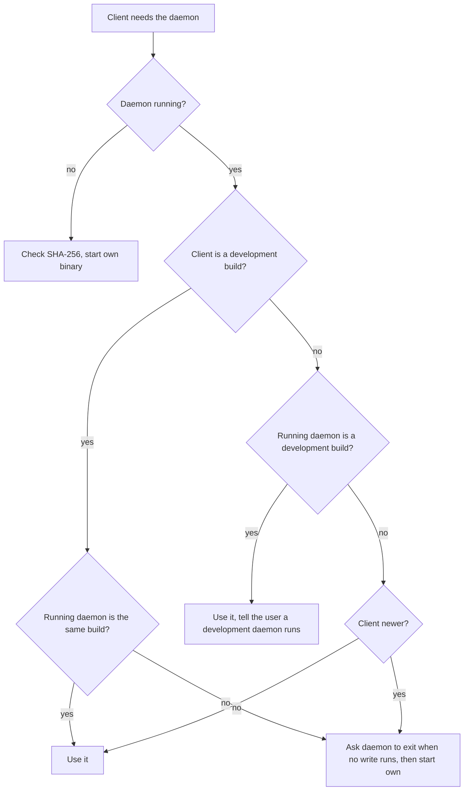

# Native Cockpit Daemon - Plan

## Goal Capsule

- **Objective:** On Windows and Linux, EVƎ Cockpit users get a brick daemon that runs on its own: it is independent of VS Code, needs no Node runtime, and answers on a channel only their account can use. VS Code, the `ev3` command and the MCP server work through it; add-ons such as EVƎ C get the new contract and work once they adopt it.
- **Means:** rewrite the whole per-user daemon as one native Rust binary, a separate project in this repository, and delete the Node daemon and the TypeScript core once it takes over.
- **Product authority:** owner decisions of 20.11.2026, in this document's Key Decisions, and in the vault note `10-Projekty/ev3-cockpit/Nativní komunikační vrstva — průzkum 2026-11-20` with its decision entry. macOS is not active scope. No backward compatibility is owed to anything, EVƎ C included.
- **Open blockers:** none.

---

## Product Contract

### Summary

The cockpit daemon becomes a single native Rust binary for Windows x64, Linux x64 and Linux arm64. It ships unsigned in the same VSIX and npm packages, at the same version as the rest. One language-neutral schema defines the contract, and both the Rust daemon and the TypeScript clients are generated from it. The TypeScript side keeps only the clients.

### Problem Frame

Since 4.10.2 every client reaches the bricks through one per-user daemon. That daemon is still a Node.js program, a leftover of the cockpit having been a VS Code extension only, and Node costs the product in four places:

- **VS Code updates.** The extension starts the daemon on VS Code's own `Code.exe` through the undocumented `ELECTRON_RUN_AS_NODE`. While the daemon runs, a VS Code update on Windows fails with `EBUSY`.
- **The channel.** Node cannot set a named pipe's security descriptor, so the pipe gets the default DACL. Its name derives from the user's SID, which other accounts can compute.
- **Native modules.** The transports rest on four npm native modules (`usb`, `node-hid`, `serialport`, `koffi`). Recorded failures: a libusb buffer overrun that crashed only under Electron, a koffi callback segfault, and a koffi connect that could not be aborted. Native npm modules are also an active supply-chain target (the 2025–2026 npm worms, one of them through `binding.gyp`).
- **Runtime dependency.** The daemon runs on whichever Node started it: VS Code's `Code.exe` or the Node running `ev3` or the MCP server. A daemon that needs no runtime of its own also serves clients written in other languages (ev3-python). `ev3` and the MCP server stay TypeScript and still need Node themselves.

Speed is not part of the problem. The brick sets the ceiling: 176 commands/s on USB, 62 on TCP and 10.7 on Bluetooth, with a 1 ms interrupt endpoint in the firmware.

### Key Decisions

- **The whole daemon moves to Rust, not only the transports.** Independence from `Code.exe` and the pipe's DACL come only from a native daemon process. (session-settled: user-directed — chosen over a native transport layer under the Node daemon, and over transports first and the rest later: those keep the daemon on `Code.exe`.) Governs R1, R2, R4.
- **Same repository, separate project.** One version and one release for VSIX and npm, and the contract and its tests in one place. Project boundary = language boundary. (session-settled: user-directed — chosen over a separate repository: versions and the contract would have to be synchronized across repositories.) Governs R1, R20.
- **The contract is a language-neutral schema, and both sides are generated.** It is readable by clients in any language later (ev3-python). (session-settled: user-directed — chosen over Rust as the source with generated TypeScript, and over the TypeScript contract mirrored by hand.) Governs R5, R6.
- **No backward compatibility, no parallel operation.** The Node daemon is dead now. Its contract shape, its tests and its open hardware rounds bind nothing. (session-settled: user-directed — chosen over running both daemons and switching per platform or by setting: the owner will not keep two implementations.) Governs R17, R18.
- **Windows and Linux first; macOS waits.** Borrowing a Mac again takes time. (session-settled: user-directed — the owner deferred macOS while keeping it in mind.)
- **Dropped in the rewrite:** the separate development daemon on its own channel, with brick loans and the hardware lock, and the handover to a newer daemon. Development and production never run side by side. (session-settled: user-directed — chosen over carrying both over 1:1.) Governs R13, R15, R16.
- **Every dangerous action is confirmed by a person the daemon asks.** The client-asserted `confirmedByPerson` flag goes. (session-settled: user-approved — chosen over today's mix, where the flag still authorizes `full` and restart: a flag a client sets itself can be forged.) Governs R9.
- **A development build always wins the shared channel.** (session-settled: user-approved — chosen over deciding by version number alone: a work-in-progress build can carry a lower version than an installed release.) Governs R16.
- **Simulated bricks are deferred; recorded brick exchanges guard regressions.** (session-settled: user-approved — chosen over unit tests plus hardware only, and over a minimal mock now.) Governs R21.
- **Shipped unsigned.** No paid certificate, ever, and the owner took the research as sufficient without testing first. On Windows, SmartScreen does not apply to files that VS Code or npm extract (no Mark of the Web, measured on HOSTA). Smart App Control on Windows 11 blocks unknown unsigned code. Today that takes USB and Bluetooth (unsigned Node modules) while TCP still runs on the signed `Code.exe`; the unsigned daemon binary loses every transport on such a machine. The owner accepts that until SignPath signs the binary. Governs R11, R12.
- **The wire transport stays as it is.** JSON-RPC 2.0 with `Content-Length` framing over the per-user pipe or socket, with the mutual HMAC hello. Message content may change. The owner left this to the agent. Governs R7, R8.
- **Replacement is not a restart that needs a person.** Installing a newer release or building a development build is the person's own act, and the development mark is fixed at build time; R9's restart means an explicit restart request. (session-settled: user-approved — chosen over asking a person before every replacement: updates would stall whenever only an agent is connected.) Governs R9, R15, R16.
- **The switch happens before Phase 5 and before any release.** No backward compatibility holds only because nothing is published; Phase 5 UX is built on the new contract. (session-settled: user-approved — chosen over leaving the order to planning: UX on today's contract would be reworked.) Governs R18.

### Requirements

**The daemon**

- R1. One native binary built from Rust replaces the Node daemon on Windows x64, Linux x64 and Linux arm64.
- R2. The binary starts and runs with no Node, .NET or VS Code installed, and it holds no file inside VS Code's installation.
- R3. Pairing, Bluetooth scanning and presence on Windows are done by the daemon itself, with no separate helper process.
- R4. The daemon keeps today's behavior, except the separate development daemon with brick loans and the hardware lock, the handover, and the changes in R9 and R13–R16:
  - discovery and connection over USB, Bluetooth and TCP, with one brick shown once across its channels;
  - filesystem, transfers and the transfer ledger;
  - programs, including deploy-and-run;
  - telemetry with its throttle;
  - holders and a write lease per request;
  - the settings store, and the safe/full access policy;
  - the daemon log file;
  - the Linux BlueZ-group question;
  - ending after its last client leaves while no brick is held through `ev3 connect`.

**Contract**

- R5. The daemon–client contract is defined once, in a language-neutral schema, and Rust and TypeScript types are generated from it. Nothing is mirrored by hand.
- R6. Everything a client reads is typed in the schema. No field is `unknown` that a client then reads as a core TypeScript type, no error carries a TypeScript class name, and no launch description assumes a script interpreter.
- R7. The hello, the daemon's version and build kind (release or development), and the request to exit stay readable by every client and daemon version. A client whose contract differs from the running daemon's says so and stops instead of misbehaving.
- R8. Clients reach the daemon by JSON-RPC 2.0 with `Content-Length` framing over the per-user named pipe (Windows) or unix socket (Linux), after a mutual HMAC hello with the per-user key.

**Security**

- R9. Forget, clearing a brick's Bluetooth list, releasing a stuck transfer slot, switching to `full` and an explicit restart request each run only after the daemon has asked a client with a person (VS Code or a terminal) and received yes. The question names the client that asked for the operation (its name and kind), as a typed field of the contract.
- R10. On Windows, the daemon creates its pipe only as the first instance, with a DACL that admits only the current user, and refuses to serve when the name already exists. Before the hello, a client checks that the pipe's server process belongs to the current user. When another account holds the name, daemon and client both say so. On Linux, the socket lives in a private directory owned by the user and readable by no one else, and the daemon refuses a foreign one.
- R11. Before starting the daemon, a client checks the binary against a SHA-256 shipped in its own package. On a mismatch it refuses and says why.
- R12. When Windows Smart App Control blocks the binary, the client tells the user that the cockpit cannot run on this machine while Smart App Control is on, and why, instead of a generic start failure.

**Lifecycle**

- R13. A user has at most one daemon at a time, on one channel shared by development and production builds. Automated test runs start their daemons on private test channels with their own state, never on the user's channel; the one-daemon rule and R16 apply only to the user's channel.
- R14. A client that finds no daemon starts the binary it carries itself.
- R15. A newer client that finds an older daemon asks it to exit once no write is in progress, then starts its own. Clients reconnect their bricks themselves, and no state is handed over.
- R16. A development build replaces a running daemon that is a production build or a different development build (once no write is in progress), whatever the versions; a daemon of its own build it simply uses. A production client never replaces a development daemon; it uses it and tells the user a development daemon is running. The development mark is fixed when the binary is built; no environment variable, argument or setting makes a release build count as a development build.

**The TypeScript side**

- R17. TypeScript keeps only the clients: the VS Code extension, the `ev3` command, the MCP server and `@ev3-cockpit/client`. The Node daemon, the TypeScript core and the npm native modules are deleted when the Rust daemon takes over.
- R18. The Node daemon gets no further work. Its open hardware rounds (F1 and F2 from `IMPLEMENTATION_PLAN.md` 4.10.2, `core-smoke` and `api-check` on a brick) are run against the Rust daemon instead.
- R19. The EVƎ C session is told about the new contract before the switch. Updating EVƎ C is that session's work and does not gate the switch.

**Distribution**

- R20. The binary ships in the per-platform VSIX (win32-x64, linux-x64, linux-arm64) and in per-platform npm packages, at the same version as the rest of the release, unsigned.

**Testing**

- R21. Automated tests replay brick exchanges recorded from real bricks during the hardware rounds, so protocol, file, program and telemetry behavior is guarded without hardware. The rounds also record induced failures (cable pulled mid-transfer, Bluetooth dropped, brick switched off during deploy-and-run), checked against the failure cases of today's test suite before the Node daemon is deleted.
- R22. The daemon's wire behavior that needs no brick is tested automatically against the running binary over its real channel. That covers the hello, errors, settings, questions and lifecycle.

### Key Flows

- F1. Development build takes the channel
  - **Trigger:** the developer starts a development build while the production daemon runs.
  - **Steps:** the development build asks the production daemon to exit. The production daemon finishes any write in progress and exits. The development daemon starts, and clients reconnect their bricks.
  - **Outcome:** only the development daemon runs. When it ends, nothing runs until the next client command starts the binary that client carries.
  - **Covered by:** R13, R14, R16
- F2. Release update
  - **Trigger:** VS Code or `ev3` updates and finds an older production daemon.
  - **Steps:** the client asks it to exit once no write is in progress, then starts its own binary after checking its SHA-256.
  - **Covered by:** R11, R14, R15

### Acceptance Examples

- AE1. **Covers R16.** **Given** a development daemon running a lower version than the installed release, **when** VS Code from the release connects, **then** it uses the development daemon, shows that one runs, and does not replace it.
- AE2. **Covers R15.** **Given** an older production daemon writing a program to a brick, **when** a newer `ev3` asks it to exit, **then** the write completes before the daemon exits, and `ev3` then starts its own binary.
- AE3. **Covers R9.** **Given** only an MCP client connected, **when** it asks to switch to `full`, **then** the daemon finds no person to ask and refuses, naming the command a person runs.
- AE4. **Covers R11.** **Given** a daemon binary whose SHA-256 differs from the one in the client's package, **when** the client would start it, **then** it refuses and names the mismatch.
- AE5. **Covers R12.** **Given** Windows 11 with Smart App Control on, **when** the extension starts the daemon and Windows blocks it, **then** the user sees that Smart App Control blocked the unsigned cockpit binary and that the cockpit cannot run on this machine while it is on.

### Success Criteria

- Hardware rounds pass on HOSTA (Windows), HOSTD (Linux x64) and the RPi5 (Linux arm64), over USB, Bluetooth and TCP. Each round covers connecting, file operations, deploy-and-run, telemetry, pairing and forget, and each is driven from VS Code, `ev3` and the MCP server.
- A VS Code update on Windows succeeds while the daemon runs.
- The repository no longer contains the Node daemon, the TypeScript core or the npm native modules.

### Scope Boundaries

**Deferred for later**

- macOS on the Rust daemon, including the Swift IOBluetooth helper and its TCC behavior.
- Simulated (mock) bricks; planned for the next version.
- Applying to the SignPath Foundation for free signing; after the Marketplace launch.
- Revisiting the communication lab's rule NF4.1 ("bez přepisu do jiného jazyka") and the lab's future.

**Removed from the product**

- macOS support until the Rust daemon covers it: today's darwin-arm64 VSIX and its Bluetooth path go with the TypeScript core.
- The separate development daemon on its own channel, with brick loans and the hardware lock.
- The handover to a newer daemon, which kept held bricks and unstored settings.
- The client-asserted `confirmedByPerson` flag.
- The TypeScript-only repository goal (IMPLEMENTATION_PLAN 7.8).

### Dependencies / Assumptions

- The trust model stays same-user. Any process holding the user's key, an add-on or an agent with a shell included, can claim to be a VS Code or terminal client and answer its own questions. R9 therefore guards against agents that reach the daemon only through the MCP server, not against add-ons or shell-capable agents.
- Smart App Control can switch back on without reinstalling Windows (KB5083769, 04.2026), so the share of blocked machines can grow. No free mitigation exists until SignPath.
- The agent writes the Rust; the owner reviews as architect.
- No CI workflow builds on Linux today; the Linux binaries need one.

### Outstanding Questions

**Deferred to Planning**

- The schema format (JSON Schema, OpenRPC or other) and the generators for Rust and TypeScript.
- Rust libraries per transport, and how Windows pairing is reached (WinRT through windows-rs).
- How brick exchanges are recorded and replayed (R21), and where the recordings live.
- How the build-time development mark is carried so R16 can tell builds apart.
- A confirmation the daemon owns itself (its own window or prompt) that no client can answer over the channel, closing the gap in the trust model above.
- How long a replacement waits for a daemon mid-write before giving up, and what the user sees meanwhile.
- Whether the Marketplace launch waits for macOS on the Rust daemon or ships Windows and Linux first.
- Whether the daemon refuses root on Linux as it refuses administrator on Windows.
- The order of work, and which platform and transport come first.

### Sources / Research

- Vault: `10-Projekty/ev3-cockpit/Nativní komunikační vrstva — průzkum 2026-11-20` (verdict, gains and costs, signing research), with dossiers in `zdroje-nativni-vrstva-2026-11-20/`.
- Current contract: `src/contract/methods.ts` (46 methods), `src/contract/events.ts` (15 notifications, `question/ask`), `src/contract/errors.ts` (30 codes), `src/contract/hello.ts`, `docs/protocol.md`.
- Places tying the contract to TypeScript or Node: `src/contract/errors.ts:59-101` (class names), `src/vscode/daemonBridge.ts:96,143,152` (untyped `details` and `repair`), `src/contract/models.ts:246-254` (`LaunchSpec`).
- The daemon being replaced: `src/daemon` (3.2k lines) and `src/core` (~30k lines). Brick ceilings: `DESIGN.md:1376`. The `EBUSY` measurement and the owner's runtime choice: `IMPLEMENTATION_PLAN.md:2062-2072`. The pipe DACL limit: `docs/plans/2026-11-19-0937-feat-cockpit-daemon-and-clients-plan.md` (KTD3).
- Rules this supersedes: `DESIGN.md:262-268` (in-process backends only), `IMPLEMENTATION_PLAN.md` 7.8, and `IMPLEMENTATION_PLAN.md:1043-1050` (the Rust addon as an unwritten candidate).
