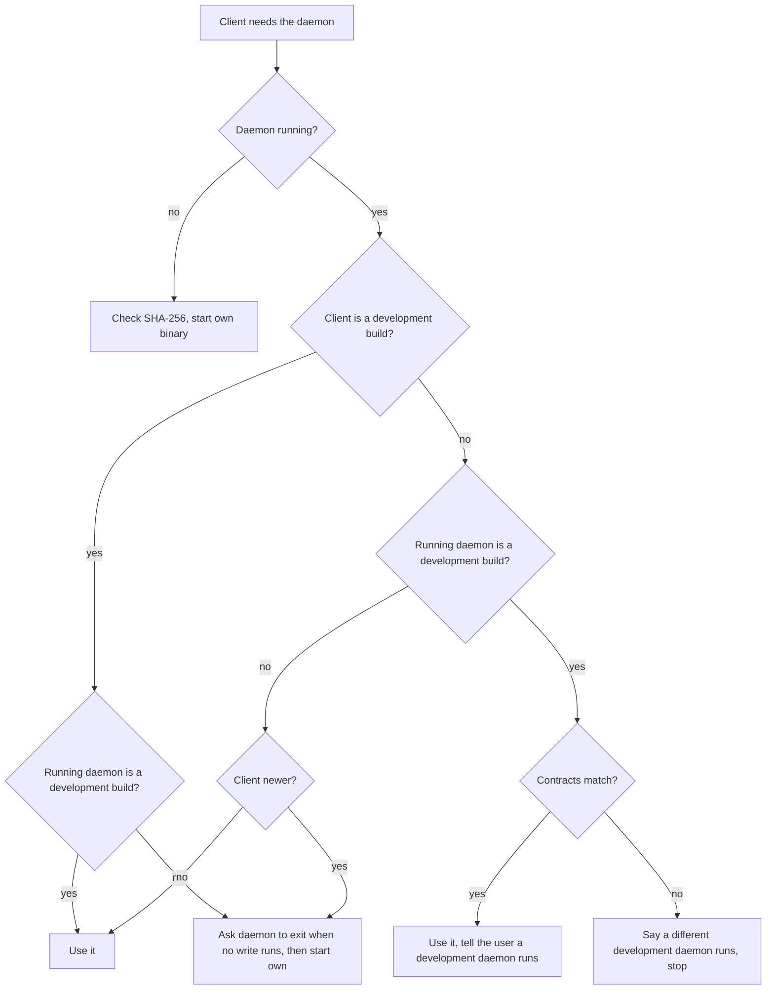
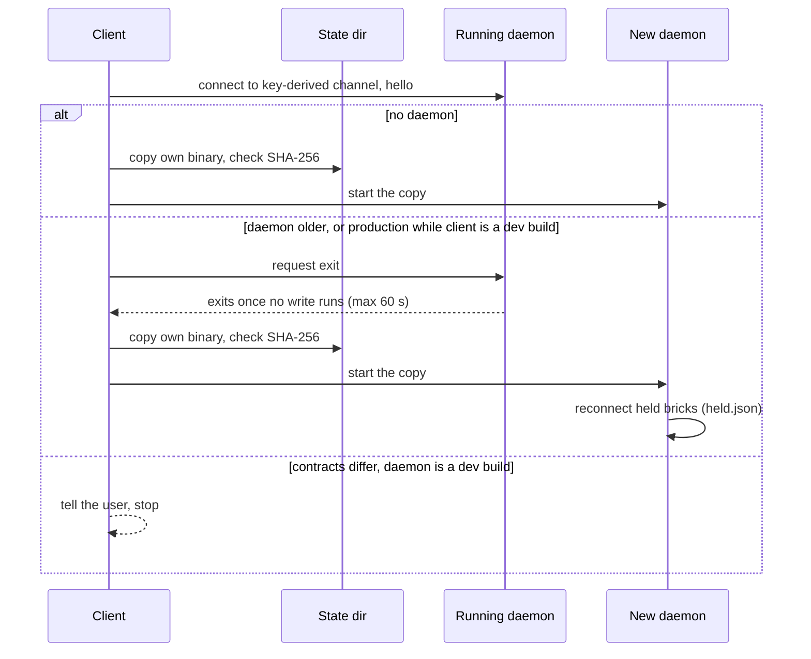
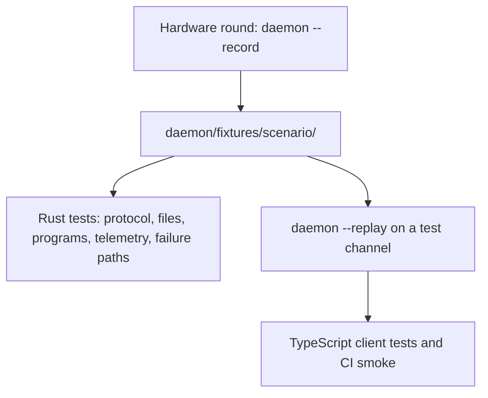

# Native Cockpit Daemon - Plan

## Goal Capsule

- **Objective:** On Windows and Linux, EVƎ Cockpit users get a brick daemon that runs on its own: it is independent of VS Code, needs no Node runtime, and answers on a channel only their account can use. VS Code, the `ev3` command and the MCP server work through it; add-ons such as EVƎ C get the new contract and work once they adopt it.
- **Means:** rewrite the whole per-user daemon as one native Rust binary, a Cargo workspace in `daemon/` of this repository, generated from one contract schema (KTD1), and delete the Node daemon and the TypeScript core once it takes over (U17).
- **Product authority:** owner decisions of 20.11.2026, in this document's Key Decisions, and in the vault note `10-Projekty/ev3-cockpit/Nativní komunikační vrstva — průzkum 2026-11-20` with its decision entry. macOS is not active scope. No backward compatibility is owed to anything, EVƎ C included.
- **Execution profile:** one branch, `feat/native-daemon`, merged into master after U17 (KTD13). The Node daemon stays untouched and working on that branch until U17.
- **Stop conditions:** stop and ask the owner when a U1 spike result rules out a KTD it tests, when a hardware round contradicts a parity rule, or when a unit would need a product decision this plan does not hold.
- **Who finishes:** the agent implements and commits; the owner runs the hardware rounds (U16) and decides on push.
- **Open blockers:** none.

---

## Product Contract

### Summary

The cockpit daemon becomes a single native Rust binary for Windows x64, Linux x64 and Linux arm64. It ships unsigned in the same VSIX and npm packages, at the same version as the rest. One language-neutral schema defines the contract, and both the Rust daemon and the TypeScript clients are generated from it. The TypeScript side keeps only the clients.

### Problem Frame

Since 4.10.2 every client reaches the bricks through one per-user daemon. That daemon is still a Node.js program, a leftover of the cockpit having been a VS Code extension only, and Node costs the product in four places:

- **VS Code updates.** The extension starts the daemon on VS Code's own `Code.exe` through the undocumented `ELECTRON_RUN_AS_NODE`. While the daemon runs, a VS Code update on Windows fails with `EBUSY`.
- **The channel.** Node cannot set a named pipe's security descriptor, so the pipe gets the default DACL. Its name derives from the user's SID, which other accounts can compute.
- **Native modules.** The transports rest on four npm native modules (`usb`, `node-hid`, `serialport`, `koffi`). Recorded failures: a libusb buffer overrun that crashed only under Electron, a koffi callback segfault, and a koffi connect that could not be aborted. Native npm modules are also an active supply-chain target (the 2025–2026 npm worms, one of them through `binding.gyp`).
- **Runtime dependency.** The daemon runs on whichever Node started it: VS Code's `Code.exe` or the Node running `ev3` or the MCP server. A daemon that needs no runtime of its own also serves clients written in other languages (ev3-python). `ev3` and the MCP server stay TypeScript and still need Node themselves.

Speed is not part of the problem. The brick sets the ceiling: 176 commands/s on USB, 62 on TCP and 10.7 on Bluetooth, with a 1 ms interrupt endpoint in the firmware.

### Key Decisions

- **The whole daemon moves to Rust, not only the transports.** Independence from `Code.exe` and the pipe's DACL come only from a native daemon process. (session-settled: user-directed — chosen over a native transport layer under the Node daemon, and over transports first and the rest later: those keep the daemon on `Code.exe`.) Governs R1, R2, R4.
- **Same repository, separate project.** One version and one release for VSIX and npm, and the contract and its tests in one place. Project boundary = language boundary. (session-settled: user-directed — chosen over a separate repository: versions and the contract would have to be synchronized across repositories.) Governs R1, R20.
- **The contract is a language-neutral schema, and both sides are generated.** It is readable by clients in any language later (ev3-python). (session-settled: user-directed — chosen over Rust as the source with generated TypeScript, and over the TypeScript contract mirrored by hand.) Governs R5, R6.
- **No backward compatibility, no parallel operation.** The Node daemon is dead now. Its contract shape, its tests and its open hardware rounds bind nothing. (session-settled: user-directed — chosen over running both daemons and switching per platform or by setting: the owner will not keep two implementations.) Governs R17, R18.
- **Windows and Linux first; macOS waits.** Borrowing a Mac again takes time. (session-settled: user-directed — the owner deferred macOS while keeping it in mind.)
- **Dropped in the rewrite:** the separate development daemon on its own channel, with brick loans and the hardware lock, and the handover to a newer daemon. Development and production never run side by side. (session-settled: user-directed — chosen over carrying both over 1:1.) Governs R13, R15, R16.
- **Every dangerous action is confirmed by a person the daemon asks.** The client-asserted `confirmedByPerson` flag goes. (session-settled: user-approved — chosen over today's mix, where the flag still authorizes `full` and restart: a flag a client sets itself can be forged.) Governs R9.
- **A development build always wins the shared channel.** (session-settled: user-approved — chosen over deciding by version number alone: a work-in-progress build can carry a lower version than an installed release.) Governs R16.
- **Simulated bricks are deferred; recorded brick exchanges guard regressions.** (session-settled: user-approved — chosen over unit tests plus hardware only, and over a minimal mock now.) Governs R21.
- **Shipped unsigned.** No paid certificate, ever, and the owner took the research as sufficient without testing first. On Windows, SmartScreen does not apply to files that VS Code or npm extract (no Mark of the Web, measured on HOSTA). Smart App Control on Windows 11 blocks unknown unsigned code. Today that takes USB and Bluetooth (unsigned Node modules) while TCP still runs on the signed `Code.exe`; the unsigned daemon binary loses every transport on such a machine. The owner accepts that until SignPath signs the binary. Governs R11, R12.
- **The wire transport stays as it is.** JSON-RPC 2.0 with `Content-Length` framing over the per-user pipe or socket, with the mutual HMAC hello. Message content may change. The owner left this to the agent. Governs R7, R8.
- **Replacement is not a restart that needs a person.** Installing a newer release or building a development build is the person's own act, and the development mark is fixed at build time; R9's restart means an explicit restart request. (session-settled: user-approved — chosen over asking a person before every replacement: updates would stall whenever only an agent is connected.) Governs R9, R15, R16.
- **The channel name derives from the per-user key.** TypeScript clients have no native code left to check who serves a pipe, and a name other accounts cannot know gives the same protection. (session-settled: user-approved — chosen over a client-side check of the pipe server's owner: impossible from TypeScript without native modules.) Governs R10.
- **Holds survive replacement; recordings also drive a replay daemon.** Holds are the user's explicit intent, and the clients' tests need a daemon without bricks while simulated bricks stay deferred. (session-settled: user-approved — chosen over dropping holds silently, and over client tests with no daemon.) Governs R23, R24.
- **The switch happens before Phase 5 and before any release.** No backward compatibility holds only because nothing is published; Phase 5 UX is built on the new contract. (session-settled: user-approved — chosen over leaving the order to planning: UX on today's contract would be reworked.) Governs R18.

### Requirements

**The daemon**

- R1. One native binary built from Rust replaces the Node daemon on Windows x64, Linux x64 and Linux arm64.
- R2. The binary starts and runs with no Node, .NET or VS Code installed, and it holds no file inside VS Code's installation.
- R3. Pairing, Bluetooth scanning and presence on Windows are done by the daemon itself, with no separate helper process.
- R4. The daemon keeps today's behavior, except the separate development daemon with brick loans and the hardware lock, the handover, and the changes in R9 and R13–R16:
  - discovery and connection over USB, Bluetooth and TCP, with one brick shown once across its channels;
  - filesystem, transfers and the transfer ledger;
  - programs, including deploy-and-run;
  - telemetry with its throttle;
  - holders and a write lease per request;
  - the settings store, and the safe/full access policy;
  - the daemon log file;
  - the Linux BlueZ-group question;
  - ending after its last client leaves while no brick is held through `ev3 connect`.

**Contract**

- R5. The daemon–client contract is defined once, in a language-neutral schema, and Rust and TypeScript types are generated from it. Nothing is mirrored by hand.
- R6. Everything a client reads is typed in the schema. No field is `unknown` that a client then reads as a core TypeScript type, no error carries a TypeScript class name, and no launch description assumes a script interpreter.
- R7. The hello, the daemon's version and build kind (release or development), and the request to exit stay readable by every client and daemon version. A client whose contract differs from the running daemon's says so and stops instead of misbehaving.
- R8. Clients reach the daemon by JSON-RPC 2.0 with `Content-Length` framing over the per-user named pipe (Windows) or unix socket (Linux), after a mutual HMAC hello with the per-user key.

**Security**

- R9. Forget, clearing a brick's Bluetooth list, releasing a stuck transfer slot, switching to `full` and an explicit restart request each run only after the daemon has asked a client with a person (VS Code or a terminal) and received yes. The question names the client that asked for the operation (its name and kind), as a typed field of the contract.
- R10. On Windows, the daemon creates its pipe only as the first instance, with a DACL that admits only the current user, and refuses to serve when the name already exists. The channel's name derives from the per-user key, which no other account can read, so no other account can predict or take the name. When the name is held all the same, daemon and client both say so. On Linux, the socket lives in a private directory owned by the user and readable by no one else, and the daemon refuses a foreign one.
- R11. Before starting the daemon, a client checks the binary against a SHA-256 shipped in its own package. On a mismatch it refuses and says why.
- R12. When Windows Smart App Control blocks the binary, the client tells the user that the cockpit cannot run on this machine while Smart App Control is on, and why, instead of a generic start failure.

**Lifecycle**

- R13. A user has at most one daemon at a time, on one channel shared by development and production builds. Automated test runs start their daemons on private test channels with their own state, never on the user's channel; the one-daemon rule and R16 apply only to the user's channel.
- R14. A client that finds no daemon starts the binary it carries itself.
- R15. A newer client that finds an older daemon asks it to exit once no write is in progress, then starts its own. Clients reconnect their bricks themselves, and no state is handed over.
- R23. Bricks held through `ev3 connect` stay held across a daemon replacement or crash: the daemon keeps its holds on disk and connects them again when it starts.
- R16. A development build replaces a running production daemon (once no write is in progress), whatever the versions. A running development daemon stays, whichever build it is; switching to another development build is an explicit restart from that build. A production client never replaces a development daemon: when their contracts match it uses it and tells the user a development daemon is running; when they differ it says so and stops (per R7). The development mark is fixed when the binary is built; no environment variable, argument or setting makes a release build count as a development build.

**The TypeScript side**

- R17. TypeScript keeps only the clients: the VS Code extension, the `ev3` command, the MCP server and `@ev3-cockpit/client`. The Node daemon, the TypeScript core and the npm native modules are deleted when the Rust daemon takes over.
- R18. The Node daemon gets no further work. Its open hardware rounds (F1 and F2 from `IMPLEMENTATION_PLAN.md` 4.10.2, `core-smoke` and `api-check` on a brick) are run against the Rust daemon instead.
- R19. The EVƎ C session is told about the new contract before the switch. Updating EVƎ C is that session's work and does not gate the switch.

**Distribution**

- R20. The binary ships in the per-platform VSIX (win32-x64, linux-x64, linux-arm64) and in per-platform npm packages, at the same version as the rest of the release, unsigned.

**Testing**

- R21. Automated tests replay brick exchanges recorded from real bricks during the hardware rounds, so protocol, file, program and telemetry behavior is guarded without hardware. The rounds also record induced failures (cable pulled mid-transfer, Bluetooth dropped, brick switched off during deploy-and-run), checked against the failure cases of today's test suite before the Node daemon is deleted.
- R22. The daemon's wire behavior that needs no brick is tested automatically against the running binary over its real channel. That covers the hello, errors, settings, questions and lifecycle.
- R24. The daemon can run on recorded exchanges instead of hardware, so the clients' automated tests and CI drive a real daemon without bricks. A daemon on a test channel never opens real hardware.

### Key Flows

- F1. Development build takes the channel
  - **Trigger:** the developer starts a development build while the production daemon runs.
  - **Steps:** the development build asks the production daemon to exit. The production daemon finishes any write in progress and exits. The development daemon starts, and clients reconnect their bricks.
  - **Outcome:** only the development daemon runs. When it ends, nothing runs until the next client command starts the binary that client carries.
  - **Covered by:** R13, R14, R16
- F2. Release update
  - **Trigger:** VS Code or `ev3` updates and finds an older production daemon.
  - **Steps:** the client asks it to exit once no write is in progress, then starts its own binary after checking its SHA-256.
  - **Covered by:** R11, R14, R15



### Acceptance Examples

- AE1. **Covers R16.** **Given** a development daemon running a lower version than the installed release with the same contract, **when** VS Code from the release connects, **then** it uses the development daemon, shows that one runs, and does not replace it. With a different contract it says so and stops.
- AE6. **Covers R23.** **Given** a brick held through `ev3 connect`, **when** a newer daemon replaces the running one, **then** the new daemon connects that brick again without any client asking.
- AE2. **Covers R15.** **Given** an older production daemon writing a program to a brick, **when** a newer `ev3` asks it to exit, **then** the write completes before the daemon exits, and `ev3` then starts its own binary.
- AE3. **Covers R9.** **Given** only an MCP client connected, **when** it asks to switch to `full`, **then** the daemon finds no person to ask and refuses, naming the command a person runs.
- AE4. **Covers R11.** **Given** a daemon binary whose SHA-256 differs from the one in the client's package, **when** the client would start it, **then** it refuses and names the mismatch.
- AE5. **Covers R12.** **Given** Windows 11 with Smart App Control on, **when** the extension starts the daemon and Windows blocks it, **then** the user sees that Smart App Control blocked the unsigned cockpit binary and that the cockpit cannot run on this machine while it is on.

### Success Criteria

- Hardware rounds pass on HOSTA (Windows), HOSTD (Linux x64) and the RPi5 (Linux arm64), over USB, Bluetooth and TCP. Each round covers connecting, file operations, deploy-and-run, telemetry, pairing and forget, and each is driven from VS Code, `ev3` and the MCP server.
- A VS Code update on Windows succeeds while the daemon runs.
- The repository no longer contains the Node daemon, the TypeScript core or the npm native modules.

### Scope Boundaries

**Deferred for later**

- macOS on the Rust daemon, including the Swift IOBluetooth helper and its TCC behavior.
- Simulated (mock) bricks; planned for the next version.
- Applying to the SignPath Foundation for free signing; after the Marketplace launch.
- Revisiting the communication lab's rule NF4.1 ("bez přepisu do jiného jazyka") and the lab's future.

**Removed from the product**

- macOS support until the Rust daemon covers it: today's darwin-arm64 VSIX and its Bluetooth path go with the TypeScript core.
- The separate development daemon on its own channel, with brick loans and the hardware lock.
- The handover to a newer daemon, which kept held bricks and unstored settings.
- The client-asserted `confirmedByPerson` flag.
- The TypeScript-only repository goal (IMPLEMENTATION_PLAN 7.8).

### Dependencies / Assumptions

- The trust model stays same-user. Any process holding the user's key, an add-on or an agent with a shell included, can claim to be a VS Code or terminal client and answer its own questions. R9 therefore guards against agents that reach the daemon only through the MCP server, not against add-ons or shell-capable agents.
- Smart App Control can switch back on without reinstalling Windows (KB5083769, 04.2026), so the share of blocked machines can grow. No free mitigation exists until SignPath.
- The agent writes the Rust; the owner reviews as architect.
- No CI workflow builds on Linux today; the Linux binaries need one.

### Outstanding Questions

**Open, not blocking this plan**

- A confirmation the daemon owns itself (its own window or prompt) that no client can answer over the channel, closing the gap in the trust model above.
- Whether the Marketplace launch waits for macOS on the Rust daemon or ships Windows and Linux first.

### Sources / Research

- Vault: `10-Projekty/ev3-cockpit/Nativní komunikační vrstva — průzkum 2026-11-20` (verdict, gains and costs, signing research), with dossiers in `zdroje-nativni-vrstva-2026-11-20/` and the planning research in its `plan/` folder (`repo-research.md` carries the parity checklist; `framework-docs.md`, `best-practices.md`, `spec-flow.md`).
- Current contract: `src/contract/methods.ts` (46 methods), `src/contract/events.ts` (15 notifications, `question/ask`), `src/contract/errors.ts` (30 codes), `src/contract/hello.ts`, `docs/protocol.md`.
- Places tying the contract to TypeScript or Node: `src/contract/errors.ts:59-101` (class names), `src/vscode/daemonBridge.ts:55-64,96,143,152` (`asCoreError`, untyped `details` and `repair`), `src/contract/models.ts:246-254` (`LaunchSpec`).
- The daemon being replaced: `src/daemon` (3.2k lines) and `src/core` (~30k lines). Brick ceilings: `DESIGN.md:1376`. The `EBUSY` measurement and the owner's runtime choice: `IMPLEMENTATION_PLAN.md:2062-2072`. The pipe DACL limit: `docs/plans/2026-11-19-0937-feat-cockpit-daemon-and-clients-plan.md` (KTD3).
- Rules this supersedes: `DESIGN.md:262-268` (in-process backends only), `IMPLEMENTATION_PLAN.md` 7.8, and `IMPLEMENTATION_PLAN.md:1043-1050` (the Rust addon as an unwritten candidate).

---

## Planning Contract

**Product Contract preservation:** changed R10 (key-derived channel name instead of a client-side owner check), R16 (development builds no longer replace each other) and AE1 (a production client stops on a different contract); added R23 (holds survive replacement), R24 (replay daemon) and AE6. All confirmed by the owner in the plan synthesis of 20.11.2026. Resolved questions moved into KTD1–KTD13.

### Key Technical Decisions

- KTD1. **The contract is JSON Schema draft-07 under `contract/`, generated into both languages.** `typify` produces the Rust types, `json-schema-to-typescript` the TypeScript types, and a small in-repo generator reads one method table (method → params, result, leased, person-only; notification → payload; error code → family) and emits the Rust dispatch trait and the TypeScript `Methods`/`Notifications` maps, the way LSP generates from `metaModel.json`. Schema rules: no `anyOf`; `oneOf` only with a required `const` tag; objects on the stable core (R7) allow unknown properties so a newer peer's extra fields do not break an older one. Rejected: OpenRPC (no maintained generator for both languages), TypeSpec (no JSON-RPC emitter). Governs R5, R6, R7.
- KTD2. **A hand-written JSON-RPC codec and dispatcher on `tokio-util`.** It frames `Content-Length` like `vscode-jsonrpc`, caps a message at 1 MiB, answers `$/cancelRequest` and `$/progress`, and lets the daemon send requests to a client (`question/ask`). No crate fits: `jsonrpsee` lacks the framing and server-to-client requests, `lsp-server` is synchronous, `async-lsp` is tied to `lsp-types`. Governs R8.
- KTD3. **Channel name, key and directories follow one written spec with cross-language test vectors.** The name is an HMAC-SHA256 of the per-user key over a fixed label, truncated; the pipe is `\\.\pipe\ev3-cockpit-<h>`, the socket lives in `$XDG_RUNTIME_DIR/ev3-cockpit/` or `/tmp/ev3-cockpit-<uid>/` (owned by the user, mode 0700, refused otherwise; path under the 108-byte limit). The daemon creates the pipe with `first_pipe_instance`, an owner-only SDDL DACL and remote clients rejected. The key file is created only when absent; a key replaced while a daemon runs gives a new name, and the old daemon idles out. The spec lives in `docs/channel.md`; vectors in `contract/vectors/` are checked by a Rust test and a TypeScript test. The Node daemon's SID-derived name never collides with it, so both can run during the work. Governs R10, R13.
- KTD4. **USB goes through libusb (`rusb` with vendored libusb), with `hidapi` as the 64-byte fallback.** On Windows only libusb's HID backend reached the brick's full 1024-byte frames; `hidapi` follows the brick's descriptor to 64 bytes, about 40× slower for files (`src/core/transports/transportConstants.ts:21-42`). The port keeps exact-size transfers, the one-byte read overrun on Windows (`READ_OVERRUN_SLACK`), skipping claimed devices during enumeration, and the 3000 ms close drain (`src/core/transports/usbLibusbAdapter.ts`). U1 confirms the 1024-byte path from Rust on HOSTA before U6.
- KTD5. **Windows Bluetooth ports the testlab winners.** Data goes over Winsock `AF_BTH`, RFCOMM channel 1, connected non-blocking and polled, never a blocking connect aborted by close. Each link runs on its own thread unless U1 shows tokio can register the socket. Presence uses Winsock SDP with `LUP_FLUSHCACHE` on a thread that can be abandoned. Discovery uses `bthprops` enumeration. Pairing is WinRT `DeviceInformationCustomPairing` in the daemon itself, on its own STA thread, from a live `DeviceWatcher` entry, offering only `ProvidePin` with 1234. Forget removes the device from Windows and the brick's list. Crates: `windows` 0.62.2 and `windows-sys` 0.61.2, pinned. Governs R3, R4.
- KTD6. **Linux Bluetooth is `zbus` plus raw sockets, mirroring today's TypeScript design.** `zbus` is pure Rust; RFCOMM channel 1 and the L2CAP PSM 1 presence probe go through `libc` sockets; the pairing agent answers `RequestPinCode` with 1234 without `RequestDefaultAgent`; the radio self-heal and the group question port as they are (`src/core/transports/bluezRadioWatch.ts`, `src/daemon/bluetoothAccess.ts`). Rejected: `bluer` (links libdbus, last release 06.2025, BR/EDR gaps). Governs R4.
- KTD7. **One recorder and one replay transport serve both test layers.** The daemon records every exchange of a session to a fixture file when started with `--record <dir>`: bytes each way, timing, and link failures. With `--replay <dir>` it serves those fixtures as bricks: a request matches a recorded one ignoring the message counter, and recorded failures replay as failures. Fixtures live in `daemon/fixtures/<scenario>/`, are generated by hardware rounds and never edited by hand (the D-Bus fixture precedent, `scripts/dbus-fixtures.py`). A daemon on a test channel accepts only `--replay` and refuses to open real transports. Governs R21, R22, R24.
- KTD8. **Daemon process rules.** `tokio` 1.54.1 multi-thread; per-user directories from one spec (KTD3); a log rotated by size (5 MB × 3) by our own writer, since `tracing-appender` rotates only by time; the daemon refuses to run as administrator on Windows and as root on Linux; idle exit 10 s after the last client while nothing is held. The hello carries version, contract version, build kind and build id (the binary's SHA-256). "A write in progress" means a leased operation, a pairing, or a forget or clear-list; a replacement waits for it at most 60 s, telling the user, then gives up. Holds persist in `held.json` (R23). A new daemon's first Bluetooth connect to a brick treats WSA 10064 and `EBUSY` within 5 s of its start as retryable, since the previous daemon's close time is unknown. Governs R13–R16, R23.
- KTD9. **Clients launch the binary from a per-user copy named by its SHA-256.** The client copies the binary it carries to the state directory, checks the hash (R11) and starts the copy, so the installed file is never locked and `npm i -g` or a rebuild works while a daemon runs. `LaunchSpec` becomes the binary path, its SHA-256, the version and the build kind. A spawn refused with Windows error 4551 shows the Smart App Control message (R12) and does not retry. Governs R11, R12, R14.
- KTD10. **Person questions name the requester and are never answered by a cache.** The daemon routes a question to a VS Code or terminal client; it names the requesting client's name and kind; a client's remembered answers apply only to its own requests; 60 s without an answer refuses the operation. Governs R9.
- KTD11. **Today's TypeScript is the behavior spec.** Each subsystem is ported against the parity checklist in `repo-research.md` §1 (planning research), every rule there gets a Rust test or a fixture, and firmware workarounds must work on the original and on a fixed firmware. The TypeScript core tests are deleted with the core in U17; their failure cases become the R21 checklist.
- KTD12. **CI builds natively per target.** `windows-latest` builds and tests win32-x64; `ubuntu-22.04` and `ubuntu-22.04-arm` build linux-x64 and linux-arm64 (glibc 2.35, so the binaries run on Debian 12 and Raspberry Pi OS). Linux VSIXes are packaged on Linux so executable bits survive. Each job publishes the binary's SHA-256 and an `actions/attest` provenance attestation. The darwin target and the .NET helper build leave CI.
- KTD13. **One branch, Rust beside Node until the switch.** All units land on `feat/native-daemon`; the Node daemon and the TypeScript core stay untouched and working until U17 deletes them; the branch merges into master after U17 and the hardware rounds. Nothing is published before the merge, so no release ever ships half of each.

### High-Level Technical Design

Architecture: one schema feeds both languages; the daemon is a Cargo workspace; TypeScript keeps only clients.

```mermaid
flowchart TB
  S[contract/ JSON Schema + method table] --> G1[Rust types and dispatch trait]
  S --> G2[TypeScript types and method maps]
  G1 --> D[ev3-cockpitd]
  G2 --> C1[@ev3-cockpit/client]
  C1 --> V[VS Code extension]
  C1 --> CLI[ev3 CLI]
  C1 --> M[MCP server]
  C1 --> A[add-ons]
  D --> R[runtime: sessions, bricks, telemetry, files, programs]
  R --> P[EV3 protocol]
  P --> T[transports: USB libusb, TCP, BT Winsock/WinRT, BT BlueZ, replay]
  V -. pipe or socket, HMAC hello .-> D
```

Launch and replacement, as a client sees it (R13–R16, KTD8, KTD9):



Record and replay (KTD7):



### Output Structure

```text
contract/                 schema, method table, channel test vectors
daemon/
  Cargo.toml              workspace
  crates/contract/        generated types, codec, dispatch trait
  crates/protocol/        EV3 packets, bytecode, commands, replies
  crates/transports/      usb, tcp, bt_windows, bt_linux, replay, recorder
  crates/runtime/         sessions, brick manager, telemetry, files, programs
  crates/daemon/          binary: channel, hello, surface, lifecycle, log
  fixtures/               recorded scenarios
src/contract/generated/   TypeScript generated from contract/
docs/channel.md           channel, key and directory spec
```

### Risks & Dependencies

- **USB speed (KTD4).** If `rusb` cannot reach the 1024-byte path on Windows, USB falls to 64 bytes. U1 measures this first; the owner decides on a fallback before U6.
- **Bluetooth threading (KTD5).** Whether tokio can drive an `AF_BTH` socket is undocumented; one thread per link is the safe default and costs little at ≤ 4 bricks.
- **Parity gaps.** About 30k lines of TypeScript carry hard-won rules; a missed one returns as a hardware bug. The checklist (KTD11) and the recordings of induced failures (R21) are the guard; the rounds run on all three bricks, never one.
- **Scope.** This is the largest change the project has made. The branch stays shippable on the Node daemon until U17 (KTD13), so a stalled port costs time, not a broken product.
- **Smart App Control.** Accepted until SignPath (Key Decisions); U14 makes the block legible.

---

## Implementation Units

| U-ID | Title | Key files | Depends on |
|---|---|---|---|
| U1 | Spikes on hardware | `daemon/spikes/` | — |
| U2 | Contract schema and generators | `contract/`, `daemon/crates/contract/`, `src/contract/generated/` | U1 |
| U3 | Daemon skeleton | `daemon/crates/daemon/`, `docs/channel.md` | U2 |
| U4 | EV3 protocol | `daemon/crates/protocol/` | U2 |
| U5 | Transport core, recorder, replay | `daemon/crates/transports/{core,replay}` | U4 |
| U6 | USB transport | `daemon/crates/transports/usb` | U5 |
| U7 | TCP and beacon transport | `daemon/crates/transports/tcp` | U5 |
| U8 | Bluetooth on Windows | `daemon/crates/transports/bt_windows` | U5 |
| U9 | Bluetooth on Linux | `daemon/crates/transports/bt_linux` | U5 |
| U10 | Sessions and the brick layer | `daemon/crates/runtime/{session,bricks}` | U6–U9 |
| U11 | Files, programs, telemetry | `daemon/crates/runtime/{fs,programs,telemetry}` | U10 |
| U12 | Daemon surface | `daemon/crates/daemon/surface` | U3, U11 |
| U13 | Lifecycle and replacement | `daemon/crates/daemon/lifecycle` | U12 |
| U14 | TypeScript clients on the new daemon | `src/client/`, `src/vscode/`, `src/cli/`, `src/mcp/` | U13 |
| U15 | Packaging and CI | `scripts/`, `.github/workflows/` | U14 |
| U16 | Recordings and hardware rounds | `daemon/fixtures/`, `scripts/` | U15 |
| U17 | The switch | `src/core/`, `src/daemon/`, docs | U16 |

### U1. Spikes on hardware

- **Goal:** settle the four mechanisms the plan cannot decide on paper, before anything depends on them.
- **Requirements:** R3, R4, R5; KTD1, KTD4, KTD5, KTD6.
- **Dependencies:** none.
- **Files:** `daemon/spikes/` (throwaway), results recorded in this plan's KTDs.
- **Approach:**
  1. Schema: a five-method slice of the contract through `typify` and `json-schema-to-typescript`, including a tagged union and an error enum; both sides compile and round-trip a message.
  2. USB on HOSTA: open a brick with `rusb` (vendored libusb), exchange a 1024-byte frame and a 100 kB file; compare with today's 200/325 KB/s.
  3. Bluetooth on HOSTA: non-blocking `AF_BTH` connect to channel 1 and an echo exchange, first under tokio, else on a thread; WinRT custom pairing of a forgotten brick from inside a tokio process.
  4. Bluetooth on HOSTD: `zbus` discovery and agent pairing, a raw RFCOMM exchange, the L2CAP presence probe.
- **Execution note:** a measurement unit. Record each result and the decision it settles in the plan and commit that before U2, as the project rule for measured decisions requires.
- **Test expectation:** none -- throwaway spikes; their measurements are the deliverable.
- **Verification:** each of the four questions has a recorded answer with numbers; any KTD a result contradicts is rewritten or escalated per the stop conditions.

### U2. Contract schema and generators

- **Goal:** one schema produces the Rust and TypeScript contract, including the method table and the stable core.
- **Requirements:** R5, R6, R7, R8 (shape); KTD1, KTD3.
- **Dependencies:** U1.
- **Files:** `contract/schema/*.json`, `contract/methods.json`, `contract/vectors/channel.json`, `scripts/generate-contract.cjs`, `daemon/crates/contract/`, `src/contract/generated/`, `src/__tests__/contractGenerated.test.ts`, `daemon/crates/contract/tests/`.
- **Approach:**
  1. Write the schema from today's contract, then type every field clients read today as `unknown`: forget and clear reports, one-sided repair, pairing events and results, the pairing-cancelled outcome.
  2. Errors carry `code` and family only; no class names. Questions carry the requester (KTD10). The settings spec, including CLI keys, becomes schema data.
  3. `LaunchSpec` per KTD9; hello per KTD8.
  4. Mark the stable core (hello, version, build kind and id, exit request) and keep it open to unknown properties.
  5. The generator emits Rust types, the dispatch trait and the TypeScript maps; CI fails when generated files are stale.
- **Patterns to follow:** `src/contract/methods.ts`, `src/contract/errors.ts`; the D-Bus fixture generator for "generated, do not edit".
- **Test scenarios:**
  - A message for each method round-trips Rust → JSON → TypeScript type check.
  - An unknown property on a stable-core message is accepted by both sides.
  - A `oneOf` without a const tag fails the generator.
  - The channel test vectors produce the same name in Rust and TypeScript.
  - A stale generated file fails the check.
- **Verification:** both sides build from the schema alone; no hand-written contract type remains outside generated code.

### U3. Daemon skeleton

- **Goal:** a binary that clients can find, authenticate to and talk to, with no bricks yet.
- **Requirements:** R1, R2, R8, R10, R13, R22; KTD2, KTD3, KTD8.
- **Dependencies:** U2.
- **Files:** `daemon/crates/daemon/src/{main,channel,key,paths,hello,codec,log,settings,status}.rs`, `docs/channel.md`, `daemon/crates/daemon/tests/`, `src/__tests__/rustDaemonWire.test.ts`.
- **Approach:**
  1. Paths, key and channel per KTD3; refuse elevated or root (KTD8).
  2. Codec and dispatcher (KTD2); hello with mutual HMAC as `src/contract/hello.ts` defines it.
  3. Settings store with the spec from U2; `full` never stored; log rotation by size.
  4. Single instance by binding the channel; idle exit.
- **Patterns to follow:** `src/daemon/key.ts`, `src/daemon/hello.ts`, `src/daemon/settingsStore.ts`, `src/daemon/channel.ts` (private directory checks).
- **Test scenarios:**
  - A TypeScript client completes the hello against the binary on a test channel; a wrong key fails both proofs.
  - A message over 1 MiB closes the connection.
  - A second daemon on the same channel exits with code 2.
  - A pipe name already created by someone else makes the daemon refuse and say so.
  - The socket directory owned by another user or readable by others is refused.
  - Started elevated (Windows) or as root (Linux), the daemon refuses.
  - Idle exit 10 s after the last client.
  - Setting `accessMode` to `full` is never written to the settings file.
- **Verification:** `ev3 daemon status` from today's CLI, pointed at the binary on a test channel, answers.

### U4. EV3 protocol

- **Goal:** the EV3 packet, bytecode, command and reply encoding in Rust, byte-identical to today.
- **Requirements:** R4; KTD11.
- **Dependencies:** U2.
- **Files:** `daemon/crates/protocol/src/{packet,bytecode,commands,responses,peripherals}.rs`, `daemon/crates/protocol/tests/`.
- **Approach:** port `src/core/protocol/*` rule by rule; carry the firmware notes (buffer 1024, name byte ≥ 128, the USB `FAILBREAK` case).
- **Patterns to follow:** `src/core/protocol/ev3Packet.ts`, `ev3Commands.ts`, `ev3Responses.ts`.
- **Test scenarios:**
  - Every byte vector in `src/__tests__/ev3Protocol.test.ts` (67 tests) encodes and decodes identically.
  - Program, firmware-code and peripheral-type vectors from their test files.
  - A reply with a foreign message counter is reported as such.
  - A truncated or oversized reply is refused, never read past its length.
- **Verification:** all ported vectors pass; no protocol rule in the checklist lacks a test.

### U5. Transport core, recorder and replay

- **Goal:** the transport trait every provider implements, the exchange machinery, and record/replay.
- **Requirements:** R4, R21, R24; KTD7.
- **Dependencies:** U4.
- **Files:** `daemon/crates/transports/src/{provider,pending,queue,guard,recorder,replay}.rs`, `daemon/crates/transports/tests/`.
- **Approach:**
  1. The provider trait mirrors `TransportProvider` (`src/core/contracts/transport.ts:475-563`).
  2. Message counter, per-exchange timer and receive-buffer discard on abandon; at most 4 stale replies stepped over; one FIFO per brick.
  3. Guard: 1000 commands per second per brick across channels, waiting rather than refusing; failures counted per channel; health reset on reconnect.
  4. Recorder and replay per KTD7; a test channel refuses real providers.
- **Patterns to follow:** `pendingReply.ts`, `commandQueue.ts`, `transportGuard.ts`.
- **Test scenarios:**
  - An abandoned exchange discards late bytes, so the next exchange reads its own reply.
  - A full guard window delays the 1001st command instead of refusing it.
  - A failure on USB does not degrade the Bluetooth channel of the same brick.
  - A recorded session replays byte-identically, with a different message counter.
  - A recorded link failure replays as the same failure at the same point.
  - A daemon on a test channel started without `--replay` opens no transport.
- **Verification:** the replay transport passes the same exchange tests as a real provider would.

### U6. USB transport

- **Goal:** USB on Windows and Linux at the 1024-byte frame size, with the 64-byte fallback.
- **Requirements:** R4; KTD4.
- **Dependencies:** U5 (and U1's USB result).
- **Files:** `daemon/crates/transports/src/usb/{libusb,hid,discovery}.rs`, tests beside them.
- **Approach:** port `usbLibusbAdapter.ts` and `usbTransportProvider.ts` per KTD4; Linux permission errors name the udev rule `native/linux/70-lego-ev3.rules`; the live session reports its frame size to telemetry.
- **Test scenarios:**
  - A 16-byte command is sent padded to the full frame size.
  - A 1024-byte read on Windows allows the one-byte overrun; on Linux it does not.
  - Enumeration never opens a brick another session has claimed.
  - Close waits for in-flight transfers at most 3000 ms and releases before closing.
  - A permission error on Linux names the udev rule.
- **Verification:** on HOSTA and HOSTD a 100 kB file round-trips at today's throughput or better (U16 confirms).

### U7. TCP and beacon transport

- **Goal:** Wi-Fi bricks found by beacon and connected over TCP.
- **Requirements:** R4.
- **Dependencies:** U5.
- **Files:** `daemon/crates/transports/src/tcp/{beacon,socket}.rs`, tests beside them.
- **Approach:** port `tcpTransportProvider.ts` and `tcpSocketAdapter.ts`: UDP 3015 bound only while discovering, `SO_REUSEADDR`, the 4000 ms firewall prime, untrusted beacons capped at 64 entries and 32-byte names with 15 s freshness, our own broadcast ignored, port 5555 with no delay.
- **Test scenarios:**
  - A beacon with a 200-byte name is truncated to 32 bytes; the 65th distinct beacon evicts the oldest.
  - Our own broadcast is not listed as a brick.
  - A beacon older than 15 s drops the brick from discovery.
  - The unlock handshake failing within 2000 ms reports the brick unreachable.
- **Verification:** a Wi-Fi brick appears and connects on HOSTA and HOSTD (U16).

### U8. Bluetooth on Windows

- **Goal:** discovery, presence, pairing, connection and forget on Windows, in the daemon itself.
- **Requirements:** R3, R4; KTD5.
- **Dependencies:** U5 (and U1's Bluetooth result).
- **Files:** `daemon/crates/transports/src/bt_windows/{winsock,sdp,discovery,pairing,forget}.rs`, `daemon/crates/transports/src/bt/queue.rs`, tests beside them.
- **Approach:**
  1. Connection queue: serialize opens, pairings and presence; 15 s cooldown after a release, error backoff from 30 s; 45 s acquire timeout; hold-only slots for presence; 5 s after a close before reconnecting.
  2. Winsock data path and error mapping (10060, 10064, host down → unreachable).
  3. Presence and pairing per KTD5, with the paired list checked before the watcher and two inquiry windows.
  4. A backend that touched the air and failed ends the attempt; no fallthrough.
- **Patterns to follow:** `btWinsockAdapter.ts`, `windowsWinsock.ts`, `btConnectionQueue.ts`, `native/bt-pairing-helper/Program.cs`.
- **Test scenarios:**
  - A connect deadline expires and the socket is closed without leaving Bluetooth unusable for the next connect.
  - WSA 10064 after a close maps to unreachable and respects the 5 s wait.
  - A presence round over three paired bricks does not hold a user connect behind it.
  - A pairing offers only `ProvidePin`; a cancelled pairing reports cancelled, not failed.
  - Forget removes the Windows pairing so the brick does not reappear on the next scan.
- **Verification:** on HOSTA, pair, connect, forget and re-pair a brick without any dialog except the brick's own (U16).

### U9. Bluetooth on Linux

- **Goal:** the same Bluetooth surface on Linux through BlueZ.
- **Requirements:** R4; KTD6.
- **Dependencies:** U5 (and U1's Linux result).
- **Files:** `daemon/crates/transports/src/bt_linux/{bluez,agent,rfcomm,presence,radio_watch,access}.rs`, tests beside them.
- **Approach:** port `bluez*.ts`, `linuxBluetoothSocket.ts`, `bluezRadioWatch.ts` and `src/daemon/bluetoothAccess.ts`: agent without `RequestDefaultAgent`, 60 s pairing timeout, L2CAP PSM 1 presence, RSSI only as fresh evidence, self-heal with the restart budget (3 per 15 min) through the udev rule, the group question asked once.
- **Patterns to follow:** the TypeScript D-Bus tests against GLib fixtures (`src/__tests__/fixtures/dbusFixtures.ts`).
- **Test scenarios:**
  - BlueZ refusing this user raises the group question once; a second refusal does not ask again.
  - A connect 0 s after a close reports `EBUSY` and retries after 2.5 s.
  - Presence answers on for an on brick and reports nothing, not an error, for an off one.
  - Two refusing windows in a row trigger a power cycle; the fourth restart within 15 min waits.
  - Pairing answers the brick's PIN request with 1234 and does not displace the desktop agent.
- **Verification:** on HOSTD and the RPi5, pair, connect and recover a brick (U16).

### U10. Sessions and the brick layer

- **Goal:** sessions, heartbeat, reconnect and the one-brick-many-channels layer.
- **Requirements:** R4; KTD11.
- **Dependencies:** U6, U7, U8, U9.
- **Files:** `daemon/crates/runtime/src/{session,heartbeat,reconnect,discovery,presence,bricks,forget,repair,chain}.rs`, tests beside them.
- **Approach:** port `sessionManager.ts`, `heartbeatMonitor.ts`, `reconnectStrategy.ts`, `discoveryScheduler.ts`, `presenceAggregator.ts`, `brickManager.ts` and `forgetReport.ts` per the checklist: unlimited reconnect with backoff to 30 s, a sighting wakes a reconnecting session, release the stale record before reconnecting, Bluetooth joins wait for the one-sided check, forget runs every part and proves by reading back.
- **Test scenarios:**
  - A dead USB link reconnects when the cable returns, with no explicit disconnect (fixture).
  - An unparseable heartbeat reply is not a miss.
  - A command sent while reconnecting is refused, not queued.
  - A transfer on USB that loses the cable fails with "channel changed" and does not continue over Bluetooth.
  - A one-sided pairing is repaired once per connect and reported afterwards.
  - Forget removes this computer's entry last and refuses an ambiguous entry.
- **Verification:** the failure-path tests listed in `repo-research.md` §3 for sessions and the brick layer each have a Rust counterpart.

### U11. Files, programs and telemetry

- **Goal:** the services clients use on a connected brick.
- **Requirements:** R4; KTD11.
- **Dependencies:** U10.
- **Files:** `daemon/crates/runtime/src/{fs,transfer,ledger,programs,deploy,shell,telemetry/*}.rs`, tests beside them.
- **Approach:** port per the checklist: transfers restart from chunk 0 on a lost reply; the ledger persists debts and sweeps unknown slots only with consent; program start asks first and confirms, emergency stop uses the power-off sequence; deploy-and-run skips files with a matching MD5; telemetry keeps one base tick per brick with dividers, at most one frame in flight, the 1200 ms settle and the p95 throttle.
- **Test scenarios:**
  - A cut upload leaves a ledger debt that survives a daemon restart and is swept after consent.
  - A declined sweep is not offered again.
  - A lost start reply reports `uncertain` and is not resent.
  - A stop before the start cancels deploy-and-run and names who stopped.
  - A skipped telemetry tick is a later sample, never a queued one.
  - A brick that comes back on the 64-byte path rebuilds its telemetry frame limit.
- **Verification:** fixtures for a file round trip, deploy-and-run and a telemetry minute replay green.

### U12. Daemon surface

- **Goal:** every method, notification and question of the schema, served by the daemon.
- **Requirements:** R4, R9, R23; KTD10.
- **Dependencies:** U3, U11.
- **Files:** `daemon/crates/daemon/src/surface/*.rs`, `daemon/crates/daemon/src/{holders,leases,questions,access,resolver}.rs`, tests beside them.
- **Approach:** implement the generated dispatch trait; holders and leases per request as today; `held.json` for holds; questions per KTD10; access policy safe/full; brick resolution by id or case-insensitive name.
- **Patterns to follow:** `src/daemon/surface.ts`, `holders.ts`, `leases.ts`, `questions.ts`, `brickResolver.ts`.
- **Test scenarios:**
  - Covers AE3. With only an MCP client connected, switching to `full` is refused naming the person command.
  - A question raised by an MCP request reaches the VS Code client naming the MCP client.
  - A VS Code client's remembered answer does not answer a question raised by another client.
  - A question unanswered for 60 s refuses the operation.
  - Two leased writes to one brick: the second gets `brick_busy` naming the holder.
  - A hold written by `ev3 connect` is in `held.json` and is gone after `ev3 disconnect`.
- **Verification:** the TypeScript wire tests (U3) cover every method against the replay daemon.

### U13. Lifecycle and replacement

- **Goal:** the replacement and development-build rules.
- **Requirements:** R7, R13, R15, R16, R23; KTD8.
- **Dependencies:** U12.
- **Files:** `daemon/crates/daemon/src/lifecycle.rs`, `daemon/build.rs` (build kind and id), tests beside them.
- **Approach:** the build kind is fixed by the build (release or development) and the build id is the binary's SHA-256; exit requests wait for no write in progress, at most 60 s; a new daemon reconnects held bricks; an incompatible contract on the stable core is reported, not served.
- **Test scenarios:**
  - Covers AE2. An older daemon mid-deploy finishes the deploy before exiting for a newer client.
  - Covers AE1. A production client meeting a development daemon with the same contract uses it and says so; with a different contract it says so and stops.
  - A development client meeting another development daemon uses it and does not ask it to exit.
  - Covers AE6. A held brick is connected again by the new daemon after a replacement.
  - No environment variable or argument makes a release build report a development build kind.
  - An exit request waiting longer than 60 s gives up and tells the user.
- **Verification:** two builds of the binary exercise every branch of the launch diagram on a test channel.

### U14. TypeScript clients on the new daemon

- **Goal:** the clients speak the generated contract and launch the binary.
- **Requirements:** R5, R6, R10, R11, R12, R14, R17, R24; KTD3, KTD9.
- **Dependencies:** U13.
- **Files:** `src/client/{index,ensureDaemon,locate,channel,hello}.ts`, `src/vscode/daemonBridge.ts`, `src/vscode/ui/*.ts`, `src/cli/commands/*.ts`, `src/mcp/tools.ts`, `src/__tests__/clientDaemonHelpers.ts`, `src/__tests__/cliHelpers.ts`, client tests.
- **Approach:**
  1. Client-owned channel spec code replaces the imports from `src/daemon` (KTD3).
  2. Launch per KTD9, including the Smart App Control message and no respawn loop.
  3. `daemonBridge` maps errors by `data.code`; the UI types come from the generated contract; labels and the event emitter move into `src/vscode`.
  4. The CLI's settings keys come from the schema's settings data.
  5. The test helpers start the binary with `--replay` on a test channel.
- **Test scenarios:**
  - Covers AE4. A binary whose SHA-256 differs from the package's is not started and the mismatch is named.
  - Covers AE5. A spawn refused with error 4551 shows the Smart App Control message and is not retried.
  - Every client test that started `--simulated` passes against the replay daemon.
  - The extension shows the right message for `brick_unreachable`, `timeout` and `connection_abandoned` codes.
  - A client reconnects its own bricks after a replacement.
- **Verification:** `test:unit` and `test:host` are green against the Rust daemon with no file in `src/core` or `src/daemon` imported by a client.

### U15. Packaging and CI

- **Goal:** the binary ships in every VSIX and npm platform package, built and attested in CI.
- **Requirements:** R11, R20; KTD9, KTD12.
- **Dependencies:** U14.
- **Files:** `scripts/packaging.cjs`, `scripts/package-vsix.cjs`, `scripts/package-npm.cjs`, `scripts/bundle.cjs`, `scripts/daemon-smoke.cjs`, `.github/workflows/ci.yml`, `.github/workflows/native-daemon.yml`, `src/__tests__/packaging.test.ts`, `src/__tests__/packageNpm.test.ts`.
- **Approach:**
  1. Targets win32-x64, linux-x64, linux-arm64; the binary takes the helper slot; native modules, the daemon bundle and the .NET helper build leave packaging.
  2. Each package carries the binary's SHA-256 for KTD9.
  3. npm per-platform packages carry the binary as optional dependencies, the esbuild pattern.
  4. CI jobs per KTD12; the smoke runs the binary with `--replay`.
- **Test scenarios:**
  - Each platform VSIX contains exactly one daemon binary, executable on Linux, and its SHA-256 matches the manifest.
  - The npm package resolves the right platform binary and refuses a missing one with a clear message.
  - No packaged artifact contains `usb`, `node-hid`, `serialport`, `koffi` or `out/daemon.js`.
- **Verification:** CI builds all three targets, attests them and passes the smoke on each.

### U16. Recordings and hardware rounds

- **Goal:** fixtures from real bricks and the parity sign-off on hardware.
- **Requirements:** R18, R21, Success Criteria; KTD7, KTD11.
- **Dependencies:** U15.
- **Files:** `daemon/fixtures/*`, `scripts/hardware-scenario.js`, `scripts/cable-pull-probe.js`, `scripts/hardware-matrix.js`, `scripts/core-smoke.js`, `scripts/api-check/`.
- **Approach:**
  1. Extend the existing hardware scripts to drive the daemon with `--record`.
  2. Record happy paths and the induced failures (cable pulled mid-transfer, Bluetooth dropped, brick off during deploy-and-run) on AAA, BBB and CCC, noting each brick's state (Wi-Fi, Port View).
  3. Run the former F1, F2, `core-smoke` and `api-check` rounds against the Rust daemon on HOSTA, HOSTD and the RPi5.
  4. Tick the parity checklist; every failure case of today's tests has a fixture or a Rust test.
- **Execution note:** the owner runs the rounds; the agent gives one instruction at a time and reads the daemon log itself (project hardware protocol).
- **Test expectation:** the fixtures this unit records become the tests of U5–U11; the unit itself is verified on hardware.
- **Verification:** every Success Criterion holds on all three hosts and all three transports.

### U17. The switch

- **Goal:** the Node daemon and the TypeScript core leave the repository; documents describe the native daemon.
- **Requirements:** R17, R19; KTD13.
- **Dependencies:** U16.
- **Files:** delete `src/core/`, `src/daemon/`, `native/bt-pairing-helper/`, the native module dependencies in `package.json`, the TypeScript core tests; update `docs/protocol.md`, `DESIGN.md`, `REQUIREMENTS.md`, `AGENTS.md`, `wiki/`, `IMPLEMENTATION_PLAN.md`, `docs/api-for-consumers.md`.
- **Approach:** delete in one commit after U16 signs off; keep `native/macos/` sources for the deferred macOS work but out of packaging; record the superseded rules (NF4.1 note, 7.8, `DESIGN.md:262-268`); tell the EVƎ C session about the new contract (R19).
- **Test expectation:** none -- deletion and documents; the full suites from the Verification Contract prove nothing depended on what left.
- **Verification:** a search finds no reference to the deleted paths in the documents of the current state; all suites and the smoke are green.

---

## Verification Contract

| Gate | Command or check | When |
|---|---|---|
| Rust format and lint | `cargo fmt --check`, `cargo clippy --workspace -- -D warnings` | every Rust commit |
| Rust tests | `cargo test --workspace` (protocol vectors, transports, replay fixtures, surface) | every Rust commit |
| Contract freshness | the generator check fails on stale generated files | every contract change |
| TypeScript | `npm run compile`, `npm run lint`, `npm run test:unit` | every TypeScript commit |
| VS Code host | `npm run test:host` | U14 onwards |
| Smoke | `node scripts/daemon-smoke.cjs` against the binary with `--replay` | U15 onwards |
| Reverse check | a fix is verified by reverting it and seeing its test fail (project rule) | every behavior fix |
| Review | `ce-code-review` with the cross-model pass before the merge | after U17 |
| Hardware | U16 rounds on HOSTA, HOSTD and the RPi5 | before U17 |
| Identifier scan | the scratchpad `scan_range.py` over the branch before any push | before push |

---

## Definition of Done

- Every unit's Verification holds, and every R, F and AE is covered by a unit's tests or the U16 rounds.
- The Success Criteria hold on Windows x64, Linux x64 and Linux arm64.
- No client imports from `src/core` or `src/daemon`, and those folders are gone.
- The parity checklist is fully ticked; every failure case of today's tests has a Rust test or a fixture.
- Spike code (`daemon/spikes/`) and any abandoned approach are removed from the branch.
- Documents of the current state describe the native daemon; superseded rules are marked.
- The branch is merged into master after review; nothing is pushed without the identifier scan.
